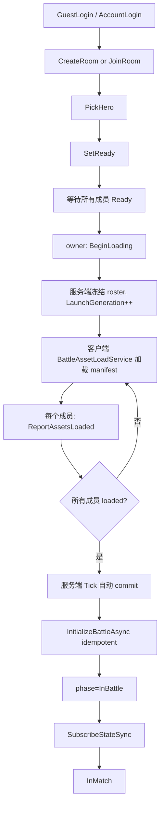

# MOBA 战斗集成指南

## 目的

本文定义 MOBA 战斗宿主的正式集成边界。ET、Orleans、本地测试宿主或未来网络网关等运行环境应复用共享宿主扩展契约，完成战斗启动、输入提交和快照映射，仅提供环境专用适配器，避免重新实现整个战斗生命周期。

## 包职责

`moba.runtime` 负责游戏开始后的战斗执行。

它负责：

- 根据已验证的游戏启动规格创建运行时角色
- 接收已归一化的 `PlayerInputCommand` 批次
- 通过世界步进驱动逻辑系统
- 生成运行时 `WorldStateSnapshot`
- 提供统一运行时端口 `IMobaBattleRuntimePort`

它不负责：

- 房间或匹配状态
- ET 或 Orleans 的传输模型
- 远程调用协议细节
- 本地、远程、帧同步或状态同步模式的业务决策

`host.extension` 负责可复用的宿主侧编排基础能力。

它负责：

- `Runtime/Server/BattleHost` 下的通用服务端 BattleHost 工作流模块
- 房间游戏启动规格和玩家配置
- `MobaBattleLaunchProfile` 及启动规格构造
- 将启动规格转换为运行时启动规格
- 可复用的快照映射器注册表及快照映射上下文
- `Runtime/Moba` 下的 MOBA 专用宿主适配器
- 不依赖单一运行环境的公共集成契约

它不应依赖 ET、Orleans 或具体表现模型。

ET 负责客户端集成。

它负责：

- 将 ET 战斗启动 DTO 转换为 `MobaPlayerLoadout` 和 `MobaBattleLaunchProfile`
- 通过 `IMobaBattleRuntimePort` 提交本地或客户端输入
- 将运行时快照转换为 ET 视图快照
- 将视图快照分发给 ET 表现处理器

Orleans 负责服务端集成。

它负责：

- 在 Orleans Grain 内维护房间或匹配成员、准备状态、英雄选择及战斗启动 RPC 边界
- 将 Orleans 房间 DTO 转换为 host.extension 的 `MobaRoomState` 和 `MobaRoomGameStartSpec`
- 将房间或服务端启动规格转换为 `BattleLogicHostGrain` 的战斗初始化参数
- 缓冲远程输入并提交运行时命令
- 驱动服务端战斗世界步进
- 通过 Orleans 契约发布状态同步和帧同步数据
- 在 Grain 或其拥有的服务内管理服务端生命周期及观察者

## 正式集成接口

新战斗环境只需实现以下部分：

1. 启动适配器

   从环境的房间或匹配 DTO 构建 `MobaPlayerLoadout[]`，再创建 `MobaBattleLaunchProfile`。使用 `MobaBattleLaunchSpecBuilder.FromLoadouts(...)` 生成正式启动规格，再调用 `ToGameStartSpec()` 供运行时使用。

2. 运行时端口访问

   从战斗世界服务容器解析 `IMobaBattleRuntimePort`。游戏启动、输入、快照和读模型访问均应通过此端口；需要直接访问更底层运行时时，必须明确记录原因。

3. 输入适配器

   将环境输入 DTO 转换为 `PlayerInputCommand`。保留运行时协议的 opCode 和载荷结构，让本地模式和远程网络模式复用同一套协议定义。

4. 快照适配器

   通过 `MobaRuntimeSnapshotMapperRegistry<TOutput>` 注册环境专用快照映射器。映射目标类型归环境所有，例如 ET `FrameSnapshotData` 或 Orleans `ActorSnapshot` 列表。注册表与上下文归 host.extension 所有。

5. 步进及生命周期宿主

   尽量组合 host.extension 中可复用的 BattleHost 模块。通用宿主工作流位于 `Runtime/Server/BattleHost`，包括宿主状态、生命周期运行器、结构化生命周期结果码、输入缓冲、步进驱动、观察者注册表、快照发布循环及同步策略。环境提供世界创建、运行时解析、运行时启动、快照提供者解析、初始快照推送、定时器调度及清理委托。战斗执行仍位于 `moba.runtime`，通过 `IMobaBattleRuntimePort` 访问。

## 快照映射规则

运行时快照是协议输出，不能直接充当表现对象。各环境应在自身边界完成映射。

使用 `MobaRuntimeSnapshotContext` 携带帧号和时间戳，以 `WorldStateSnapshot.OpCode` 作为分发键。不得将 ET 视图类型、Orleans 契约类型或运行时读模型回退类型放入 host.extension 共享契约。

预期用法：

```csharp
var context = new MobaRuntimeSnapshotContext(frame, timestamp);
if (registry.TryMap(in runtimeSnapshot, in context, out var output))
{
    Publish(output);
}
```

允许环境专用回退。例如，缺少变换快照时，Orleans 可回退到 `LogicWorldEntityState` 读模型数据，因为该回退属于服务端输出策略。

## 当前正式调用路径

ET 路径：

- `ETBattleEnterGameSpecBuilder` 通过 host.extension 构建启动规格。
- `ProcessETInputPhase` 通过 `IMobaBattleRuntimePort` 提交归一化命令。
- `CollectSnapshotPhase` 收集运行时快照，通过 `ETBattleWorldSnapshotAdapter` 及共享快照注册表映射。

Orleans 路径：

- `RoomGrain` 负责房间成员、准备状态、英雄选择及仅房主可启动战斗的边界。
- `RoomGrain` 将 Orleans 房间成员镜像到 host.extension 的 `MobaRoomState`，启动战斗前使用 `DefaultMobaRoomGameStartSpecBuilder`。
- `OrleansRoomBattleStartMapper` 将 `MobaRoomGameStartSpec` 转换为 Orleans `BattleInitParams`，不将 Orleans DTO 引入 host.extension。
- `DefaultOrleansBattleProtocolMapper` 通过 host.extension 构建运行时启动规格。
- `BattleLogicHostGrain` 负责 Orleans 生命周期，将协议转换委托给 `IOrleansBattleProtocolMapper`。
- `DefaultOrleansBattleProtocolMapper` 通过共享快照注册表映射角色变换运行时快照，将服务端读模型回退保留在本地。

## 后续开发规则

- 不在 ET 或 Orleans 入口流程手工构造完整 `MobaBattleLaunchSpec`。
- `IMobaBattleRuntimePort` 已覆盖的操作，不从环境代码直接调用内部运行时服务。
- 可放在映射器中的快照 opCode 分支，不直接放入 Grain 或 ET 帧阶段。
- 不让 host.extension 依赖 ET、Orleans 或具体视图模型。
- 本地直连模式和远程网络模式复用协议载荷。
- 保留 Orleans 帧同步和状态同步两种服务端选项。

## BattleHost 扩展方向

可复用战斗宿主工作流应先在 host.extension 实现，再由 ET、Orleans、本地测试宿主或未来服务端项目组合。通用工作流位于 `Runtime/Server/BattleHost`。Orleans 承担环境适配和 RPC 边界职责，可复用宿主框架由 host.extension 维护。

当前 host.extension 通用 BattleHost 的职责方向如下：

- `BattleHostState` 管理可复用宿主生命周期状态，包括战斗 ID、世界 ID、帧号及步进频率。
- `BattleHostLifecycleResult` 和 `BattleHostLifecycleErrorCode` 为宿主启动、清理和失败报告定义精简的结构化结果模型。
- `BattleHostStartContext` 携带环境无关的启动数据：世界 ID、战斗 ID、步进频率和步进间隔。
- `BattleHostLifecycleRunner` 通过环境提供的委托管理正式启停顺序及回滚路径。
- `BattleInputBuffer<TInput>` 负责按帧索引的输入缓冲，不依赖 Orleans DTO 或 MOBA 协议 DTO。
- `BattleTickDriver<TInput>` 通过环境提供的委托管理通用的排空、提交、步进及帧推进工作流。
- `BattleObserverRegistry<TObserver>` 负责观察者注册及基于快照的安全枚举。
- `BattleSnapshotSyncPolicy` 负责公共发布策略和完整快照策略决策。
- `BattleSnapshotPublisher<TObserver, TSnapshot>` 负责通用快照创建及异常隔离的观察者推送循环。

仅当模块依赖 MOBA 启动规格、玩家配置、房间规则或 MOBA 快照映射时，才放在 host.extension 的 `Runtime/Moba` 下。Orleans Grain 保持为 Orleans 激活和 RPC 边界，组合通用 host.extension 模块，并提供 Orleans 专用映射、运行时提交、世界步进、观察者推送、定时器调度及生命周期委托。

## 服务端房间到战斗的方向

服务端房间流程应规范为 `Room/Match -> MobaRoomState -> MobaRoomGameStartSpec -> BattleInitParams -> BattleHost`。

当前服务端规则如下：

- Orleans `RoomGrain` 负责账号成员关系、所有权检查、房间关闭及面向 RPC 的 DTO。
- host.extension 的 `MobaRoomState` 负责 MOBA 房间准备规则、英雄及玩家配置选择、队伍分配、最少及最多玩家数验证和 `CanStart`。
- host.extension 的 `DefaultMobaRoomGameStartSpecBuilder` 负责将房间状态转换为 `MobaRoomGameStartSpec`。
- Orleans 映射代码负责将 `MobaRoomGameStartSpec` 转换为 Orleans `BattleInitParams`。
- `BattleLogicHostGrain` 仅接收战斗初始化数据，通过通用 BattleHost 生命周期运行器启动单场战斗。

未来玩法模式应围绕该流程增加房间或启动配置适配器，不应绕过 `MobaRoomState`，或在 Grain、网关处理器中手工构造运行时启动规格。

## Orleans Gateway 房间入口

Orleans Gateway 将房间流程公开为传输入口。TCP 网关处理器从 `AbilityKit.Protocol.Moba.Room` 反序列化共享 MemoryPack 传输 DTO，验证会话令牌，将请求映射为 Orleans 房间 DTO，调用 `IRoomGrain` 并返回共享传输响应。HTTP 端点是相同 Grain 调用的便于调试的包装，在推导账号 ID 前验证会话令牌。

房间网关操作码集中定义于 `RoomGatewayOpCodes`：

- `CreateRoom = 101`
- `JoinRoom = 102`
- `SetReady = 104`
- `PickHero = 105`
- `StartBattle = 106`

预期远程客户端流程为登录、创建或加入房间、选择英雄、准备、房主启动战斗，随后用返回的战斗 ID 和世界 ID 订阅状态同步或进入帧同步流程。`GatewayRoomClient` 的 TCP 载荷应使用 `WireRoomGatewayBinary`，不得发送 JSON 或反序列化 Orleans DTO。网关处理器只验证传输载荷、解析当前房间及账号上下文、将传输 DTO 映射为 Orleans DTO，再委托给 `RoomGrain`，不重建房间规则或战斗启动规格。

`NumericRoomId` 由 `RoomGatewayIds.CreateNumericRoomId(roomId)` 推导。Gateway 房间响应和 Orleans 房间到战斗映射使用同一规则，确保客户端房间 ID、战斗 `WorldId` 及状态同步和帧同步路由一致。

Orleans Gateway 负责服务端监听、已接受的会话、连接 ID、会话注册表、令牌验证及向 Orleans Grain 分发请求。它不应依赖 GameFramework `INetworkChannel`，因为该抽象描述 Unity 客户端出站通道生命周期。服务端 TCP、KCP、WebSocket 或 HTTP 传输应保留各自的监听器及会话适配器，通过 Gateway 传输事件发布请求。

Gateway 传输应复用共享 AbilityKit 传输协议，不定义本地帧或包头类型。当前 TCP Gateway 引用 `AbilityKit.Network.Runtime`，使用 `AbilityKit.Network.Protocol.NetworkFrameCodec`、`NetworkPacketHeader` 和 `NetworkPacketFlags` 处理长度前缀帧、标志、操作码、序列 ID 及载荷长度。房间载荷继续使用 `AbilityKit.Protocol.Moba.RoomGatewayOpCodes` 和 MemoryPack DTO，使 Unity 本地直连模式、基于 GameFramework 的 TCP、回退 TCP 及 Orleans 远程 Gateway 模式共享数据包语义。

## Unity 客户端网络方向

Unity 客户端网络采用两层边界：

- GameFramework 负责 Unity 侧网络通道生命周期、通道命名、服务类型选择、心跳集成及项目级网络管理。
- AbilityKit.Network 负责 AbilityKit 协议语义：长度前缀帧、`NetworkPacketHeader`、操作码、序列 ID、请求及响应标志、服务端推送标志和 `IConnection`。

桥接包为 `com.abilitykit.gameframework.network`。它通过 `GameFrameworkNetworkChannelConnection` 将 GameFramework `INetworkChannel` 适配为 AbilityKit `IConnection`，使用 `AbilityKitGatewayNetworkChannelHelper` 在 GameFramework 数据包管线内序列化和反序列化 AbilityKit Gateway 帧。

`moba.view` 不应直接依赖 GameFramework 数据包或包头类。`BattleSessionFeature` 将房间连接保存为 `IConnection`；`GatewayRoomClient` 继续仅消费 `IConnection` 和共享 MemoryPack 房间 DTO。未提供工厂时，仍可回退到兼容演示项目的 TCP `ConnectionManager` 路径。使用 GameFramework 的项目应在 Unity 组合层创建或解析 `INetworkManager`，传入返回 `GameFrameworkGatewayConnectionFactory.Create(networkManager, channelName)` 的工厂。

Unity 战斗功能应通过 `IAbilityKitConnectionRegistry` 按逻辑角色解析网络通道：

- `AbilityKitConnectionRole.GatewayReliable` 是可靠的网关、房间及登录连接。当前演示项目可使用 GameFramework TCP 或回退的 `ConnectionManager` TCP 路径。
- `AbilityKitConnectionRole.BattleRealtime` 为未来高频战斗流量预留，如 KCP 输入、帧或状态同步数据。
- `AbilityKitConnectionRole.BattleReliable` 为需要独立 TCP 通道的战斗流程预留，承载可靠低频战斗 RPC。

这样既可复用演示项目业务流程，也允许生产 Unity 项目围绕 GameFramework 统一通道创建和生命周期。TCP 与 KCP 可以共存：组合层按角色注册提供者或具体 `IConnection` 实例，战斗代码按需请求角色，无需了解底层是 GameFramework TCP、回退 TCP 还是未来的 KCP 通道。

## 正式多人模式启动流程

正式多人模式启动流程用分阶段协议取代旧的直接 `StartBattle`：Lobby 准备、加载屏障、幂等 Battle commit 与状态推送。这确保所有成员在权威战斗世界创建前完成资源加载。

### 端到端流程



### 关键不变量

| 不变量 | 强制方式 |
|--------|----------|
| LaunchGeneration 单调 | 只增不减。携带不匹配 generation 的过期 `ReportAssetsLoaded` 被幂等忽略 |
| Loading 期间 roster 冻结 | `BeginLoading` 后不允许 Join/Leave 改变参战名单 |
| 单次 Battle commit | `CommitId`（`roomId:LaunchGeneration`）+ `InitSpecHash` 保证 `InitializeBattleAsync` 幂等；重复调用返回 `AlreadyInitialized` |
| Revision 单调推送 | `RoomStateChanged` 携带单调递增的 `Revision`；`ClientRoomStore` 拒绝旧 revision |
| EventSequence 缺口检测 | 客户端检测 `LastEventSequence` 缺口并触发 `GetSnapshot` 补拉 |
| 战斗前资源屏障 | `BattleAssetManifest` 屏障必须在 `ReportAssetsLoaded` 前完成；首帧不再代表资源加载完成 |
| owner 迁移稳定性 | 新 owner 由在线成员中 `JoinOrdinal` 最小者担任 |

### 已废弃入口

| 已废弃 | 替代方案 | 行为 |
|--------|----------|------|
| `StartBattle`（opCode 106） | `BeginLoading` + `ReportAssetsLoaded` | `StartRoomBattleHandler` 返回 `Conflict`，提示 "StartBattle is deprecated" |
| `FirstFrameReceived` 作为加载完成信号 | `BattleAssetManifest` 屏障 + `AssetsLoadCompleted` 信号 | 首帧不再驱动 `LoadingDone`；只有 manifest 屏障完成才允许 `ReportAssetsLoaded` |

### 测试矩阵参考

正式流程由阶段 8 测试套件验证：

| 测试套件 | 源码 | 覆盖范围 |
|----------|------|----------|
| 状态机单元测试 | `Server/Orleans/src/AbilityKit.Orleans.Grains.Tests/Rooms/RoomStateMachineTests.cs` | BeginLoading/ReportAssetsLoaded/CancelLoading/PrepareCommit/CommitBattleStarted/RollbackBattleCommit 转换 |
| 端到端流程测试 | `Server/Orleans/src/AbilityKit.Orleans.Grains.Tests/Rooms/RoomMultiplayerE2EFlowTests.cs` | 双玩家完整流程、超时回滚、owner 迁移 |
| 故障矩阵测试 | `Server/Orleans/src/AbilityKit.Orleans.Grains.Tests/Rooms/RoomFaultMatrixTests.cs` | 重复上报幂等、双重 BeginLoading、非法阶段、取消 generation |
| 协议兼容性 | `Server/Orleans/src/AbilityKit.Orleans.Gateway.Tests/RoomProtocolCompatibilityTests.cs` | opcode 稳定性、wire DTO 往返 |
| 加载 Handler 测试 | `Server/Orleans/src/AbilityKit.Orleans.Gateway.Tests/RoomLoadingHandlersTests.cs` | BeginLoading/ReportAssetsLoaded/CancelLoading/GetSnapshot handler 验证 |
| 客户端 Room 仓库测试 | `Unity/Packages/com.abilitykit.demo.moba.view.runtime/Runtime/Game/Test/UnitTest/ClientRoomStoreTests.cs` | revision 单调性、缺口检测、幂等应用 |
| 客户端加载测试 | `Unity/Packages/com.abilitykit.demo.moba.view.runtime/Runtime/Game/Test/UnitTest/GatewayRoomClientLoadingTests.cs` | GatewayRoomClient 分阶段 API |
| 资源加载测试 | `Unity/Packages/com.abilitykit.demo.moba.view.runtime/Runtime/Game/Test/UnitTest/BattleAssetLoadServiceTests.cs` | manifest 屏障语义 |

### 源码索引

| 组件 | 源码 |
|------|------|
| 房间状态机 | `Server/Orleans/src/AbilityKit.Orleans.Grains/Rooms/RoomStateMachine.cs` |
| 房间 Grain | `Server/Orleans/src/AbilityKit.Orleans.Grains/Rooms/RoomGrain.cs` |
| InitSpec 哈希 | `Server/Orleans/src/AbilityKit.Orleans.Grains/Rooms/RoomBattleInitSpecHasher.cs` |
| 状态推送构建器 | `Server/Orleans/src/AbilityKit.Orleans.Grains/Rooms/RoomStatePushBuilder.cs` |
| 房间模型 | `Server/Orleans/src/AbilityKit.Orleans.Contracts/Rooms/RoomModels.cs` |
| 加载模型 | `Server/Orleans/src/AbilityKit.Orleans.Contracts/Rooms/RoomLoadingModels.cs` |
| Gateway 房间客户端 | `Unity/Packages/com.abilitykit.demo.moba.view.runtime/Runtime/Game/Battle/Client/Gateway/GatewayRoomClient.cs` |
| 客户端 Room 仓库 | `Unity/Packages/com.abilitykit.demo.moba.view.runtime/Runtime/Game/Battle/Client/Gateway/Room/ClientRoomStore.cs` |
| 战斗资源清单 | `Unity/Packages/com.abilitykit.demo.moba.view.runtime/Runtime/Game/Battle/Shared/Assets/BattleAssetManifest.cs` |
| 战斗资源加载服务 | `Unity/Packages/com.abilitykit.demo.moba.view.runtime/Runtime/Game/Battle/Shared/Assets/BattleAssetLoadService.cs` |
| 多人房间流程控制器 | `Unity/Packages/com.abilitykit.demo.moba.view.runtime/Runtime/Logic/Flow/Multiplayer/MultiplayerRoomFlowController.cs` |
| 正式大厅 Feature | `Unity/Packages/com.abilitykit.demo.moba.view.runtime/Runtime/Game/App/Flow/Boot/FormalLobbyFeature.cs` |
