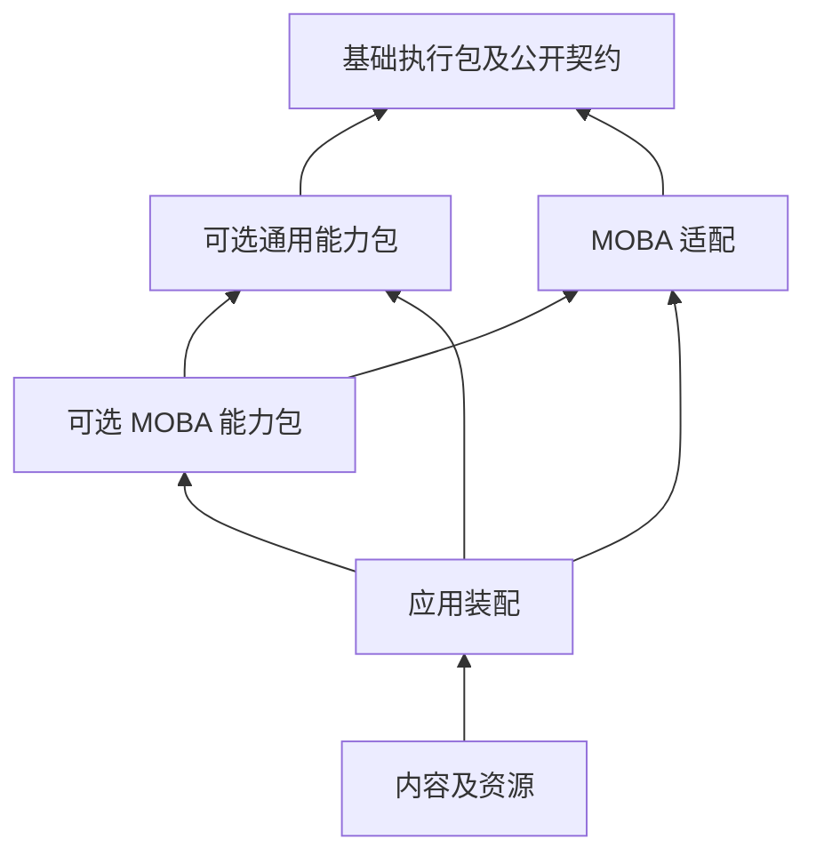

# MOBA 与框架包的固定边界及包外扩展方案

日期：2026-11-18。补充 [机制扩展架构分析](MobaMechanismExtensionArchitecture.md)。

本轮用户明确的建设方向是：组合会随需求增长，应区分固定契约与可扩展能力，稳定部分由框架承载，变化部分允许包外扩展，控制核心包职责与体量。本文将该方向整理成包边界和扩展方案，不表示具体 API、schema、注册冲突行为、包迁移或恢复范围已经批准。当前只修改设计与 Skill，不实施运行时变更。

阅读顺序：第 1–3 节划分固定与开放，第 4 节列当前真实入口，第 5–7 节定义包外接入及防止膨胀的约束，第 8 节给推进次序与验收。

## 1. 固定的是执行契约，扩展的是领域策略与内容

框架应提供稳定的执行模型、边界和少量基础能力；玩法包在这些边界内实现差异，内容再组合已有能力。不能将之前的 Projectile→Area→Motion 等验收切片变成必须持续增加的组合类型库。

例如“弹体命中后生成区域，区域推动目标”是配置对原语的组合，不应增加 `ProjectileAreaMotionSkill` 框架类型。其后增加减速、链式弹射或召唤物，也不应形成排列组合的新基类。

“固定”不表示永不演进，而表示消费者不能通过配置或注册偷偷改写契约；契约变化需要明确评审、版本与迁移。包外扩展也必须遵守确定性、来源、提交和生命周期边界，不能成为绕过机制治理的入口。

## 2. 建议分成四个交付层

| 层 | 负责什么 | 变化来源 | 依赖方向 |
|---|---|---|---|
| 基础执行包 | 各自领域的接口、执行模型、状态和失败边界；有限基础算法 | 契约演进 | 不引用玩法、具体扩展和内容 |
| 可选能力包 | 有独立语义的轨迹、发射 pattern、查询策略、动作、决策算法等 | 新能力需求 | 引用所需基础包；被应用选择安装 |
| 玩法适配与装配 | MOBA 的 Actor、技能槽、标签、伤害、来源、同步、作者化桥接和安装选择 | 玩法规则 | 引用基础包与选用的能力；组成正式世界 |
| 内容 | 英雄、技能、状态图、树、模板、数值、资源和原语组合 | 内容生产 | 只引用已安装、已定义的能力 |

这是职责与交付划分，不要求立即拆出四组新项目。基础执行包继续按 Pipeline、HFSM、Motion、Projectile 等领域保持边界，不把它们集中到一个膨胀的 Core。可选能力可以先由现有独立程序集交付，只有依赖或发布需求成立时才拆 UPM/NuGet 包。

有些扩展天然依赖 MOBA：比如某类技能候选策略或伤害阶段插件，应位于 MOBA 之上的扩展包；纯轨迹策略则可以只依赖 Motion。不能为了“包外”强迫所有扩展只依赖最低层 Core，也不能让基础框架反向引用 MOBA。



箭头表示依赖方向，不代表每个应用必须安装所有层。扩展 A 确实需要 B 时显式声明依赖；不能让所有可选能力互相引用或全部由核心默认加载。

## 3. 固定与开放的边界矩阵

| 领域 | 应保持稳定的核心契约 | 允许包外变化的部分 | 内容配置承担什么 |
|---|---|---|---|
| Pipeline | 单次运行、阶段推进、串并行语义、提交/取消/错误传播及游标规则 | 必要的新叶阶段/等待条件/领域动作适配；改变执行模型须核心方案 | 阶段树、等待值、提交位置、引用的效果 |
| 角色 HFSM | 转换评估、优先级、状态实例、动作边界、参数与恢复契约 | 受约束的条件/动作绑定、事实适配；不注册第二套转换调度器 | 拓扑、条件、阈值、参数、动作引用 |
| Trigger | Scope、Payload 访问、规则执行/拒绝、效果调用边界 | 条件、查询、Action Schema/Module；业务算法在领域内实现 | 事件、条件与动作组合、数值、引用 |
| Continuous | 实例起止、世界帧推进接口、暂停/结束契约及来源撤销 | 各类持续行为及必要的局部状态适配 | 寿命、间隔、标签/Modifier、引用 |
| Projectile | 身份、一次物理推进、碰撞事件合同、合法清理和状态恢复入口 | 发射 pattern/provider、命中/运动策略及所需描述/恢复适配，按实际开放点区分 | 速度、模板、轨迹参数、阶段与命中效果 |
| Area | 空间成员与武装/到期合同、事件与认领的已定义语义 | 新几何/资格算法或应用层策略，仅在已有或批准的扩展边界内 | 形状参数、延迟、Stay、过滤、效果和组引用 |
| Motion | 来源推进、组仲裁规则、解算输入/输出、实际位置写回和清理 | `IMotionSource`、轨迹、`IMotionSolver`/碰撞适配；新仲裁规则单独评审 | 来源数值、组/优先级、方向、现有碰撞策略 |
| Brain | 事实/候选/意图/执行的分工及唯一输出合同 | 决策驱动、树节点、候选/目标策略 | 树、参数、优先级、技能槽与查询引用 |
| Summon | Actor 正式构造/销毁、身份、来源/retain、容量与失败补偿合同，当前在 MOBA 层 | AI、继承/选择等独立策略；生产节奏、落点和入场条件按 [专项规划](MobaSummonProductionLifecyclePlan.md) 查证/提案，新的结构生命周期不能随插件任意替换 | 召唤定义、属性继承、技能/Brain、寿命与现有容量规则 |
| 恢复与同步 | 预检、字段/结构分工、恢复顺序、静默重绑和版本拒绝合同 | 扩展自己的版本化状态、codec/Provider/重绑适配，接入原所有权 | 支持能力声明与协议引用；不存委托或历史回调 |
| 表现/作者化 | 逻辑/表现权限、描述符消费、引用校验、发布一致性 | 表现消费者、编辑器描述符、编译/校验适配；与运行时依赖分开 | 资源、动作、轨道与可见效果 |

表中“允许”表示架构应允许的方向，不代表当前每项都有完整包外入口。尤其 Projectile 运动、Area、新阶段、Summon 事务和恢复适配，必须按第 4 节查证，不得仅凭这张矩阵接入实现。

### 3.1 闭合集合与开放策略必须区分

- **执行状态和有限结果语义可以闭合。** 例如已定义的阶段完成/失败、碰撞 Ignore/Hit/Block，无需因为新增轨迹就增加一种核心执行结果。
- **策略种类可以开放。** 新轨迹、发射形态或目标评分，在现有输入输出合同下增加实现，优先用领域内稳定的注册 key/ID 与强类型参数。
- **组合是内容。** 轨迹 + 命中动作 + 区域 + Buff 可以组合；不为每种组合新增枚举、DTO 子字段和框架类。
- **调度语义变化是核心演进。** 第二套提交、Tick、转换仲裁、结构事务或恢复顺序不是普通插件。

保留 Sequence/Parallel 等有限结构节点的显式编译分支并不天然有问题。需要避免的是每新增一种领域效果就扩充核心阶段枚举和执行器；事件效果优先复用现有 RulePlan/领域动作入口。只有原有阶段生命周期确实不能表达需求时，才提出新阶段方案。

## 4. 当前真实扩展面：入口开放程度不相同

下表为源码核查结果，未执行包外编译或 Unity Player 验证。“运行时入口存在”与“生产包外扩展可交付”分别判断。

| 对象 | 当前证据 | 仍需查证或设计的边界 |
|---|---|---|
| Pipeline 阶段 | [IAbilityPipelinePhase](../Unity/Packages/com.abilitykit.pipeline/Runtime/Interface/IAbilityPipelinePhase.cs) 公开；[IAbilityPipelineExtensionPoint](../Unity/Packages/com.abilitykit.pipeline/Runtime/Interface/IAbilityPipelineExtensionPoint.cs) 是阶段边界回调 | 回调接口不是阶段编译注册。MOBA 的 [阶段编译器](../Unity/Packages/com.abilitykit.demo.moba.runtime/Runtime/Application/Skills/Pipeline/TableDrivenMobaSkillPipelineLibrary.cs) 仍按 `SkillPhaseType` 与生成清单构造，不能推断包外新类型会自动编译/恢复 |
| HFSM 绑定 | [BindingCatalog](../Unity/Packages/com.abilitykit.hfsm/Runtime/HFSM/Core/Runtime/BindingCatalog.cs) 可注册/扫描描述符 | Catalog 是元数据，不能代替运行时绑定、角色声明校验和动作状态恢复；仍需穿透真实消费者 |
| MOBA PlanAction | [PlanActionModuleRegistry](../Unity/Packages/com.abilitykit.demo.moba.runtime/Runtime/Application/Services/Triggering/PlanActions/Core/PlanActionModuleRegistry.cs) 有显式模块数组构造；默认采用本包生成清单，反射回退只扫本程序集且正式构建禁用 | 外包加特性不等于会被默认发现。需验证已有默认模块如何合并、DI 替换、作者描述符、校验及发布；不能手改生成清单 |
| Projectile HitPolicy | [ProjectileHitPolicyFactory](../Unity/Packages/com.abilitykit.combat.projectile/Runtime/Projectile/Policies/ProjectileHitPolicyFactory.cs) 可 RegisterFactory/RegisterType/Scan | 静态全局注册；自定义 Kind 的配置校验、恢复与多世界一致性需核对，不能当作世界隔离注册 |
| Projectile schedule | [PatternResolver 与快照接口](../Unity/Packages/com.abilitykit.combat.projectile/Runtime/Projectile/Schedules/IProjectileSchedulePatternResolver.cs) 区分捕获、只读 Validate、冻结模式和动态 provider 恢复 | 已有描述与接入边界，但不证明任意插件的作者源、描述版本及所需依赖已经接通 |
| Motion | [IMotionSource](../Unity/Packages/com.abilitykit.combat.motion/Runtime/MotionSystem/Core/IMotionSource.cs)、[IMotionSolver](../Unity/Packages/com.abilitykit.combat.motion/Runtime/MotionSystem/Collision/IMotionSolver.cs)、[IMotionSnapshotSource](../Unity/Packages/com.abilitykit.combat.motion/Runtime/MotionSystem/Core/IMotionSnapshotSource.cs) 均公开 | 模拟可使用外部实现；[MotionSourceSnapshot](../Unity/Packages/com.abilitykit.combat.motion/Runtime/MotionSystem/Core/MotionSourceSnapshot.cs) 的通用字段不能自动证明扩展类型可重建，MOBA 受管恢复也有来源类型边界 |
| Continuous | [IContinuous](../Unity/Packages/com.abilitykit.continuous/Runtime/IContinuous.cs) 不指定内部行为 | MOBA 生命周期所有权、注册、标签/Modifier、局部恢复仍需接通，不表示任意实现可被联合恢复 |
| Brain driver | [MobaBrainDecisionDrivers](../Unity/Packages/com.abilitykit.demo.moba.runtime/Runtime/Application/Services/Behavior/MobaBrainDecisionDrivers.cs) 支持驱动注册和驱动自有定义校验 | 当前同 key 注册采用赋值覆盖；这是现状，不应在文档里宣称冲突必拒绝。新驱动的记忆恢复、意图和作者化仍需验证 |

因此当前能确定的是：已有多处可复用公开入口，但不能宣称“所有机制都能完整包外扩展”。优先补真正阻碍独立消费的边界，避免同时重做所有注册系统。

## 5. 一个包外能力应怎样接入

### 5.1 运行时和作者化分开交付

以下是示意布局，不是本轮新建包或指定最终名称：

```text
某能力 Runtime
  领域参数与执行策略
  当前需要的显式注册适配
  有状态时的快照/恢复适配

某能力 Editor（仅需要作者化时）
  描述符、编辑、编译/引用与参数校验
  对应生产源的发布适配

应用装配
  选择能力与版本，注入已有领域入口
  安装对应状态恢复/同步支持

内容
  引用该能力，填写参数并组合原语
```

不能让基础运行时依赖扩展 Editor，也不能把全部扩展的 editor/codec/资源目录集中回核心包。优先复用现有 package.json、asmdef、DI、生成清单和发布器；本轮不提出额外统一插件 manifest 或全域 PluginManager。

### 5.2 包外开放必须检查整条路径

| 环节 | 要证明的事情 |
|---|---|
| 编译边界 | 外部程序集只依赖公开 API；不复制框架源码、不靠 friend assembly/反射访问 internal |
| 注册与装配 | 外部实现能被选定应用显式安装；清楚默认实现、合并、顺序、重复 key 与替换规则 |
| 类型与配置 | key/ID 在所属领域内稳定且可追踪，参数有真实语义；不继续向核心 DTO 追加每个玩法专属可空字段 |
| 执行与权限 | 只使用扩展合同允许的数据和请求；运动算法不擅自发伤害，决策不绕过正式 Cast |
| 实例状态 | 单例/工厂/实例边界清楚，状态不串 Cast/Actor/World；来源与清理由既有所有者负责 |
| 作者化与发布 | 编辑器描述、编译、校验、生产源与两端产物一致；运行时无需编辑器程序集 |
| 恢复与同步 | 有状态扩展能在所需模式下描述/恢复并静默重绑；明确不支持的名单/生命周期和跨会话范围 |
| 独立消费 | 在基础包外构建和运行，能安装、使用、结束；不安装时不影响无关基础能力 |

对于纯内容组合，不额外制造运行时插件或 codec。对于无状态策略，复用已有描述和恢复合同，不机械要求新 Provider。扩展增加的状态由扩展或其合法领域所有者承载，不能为接入方便都塞进核心快照结构。

### 5.3 注册的边界与确定性

建议应用在正常模拟前确定本会话启用的能力及版本；稳定顺序显式声明，不依赖程序集加载/目录扫描顺序。可选包缺席时：不引用它的内容可正常使用，引用它的内容应在现有校验边界明确失败，不能换成占位默认行为。

重名 key、内置替换、会话中卸载和静态注册冲突需按注册表逐项给出方案。默认建议禁止无声明地覆盖已选实现，不默认提供运行中热替换或卸载。有些现有注册表允许覆盖，具体改成拒绝属于行为变化，仍需确认和回归，不能本轮直接“统一修正”。

已有静态全局 registry 不代表它拥有世界隔离语义。短期可核对并约束应用初始化；是否改为实例注入/不可变目录，由真实多世界需求和兼容方案决定，不批量重写。

### 5.4 扩展恢复不能反向污染核心

新增策略若带内部游标、延迟任务或动态参数，应使用所属扩展的版本化数据与现有恢复入口。核心负责外层调用、预检和生命周期契约，扩展负责解释自己的数据及重绑依赖；不能每增加一种策略都让核心识别其类并追加专属字段。

现有结构若无法承载必要的类型、版本或恢复创建，需要先提交针对该扩展点的最小方案；不以任意字节数组、字符串字典或任意委托绕过语义、校验和资源上限。开启回滚的 MOBA 会话仍必须满足业务恢复契约；关闭时正常运行不依赖回滚专用设施。

## 6. 怎么防止核心包和扩展包变成大杂烩

### 6.1 留在内容、扩展包或进入框架的判断

| 判断结果 | 落点 | 举例 |
|---|---|---|
| 只是已有算法的数值、引用、拓扑或时序不同 | 内容配置 | 四发/八发、伤害后减速、命中再生成区域 |
| 现有合同足够，只缺一种算法或领域操作 | 包外能力/玩法扩展 | 新轨迹、目标评分、新的树节点/动作适配 |
| 公共算法稳定且独立，但并非基础消费者都需要 | 可选通用能力包 | 有独立依赖和资源要求的高级弹道/导航策略 |
| 现有合同无法描述必要的生命周期/结果/恢复 | 框架扩展点或领域契约的最小演进 | 类型化策略恢复入口、合法新阶段边界 |
| 只是某英雄/技能的身份特殊处理 | 回到领域语义重新设计 | 不能搬进插件后继续按英雄身份选择硬编码行为 |

多个英雄使用同一算法，通常先说明它值得共享；不自动证明它应该成为基础包默认能力。升级进入框架还要审查领域独立性、API 稳定性、依赖成本、安装体积、作者/恢复代价和已有消费者兼容。

可以保留有限内置算法作为可直接使用的基础集合。无需把每个基础实现都拆包；也不因已有一两个内置策略就把未来所有策略放回同一包。具体升级应给可复查理由，而不是规定“第二个使用者出现立即上移”。

### 6.2 限制变化传播范围

包外新算法的理想改动范围是：新增该扩展的运行时/必要适配、应用安装选择和内容引用；基础包源码及公开 API 不变。如果每增加一种技能都要同步修改核心 enum、DTO、factory switch、恢复分支和编辑器总表，应先查是否缺了适当的扩展边界。

这也不是“任何 switch 都违规”的规则：框架闭合结构的分支可保留。重点看分支数量是否跟玩法品类和内容数量一起增长。

扩展包自身也需明确单一领域职责。共同发布/依赖的几个策略可以同包，不按英雄建包，也不把所有“高级技能”放进一个持续增长的扩展总包。

### 6.3 组合能力的三种失败方式

- 为每条端到端技能链建新类，导致组合数量映射为类型数量。
- 建一个万能 Profile/Context/DTO，持续追加互斥字段与开关，执行器成为总分派器。
- 表面把代码搬到扩展包，核心仍按扩展类型/资源 ID 检测或反向依赖该包，外部配置不能独立选择。

采用职责图并不能自动解决这些问题。审查时需要给出实际程序集依赖、类型分派位置、状态所有者和外部消费证据。

### 6.4 边界对管理有用，不要求运行时层层实例化

这些边界可以指导不同机制的扩展，前提是落到三种可检查结果：新增内容是否只改变内容/必要扩展；生命周期、提交与恢复是否只有明确所有者；新增策略是否复用同一执行合同和验收夹具。发现新时序、资格或事务语义时，更新对应领域合同；不能为了套入现有抽象不断添加模糊开关。

职责层不是对象数量、事件跳数或 Tick 层数的要求。一个同步调用可以完成多个职责阶段；只有需要跨帧记忆、独立取消或独立所有权时，才保留相应实例。无状态算法可共享实现与只读定义；有状态游标、来源、临时缓冲必须按世界/实例隔离，不为省对象让不同战斗共享可变业务状态。

**性能风险取决于执行方式和规模，不能由接口层数推算，也不能承诺抽象零成本。** 策略间接调用可能限制内联/批处理，有额外对象时还会影响分配和缓存局部性；更需警惕全量扫描、重复解析与快照复制把有限成本放大。新增内容类型数增加时，若每帧都遍历全部已安装策略再匹配，就把内容规模带入了模拟热路径。

| 成本维度 | 建议实现边界 | 容易放大成本的做法 |
|---|---|---|
| 注册与选择 | 初始化/加载时解析静态引用，实例绑定明确策略；实时选择只按已声明的采样时点执行 | 每帧反射扫描、字符串解析配置、遍历全部策略寻找匹配；过早缓存应实时采样的结果 |
| 生产调度 | 仅保留未完成过程/未来必要游标；定时条件以到期判断，事件条件按正式事件与明确记忆推进 | 为已完成过程或每个瞬时动作保留常驻 Tick；每帧对所有 Actor 重算所有准备条件 |
| 状态与门禁 | 一个权威阶段派生门禁；必要的索引/缓存按实际变更维护，并验证恢复后重建 | 多套 Ready 状态互相同步；每次查询都重遍历全部 Modifier/对象拼装阶段 |
| 位置与数量 | 有界候选与重试；批量结果用明确归属的缓冲；规则允许时用下一项游标表达重复序列 | 无界随机找点；每次 Tick 重建完整阵型/未来全部项；跨实例共享可变缓冲 |
| 数据组织 | 按热点实际规模选择紧凑记录/分组处理；纯策略实现可复用 | 每个字段包一个对象、每个阶段再套一层调度；未测量就把全部对象池化 |
| 诊断与恢复 | 诊断按既有可选/采样合同；开启回滚才付回滚专用成本，保存未来充分状态与稳定引用 | 为未启用能力保存空任务历史；每帧格式化全量诊断；为省成本漏掉必要状态或擅自降低捕获频率 |

列表、堆、时间桶等结构按实际任务数、到期密度和取消比例选择。少量任务的线性遍历可能比复杂索引更便宜；不能先引入新调度器。任何替换必须保持既定同帧处理顺序、RNG 消费、派生边界与恢复等价，不能把按类型分组或按 ID 排序视为无条件安全的性能优化。

评估时把成本拆开：每帧时间由调度检查、实际到期/条件评估、必要领域工作、扩展分派、输出及启用的恢复捕获等组成；内存由活动实例、必要未来任务、索引/缓冲、定义和保留窗口内的历史组成。接口分派只是其中一项。内容需要更多实体、查询或准备状态所增加的必要业务成本，与框架为了表达同样行为多出的成本分别报告。

验证方式复用现有场景和性能工具，不另建全局治理平台：

1. 用相同行为、数量、采样时点、随机输入和输出作前后对照；瞬时路径单独比较，不能拿新复杂玩法和旧简单玩法的差值全算给抽象。
2. 分别覆盖无活动任务、普通规模、峰值同帧到期、长时间未来任务、取消/结束后的残留，以及回滚关闭/开启。把调度层与包含 Actor/Brain/物理/表现的完整链分开测，最后以完整链验收。
3. 在目标构建和硬件记录帧耗时 P95/P99、分配字节/次数、驻留内存、任务/条件评估数量、快照体积与恢复耗时；冷启动和预热后分别报告，不能靠对象池预热隐藏首次峰值或内存高水位。
4. 预算由实际基线、目标帧预算与产品规模决定，既给绝对增量也给相对变化。没有新实现/同环境测量时，只能列风险和目标，不宣称已有开销百分比或“无性能影响”。

优化不得静默更改效果数量、延迟、采样、顺序、容量、恢复窗口或输出合同。成本超标时先定位扫描、分配、数据布局与重复工作，再评估扩展分派本身；实现结构调整同样需要行为等价证据，新机制语义仍按治理确认。

### 6.5 项目方向确定后，可选择能力子集并替换执行实现

用户进一步明确希望项目能按需移除抽象成本。建议把稳定的领域合同与可替换的执行实现分开：保留用于作者化、校验和验收的语义边界，按项目支持范围选择运行路径。该方向不要求所有项目一直携带动态注册、解释执行和完整可选状态，也不表示本轮已批准具体后端、代码生成器或装配/schema 变更。

先区分两类变化：

- **能力裁剪**：项目不支持周期生产、玩法入场、某类策略或可选回滚等能力，对应包、服务、System、状态与历史可以按依赖关系不装配。内容若引用被裁掉的能力，在既有加载/构建校验边界明确拒绝，不能回退成瞬时、零效果或占位结果。MOBA 当前要求所用模拟机制提供回滚支持；会话未启用时不付回滚专用运行成本，不代表删除应提供的恢复实现。
- **实现替换**：项目仍支持同样行为，用固定算法、直接调用、紧凑数据或预生成执行计划替代动态路径。身份、采样、时序、来源、容量、结果、清理及所需恢复保持合同等价；声明支持范围内的新内容仍能沿同一作者化链工作。

| 选择时机 | 可以减少的成本 | 限制 |
|---|---|---|
| 构建/包选择 | 未使用模块的依赖、代码/资源体积，以及能够实际排除的运行注册和状态 | asmdef/package/链接器有真实裁剪证据才登记；开一个开关或 Editor 不执行不代表 Player 已剔除 |
| 应用装配/世界创建 | 运行时发现、工厂查找、未选服务与 System 的初始化/遍历 | 复用 DI/显式安装；保留依赖闭包，不能把未安装的正式依赖当可选 null |
| 会话启动/内容加载 | 将静态策略 key、配置引用与条件结构解析为选定实例或执行计划 | 固定会话支持范围与定义版本；动态 EventSample/实时事实不能提前冻结 |
| 过程创建/提交 | 依据已校验的机制选定瞬时、定时、事件条件等执行路径 | 选择依据是领域语义及输入，不能按英雄/技能身份硬编码算法 |
| 热路径专门实现 | 经验证的直接调用、固定布局、批量算法或生成代码，减少分派与解释成本 | 属于可选建设；不承诺 JIT/AOT 一定内联，不支持默认运行中热替换 |

DI 预绑定策略可以消除重复发现/查表，但如果执行仍经接口调用，间接分派可能仍存在。`sealed`、泛型或代码生成也不自动保证机器码没有该成本，应在目标 Player/AOT 或目标 .NET 构建测量。无需为了消除一次分派复制整个战斗执行链。

例如一个项目只需要单项瞬时召唤、固定继承和一种落点算法，可装配直接构造路径，不创建未来生产任务或准备阶段。若以后支持间隔召唤，则选择相应生产实现。固定环形阵型可以复用不变的局部偏移；若锚点本应出生时读取，仍在该时点应用锚点变换并校验实际落点，不能将整个出生结果提前冻结。

项目的支持子集和实现选择放在应用装配及既有内容校验中维护，优先普通依赖引用、显式安装和已有生成入口，不先引入全域开关矩阵、统一后端管理器或另一套内容 DSL。一个选择能替代一条执行路径时，通常比热路径里每层重复检查多个布尔开关更清楚。尽量按独立语义能力拆分，限制必须长期维护的组合数量。

当前仓库已有部分接点：[PlanActionModuleRegistry](../Unity/Packages/com.abilitykit.demo.moba.runtime/Runtime/Application/Services/Triggering/PlanActions/Core/PlanActionModuleRegistry.cs) 接受显式模块数组且默认使用生成描述；[MobaGameplayFeatureSet](../Unity/Packages/com.abilitykit.demo.moba.runtime/Runtime/Application/Gameplay/Match/MobaGameplayFeatureSet.cs) 控制部分可选玩法。[MinionWaveTickSystem](../Unity/Packages/com.abilitykit.demo.moba.runtime/Runtime/Application/Gameplay/Extensions/MobaMinionWaveTickSystem.cs) 仍会在系统内部检查选择，这证明“停用能力”与“裁掉系统/检查成本”有区别。以上不构成通用静态编译、完整按需打包或任意策略替换已经具备的证明。

选择一个专门实现时，在既有方案中补清：支持的机制子集、替换的入口及依赖、哪些成本确实移除、哪些仍存在、未知/不支持内容的拒绝、定义/实现版本及恢复兼容。已持有状态的活动会话不默认切换；不同实现之间的旧检查点兼容，需保持相同恢复合同或明确版本拒绝/迁移，不能只因玩法结果相同就导入。

替换验收复用同一领域合同和代表场景，覆盖结果、顺序、RNG、拒绝、取消、来源清理及适用恢复，另加被裁能力的负向校验和目标构建性能对照。允许开发/验证时保留通用实现作对照；正式包无需为了形式同时装配所有实现。原作者源尽量保留为单一权威；若生成专门代码，应从该源产生并检查漂移，不手工维护平行行为副本。

能移除的是未使用能力及表达/分派的可替代成本。已承诺的跨帧时间、实际碰撞、共享容量、来源生命周期、必要未来状态和恢复充分性仍要有等价承担者；关闭这类工作会改变业务能力，应按能力变更处理。新增替换接点按机制治理确认，不以“性能后端”名称绕过批准，也不擅自把 HFSM、Trigger、正式 Cast 或 Actor 提交从需要它们的业务中删除。

## 7. 把原来的“组合推进顺序”改为“扩展点验证顺序”

之前列出的三类组合继续作为代表性验收切片，覆盖原语之间的接口；不列成未来必须实现完整的组合目录：

| 切片 | 固定合同验证 | 包外扩展验证 |
|---|---|---|
| Projectile→Area→Motion | 身份、来源、命中/认领、实际位移、帧结算及最后释放 | 选一个策略在包外替换或增加，正式链仍可消费，不追加组合类型 |
| Summon→Brain→Cast/Move | Actor 构造、owner/source、意图和执行、终结 | 包外决策/查询策略通过正式安装入口工作，无需修改召唤服务 |
| 长期模式→多次短 Cast | HFSM/参数、独立提交、打断/恢复、子对象存续 | 优先用图/内容配置复用；只有确实缺叶动作或条件才加扩展 |

选择一个真实扩展即可验证接口，随后再扩展高价值领域。无需同时设计几十种移动、宠物和投射物，也不要求为了证明通用而额外制造英雄。

## 8. 推荐下一批与完成条件

### 8.1 先做边界盘点

将第 4 节的入口逐项补成证据表：公开 API、运行注册、生产作者化、恢复、独立消费与当前限制。优先核对 PlanAction 默认清单合并以及 Motion 自定义来源的完整消费/恢复，因为它们最容易出现“接口可实现、生产无法用”的落差。

该阶段不新增插件框架，不改变注册覆盖行为，不为所有 phase 开新注册 API。查到既有契约断链可按修复范围推进；新合并规则、格式和恢复创建路径先提案。

### 8.2 再选一条真正的包外切片

在不改基础包实现的外部程序集实现一个有实际用途的策略/动作，通过现有入口安装，以正式 MOBA 作者源和消费者验证。若缺某一接点，只针对那个接点给最小接口/适配方案，列明源码层、schema、兼容和恢复影响后确认。

外部测试项目不能通过同程序集编译、复制包内代码或 friend assembly 掩盖访问限制。具体是否打包发布、选哪种真实能力，需依据盘点结果确定，不将本设计当作发布授权。

### 8.3 这条切片的验收

- 基础包不反向引用扩展，不因新增内容增加核心行为分支。
- 独立编译、注册、参数校验与真实结果通过；不安装扩展时基础能力仍可使用。
- 注册冲突、缺失依赖、未知 key/版本在对应边界有可解释结果，结果符合当前已确认契约。
- 有状态时，来源、清理与所需模式的恢复通过；同会话和跨会话范围分开报告。
- Unity Player/AOT 的发现与裁剪可用性有真实证据后才登记支持，不用 Editor 反射成功代替。
- 内容组合复用同一实现；改一组技能 ID/资源绑定无需改变算法。

本文不宣布当前所有入口都达到以上目标。只有查证出的扩展缺口才进入后续机制方案，已有批准范围不重复申请。

## 9. 后续机制记录增加两个维度

在既有机制映射中补充：

```text
包归属：基础执行契约 / 可选通用能力 / MOBA 适配与扩展 / 内容组合。
固定与开放：本机制不允许改变的合同是什么，允许外部变化的输入/实现是什么。
扩展边界：公开接口、注册与选择方式、参数 schema、状态与恢复所有者。
变化传播：新增该能力需要改哪些包；为何需要改基础包，能否缩小到一个扩展点。
独立消费：不改基础包源码的外部程序集验证，生产作者化与所需模式的恢复证据。
```

这些信息直接用于决定实现位置与验收范围，不再另造一套与现有配置或代码竞争的能力权威库。工程约束同时遵循 [框架包工程规范](design/10-EngineeringQuality/10-FrameworkPackageEngineeringStandards.md)。
