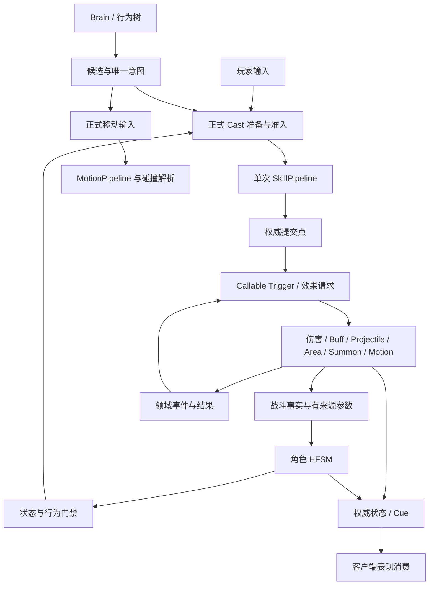

# MOBA 技能机制扩展：职责、原语与建设顺序

日期：2026-11-18。范围：MOBA 内容作者链、确定性模拟、表现消费，以及它们依赖的框架能力。

本文是基于当前工作树的分析与方案。既有契约以 [机制治理](MobaMechanismGovernance.md)、各领域规范和对应批准记录为准；本文中的建设建议、候选接口和后续切片不构成新机制批准。本轮只整理文档与 Skill，不修改战斗代码、生产配置或发布物，也没有重新运行战斗验收。列出的测试是可追踪的验证入口，不是本轮通过报告。

阅读路径：第 1–4 节看职责和数据归属，第 5–7 节看投射物、召唤物、移动，第 8–10 节看缺口、建设顺序和验收，第 11 节看如何沉淀 Skill。证据编号统一在第 12 节解析。复杂业务的竞争、部分失败、容量、版本证据及流程分级，继续读 [战斗流程规模化复核](MobaCombatWorkflowScalabilityReview.md)；其中推演不是已执行测试。

## 1. 结论与当前问题

当前已有 HFSM、SkillPipeline、Trigger、Continuous、Modifier、Motion、Projectile、Area、Brain，以及来源、retain 和恢复设施。后续失控的主要风险是这些能力之间的权威、生命周期和提交边界不一致。继续增加英雄之前，应先让代表性组合在真实装配中闭环，并把每种原语的适用范围登记清楚。

建议保留现有多种执行模型，以领域契约连接它们：

- HFSM 管角色或对象“当前处于什么阶段、允许怎样转换”。
- Brain/行为树管“本次想做什么”，输出意图。
- SkillPipeline 管“一次施法怎样准备、提交、取消、结束”。
- Trigger 管“某个事件满足什么条件时，请求哪些效果”。
- 领域运行时管运动、碰撞、伤害、召唤等算法和对象生命周期。
- System 管固定世界帧中的调用与结算顺序。
- 表现消费者从权威状态和 Cue 重建可见结果。

这套分工已经有代码支撑，重点应是补接线、消除歧义和验证组合，不宜先建立一个取代全部模块的万能图或万能技能对象。

### 1.1 本轮查证的关键事实

| 事实 | 对扩展方式的影响 | 证据 |
|---|---|---|
| 角色图通过 `DefinitionId` 关联条件、Cast 职责、瞄准作用域与参数快照绑定 | 英雄差异可以留在图和声明；不能按英雄、参数号或路径后缀推断算法 | E01、E02 |
| 参数服务按 Actor、Parameter、Owner 保存贡献；已有 `set_hfsm_parameter` 和稳定来源 Toggle | 不能把所有持久状态都强制包装成 Buff，也不能把写参数解释为直接跳状态 | E03、E04 |
| Cast runtime 有 PipelineEnded、WaitingChildren、retain 和子对象种类 | Flow 结束、Cast 上下文释放、弹体/区域/召唤物结束是不同边界 | E05、E06 |
| Summon 动作已消费 `duration_ms`，并通过请求身份与服务提交；部分其它字段只有 Schema 解析 | “字段能填”不能等同于“机制可用”；旧 Skill 的四字段全未消费说法已过期 | E07、E08 |
| 召唤树已有感知、候选、条件、瞄准、意图、仲裁；输出再走正式 Cast/移动入口 | 无需为了新增宠物复制整套 AI；拴链等新语义应另提案 | E09–E11 |
| Dash 创建运动源并通过 Continuous 管理，Blink 直接解析终点并更新状态 | 同属“位移”也不意味着相同实例生命周期，不能统一套持续对象 | E12–E14 |
| 投射物命中策略工厂已有公开注册 API | 旧 Skill 中“internal switch、扩展必改框架”的判断已失效；注册存在仍不等于语义获批 | E15 |
| 正式帧内结算已有唯一入口、整轮冻结、预算与失败门禁 | 新回调必须接入现有边界；不能通过补 Tick、尾部第二次同步补行为 | E16、E17 |
| 近期弹体恢复方案与较早治理摘要、Launcher 待确认方案及当前修改之间存在状态差异 | 必须同时核对代码、批准范围和验收记录，不能引用一个历史段落宣布全部恢复可用或全部缺失 | E18–E20 |

### 1.2 能力成熟度必须拆成几个问题

评估每种机制时，分别填写：内核是否支持、MOBA 适配是否接通、生产作者源能否表达、真实组合是否验收、启用回滚时支持哪些名单/生命周期、跨会话恢复是否支持。每项使用“有证据 / 缺证据 / 明确拒绝 / 不适用”，附路径和时间。

不使用一个总的“支持”勾选掩盖这些差异。例如命中策略能注册，不代表生产表、校验器、策略冻结、快照 codec 和恢复工厂已经支持该自定义类型。

## 2. 怎样选择 HFSM、Pipeline、Trigger 和行为树

### 2.1 判定顺序

先明确主语和生命周期，再选择工具。一个技能通常需要几个工具合作，不应要求整个技能只属于一类。

| 要回答的问题 | 首选落点 | 它不负责的事情 |
|---|---|---|
| 哪个敌人/技能更合适，现在追击还是跟随？ | Brain/行为树：事实、候选、意图 | 不直接扣血、传送、创建或销毁召唤物 |
| 角色当前是自由、受控、换弹还是架枪，冲突时进入哪个阶段？ | 角色 HFSM：事实/参数、转换、优先级、状态边界动作 | 不复制伤害公式和投射物算法 |
| 这次施法何时预留资源、等待、提交、取消？ | SkillPipeline 的阶段树 | 不持有跨多次输入的长期模式 |
| 命中后是否扣血、计数、加 Buff 或生成区域？ | Trigger 的条件与效果动作 | 不建立独立时钟，不托管整段施法阶段 |
| 一个 Buff、光环、位移或周期效果何时开始、推进和撤销？ | 对应 Continuous/领域实例 | 不替代角色状态优先级，也不等同于有特效就有持续实例 |
| 弹体是否继续飞行、返程、等待到达或回收？ | Projectile 运动/命中策略；有独立阶段时使用对象状态机 | 不放进施法者的角色 HFSM，也不靠施法 Flow 一直等待 |
| 谁拥有实体创建、容量替换、清理、索引与失败补偿？ | 对应领域服务及现有 Actor 构造/销毁链 | 不由 Trigger 节点串几个 setter 假装原子提交 |
| 每帧何时运行，派生通知何时结算？ | 正式 System 树和领域结算入口 | 不允许每个技能自行调度第二套 Tick |
| 动画、特效、音效怎样播放和恢复？ | HFSM 表现动作/Timeline 表现分流/Cue 消费 | 不决定伤害、提交成功、换弹或权威状态退出 |

“HFSM 优先”表示先明确角色阶段及冲突规则。普通瞬发技能复用现有 Cast 状态即可，不要求给每个技能制造一组新状态。选择新状态应能回答：它改变了哪些准入、优先级、持续事实或恢复行为，而不是仅因动画名称不同。

### 2.2 容易混淆的边界

**Channel 与长期模式。** 一次输入开始、明确结束/取消的持续施法可以是有界 Pipeline；如果进入模式后还接受多次独立施法输入，模式由 HFSM 与具有明确所有者的持久状态维持，每次施法独立建 Flow。不要用固定秒数区分，应看输入、提交、取消和所有权边界。

**周期效果与重复施法。** 同一施法内有限的连续攻击可以由阶段树表达；独立存续的光环 Tick 由领域实例/Continuous 推进；架枪后每次点击发射属于独立 Cast。三者都“重复”，但不是同一原语。

**事件响应与等待。** Pipeline 等待本次施法所需的条件或事件；Trigger 响应事件并执行效果。Trigger 的事件订阅不是施法事务，也不能通过 Delay 节点另造一套施法状态机。

**技能 Pipeline 与 MotionPipeline。** 前者编排一次施法；后者聚合运动源、解析位移和碰撞。名字相同不代表可替换。通用 Flow 任务树、角色 HFSM 与投射物 `HierarchicalProfile` 也各有执行及快照契约。

**参数写入与状态转换。** Trigger 可以通过现有参数服务写来源贡献并触发同帧条件重评估；HFSM 仍负责按声明条件和优先级选状态。重评估不应被扩展为额外推进一帧时间。

### 2.3 组合示意



这是职责图，不是新增调用顺序。运行时具体先后遵循 E16；尤其 HFSM 状态逻辑动作也可调用 Trigger，不能把上图误读为所有 Trigger 都必须经过技能 Commit。

## 3. 决策、数据、行为应如何拆分

### 3.1 六种职责，逐条找真实归属

| 职责 | 产出或持有内容 | 当前映射 | 扩展时检查 |
|---|---|---|---|
| 内容定义 | 数值、图、规则、模板、引用 | Luban、HFSM Authoring、SkillFlowCO、Trigger Module、ActionEditor | 同一个语义只有一个可编辑权威源 |
| 查询与决策 | 世界事实、候选、合法性、选择结果 | Query、Brain 节点、Cast policy、标签门禁 | 查询是否纯读；顺序、空结果和目标失效是否明确 |
| 请求与事务 | 一次施法或领域操作的输入、预留、提交、结果 | Cast preparation/economy；Summon/Projectile 等服务请求 | 拒绝前是否已有可见副作用；是否存在重复提交 |
| 权威状态 | 阶段、计时、资格、来源、随机与分配器进度 | ECS、Cast、Continuous、领域服务 | 谁唯一写入，哪些是快照、哪些实时读取 |
| 确定性执行 | 推进、仲裁、碰撞、结算、撤销 | System 调用领域 Runtime/Service/策略 | 使用世界时钟；顺序和失败边界不依赖表现 |
| 投影与表现 | 槽位/参数投影、索引、协议状态、Cue、动作游标 | 已有投影服务与客户端消费者 | 派生值不可成为第二个权威源；恢复不补发玩法 |

这里描述职责，不要求一个职责对应一个新接口、类或包。现有小型服务能够清晰承载时，应保留；只有真实边界和验证收益足够时再拆类。

### 3.2 状态归属表

| 状态 | 建议归属判断 | 必须区别的内容 |
|---|---|---|
| 基础攻防/移速等通用属性 | 原属性体系 | 基线与 Buff/Modifier 修正 |
| 当前 HP/Mana 等资源 | `ResourceContainer` | 当前值与属性基线不是同一份数据 |
| 槽位冷却/充能 | 已有 loadout/economy/能力状态所有者 | 不能因某次 Flow 结束就清零；本次 Cast 只持有预留和提交采样 |
| 本次施法等级、目标、瞄准、提交状态 | Cast runtime 与既有阶段上下文 | 输入时值、提交时值、派生创建时值及实时值 |
| 角色自身模式/弹药/本地阶段记忆 | 已定义角色本地状态、计数或有稳定来源的参数贡献 | 无自然寿命的本地记忆不应只为“持续”包装成假 Buff |
| 外部增益、控制、临时槽位替换 | Buff/Continuous 与来源化 Modifier | 叠加、优先级、撤销最后一个来源后的有效值 |
| 飞行进度/命中资格/返程阶段 | Projectile 领域数据 | Actor 位置、物理对象、link/source 是不同数据，不能只恢复 Transform |
| 区域内成员/组认领/武装与延迟 | Area 物理及领域元数据 | 空间资格、业务资格、一次认领和延迟游标分别定义 |
| 主人/召唤物/retain/来源关系 | Summon 服务及正式 Actor 关系数据 | owner、root owner、攻击来源和生命周期持有者不应混为一个 ID |
| 运动源计时与仲裁 | Motion 来源及其 Continuous/运行时所有者 | 角色位置恢复不等于运动源进度恢复 |
| 本帧决策输出 | Brain 当前帧意图 | 瞬时输出每帧重建；跨帧记忆须有明确状态和恢复归属 |
| 临时查询结果 | 调用/作用域局部数据 | 不把每次查询结果永久塞进世界级 Blackboard |

### 3.3 本地状态与 Modifier 的具体边界

“参数”是读取接口，不自动说明它的所有者。每个参数必须区分：系统同步事实、角色本地记忆、外部来源贡献、准确 Cast 的冻结贡献、最终合成值。

当前 `MobaCharacterHfsmParameterService` 存储来源贡献并校验 profile/operation，`set_hfsm_parameter` 已有稳定 `source_id` Toggle；Counter 也能按配置投影 HFSM 值。这些都是已有入口，新增内容应先查它们。

不能据此给任意新参数自行规定永久保留、死亡重置或合成规则。若既定规范无法解释某个写入的所有者与撤销时机，先登记冲突。要新增角色本地状态存储、source 分类或新合成运算，应单独提出机制方案。

### 3.4 Blackboard 不替代领域模型

Blackboard 适合已定义的局部阶段数据、查询中间值和 Brain 记忆。每个 key 仍应说明类型、scope、写入者、默认值、生命周期、采样时机、恢复与清理。

若一个 key 开始表示全世界的跨实体身份、容量占用、共享护盾池或实体生命周期，就需要先检查现有领域服务，不宜继续堆字符串和回调。反之，不能只因一个值很重要，就新建组件和服务。

### 3.5 输入、采样、事件与结果要分开

同一个“伤害值”可能指请求值、减免后值、护盾吸收量或实际 HP 扣减；同一个“目标”可能指输入目标、创建时锁定目标或本帧碰撞对象。新增效果时先选已有 Payload/参数阶段的准确含义，不用名字相似的字段代替。

| 数据边界 | 应说明的问题 |
|---|---|
| 请求输入 | 谁发起、目标是否已锁定、零方向/空选点如何处理，拒绝前是否已消耗资源 |
| 数值与引用采样 | 基值和 Modifier 在准备、提交、创建还是事件时读取，之后是否冻结 |
| 领域事实 | Hit/Arrival/Absorb/Die 是哪个领域确认的事实，必需的来源、对象与因果字段是什么 |
| 内容响应 | Trigger 是显式 Callable 还是 OwnerBound 订阅，重复调用/订阅是否可能产生双重效果 |
| 结算结果 | 实际成功/伤害/吸收/死亡结果由谁产出，计数和奖励消费请求还是确认结果 |
| 派生效果 | 反伤、追加伤害、链式生成是否继承来源，是否已有递归/资格规则，最终由谁收尾 |

Trigger 的 Global/OwnerBound 以引用合同判定，不能按“放在被动模块”猜 Scope。Flow、对象事件等显式引用的 Global Trigger 应按既有 Callable 契约接线，不能再订阅宽泛事件而无意执行两次，详见 [Trigger Authoring](MobaTriggerAuthoring.md)。

需要新归因、递归抑制、结果字段或跨帧消息语义时，先查现有来源/结果模型，再给出最小方案。不能把所有场景塞进一个可空字段不断增长的万能 Payload，也不另外保存历史事件以弥补状态所有权缺失。

## 4. 基础原语应登记什么

“原语”应表示独立领域语义，不以类数量或最小代码行数衡量。一个 `spawn_summon` 动作可以是内容原语，但其实现需要完整的身份、构造、继承、容量、失败补偿和清理事务；无需让内容作者拼出这些内部步骤。

| 原语族 | 已有支点 | 每个实例必须描述的边界 |
|---|---|---|
| 身份与来源 | ActorId/EntityVersion、Context lineage、SkillRuntime handle/generation | 身份域、分配者、复用保护、父/根/所有者、恢复后重绑 |
| 查询与资格 | TargetRequest/Query、标签规则、命中/Area claim | 候选集合、排序、过滤、认领键、消费次数、拒绝是否消耗资格 |
| 状态与贡献 | HFSM 参数、Counter、Modifier、Blackboard | 唯一权威、来源键、合成、默认、撤销和死亡策略 |
| 请求与提交 | Cast preparation、Reserve/Commit、Summon ticket | 唯一提交点、重复输入、失败副作用、返回结果和补偿 |
| 时间与阶段 | Pipeline phase、HFSM 时间条件、领域 schedule | 时钟、单位、采样点、推进者、暂停/中断/恢复与到期顺序 |
| 生命周期与持有 | Continuous、SkillRuntime child/retain、领域 spawn/end | 正常结束、取消、强制终止、最后消费、释放与级联范围 |
| 空间与运动 | 形状/Query、Projectile、Motion source/solver | 逻辑坐标、碰撞采样、请求与实际终点、碰撞响应 |
| 结算与因果 | Trigger scope、领域 Payload、伤害/击杀结果 | 事件生产者、必需字段、归因、递归与本帧派生边界 |
| 恢复与外部投影 | Provider、类型化 Command、状态快照、Cue | 字段与结构、预检、静默恢复、重演及跨会话边界 |

不建议现在增加一套统一 `IPrimitive`、通用 Effect VM 或全域调度器。先用现有原语跑通代表切片，只有证据显示不同领域确实重复同一契约时再提取框架能力。

### 4.1 最小机制记录模板

每个新增或受影响的机制在对应设计中填写，普通数值调整只填变化部分：

```text
机制及场景：用领域输入/输出描述，不用英雄名定义算法。
现有证据：规范、权威作者源、真实消费者、验证入口及日期。
落点：决策 / 角色或对象阶段 / 单次施法 / 事件效果 / 领域执行。
数据：字段或 key，类型/单位，权威写入者，scope 与来源键。
采样：输入、准备、提交、派生创建、事件或实时；冻结值归谁保留。
提交：唯一提交点，重复输入与部分失败如何处理。
存续：谁推进，父流程结束后谁持有，正常/取消/死亡/替换怎样结束。
恢复：字段 Provider、结构 Command、派生重绑、支持与拒绝范围。
表现与发布：逻辑/表现分流，作者源、编译校验与双端产物。
状态：规范内复用 / 待确认机制 / 已确认机制 / 既有违规待治理。
验收：正常结果、负例、交叉组合、适用的恢复和复用证据。
```

### 4.2 新能力具体应该扩展哪一层

| 实际缺口 | 优先落点 | 接入时要贯穿的链 |
|---|---|---|
| 已有动作和查询能表达，仅数值/引用不同 | 权威内容配置 | 作者校验、发布、正式消费者、结果验收 |
| 既有一次施法阶段无法表达新的等待/资源/取消边界 | Pipeline phase 的最小扩展方案 | 阶段定义/编译/运行、提交/清理、游标恢复、作者化 |
| 事件需要一个新的领域操作 | PlanAction 作为请求适配，算法留在相应领域 | Args/Schema/Module、描述符和生成注册、作用域/来源、结果与失败 |
| 查询缺少过滤或排序语义 | 目标查询的策略扩展 | 类型化参数、注册、稳定排序、空集合、生产作者化 |
| Projectile/Motion 已有生命周期，仅算法不同 | 对应运动/命中/解算策略 | 输入/输出、冻结/实时参数、注册、状态与恢复描述 |
| 新的实例状态、跨实体关系或结构事务 | 对应领域状态/服务；必要时新增原语 | 状态所有者、身份、生命周期、失败补偿、Provider/Command |
| 现有服务需要每帧确定性推进 | 已有 System 调用；只有职责确实新增时才加 System | Phase/Order、装配唯一性、依赖、帧完成/失败门禁 |
| 仅可见结果不同 | 资源/表现配置，必要时提表现消费者扩展 | 来源身份、状态快照、播放游标、打断/恢复/清理 |

表中新增部分都须按机制准入确认；“应放在这里”只回答技术位置。扩展成本由跨越的契约决定：一个十行的新策略如果需要新快照类型、编辑器、协议和恢复，成本可能大于一个只复用现有字段的长配置。

### 4.3 面向其它玩法类型的边界

建议将可复用语义保留在既有框架包，将 MOBA 规则放在适配层，英雄只做内容绑定：

| 层 | 可承载内容 | 不应混入的依赖 |
|---|---|---|
| 通用框架 | Pipeline/HFSM/Trigger 执行语义、Continuous、运动与投射物算法、确定性时间/随机、恢复扩展协议 | 英雄、MOBA 槽位号、固定控制标签、Unity 模型与资源 ID |
| MOBA 适配 | Actor/阵营/技能槽、标签门禁、来源与伤害语义、作者化、System 装配、同步及表现映射 | 按英雄身份选择算法的分支 |
| 内容 | 英雄技能、状态图/参数、树、模板、数值、资源及它们的引用 | 私有执行器、隐藏补偿链、直接绕过领域事务 |

例如射击玩法可以复用弹道、命中策略和运动源，而命中部位、弹药与武器规则由自己的适配层定义；宠物、敌方单位和护送对象可以共享事实/候选/意图模式，但目标优先级与主人关系策略由内容或领域规则表达。

不建议现在为这些未来用途新增基类和全局能力表。提取通用能力的依据应是：语义不依赖 MOBA 身份，输入输出能独立解释，所有权和时间清晰，可以在不装配英雄内容与 Unity 表现时验证。需要改变通用包 API、注册或恢复契约时，先提最小方案；MOBA 层不能暗改通用默认行为来迁就一个技能。

### 4.4 固定契约与包外扩展

根据后续用户明确的防止功能膨胀方向，进一步按“基础执行包 → 可选能力包 → 玩法适配与装配 → 内容”划分交付。固定的是执行、提交、生命周期、结果和恢复契约；开放的是受约束的领域算法、叶动作/条件、决策策略及内容组合。稳定且可共享的可选算法也不自动成为基础包默认依赖。

具体边界矩阵、当前入口的开放程度、包外注册/作者化/恢复链，以及独立消费验收见 [固定边界与包外扩展方案](MobaFrameworkExtensionBoundaries.md)。后文组合只作为代表性接口验收切片，不建立穷举组合的框架类型库；推进时优先验证一个真实包外扩展能否沿正式链使用。

该方向不表示具体 API、schema 或包迁移已获批准；新增或改变执行/注册/恢复语义仍按机制治理提案。

## 5. 投射物与区域扩展

### 5.1 建议按六个独立职责理解

1. **发射请求与 Launcher**：确定来源、冻结或按既定时机读取的参数、发射 pattern、schedule、数量与结束条件。
2. **飞行运动**：直线、追踪、曲线、弹射或返程等位置推进；“追踪目标”与“初始瞄准目标”是不同决策。
3. **碰撞参与与响应**：碰撞层决定候选集合，CollisionRules 决定 Ignore/Hit/Block，命中策略决定继续或终止。
4. **命中身份与资格**：按 Collider、Actor 或往返阶段等已定义身份记忆命中；不要在伤害 Trigger 各自补一个去重集合。
5. **独立对象阶段**：需要飞行后等待、被重施激活、延迟爆炸等阶段时，使用对象状态机和领域数据；与角色状态机分离。
6. **效果与清理**：合法命中/到达等领域事件调用 Trigger；最后合法消费者完成后释放 link/source/retain，表现从快照消费。

并非每个弹体都需要 HFSM。运动策略及现有生命周期已能解释的普通弹体，不必为形式增加图。新增反射、捕获、拦截墙、分裂或共享命中组时，要明确改变的是哪一层及其恢复语义。

### 5.2 Area 与 Projectile 的组合边界

落地生成区域应明确：到达是否唯一认领、区域来源是否继承原 Cast、生成当帧是否完成 Spawn、首次空间检测何时发生、施法者死亡后是否继续。

当前正式合同是每帧物理一次，新派生区域可在共同结算轮次完成 Spawn，但首次空间检测等到下一次正常物理 Tick。不得为了“立即炸到”而从 Trigger 补跑 AreaWorld。

区域应分别描述几何存在、武装/延迟、成员 Enter/Stay/Exit、组资格和来源寿命。持久陷阱不一定是有 Brain 的 Summon；按是否需要单位身份、受击属性、技能槽和决策能力选择现有载体。需要新的混合载体时再提案。

### 5.3 当前优先补证据的组合

| 组合 | 要验证的核心结果 | 复用入口 |
|---|---|---|
| 连续发射 → 命中 → 最后一颗退出 | schedule 不多发，命中不重复，来源保留到最后消费 | E05、E16、E17 |
| 往返/多碰撞体 | 一次/分段命中身份与预算一致，恢复后资格不重复 | ProjectileHitIdentityTests，E15 |
| 到达 → Area → 位移 → Cross/Enter | 采样节奏、过滤先于认领、伤害/控制顺序与来源一致 | E17、E23 |
| 原 Cast 结束 → 子对象仍存活 → 重施 | 绑定准确 runtime/generation 和子对象，重复或过期输入按既有契约拒绝 | E06、E24 |

本轮未证明所有组合均通过。先选真实生产配置可表达的场景，不能把框架层人工构造通过当成作者化已完成。

## 6. 召唤物扩展

### 6.1 生命周期与决策分开

召唤服务负责身份、构造、属性继承、容量、来源/retain、存续和终结；Brain 负责感知、选择和意图；角色 HFSM 负责执行状态；技能和位移继续走正式入口。

```text
Trigger 请求召唤
  → Summon 请求身份与准入
  → Actor 构造 / 继承 / 技能槽 / 关系与来源
  → Brain 激活
  → 每帧事实刷新 → 候选选择 → 意图仲裁
  → 正式 Cast / 移动入口 → 角色与领域执行
  → 死亡 / 超时 / 容量替换 / 主人策略
  → 正式终结与资源清理
```

`summon_warden_bt` 已有攻击、接近、无敌人时跟随主人的组合；不能继续依据较早路线图把它记作“只有原型”。但这不证明强制目标、受击反击、拴链半径、主人命令和跨会话恢复都已支持。

### 6.2 后续扩展应拆成可确认的小语义

| 需求 | 优先检查现有入口 | 需要新机制时说明 |
|---|---|---|
| 复用宠物攻击/跟随 | 现有树、Query、技能候选策略、移动意图 | 哪个事实、条件或意图无法表达，避免增加“某宠物全功能节点” |
| 玩家指定攻击/移动目标 | 输入身份、Brain 记忆与仲裁 | 命令有效期、优先级、目标失效、重复输入及回滚 |
| 超距返回/传送/放弃战斗 | owner 关系、距离条件、Motion | 阈值与恢复条件、是否抢占当前施法、实际移动策略 |
| 召唤物光环/被动 | 已有 Area/Continuous/OwnerBound Trigger | 由谁拥有区域、跟随更新、死亡后的终结顺序 |
| 周期召唤/批量召唤 | Pipeline 有界重复与现有实例调度 | 是一次施法内几次请求，还是独立长期 schedule；失败与数量如何结算 |

最后一项尤其不能通过启用未消费的 `interval_ms/total_count` 字段直接实现。当前动作 `DurationMs` 是单个召唤物的寿命覆盖，不能解释成一段召唤 schedule 的总长。

### 6.3 最小端到端验收

保留一条生产召唤链，覆盖召唤成功、跟随、发现敌人、接近、攻击、目标失效、恢复跟随、受控、超时/死亡和清理。另以缺配置/容量/重复请求等负例验证无半成品与来源泄漏。回滚验收必须同时检查 Actor、Brain、owner/source、技能 retain、请求序号和后续结果，不以 Actor 数量相同替代。

E21、E22 提供已有身份与行为场景，后续在其上扩充高价值组合即可，不需要为每个小节点建立一套集成夹具。

### 6.4 召唤生产与入场不应被单次 Spawn 掩盖

像投射物的发射过程一样，召唤也应区分请求/排期、逐项正式构造、入场激活及产物存续。瞬时召唤可以无等待完成，不要求新 Launcher、空壳 Actor 或额外一帧。位置/朝向、数量/节奏、准备条件是不同扩展维度，容量、唯一提交、来源、激活和恢复仍由领域合同约束。

详细查证、三种出场方式、固定/开放矩阵、瞬时兼容与分批方案见 [召唤生产过程与入场激活规划](MobaSummonProductionLifecyclePlan.md)。其中玩法准备、Actor 构造与客户端资源就绪不能混为一谈；当前 Actor 未发布构造仍注册实体/碰撞，不能直接充当隔离准备区。本规划不代表已批准新增生产任务、激活门禁或接口/schema。

## 7. 移动与强制位移扩展

### 7.1 请求、仲裁、解算和结果分开

| 层 | 责任 | 现有映射 |
|---|---|---|
| 意图 | 移动方向/目标位置/停止距离 | 玩家输入、Brain 输出、寻路 |
| 运动源 | 给定时间内提出速度/增量及优先级 | Locomotion、Path、FixedDelta 等来源 |
| 仲裁 | 组间抑制、组内选择、叠加与主导策略 | MotionPipeline 与运动组 |
| 碰撞解算 | sweep、墙体、滑动、穿墙、终点修正 | Solver 与 collision constraints |
| 生命周期 | 持续源激活、停止、清理与来源身份 | Motion Continuous；瞬时 Blink 单独处理 |
| 结果消费 | 写入实际位置，再处理合法碰撞/落地效果 | MotionTick、命中/落地 Trigger |

不要从“希望去哪里”直接推断“实际撞在哪里”。碰撞效果需要消费真实解算结果；回调可能创建下一段运动，结果写回不得覆盖新来源。E12、E13 已有对应路径。

### 7.2 需要分别定义的语义

- 自主移动、主动冲刺、对敌强制位移的准入不能共享一个未经说明的 CannotMove 判断；禁足、硬控、霸体与目标免控应按既有标签契约组合。
- 穿墙时是否仍扫单位、途中碰撞与最终落点修正是否不同，要分别表达。
- 轨迹、速度、持续时间、高度和落地事件不是同一个概念；击飞与视觉抛物线不能互相替代。
- 多来源同时存在时，要说明被抑制来源是否继续计时、被移除来源是否恢复、结束是否只撤销自身。
- Blink 当前是瞬时解算并修改状态；不能为统一接口强行假装成持续运动。

上述条目是设计问题清单，未替所有需求规定答案。扩展或改变答案时仍按机制治理确认。

### 7.3 Motion 模板化的建议

[现有位移配置方案](MobaMotionConfigPlan.md) 已提出将可复用参数移到模板。建议先核对生产 Action 参数重复量与变更频率，再决定是否推进一类 Dash 模板；不要同时迁 Dash/Jump/Pull/Blink。

模板若采用，需明确参数编辑权、引用与覆盖规则、合法字段组合、旧数据退出范围和冻结时机。该提议改变作者 schema 和消费契约，本轮不实施，也不视为已批准。不建议先铺满所有可能的位移字段再等待使用者。

## 8. 当前最影响稳定扩展的缺口

### 8.1 文档与实现状态漂移

本轮已纠正 Skill 中命中策略扩展点、Summon 寿命参数和状态归属的具体误导。更深的历史差异只登记，不自行裁定批准或改写历史：

| 差异 | 当前应怎样判断 |
|---|---|
| 治理摘要仍有旧的“烬专属分支待迁移”，收敛记录已报告 A–E 迁移 | 查受影响分支及现有消费者；既不复制旧特例，也不宣称全项目已无特例，见 E25 |
| 较早盘点中 Area/Summon/Brain 恢复缺失，后续已有专项实现 | 旧文档保留历史用途；机制清单指向当前 Provider、批准范围和最新有效验收 |
| 治理摘要把有限弹体恢复写作待确认，方案 E18 已记录确认/实施 | 不把旧摘要当最新结论；发布或扩展前核对 E18 的精确对象范围 |
| Launcher 方案 E19 标待确认，当前工作树预检已出现 Launcher 路径 | 记录“代码/方案状态待对齐”；本次未查得同步后的确认和验收，不擅自删除、放宽或宣布该能力完成 |

文档建设应优先维护当前契约与证据索引，不再往 Skill 正文追加每次历史时间线。工作树已有大量在进行的修改，本分析不推断这些差异全部来自同一批次。

### 8.2 作者字段与真实能力不一致

Schema 解析、编辑器可见、运行时消费、恢复描述和验证需要逐字段闭环。Summon 的部分未消费字段是一个具体入口。后续先盘点生产源是否真的填写这些字段，再分为：恢复既定消费契约、明确拒绝不支持输入、或提出新机制。

不能为了清理字段而无授权改变 schema 兼容、默默赋新含义或删除生产输入；也不能以字段已存在为由自动补一套周期召唤机制。

### 8.3 状态所有权与结束原因需要贯穿整链

Flow 正常结束、Cast 强制终止、领域对象自然到期、owner 死亡和场景 teardown 不必产生相同级联。每个机制要记录哪些子对象继续存活、哪些被显式结束、retain 由谁释放。不要给所有子对象统一套“父结束全部销毁”，也不要默认全部独立。

### 8.4 组合和恢复的支持范围容易被夸大

Provider 注册、原地 Import、两次重演、跨名单对象重建和跨会话重连分别是不同证据。状态哈希当前的 Transform/HP 投影也不能证明技能阶段、资格与延迟任务一致。恢复只能沿已有数据、Command 与静默重绑路径，不建立历史 Hit/Enter/回调回放系统。

### 8.5 发布链依赖与验收登记仍有人工成本

保留现有权威源和发布器，先验证依赖、Scope、双端产物及失败即停。可以先维护轻量机制索引和改动影响表；是否新增自动生成清单、revision 协议或统一发布入口，应基于真实遗漏再提案，避免出现第三套内容权威源。

## 9. 建议建设顺序与退出条件

### 阶段 A：先固定可复查的契约

产物：本分析、可复用 Skill 参考、受影响机制记录。将“内核 / 适配 / 作者化 / 组合 / 恢复 / 跨会话”分别登记；优先对齐近期 Projectile/Launcher 恢复状态和角色参数所有权。

退出条件：后续 Agent 能从需求找到权威源、消费者、支持边界和批准依据，且不会凭旧审计直接造新机制。本轮完成文档入口；不声称所有领域历史记录已整理完。

### 阶段 B：先通一条 Projectile → Area → Motion 组合

本阶段与后两类组合用于检验接口边界，不新增对应的“组合技能类型”。按 [包外扩展方案](MobaFrameworkExtensionBoundaries.md) 先选择一个真实扩展点，检查新增策略能否留在独立程序集和内容层，避免基础包承担不断增长的组合算法。

复用当前正式世界和 E17，不建新微型模拟器。按真实内容选择一条链，检查输入采样、唯一提交、命中资格、区域派生、实际位移、来源释放与帧末完整性。保留普通投射物作为对照。

退出条件：正常、取消、死亡、重复事件、相邻帧与适用的恢复重演有结果证据；拒绝路径零部分导入；关闭回滚仍能运行。缺口先按治理分类，改变时序/重建范围的部分分别提案。

### 阶段 C：通 Summon → Brain → Cast/Move → 终结

先使用现有召唤树和技能槽，验证服务、身份、行为和清理的组合。再复用同一行为配置或原语到另一个领域配置；无需为了形式制造第二个英雄。

退出条件：创建与失败补偿、跟随/战斗交接、目标失效、控制、死亡/到期、来源与 Brain 清理、请求身份和适用恢复完整。主人新命令/拴链暂列独立提案，不混进基础接线修复。

### 阶段 D：通长期模式与多输入闭环

选择已有 Toggle/架枪/独立重施代表，核对本地状态、外部贡献、准确 Cast 快照、槽位和 HFSM 的权威关系。覆盖提交前/后受控、模式退出和子对象存续。

退出条件：每次独立输入有独立施法，长模式不靠未结束 Flow 维持，参数来源撤销不会清掉其它来源，恢复不重复提交。新 Channel/Toggle/Recast 语义另行确认，不能一口气做成万能技能模式系统。

### 阶段 E：有证据后再提取新模板或框架扩展点

候选包括位移模板、宠物命令、共享命中资格、反射/拦截和复杂归因。每次只选择真实内容已经暴露的缺口，先给出最小契约和旧配置迁移范围，再实施。

退出条件：原语能由领域输入解释，生产可编辑且可校验，失败/清理/恢复均有边界，对现有内容无隐式语义改变。不要以“未来各种技能可能需要”为理由先扩展所有层。

### 9.1 需要用户决策的新增建设候选

| 候选 | 建议最小方案 | 替代与取舍 | 确认后涉及的层及验收 |
|---|---|---|---|
| Motion 参数模板化 | 首批只迁一种 Dash 的公共静态参数，启动时序仍由 Flow，效果仍由 Trigger | 继续使用 Action 参数，迁移成本低，但重复修改继续存在 | Luban schema、Action 引用、校验/发布、冻结/恢复指纹；墙体、单位碰撞、旧内容结果 |
| 宠物命令/拴链 | 从一个明确玩家命令或超距场景开始，定义事实、优先级、失效与执行意图 | 继续复用现有攻击/无敌人跟随，能力范围较窄但已有基础 | 输入/Brain 记忆/仲裁、正式执行、快照及行为树作者化；目标失效/重复命令/死亡竞争 |
| 未消费 Summon 字段治理 | 先盘点生产使用；对无既定消费合同的字段提出明确拒绝/下架方案 | 实现周期召唤会引入新 schedule、数量与失败语义，成本更高，不建议默认采用 | Schema、编辑器、生产源迁移和契约测试；不支持输入不得假装成功 |

这些是可审阅方向，还不是完整实施授权。具体批次按治理模板补齐字段、文件、兼容和验收后请求确认。Launcher 等已有独立方案不在本文重复申请批准，也不被以上候选自动覆盖。

## 10. 怎样判定“基础打通、可以继续堆量”

不以英雄数量、类数量或一个总通过率判断。先对所需机制族取得以下证据：

| 边界 | 最小有意义的证明 |
|---|---|
| 作者源到运行时 | 真实作者源发布后由正式消费者执行；无未消费字段或直接修生成物 |
| 正常与重复输入 | 输入→准备→提交→效果→清理的实际结果；重复提交不额外付款、生成或计数 |
| 取消与打断 | 提交前/后分别测试，按原契约退款、保留效果或撤销来源 |
| 生命周期组合 | 父 Flow 结束后子对象继续/终止有明确依据，最终 source/retain/索引无残留 |
| 多来源与资格 | 撤销一个来源不影响另一个；过滤、去重和认领顺序稳定 |
| 帧时序 | 正式树唯一推进、相邻帧结果确定、派生链完成后才能捕获和输出 |
| 回滚 | 支持名单内 N 帧恢复、N+1 重演两次，比较未来所需状态与结果；不支持范围明确拒绝 |
| 跨会话 | 只有存在独立基线和协议证据才登记支持；同会话 journal 不替代重连 |
| 表现 | 正式消费者创建、定位和清理；恢复只重建可见状态，不触发玩法 |
| 内容复用 | 替换身份/模板后仍是同一领域算法，无英雄执行分支 |

测试分层：先跑改动对应的模块/配置检查，再跑代表组合，批次交付时补受影响英雄与发布门禁。纯文档整理无需启动整场战斗；新运行时语义则不能只做静态搜索或 helper 单测。

“允许继续堆量”的范围应按机制族列出。例如只使用现有单次施法、普通弹体和 Buff 的内容可在已有证据范围内复用；需要未确认宠物命令或跨会话重建的内容继续停在设计。无须等待所有未来原语齐备，也不能据一个切片放行所有复杂技能。

## 11. Skill 如何沉淀与维护

现有 `moba-skill-authoring` 继续作为唯一 MOBA 技能开发入口，避免新增一个职责重叠的 Skill。入口只保留治理、职责判定、权威作者源和路由；新增 [机制设计工作流](../.claude/skills/moba-skill-authoring/references/mechanism-design-workflow.md) 承载跨机制分析、状态归属表与组合审查问题。

维护分工建议：

- `Docs/MobaMechanismGovernance.md`：准入与已确认边界；不复制所有实现细节。
- 各领域规范：当前字段、消费语义、发布和恢复支持范围。
- 本文：跨机制架构分析、问题和建设路线；方案状态变更时更新对应范围。
- 英雄设计/批准方案：具体差异、批准依据与批次验收。
- Skill 参考：把上述材料变成可重复的查证与执行步骤，不记录固定模块数和历史通过率。

今后一次扩展应产生的是“机制映射 + 状态所有权 + 权威源/消费者 + 批准范围 + 结果证据”。不要求普通数值修改重写整套架构，也不把每次问题都追加为适用于全部需求的绝对规则。

### 11.1 选择规则的场景推演

以下仅验证设计路径是否有区分力，不是运行测试或对新机制的批准：

| 请求 | 按本工作流应得的判断 |
|---|---|
| 按一次键，有限时间内连续发出四颗弹体 | 先查已有阶段树/Launcher pattern；同一次提交的有界效果可以复用，不自动拆四次输入 |
| 进入架枪后，玩家按四次键分别射击 | 长期模式归 HFSM/有明确所有者的持久状态；四次独立短 Cast，不用长 Repeat 保持模式 |
| 弹体飞到目标点后等待再次按键爆炸 | 飞行/等待归独立对象阶段，原 Cast/child channel 持有准确关联；现有重施不覆盖的语义先提案 |
| 新宠物只需要攻击、接近和无敌人时跟随主人 | 先复用树、技能槽和查询；新增模型/数值不需要宠物专用运行时节点 |
| 给 `spawn_summon` 填 interval/count 让它每秒召唤 | 字段解析不代表消费；不默默启用，先核对是否有既定合同，再决定配置组合或新机制方案 |
| 命中策略已可注册，希望立即投入可回滚战斗 | 继续核对作者化、冻结、codec、恢复和真实组合；注册成功不能直接登记全链支持 |
| 希望服务计时也能回滚 | 按既有 Service/Runtime 归属接 Provider，由 System 推进；不为序列化强迁 ECS，也不保存历史回调 |

这几类需求如果被同一个“全部加 HFSM / 全部写 Trigger / 全部用 Pipeline”规则处理，说明职责划分仍没有发挥作用。

## 12. 源码与验证入口索引

以下是本轮查证入口。路径存在与测试方法存在只证明可复查性；历史测试成绩应到对应批次报告核对。

| 编号 | 证据入口 | 本文使用范围 |
|---|---|---|
| E01 | [MobaStateMachineAuthoring](MobaStateMachineAuthoring.md) | 图、绑定、条件、瞄准、逻辑/表现与恢复契约 |
| E02 | [MobaCharacterBindings.cs](../Unity/Packages/com.abilitykit.demo.moba.runtime/Runtime/Application/Services/StateMachine/MobaCharacterBindings.cs) | DefinitionId 绑定及验证 |
| E03 | [MobaCharacterHfsmParameterService.cs](../Unity/Packages/com.abilitykit.demo.moba.runtime/Runtime/Application/Services/StateMachine/MobaCharacterHfsmParameterService.cs) | 来源贡献、operation、Toggle、恢复校验 |
| E04 | [SetHfsmParameterPlanActionModule.cs](../Unity/Packages/com.abilitykit.demo.moba.runtime/Runtime/Application/Services/Triggering/PlanActions/Gameplay/SetHfsmParameterPlanActionModule.cs) | 稳定来源和同帧条件重评估 |
| E05 | [MobaSkillCastRuntime.cs](../Unity/Packages/com.abilitykit.demo.moba.runtime/Runtime/Application/Skills/Cast/Runtime/MobaSkillCastRuntime.cs) | 子对象、retain 与施法聚合生命周期 |
| E06 | [MobaSkillPipeline](MobaSkillPipeline.md) | 提交、短 Flow、child channel、独立重施和保留 |
| E07 | [SpawnSummonPlanActionModule.cs](../Unity/Packages/com.abilitykit.demo.moba.runtime/Runtime/Application/Services/Triggering/PlanActions/Skill/SpawnSummonPlanActionModule.cs) | 请求身份、实际消费字段和返回值 |
| E08 | [SpawnSummonSchema.cs](../Unity/Packages/com.abilitykit.demo.moba.runtime/Runtime/Application/Services/Triggering/PlanActions/Skill/SpawnSummonSchema.cs) | 与真实消费对照的作者参数 |
| E09 | [MobaBehaviorTreeNodeGranularity](MobaBehaviorTreeNodeGranularity.md) | 节点职责与当前召唤行为范围 |
| E10 | [summon_warden_bt.json](../tools/bt-export/authoring/moba/summon_warden_bt.json) | 生产树作者源、选择与意图仲裁 |
| E11 | [MobaBrainOutputApplySystem.cs](../Unity/Packages/com.abilitykit.demo.moba.runtime/Runtime/Application/Systems/Behavior/MobaBrainOutputApplySystem.cs) | 移动意图和正式 TryCastBySlot 消费 |
| E12 | [DashPlanActionModule.cs](../Unity/Packages/com.abilitykit.demo.moba.runtime/Runtime/Application/Services/Triggering/PlanActions/Motion/DashPlanActionModule.cs) | 来源构造、碰撞与 Continuous 接线 |
| E13 | [MobaMotionTickSystem.cs](../Unity/Packages/com.abilitykit.demo.moba.runtime/Runtime/Application/Systems/Motion/MobaMotionTickSystem.cs) | 解算后写回、实际命中与新来源保护 |
| E14 | [BlinkPlanActionModule.cs](../Unity/Packages/com.abilitykit.demo.moba.runtime/Runtime/Application/Services/Triggering/PlanActions/Motion/BlinkPlanActionModule.cs) | 瞬时位移及终点解析 |
| E15 | [ProjectileHitPolicyFactory.cs](../Unity/Packages/com.abilitykit.combat.projectile/Runtime/Projectile/Policies/ProjectileHitPolicyFactory.cs)；[工厂测试](../src/AbilityKit.Combat.Projectile.Tests/ProjectileHitPolicyFactoryTests.cs) | 开放注册与内置策略边界 |
| E16 | [SystemOrderGuide](../Unity/Packages/com.abilitykit.demo.moba.runtime/Runtime/Docs/SystemOrderGuide.md) | 正式装配、物理与派生结算合同 |
| E17 | [MobaProjectileAreaMotionCompositionTests.cs](../src/AbilityKit.Demo.Moba.Tests/StateSync/MobaProjectileAreaMotionCompositionTests.cs) | 连发、区域、位移、帧完成与恢复入口 |
| E18 | [有限弹体恢复方案](../plans/MobaDestroyedProjectileRecoveryDecision.2026-11-18.md) | 已记录确认的精确对象范围和结构顺序 |
| E19 | [Launcher 恢复方案](../plans/MobaDestroyedLauncherRecoveryDecision.2026-11-18.md) | 独立待确认范围，需与最新批次核对 |
| E20 | [MobaActorRollbackCommandRuntime.Preflight.cs](../Unity/Packages/com.abilitykit.demo.moba.runtime/Runtime/Application/Rollback/MobaActorRollbackCommandRuntime.Preflight.cs) | 当前工作树与方案状态差异的查证入口 |
| E21 | [MobaSummonRequestIdentityTests.cs](../src/AbilityKit.Demo.Moba.Tests/StateSync/MobaSummonRequestIdentityTests.cs)；[延迟召唤重演](../src/AbilityKit.Demo.Moba.Tests/StateSync/MobaDelayedSummonReplayTests.cs) | 请求、序号与原输入来源恢复 |
| E22 | [MobaSummonMovementHandoffTests.cs](../src/AbilityKit.Demo.Moba.Tests/Smoke/MobaSummonMovementHandoffTests.cs) | 跟随与战斗交接 |
| E23 | [MobaManagedMotionRecoveryTests.cs](../src/AbilityKit.Demo.Moba.Tests/StateSync/MobaManagedMotionRecoveryTests.cs)；[碰撞 Dash](../src/AbilityKit.Demo.Moba.Tests/Motion/MobaCollisionDashTests.cs) | 同来源精确恢复、仲裁和真实碰撞 |
| E24 | [MobaSkillChildRecastTests.cs](../src/AbilityKit.Demo.Moba.Tests/Skill/MobaSkillChildRecastTests.cs) | 独立重施的准确子对象绑定 |
| E25 | [英雄执行特例收敛结果](design/09-ImplementationExamples/MOBA/42-MobaHeroSpecialCaseConvergenceResults.md) | 历史 A–E 范围；不替代当前完整审计 |

恢复原则另见 [业务状态回滚契约](../.claude/skills/framesync-prediction-rollback/business-state-rollback.md)。历史差距可参考 [复杂需求稳定性清单](../plans/MobaComplexDemandStabilityRemaining.2026-11-15.md)，但必须结合之后的实现和批准记录更新判断。
