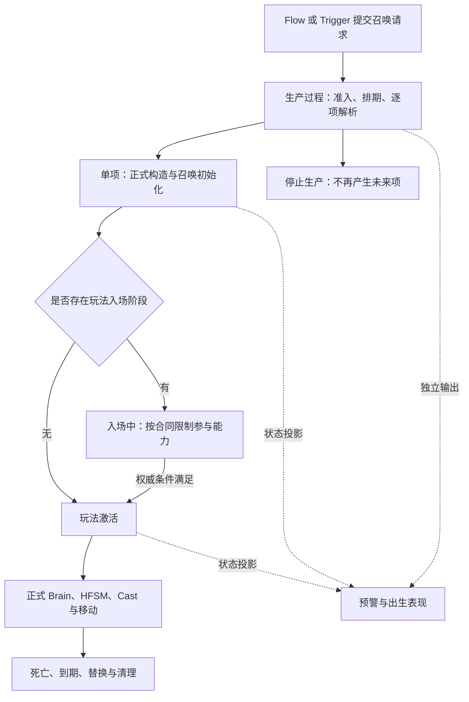

# 召唤生产过程与入场激活扩展规划

日期：2026-11-18。状态：分析与待确认方案；本轮只更新文档和 Skill，不修改运行时、配置或发布物。遵循 [机制治理](MobaMechanismGovernance.md) 和 [框架扩展边界](MobaFrameworkExtensionBoundaries.md)。

## 1. 结论与范围

召唤应当像投射物一样，显式区分“生产过程”和“产物生命周期”，并进一步区分单个召唤物的构造、入场与玩法激活。瞬时召唤是这个模型中无等待、单项生产的路径，无需为了未来扩展给现有召唤增加一帧延迟、空壳 Actor、Launcher 或长期任务。

建议现在固定身份、来源、数量含义、采样、提交、激活、取消和恢复边界；位置图案、生产节奏、内容选择及可表达的准备条件留作领域扩展。先稳定概念和接点，具体接口/schema 由真实切片驱动，不预建所有策略。

范围涵盖技能触发的瞬时、延迟、分批召唤和召唤物入场。地图刷怪、小兵波次、建筑生产存在相似结构，可用来检验边界；它们的玩法调度、容量和所有权不在本方案中统一或迁移。

## 2. 当前已具备什么

| 入口 | 已查事实 | 不能由此推导的能力 |
|---|---|---|
| [SpawnSummonPlanActionModule](../Unity/Packages/com.abilitykit.demo.moba.runtime/Runtime/Application/Services/Triggering/PlanActions/Skill/SpawnSummonPlanActionModule.cs) | 解析执行上下文，分配输入请求 ticket，解出位置与朝向，调用一次 TrySummon；成功输出单个 ActorId 和数量 1；DurationMs 覆盖该 Actor 寿命 | 返回成功不表示接受了一项异步生产任务；不能直接把原 ActorId 输出改成过程 ID |
| [SpawnSummonSchema](../Unity/Packages/com.abilitykit.demo.moba.runtime/Runtime/Application/Services/Triggering/PlanActions/Skill/SpawnSummonSchema.cs) | 解析 interval/count/rotation/query/target 等参数，但上述动作未消费这些相关字段 | 字段存在不等于周期生产、批量落点、准备条件已经实现；DurationMs 不是生产窗口或出场时间 |
| [MobaSummonService](../Unity/Packages/com.abilitykit.demo.moba.runtime/Runtime/Application/Services/Summon/MobaSummonService.cs) | 负责来源、请求结果与 ordinal、容量/替换、Actor 构造、属性继承、技能/被动、Brain 绑定、retain、Spawn 通知和失败补偿 | 单次结果表不等于可恢复的未来生产队列；同一输入下多个动作使用不同 ordinal，不能把输入身份直接当整批唯一项 |
| Brain 接线 | 服务在创建帧调用 EnsureBehavior；行为仍等下一个正式 BrainTick 执行 | 创建时绑定 Brain 不等于创建时立即执行 AI，也不证明已有可配置“准备中不行动”阶段 |
| [位置解析](../Unity/Packages/com.abilitykit.demo.moba.runtime/Runtime/Application/Services/Triggering/PlanActions/Core/MobaTemporaryEntityPositionResolver.cs) | 当前解析 Caster、Target、AimPos；Fixed 分支返回初始化的零点 | 不是可配置的阵型/散布/地形合法化服务；Fixed 不代表已有任意坐标参数 |
| [ActorSpawnService](../Unity/Packages/com.abilitykit.demo.moba.runtime/Runtime/Application/Services/EntityConstruction/MobaActorSpawnService.cs) 与 [Coordinator](../Unity/Packages/com.abilitykit.demo.moba.runtime/Runtime/Application/Services/EntityConstruction/MobaActorSpawnCoordinator.cs) | 有构造、未发布构造、批量准备/发布/回退；构造时仍注册实体及碰撞 | Unpublished 不等于不可查询、无碰撞或未参与玩法；批量 Actor 回退不自动覆盖 Summon 来源、容量替换和已发出的通知 |
| [小兵波次](../Unity/Packages/com.abilitykit.demo.moba.runtime/Runtime/Application/Gameplay/Extensions/Minions/MobaMinionWaveService.cs) | 已有 PendingSpawn、到期排序、波次身份、活动与待出生容量统计和状态捕获 | 这是小兵领域合同，不是技能召唤已可复用的通用生产器，不自动移交其 System 或恢复职责 |
| [Projectile LaunchSequence](../Unity/Packages/com.abilitykit.demo.moba.runtime/Runtime/Application/Services/Projectile/Launch/RepeatProjectileLaunchSequence.cs) | 发射过程与弹体分离，正式 schedule 推进；当前首发安排到下一帧，完成检查还涉及活动弹体 | 可借鉴分层，不能复制其首发时序、Launcher 身份或完成条件到瞬时召唤 |

另一个需要关注的事实：当前 Summon 的容量替换发生在新 Actor 构造之前。因此不能假定“新召唤失败后旧召唤必然仍存在”。若要保证替换原子性，应单独设计容量、旧对象和新对象的最小提交范围。

## 3. 三层生命周期，不强制一张大状态机

图是职责模型，不要求新增上述名字的 enum、组件、HFSM 或 System。现有瞬时调用可直接完成 B→C→E；“同帧完成”依然遵守各消费者的正常顺序，不补跑已执行的 BrainTick 或物理。

| 层 | 持有者建议 | 完成的含义 |
|---|---|---|
| 生产过程 | 当前召唤领域服务拥有的请求/过程状态，正式 System 驱动；仅跨帧时保留实例 | 没有未来生产项，已分配项均有明确结果；不等于产物全部激活或死亡 |
| 单项构造/入场 | 召唤领域生命周期持有；涉及可行动阶段时通过既有 HFSM/参数契约协调 | 构造成功、激活成功或失败/取消分别记录，不混成一个 bool |
| 活动召唤物 | 原 Actor、Brain、HFSM 和 Summon 生命周期 | 按正常死亡、寿命、替换和主人策略终结；不由生产游标接管全部行为 |

一次短 Flow 可以等待本次生产，也可以按已提交的异步子任务合同结束。独立长期生产不靠延长 Flow 维持。生产停止、单项激活、所有产物终结是三个不同观察点；内容按所需观察点接线，不把它们都命名为 Complete。

## 4. “准备完成”必须说明准备了什么

| 状态 | 权威与作用 | 边界 |
|---|---|---|
| 请求可接纳 | 输入、配置、来源、容量等准入结果 | 尚未证明 Actor 已存在；受理后仍可能延期或逐项失败 |
| 逻辑构造完成 | Actor 初始化、属性、技能、关系和来源等已建立 | 尚未证明允许行动、攻击或被查询 |
| 玩法激活 | 确定性逻辑条件满足，正式执行链按合同放行 | 可即时满足，也可等待世界帧时间、权威事件或交互；条件和上限需明确 |
| 表现就绪 | 客户端模型、特效、动画可显示 | 不决定伤害、AI、出生位置或玩法激活；加载慢时继续按权威状态对账 |

玩法准备中的对象可能仍可被攻击、阻挡、接受治疗，甚至带有可摧毁的孵化阶段。因此“禁用 Brain”或“无敌 Buff”都不足以通用表达准备期。需要逐项定义移动、施法、目标资格、受伤/死亡、碰撞/阻挡、被动/光环、寿命及主人命令的参与情况。

建议由单一生命周期事实或现有 HFSM 权威阶段派生这些门禁，不让生产器、Brain、HFSM 各持一个可独立写入的 Ready 标志。创建技能槽/被动和执行状态进入动作也可能产生效果，必须核查实际发生时点；事后阻止 BrainTick 不能撤回创建时已执行的玩法。

首次入场激活只针对该单项/Actor generation 完成一次。之后的眩晕、沉默、休眠等沿活动状态合同处理，不重置出生资格。准备期被击杀或到期时不补激活，不派发 Ready 效果。

### 4.1 三种不同的出场方式

| 方式 | Actor 何时存在 | 适用与影响 |
|---|---|---|
| 延迟创建 | 到期前只有未来生产项，可另发预警表现 | 不能提前被选中或受伤；到期重新校验位置、来源和容量 |
| 先创建再激活 | Actor 先存在，经历确定性的入场阶段 | 可支持孵化/落地等玩法，但必须接通全部参与门禁与准备期清理 |
| 逻辑即时、表现渐入 | Actor 正常激活，客户端播放出生效果 | 不新增玩法等待；动画时长不能暗中变成行动锁定 |

若一段内容需要“出生动画播完才能攻击”，应在权威作者源定义逻辑入场时长/条件并驱动表现对齐，不等待 Animator、异步加载或客户端确认。确有玩家/服务器交互条件时，需走正式输入及事件合同，不把外部回调直接当模拟时钟。

## 5. 固定契约与可扩展策略

| 维度 | 运行时固定的边界 | 可扩展的部分与必要声明 |
|---|---|---|
| 内容选择 | 明确模板、参数类型、引用校验与冻结记录 | 固定模板、分项模板、受约束的候选选择；策略版本、采样时点 |
| 时间与数量 | 唯一正式帧驱动、确定性项序号、有限单帧工作量 | 单项、同帧批量、间隔/分波；首次时点、总量、追赶与超限语义 |
| 位置与朝向 | 输入坐标系、快照/实时边界、最终位置提交 | 点/环/阵型/跟随锚点等解析；请求点与合法化点分开，退避和朝向单独说明 |
| 构造 | 正式 Actor 服务、召唤初始化、来源/retain、唯一结果与补偿 | 属性继承、技能/Brain/组件模板等受控初始化；不让位置策略自己 Spawn |
| 入场激活 | 单一权威事实、参与门禁、激活唯一提交、失败和终结 | 即时、定时或明确权威条件；不允许任意闭包决定激活 |
| 容量 | 容量作用域、占用/预留/释放责任和竞争次序 | 拒绝/延期/替换等有依据的领域策略；当前已有行为逐项保留，新增规则先确认 |
| 输出 | 请求、逐项创建、激活与批次结果可区分 | 内容选择等待哪个结果，表现如何投影；不偷换已有 ResultId/ResultCount |
| 恢复 | 状态所有权、结构恢复、只读预检、静默重绑 | 各策略的版本化数据与解析；不把所有扩展私有字段堆入核心 DTO |

前两列是建议稳定的合同方向，不表示当前已提供全部接口。可以复用位置向量、时间和纯图案计算；不因为都能“产生对象”就把 ProjectileService、SummonService、小兵波次及 Actor 构造合成万能生产系统。

策略输入/输出应是有单位和边界的类型化数据：例如稳定项序号、到期帧、模板引用、锚点快照、候选点、最终提交位置及拒绝原因。策略负责计算或提出候选，领域服务负责验证和提交；Capture/Validate 不执行有副作用的策略。

包归属建议：Actor 基础构造继续用原基础设施；技能召唤生产/激活先留召唤领域；复杂位置、图案或条件实现可进入可选扩展包，由 MOBA 适配和应用安装。内容组合不新增组合基类。当前公开注册、作者 schema、发布、恢复和 AOT 不一定开放，落地时依 [包外扩展完整链](MobaFrameworkExtensionBoundaries.md) 核对，缺哪里才提最小接点。

## 6. 数量、位置、容量和随机必须一起定义

### 6.1 数量至少分清这些口径

- 计划项数：本次生产打算处理多少项。
- 已尝试、已创建、已激活、已失败/取消项数：不同阶段的累计结果。
- 当前存活、准备中、未来预留：容量占用的候选口径，不默认全部等价。

一批计划 5 个，第 3 个位置失败，其余 4 个成功，需要明确是跳过该项、停止后续，还是有限重试；重试沿原项身份追加尝试，不能无条件另加一个计划项。持续保持“场上始终 5 个”属于补充生产规则，不能用 total_count 偷换表达。

同帧一批能否整体失败、跨帧生产能否部分成功、付款是否退款分别定义。Actor Batch 的局部回退不能自动撤销已经存活数帧并参与战斗的前几项；跨帧整批原子性不作为默认能力。

### 6.2 落点与朝向分别处理

每项说明锚点来自提交快照、出生时主人/目标当前位置还是独立固定值；锚点移动、死亡、瞬移和失效后的行为不能隐式切换。偏移采用世界坐标还是锚点局部坐标，朝向取输入/目标/锚点/阵型方向也单独声明。

先产生候选点，再由当前逻辑空间规则校验可站立、墙体、范围、占用和分离间距；需要合法化时保存实际结果，不直接把请求坐标当成功位置。只有逻辑世界可复现的空间查询可决定落点，不能依赖客户端物理或未验证确定性的异步导航结果。

同帧多项围绕同一落点时，候选之间是否互相占位、是否一次性规划后提交、按什么稳定顺序处理须明确。随机采样沿世界既有 RNG 合同，记录必要的冻结结果/游标；最大尝试次数和候选平局顺序有界。预览不消耗正式 RNG，重试也不重新抽整批覆盖已有项。

### 6.3 准备期与未来项是否占容量

先写明上限按 rootOwner、直接 owner、模板还是组统计，以及准备中、已创建和待出生是否占用。长过程可选择逐项准入，也可提出预留；前者可能后续失败，后者引入可恢复的预留账与释放责任。不能只把已存活计数拿来支持多项并发预订。

替换旧召唤物还需明确“先移除旧再创建新”还是“新准备成功后替换”，及旧对象死亡效果、source/retain 和失败时的处理。不能把现有 PrepareCapacity 命名理解为无副作用的纯校验。

## 7. 身份、寿命、取消和恢复

建议生产请求保持原来源与 Cast 关联，单项在生产过程身份下拥有稳定序号；具体如何扩展现有 input identity + ordinal 要专门设计。Actor 在正式构造时分配身份，并保存单项→Actor/generation 关系；尚无 Actor 的项也能被取消和恢复，不必预建虚假实体。

请求受理、Actor 创建和激活是不同返回语义。保留现有单次 TrySummon 与 ActorId 输出的意义；未来异步入口若需要过程 handle、逐项结果或集合输出，应显式设计，不能写入旧 result 字段伪装兼容。

生产过程的来源保活与产物 retain 分开：未来项未处理时谁保住来源、单项创建成功时如何建立子对象关系、生产结束释放哪一份 retain 都要明确。生产停止默认不推导已创建子对象必须销毁；主人死亡、Flow 取消、模式退出、场景关闭分别引用或提出相应策略。

区分首次延迟、项间隔、生产截止、入场时长、Actor 寿命。当前 Actor 寿命从创建时计算，不因本规划自动改成激活时；如要更改须显式确认。准备期已经过期的 Actor 不补一次激活；生产截止也不自动让存活 Actor 到期。

开启回滚时，沿既有领域所有者捕获未来充分状态：过程/项身份、到期与顺序、游标、冻结或实时采样模式、必要随机状态、结果、预留、入场阶段/条件记忆、激活时点、来源和 Actor/generation 对应。结构沿已有 Actor/Command；需要新增已销毁召唤物重建时另界定范围，不套用飞行弹体的有限批准。

恢复只重绑，不重跑 Spawn/Ready/Added、动画结束或旧效果。准备中检查点恢复后，未来正式条件满足时激活一次；已激活检查点恢复不再结算激活效果。现有 pending Actor spawn Provider 保存的是未发送的输出队列，不是未来尚未构造的生产项。

## 8. 瞬时召唤的兼容基线

建议把现有“单次立即召唤”作为回归基线：一个请求创建一个 Actor，位置与继承按当前路径采样，寿命和容量行为保持既有合同，Brain 在创建帧绑定、下次正式 BrainTick 决策。无逻辑入场要求时不等待表现，也不新增跨帧过程。

这是后续新设计的兼容目标，不表示本次修改任何默认值或输入 schema。旧的未消费 count/interval 等字段应先盘点实际作者源，再决定拒绝、迁移或正式支持；不能把 0 无差别解释为新默认值并静默改变旧内容。

复杂能力作为可选路径：有延迟/分批才持久化生产过程，有玩法入场才增加相应阶段和门禁，有预留需求才增加容量预留。该分级可避免所有瞬时召唤承担最大化模型。

### 8.1 控制抽象带来的运行成本

通用原则见 [框架扩展边界 §6.4](MobaFrameworkExtensionBoundaries.md#64-边界对管理有用不要求运行时层层实例化)。召唤的三层是职责划分，不要求三套对象、三套 Tick、三次事件转发或三个互相同步的状态机。

- 瞬时召唤保留同步直达路径；跨帧生产仅保存必要的身份、游标、下次到期和来源，完成后按生命周期释放活动记录。合法重放窗口内仍需保留的请求结果单独管理，不因过程结束就删除幂等依据。
- 定时入场只在到期时尝试转换，已有纯时间条件不应每帧遍历全部策略；事件/组合条件的变化检测按其真实合同执行，活动状态的控制与行为继续走既有链。此处不预先承诺新事件订阅或调度结构。
- 数量很多但规律明确的未来项可以评估用计划加游标表达，逐项身份、结果和随机采样保持原语义；不强制提前创建全部 Actor，也不提前抽取本应出生时采样的位置/继承值。
- 模板与策略引用按已声明时点解析并复用，只读定义避免重复持有大对象图；有状态策略和缓冲仍按作用域隔离。位置求解、容量、继承、技能/被动初始化和 Brain 接线分别统计，避免把全部 Spawn 耗时归因于接口。

当前源码提供的只是成本分析入口：[ProjectileService.TickSchedules](../Unity/Packages/com.abilitykit.combat.projectile/Runtime/Projectile/Services/ProjectileService.cs) 遍历活动 schedule，到期时才取 pattern 并借用生成缓冲；小兵 SpawnDue 对待出生列表排序；Summon 容量检查会压缩/扫描该 owner 的追踪列表，状态捕获也构造列表和数组。这些操作是否构成瓶颈要按规模测量，不能把旧路径的成本算成新规划已引入的回归。

后续对照至少包含：当前单次瞬时召唤；相同数量/节奏的已有编排与新生产过程；大量远期任务但少量到期；峰值批量创建；大量准备中 Actor；取消与清理；回滚开/关。报告抽象增量与完整业务成本，定义目标平台预算后再验收。本轮没有实现这些路径或运行性能基准，不能据规划保证开销可忽略。

### 8.2 可按项目支持范围选择固定实现

按 [框架扩展边界 §6.5](MobaFrameworkExtensionBoundaries.md#65-项目方向确定后可选择能力子集并替换执行实现)，召唤可以保留统一的领域合同，让项目选择执行实现：只支持单项瞬时召唤时装配直接路径；需要跨帧数量/间隔时再装配生产过程；需要玩法入场时才引入对应状态和门禁。复杂能力不要求通过空任务、空策略或每帧开关模拟“关闭”。

固定实现按支持子集和作者数据选择，不按英雄身份分派。被裁掉的周期、阵型或准备条件引用必须明确拒绝；需要时重新选择相应能力并验收，不静默降级。固定实现仍走正式 Actor 构造、来源/retain、容量、初始化及清理合同，适用的恢复支持也保持完整。

这不表示现有召唤已具备全部可替换后端。首个切片先查公开接点，缺少时只提出必要的装配/调用和校验方案；直接绑定是否减少分派、是否裁掉状态/系统，以及 Player 构建实际移除多少依赖，分别用证据确认。

## 9. 推荐落地批次与验收

| 批次 | 具体产出 | 边界 |
|---|---|---|
| A：固定瞬时基线 | 核对现有请求→位置→容量→构造→初始化→输出→清理，记录真实消费者与结果 | 当前任务只做分析；恢复既定契约的后续修复按授权推进，不暗改容量或 Spawn 时点 |
| B：选一个跨帧生产需求 | 建议单模板、固定有限项数和间隔、明确锚点采样与逐项失败规则；不先包含所有策略 | 设计身份/返回/来源保活/恢复、正式推进接点与作者化，确认后实现；瞬时旧路径作对照 |
| C：选一个真实玩法入场需求 | 明确延迟创建或先创建再激活；若后者，逐项接通行动、目标、碰撞、被动与寿命门禁 | 不用“禁用 AI”冒充完整准备状态；若仅视觉渐入则无需此机制 |
| D：检验包外扩展 | 在外部程序集加入一个位置图案或准备条件实现，沿公开入口安装 | 正式作者源可选、缺包明确拒绝、恢复与 Player/AOT 有相应证据；核心不增加身份分支 |

这些批次检验不同边界，不要求强制按 B→C 顺序接全部能力。若真实下一个需求只有位置散布，可先解决该接点，无需同时实现跨帧生产和入场阶段。

验收选择：瞬时对照；同帧多项与有限间隔；锚点移动/失效；重叠/堵塞/无合法点；容量竞争与替换失败；重复请求/过期身份；准备中死亡/过期；激活帧与取消/主人死亡竞争；Flow 结束后未来项；场景关闭；关闭回滚正常运行；准备前/中/激活后三个检查点及同输入两次重演。检查数量口径、实际位置、正式 AI/Cast 起点、效果唯一性、来源/retain/预留和最终清理。

当前可复查测试入口：[请求身份](../src/AbilityKit.Demo.Moba.Tests/StateSync/MobaSummonRequestIdentityTests.cs)、[延迟 Timeline 派生召唤](../src/AbilityKit.Demo.Moba.Tests/StateSync/MobaDelayedSummonReplayTests.cs)、[跟随/战斗交接](../src/AbilityKit.Demo.Moba.Tests/Smoke/MobaSummonMovementHandoffTests.cs)、[待发送 Spawn 队列](../src/AbilityKit.Demo.Moba.Tests/StateSync/MobaPendingActorSpawnRollbackTests.cs)、[小兵波次合同](../src/AbilityKit.Demo.Moba.Tests/Minions/MobaMinionWaveContractsTests.cs)。它们提供复用入口，不证明本方案中的新生产/激活能力已实现或本轮已通过。

## 10. 实施前需明确的决策

在选定真实切片后，一次列清：生产完成的观察点；现有同步接口兼容与新过程结果；逐项/批次失败；容量预留与替换时点；位置/继承/模板采样；准备期参与矩阵；寿命起点；取消/主人死亡对未来项与现存产物的影响；正式 System 接点、schema/发布/包外入口与恢复支持范围。

不预设所有项目采用同一套策略值。可先批准一个最小切片的明确语义，其余保留设计空间；本文件的规划和 Skill 链接不代替该批准，也不表示必须立即抽取通用框架包。
