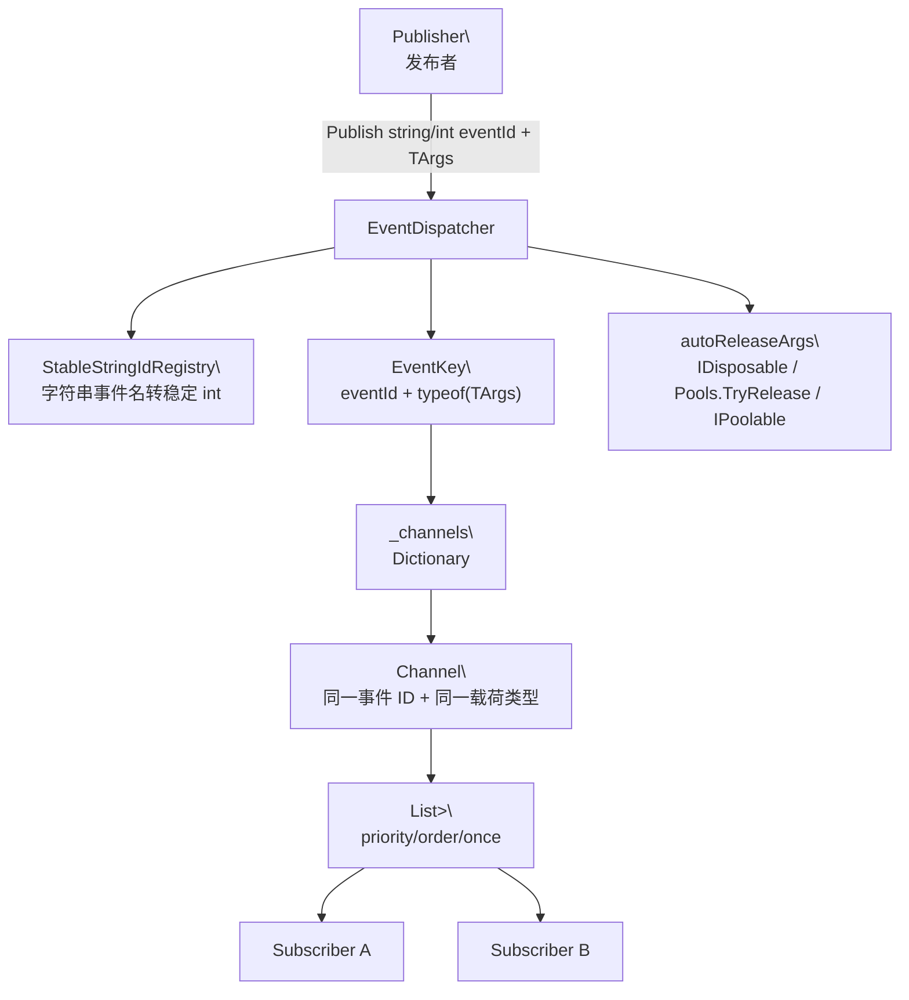
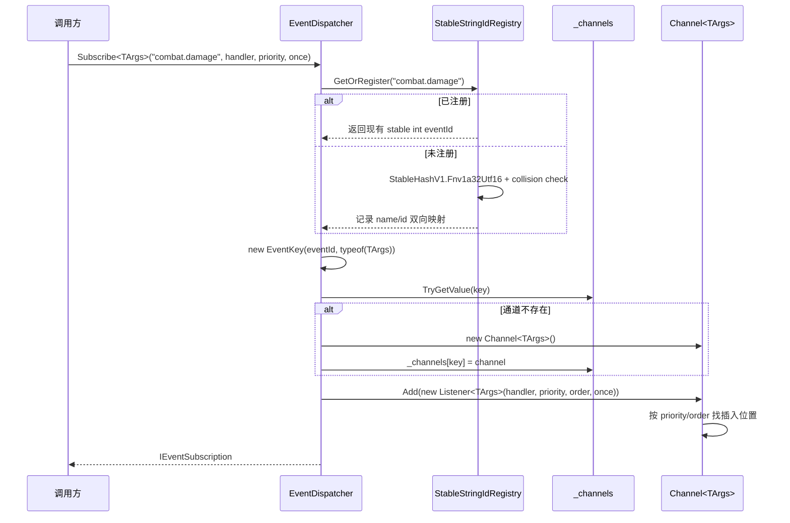
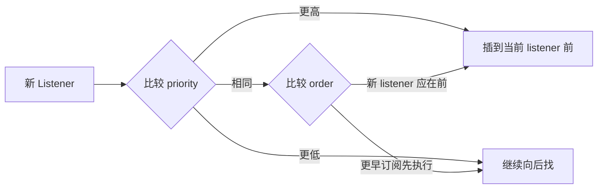
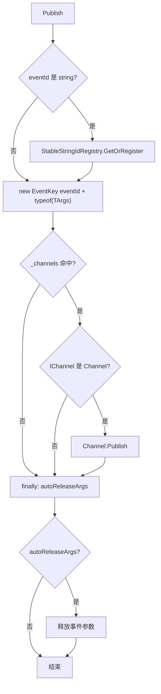
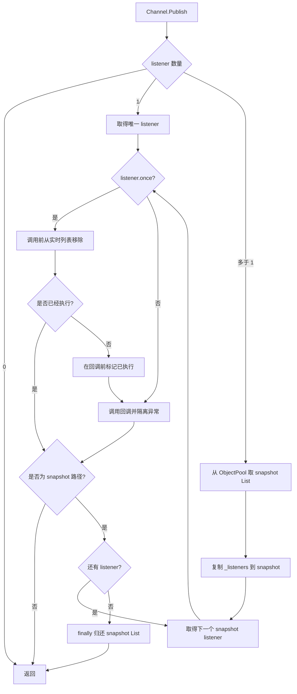
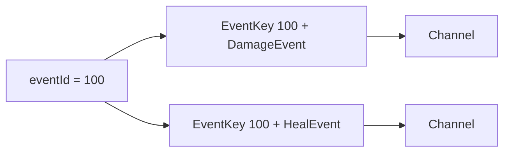
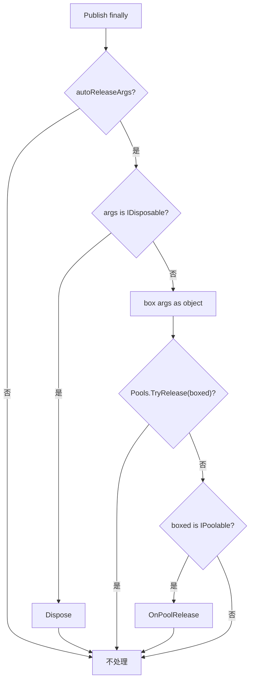
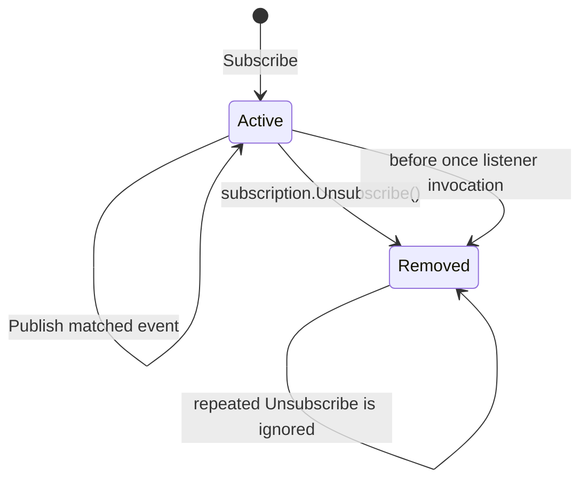

# 5.1 事件系统：EventDispatcher 的发布订阅、优先级与事件载荷回收

> 本文从源码解释 AbilityKit Core 事件系统。它不是一个全局消息总线的概念草图，而是由 `EventDispatcher`、`EventKey`、`Channel<TArgs>`、`IEventSubscription` 和 `StableStringIdRegistry` 组成的轻量运行时通信机制。

随包交付的行为契约见 [同步事件契约](../../../Unity/Packages/com.abilitykit.core/Documentation~/Eventing.md)。本轮已统一源码目录，并修复多监听器快照下的一次性订阅重入问题；以下说明以当前实现为准。

---

## 1. 能力定位

事件系统解决的是“模块之间需要通知，但不应该互相持有具体对象”的问题。

它适合：

- 战斗逻辑向表现层发出伤害、治疗、命中、技能释放等通知。
- Triggering、Ability、Combat 等模块之间传递轻量领域事件。
- Demo 或工具层监听框架事件，做日志、表现、录制、调试。
- 发布者不关心监听者数量，监听者可以按生命周期自主退订。

它不负责：

- 跨网络同步。网络同步应走帧同步、快照或状态同步模块。
- 事件持久化。需要回放时应进入 Record/Replay 体系。
- 多线程事件调度。当前实现主要面向单世界 Tick 中的同步派发。

责任边界如下：

| 层级 | 应负责 | 不应由该层统一规定 |
|------|--------|--------------------|
| Core 框架 | 通道键、稳定顺序、同步派发、订阅句柄、载荷释放协议 | 具体事件目录、跨帧队列、业务补偿与网络可靠性 |
| Host / World 接入 | dispatcher 的实例范围、Tick/线程约束、初始化与销毁顺序 | 替业务定义事件含义或默认持久化所有事件 |
| 项目应用层 | 事件常量、载荷类型、监听生命周期、异常/重入策略和跨层适配 | 修改 Core 派发语义来迁就单个玩法 |
| MOBA / Starter 示例 | 展示 Triggering 桥接、手动释放与最小订阅流程 | 作为所有游戏必须采用的事件目录或总线架构 |

这种划分保留了工具集的低接入成本：项目可以直接使用同步分发机制，但不会被迫接受某一款游戏的事件分类、持久化或失败策略。

源码入口：

| 源码 | 作用 |
|------|------|
| `Unity/Packages/com.abilitykit.core/Runtime/Eventing/EventDispatcher.cs` | 事件订阅、派发、监听者管理和事件参数自动释放 |
| `Unity/Packages/com.abilitykit.core/Runtime/Eventing/GlobalEventDispatcher.cs` | 持有单一静态 `EventDispatcher` 实例并代理 string/int 订阅与发布 |
| `Unity/Packages/com.abilitykit.core/Runtime/Eventing/EventKey.cs` | 用 `eventId + argsType` 组成事件通道键 |
| `Unity/Packages/com.abilitykit.core/Runtime/Eventing/IEventSubscription.cs` | 订阅句柄；当前接口只提供 `Unsubscribe()` |
| `Unity/Packages/com.abilitykit.core/Runtime/Identifiers/StableStringIdRegistry.cs` | 将字符串事件名稳定映射为 int ID，并检测哈希冲突 |
| `Unity/Packages/com.abilitykit.core/Runtime/Pooling/Core/Pools.cs` | 事件参数自动释放和派发快照列表池化依赖 |

---

## 2. 总体结构



核心设计点有三个：

| 设计点 | 说明 |
|--------|------|
| 事件 ID 和载荷类型共同隔离 | 同一个 `eventId` 可以对应不同 `TArgs`，实际通道键是 `EventKey(eventId, typeof(TArgs))` |
| 派发顺序确定 | 监听者按 `priority` 降序，同优先级按订阅顺序执行 |
| 发布后自动回收载荷 | `Publish` 默认 `autoReleaseArgs = true`，减少事件对象泄漏和 GC 压力 |

---

## 3. 订阅流程

`EventDispatcher` 提供字符串和整数两类订阅入口：

```csharp
var subscription = dispatcher.Subscribe<DamageEvent>(
    eventId: "combat.damage",
    handler: OnDamage,
    priority: 100,
    once: false);
```

字符串事件名会先进入 `StableStringIdRegistry.GetOrRegister(string)`，再转成整数事件 ID。这样做的目的不是让字符串在每次派发时到处比较，而是把可读名称稳定压缩成整数。

`StableStringIdRegistry` 的实现很小，但它是事件名稳定性的关键边界：

- `_nameToId` 使用 `StringComparer.Ordinal`，避免不同区域性导致字符串比较结果漂移。
- `StableHashV1.Fnv1a32Utf16` 使用固定 offset 和 prime 混合 UTF-16 代码单元，不依赖 .NET 运行时的随机化字符串哈希。
- `_idToName` 会反查生成后的整数 ID。如果两个不同字符串得到同一个 ID，会立即抛出 hash collision 异常，而不是静默把两个事件合并到同一通道。
- `TryGetId` 只查询已注册名称，不会隐式创建；`GetOrRegister` 才会建立双向映射。



`Channel<TArgs>.Add` 不在发布时排序，而是在订阅时通过 `FindInsertIndex(priority, order)` 插入到正确位置。这意味着常见的 `Publish` 路径不用为排序付费。

排序规则：



---

## 4. 发布流程

发布入口也支持字符串和整数：

```csharp
dispatcher.Publish("combat.damage", damageEvent);
dispatcher.Publish(GameEvents.Damage, damageEvent, autoReleaseArgs: false);
```

真实执行链路：



整数 `EventDispatcher.Publish<TArgs>` 使用 `try/finally`，即使监听者抛异常，事件参数的释放路径仍然会执行。`Channel<TArgs>.Publish` 会分别捕获并无条件吞掉每个监听者异常，后续监听者继续执行；当前实现没有日志、聚合异常或失败返回值，因此发布者不能通过异常判断监听处理是否成功。

字符串重载的当前委托链需要区分两种情况：

- 非 `null` 字符串先取得稳定整数 ID，再以 `autoReleaseArgs: false` 调用整数重载，最后由字符串重载自己的 `finally` 按原始参数释放。因此不会发生内外层重复释放，且已有直接测试保护“恰好一次”。
- `eventId == null` 时，字符串重载在进入 `try/finally` 前直接返回，因此即使 `autoReleaseArgs: true` 也不会释放载荷。这是调用方必须处理的剩余所有权边界。

Ability Triggering 的 `CommonEventDispatcherBus` 因为在外层拥有 `TriggerEvent.Args`，仍显式传 `autoReleaseArgs: false` 并在自己的 `finally` 释放。这里体现的是适配层所有权选择，不再是规避字符串重载缺陷。

---

## 5. Channel<TArgs> 的派发策略

源码里 `Channel<TArgs>` 对单监听者和多监听者做了不同处理。



这个设计有几个重要后果：

| 场景 | 行为 |
|------|------|
| 监听者在回调中退订自己 | 多监听者路径遍历的是 snapshot，不会破坏正在遍历的列表；退订影响后续发布 |
| 监听者在回调中退订别人 | 本次派发已经复制到 snapshot 的监听者仍可能继续执行，退订主要影响后续发布 |
| 监听者在回调中新增订阅 | 新监听者不在已经生成的 snapshot 中，从下一次发布开始生效 |
| `once = true` | 回调前移除并记录单次执行状态；内层发布已经消费的监听项不会被外层旧快照再次执行，异常后也不重试 |
| 监听者抛异常 | 异常被吞掉，once 监听者仍会移除，后续监听者继续执行 |
| 只有一个监听者 | 不租借 snapshot 列表，走更短路径；仍然是同步、可递归调用 |

多监听者 snapshot 列表本身也来自对象池：

```csharp
private static readonly ObjectPool<List<Listener<TArgs>>> _snapshotPool = Pools.GetPool(
    createFunc: () => new List<Listener<TArgs>>(32),
    onRelease: list => list.Clear(),
    defaultCapacity: 32,
    maxSize: 256,
    collectionCheck: false);
```

这说明事件系统和对象池不是孤立模块。事件派发为了遍历稳定性需要临时列表，但通过池化把临时分配控制住。这里的“稳定”指当前发布周期的迭代集合稳定，不表示每次回调前都会重新检查监听者是否仍在 `_listeners`。

---

## 6. EventKey 为什么包含 TArgs 类型

如果事件键只有 `eventId`，下面两段代码会进入同一个通道：

```csharp
dispatcher.Subscribe<DamageEvent>(GameEvents.Combat, OnDamage);
dispatcher.Subscribe<HealEvent>(GameEvents.Combat, OnHeal);
```

AbilityKit 的实现用 `EventKey(eventId, typeof(TArgs))` 隔离通道：



这样可以保留整数 ID 的轻量性，也避免不同事件参数类型误投递。代价是：发布和订阅必须使用完全一致的 `TArgs` 类型，否则会命中另一个通道或根本没有监听者。

---

## 7. 自动释放事件参数

`Publish<TArgs>` 默认 `autoReleaseArgs = true`。发布结束后，释放顺序如下：



这条路径需要明确以下约束：

- 释放优先级是 `IDisposable.Dispose()`、`Pools.TryRelease(boxed)`、无归还句柄时的 `IPoolable.OnPoolRelease()`；命中前一项后不会继续执行后一项。
- 如果事件参数是池化对象，并且由 `Pools.Get` 或某个 `PoolScope.Get` 取出，`Pools.TryRelease` 可以把它归还到对应对象池。
- 如果对象只实现 `IPoolable`，但没有被 `PoolManager` 记录归还句柄，则只会调用 `OnPoolRelease()`，不会进入某个具体池。
- `Dispose()` 与无池句柄时兜底 `OnPoolRelease()` 的异常会被吞掉。`Pools.TryRelease` 若命中池，其内部 release 生命周期回调异常没有被 `ReleaseArgs` 捕获，会穿透 `Publish`；调用方不能假设所有释放失败都静默。
- 如果事件参数归属外部生命周期，应显式传 `autoReleaseArgs: false`。
- 字符串重载先解析稳定 ID，再以 `autoReleaseArgs: false` 调用整数重载，最终只在字符串重载外层释放一次；字符串和整数入口都遵守单次自动释放所有权。
- `eventId == null` 的字符串入口会直接返回，当前不会释放 `args`。调用方若可能传入 null，必须在进入 dispatcher 前校验，或自行负责载荷回收。

整数 ID 适合已经集中定义事件目录的热路径；字符串 ID 也可使用默认自动释放：

```csharp
var evt = Pools.Get(() => new DamageEvent());
evt.AttackerId = attackerId;
evt.TargetId = targetId;
evt.Value = damage;

// 整数重载发布后尝试归还 evt。监听者不要长期持有 evt 引用。
dispatcher.Publish(GameEvents.Damage, evt);
```

---

## 8. 订阅句柄、全局门面与生命周期

订阅返回 `IEventSubscription`。当前接口没有继承 `IDisposable`，只提供幂等的 `Unsubscribe()`；退订前先清空句柄中的 listener 引用，重复调用直接返回。dispatcher 与通道键仍作为只读身份保留；句柄不负责释放回调目标，旧句柄不能移除之后创建的替代订阅。



订阅句柄应绑定到拥有者生命周期：

```csharp
private IEventSubscription _damageSubscription;

public void Initialize(EventDispatcher dispatcher)
{
    _damageSubscription = dispatcher.Subscribe<DamageEvent>(
        "combat.damage",
        OnDamage,
        priority: 100);
}

public void Dispose()
{
    _damageSubscription?.Unsubscribe();
    _damageSubscription = null;
}
```

这样可以避免世界销毁、UI 关闭、系统卸载后仍然收到事件。`GlobalEventDispatcher` 是静态 facade，不能实例化；它只代理 string/int 重载并共享 `GlobalEventDispatcher.Instance`。需要世界级隔离、测试隔离或明确销毁边界时，应自行持有 `EventDispatcher`，不要把全局实例当作自动清理的作用域。

---

## 9. 使用约束

| 约束 | 原因 |
|------|------|
| 用常量保存事件名或事件 ID | 避免字符串拼写错误导致发布和订阅进入不同通道；字符串名最终会被稳定哈希成 int |
| 事件参数类型保持稳定 | `EventKey` 包含 `typeof(TArgs)`，类型变化会改变通道 |
| 字符串 ID 在入口处判空 | `null` 字符串在进入 `try/finally` 前直接返回，不派发也不自动释放载荷；调用方仍拥有它 |
| 监听者回调保持短小并管理嵌套发布 | 当前派发同步，一次性项保证最多执行一次；普通回调没有全局递归深度限制，调用方仍需管理顺序和参数所有权 |
| 需要跨帧保存事件数据时复制字段 | 自动释放后，池化事件对象可能被复用 |
| 模块卸载时调用 `Unsubscribe()` | `IEventSubscription` 没有 `Dispose()`，订阅所有者必须显式退订 |
| 限制在单线程/单世界执行域 | dispatcher、channel 和字符串注册表都使用无锁字典/列表，不能声明为线程安全 |

---

## 10. 边界判断

### 10.1 以为同一个 eventId 一定是同一类事件

不是。实际通道还包含 `TArgs`。

```csharp
// 这是两个不同通道。
dispatcher.Subscribe<DamageEvent>(100, OnDamage);
dispatcher.Subscribe<HealEvent>(100, OnHeal);
```

### 10.2 在监听者里长期保存事件参数引用

如果发布者使用默认 `autoReleaseArgs = true`，事件参数可能在发布结束后被归还池。监听者需要保存时应复制必要字段。

### 10.3 把 EventDispatcher 当异步队列

当前实现是同步派发：`Publish` 调用栈内直接执行监听者。一次性项具有单次执行保护，但没有事件队列、线程切换或全局递归深度限制；需要排队、跨帧、网络传输时，应使用对应运行时模块。

### 10.4 一次性订阅在重入发布中最多执行一次

once listener 在回调调用前移除，并在执行回调前记录已执行状态。多监听器场景中，内层发布可能先消费外层快照尚未调用的 once listener，外层随后会跳过已消费的监听项；回调抛出异常也不重试。该保证不禁止普通回调嵌套发布。

### 10.5 以为退订能阻止当前 snapshot 中的后续回调

多监听者路径会先复制 `_listeners` 到 snapshot，再遍历 snapshot。某个监听者在回调中退订另一个监听者时，被退订者如果已经在当前 snapshot 中，仍可能在当前发布周期被调用。需要强制阻止当前发布周期的后续逻辑时，应在事件参数或监听者自身状态里加显式有效性判断。

### 10.6 单监听者快路径与通道替换

只有一个监听者时，`Channel<TArgs>.Publish` 直接取得该监听项，不租借快照列表；一次性项仍在回调前按对象身份移除。回调中重入、清空或新增监听项后，外层清理只会移除原先观察到的空通道，不会误删替代通道。

单监听者与多监听者路径共享优先级、单次执行和异常隔离契约，区别在于是否需要快照列表。回调内的订阅变更仍不能作为撤销当前普通监听项快照的手段。

---

## 11. 生产证据、样例与测试成熟度

| 证据 | 当前结论 |
|------|----------|
| `Ability/Triggering/CommonEventDispatcherBus.cs` | 直接注入 Core `EventDispatcher`；桥接 Triggering 时传 `autoReleaseArgs: false`，再在外层 `finally` 释放 `TriggerEvent.Args`，属于真实生产适配 |
| `Samples/Starter/FoundationStarter.cs` | 可执行 Starter 直接演示订阅、发布和退订；事件发布同样显式关闭自动释放 |
| `Samples/Foundation/EventSystem.cs` | 仍包含实例化 `GlobalEventDispatcher`、`Dispatch` 和 `subscription.Dispose()` 等过期 API，只能视为待修样例文本，不能作为当前契约证据 |
| `src/AbilityKit.Core.Tests/EventDispatcherTests.cs` | 覆盖字符串载荷恰好释放一次、稳定优先级/同优先级顺序、once 和监听器异常隔离，构成 Core 直接 E3 契约证据 |
| `src/AbilityKit.Core.Tests/EventDispatcherContractTests.cs` | 本轮新增 12 项回归，覆盖一次性订阅嵌套发布、快照变更、替代通道、空引用事件名的参数所有权、释放异常及参数类型隔离 |
| `src/AbilityKit.Triggering.Tests/AbilityKit.Triggering.Tests.csproj` | 本轮 .NET 跨包回归 26 项通过；验证范围为该测试工程 |

2026-08-16 的 3/3 是历史聚焦结果。本轮 2026-11-17 的 Core 全量直接测试为 173 项通过，Triggering 跨包回归为 26 项通过，均无失败或跳过。回调中增删监听器、单监听者 once 重入及替代订阅、多监听者 once 被内层消费、空引用事件名的参数所有权和释放异常已有回归覆盖。事件参数的对象池归还与 IPoolable 兜底完整组合，以及真实 Unity/IL2CPP 验收，仍待后续补齐。并发发布不属于支持契约，不能由这些单线程测试外推线程安全保证。具体命令和日志登记在 Core 稳定化推进记录中。

---

## 12. 源码阅读路径

1. `EventDispatcher.Subscribe<TArgs>`：事件 ID、`EventKey` 和 `Channel<TArgs>` 的关系。
2. `Channel<TArgs>.Add`：优先级和订阅顺序。
3. `Channel<TArgs>.Publish` 与 `Listener<TArgs>.Invoke`：单监听者快路径、多监听者 snapshot、异常隔离、once 调用前移除及单次执行状态。
4. string/int `Publish<TArgs>` 的委托关系：字符串入口关闭内层释放，由外层 `finally` 单点回收。
5. `GlobalEventDispatcher` 与 `CommonEventDispatcherBus`：全局 facade 和生产适配的所有权差异。
6. [对象池](./02-ObjectPool.md)：`Pools.TryRelease` 和事件系统的关系。

---

## 13. 和其他文档的关系

- [对象池](./02-ObjectPool.md)：解释事件 snapshot 列表和事件参数自动释放背后的池化机制。
- [定时器框架](./03-TimerFramework.md)：解释需要跨时间推进的任务为什么不应塞进同步事件派发。
- [触发器系统](../08-GameplayModules/02-TriggeringSystem.md)：事件可以作为触发来源，但触发计划、条件、动作执行由 Triggering 模块负责。
- [表现层事件抽象](../04-PresentationLayerDesign/01-ViewEventAbstraction.md)：表现层事件是更高层的跨端视图抽象，不等同于 Core 同步事件分发器。

---

文档类型：Canonical 设计 | 原事实基线：2026-08-16；事件实现与回归更新：2026-11-17 | 证据等级：E0 源码、E2 既有生产消费者、E3 Core 及 Triggering 契约测试；本轮未补真实 Unity/IL2CPP 验收，未达到 E4/E5

*文档版本：v3.3 | 最后更新：2026-11-17*
