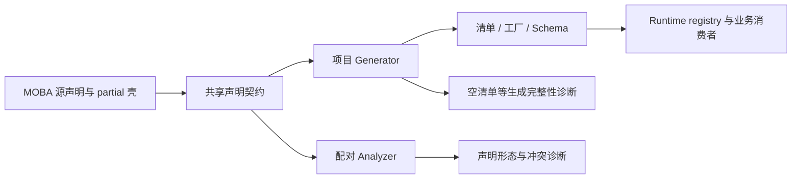
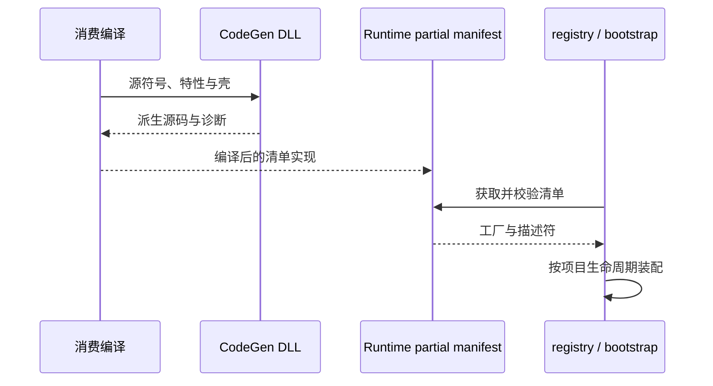
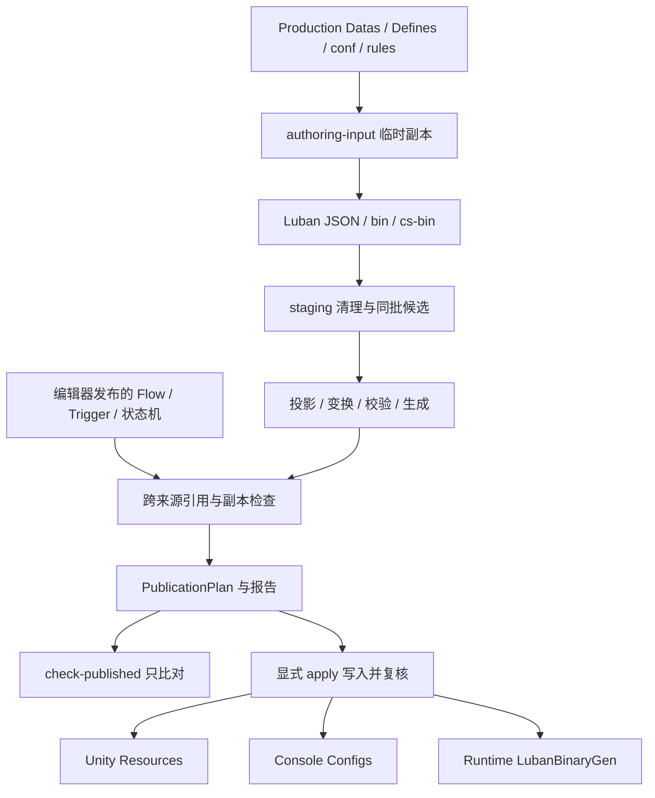

# 5.7 MOBA CodeGen 与 Luban 生产链：项目清单、候选数据和发布边界

> 文档类型：Canonical 设计与生产链审计
> 事实基线：2026-11-25；按当前工作区源码核对，不代表现有包根 DLL 已与源码对齐。
> 核校状态：已核校本文生成所有权、生产导出/发布源码、局部测试与只读发布一致性；Unity 编辑器发布、完整 gate 和 CI 未在本批验收。

## 1. 能力定位

本专题解释两条相互衔接但所有权不同的链：Roslyn 将 MOBA 项目声明转成编译期清单与强类型工厂；Luban 管线将生产 authoring 输入转成同批 JSON、二进制和生成 C#，再与编辑器创作的 Flow、Trigger、状态机交接。

包的独立使用契约分别由 [MOBA CodeGen](../../../Unity/Packages/com.abilitykit.demo.moba.codegen/README.md)、[Ability ConfigDatabase](../../../Unity/Packages/com.abilitykit.ability/Documentation~/ConfigDatabase.md) 和 [Luban Runtime](../../../Unity/Packages/com.abilitykit.thirdparty.luban.runtime/README.md) 维护。导表操作唯一入口是 [MOBA Luban 配置管线](../../../LubanConfig/Moba/README.md)，本篇不再复制完整表目录和英雄配置规则。

| 所有者 | 负责 | 边界 |
| --- | --- | --- |
| Ability 配置内核 | 输入适配、构表、查询和 reload 提交 | 不规定 MOBA 表和内容生产方式 |
| MOBA CodeGen | 项目清单、工厂、字段/Schema 派生代码及编译诊断 | 不作为所有游戏的默认生成器，不执行内容发布 |
| Luban Runtime | 二进制读取与生成代码所需兼容层 | 不包含 CLI、业务表或完整发布能力 |
| MOBA authoring 与发布工具 | 定义表、编辑源、规则、生成物和发布清单 | 不接管运行期缓存、战斗规则或恢复机制 |
| 项目维护者 | 内容审查、批次一致性、业务验收和回退决策 | 生成或副本一致不能替代业务正确性 |

旧 `com.abilitykit.codegen` 已移除；框架分析器归 `com.abilitykit.analyzer`。不得继续引用不存在的框架生成器工程来定义现行能力。`.generated`、`MiniTemplate` 和旧 `Runtime/LubanGen` 是历史流程；当前候选 staging 在 `local/luban-export`，代码目标为 `LubanBinaryGen`。

## 2. 当前源码与工具入口

### 2.1 MOBA 编译期组件

| 入口 | 作用 |
| --- | --- |
| [CodeGen 使用指南](../../../Unity/Packages/com.abilitykit.demo.moba.codegen/Documentation~/Usage.md) | 本包环境、构建副作用、编译输入、DLL 导入与排错 |
| [工程](../../../Unity/Packages/com.abilitykit.demo.moba.codegen/DotNet~/AbilityKit.Demo.Moba.CodeGen/AbilityKit.Demo.Moba.CodeGen.csproj) | netstandard2.0 / Roslyn 3.9；Build 后将 DLL 复制到包根 |
| [Generators](../../../Unity/Packages/com.abilitykit.demo.moba.codegen/DotNet~/AbilityKit.Demo.Moba.CodeGen/Generators)、[Analyzers](../../../Unity/Packages/com.abilitykit.demo.moba.codegen/DotNet~/AbilityKit.Demo.Moba.CodeGen/Analyzers)、[Contracts](../../../Unity/Packages/com.abilitykit.demo.moba.codegen/DotNet~/AbilityKit.Demo.Moba.CodeGen/Contracts) | 项目编译资产、共享声明规则及诊断 |
| [配置表 manifest 壳](../../../Unity/Packages/com.abilitykit.demo.moba.runtime/Runtime/Infrastructure/Config/Core/MobaGeneratedConfigTableManifest.cs) | 消费生成 specs、排序与唯一性校验，控制反射 fallback |
| [配置 registry](../../../Unity/Packages/com.abilitykit.demo.moba.runtime/Runtime/Infrastructure/Config/BattleDemo/MobaConfigRegistry.cs) | 项目表目录与运行时使用 |
| [契约测试工程](../../../Unity/Packages/com.abilitykit.demo.moba.codegen/DotNet~/AbilityKit.Demo.Moba.CodeGen.Tests/AbilityKit.Demo.Moba.CodeGen.Tests.csproj) | Roslyn compilation tests；不再把该工程写为待建立 |

生成域以目录为准，包括配置、PlanAction manifest/Schema、Payload、事件、目标查询、投射物、引导/注册、World/回滚、快照及战斗路由等；不维护“固定十组”的静态计数。Unity 实际使用包根带 `RoslynAnalyzer` 标签的 DLL，不直接执行包内 csproj。工程存在、构建成功、DLL 与当前源码对应、消费编译产生预期结果应分别验收。

### 2.2 Luban 与发布

| 入口 | 当前职责 |
| --- | --- |
| [export_pipeline.py](../../../LubanConfig/Moba/export_pipeline.py) | 从 Production 构建 JSON/bin/cs-bin，运行规则和引用校验，形成发布计划 |
| [export_moba_configs.ps1](../../../LubanConfig/Moba/export_moba_configs.ps1) | 转发默认验证、`-Apply` 或 `-CheckPublished`，互斥参数并传播 Python 非零退出码 |
| [pipeline_rules.py](../../../LubanConfig/Moba/pipeline_rules.py)、[business](../../../LubanConfig/Moba/business) | 分阶段规则、业务投影、校验与生成，不把英雄分支塞进通用调度器 |
| [publication.py](../../../LubanConfig/Moba/publication.py) | 目标归属、去重、预期内容、差异、哈希与写入失败恢复 |
| [sync_moba_json_configs.ps1](../../../tools/sync_moba_json_configs.ps1) | 兼容的 package → Console `moba`/`ability` JSON 同步；不覆盖 Luban 全部产物 |
| [test-gates.json](../../../tools/test-gates.json)、[ownership validator](../../../tools/validate_moba_codegen_ownership.ps1) | 声明步骤与所有权检查；完整执行、单步和 CI 证据分开 |

## 3. 生成资产所有权

成对 Generator/Analyzer 复用 Contracts 检查声明；Generator 过滤无效项并产生确定性源码。部分 Generator 自身还报告空清单等诊断，因此旧的“生成器绝不报告诊断”表述不符合当前实现。注册/World 等生成器另有各自规则，不能把所有域的约束机械合并。

配置 manifest 提供 `DtoTableFactory`、`EntryTableFactory` 和 `ChangedIdCollector`。字段转换依旧由 `MO(DTO)` 或显式 factory 拥有，变更收集器不是行级差异算法。输出由编译器持有，不能直接编辑 `.g.cs`；包根 DLL 由工程构建，不能用旧 DLL 的存在证明新源码已经生效。

## 4. 运行时装配边界

配置表壳仅在 `generatedCount == 0` 时考虑反射 fallback，并受 `AbilityKit.Moba.DisableConfigTableReflectionFallback` 控制。当前源码的 `#if !UNITY_EDITOR && !DEVELOPMENT_BUILD` 分支会强制禁用；不能概括为“外部或非 Unity 环境始终有反射兜底”。其他 manifest 的 DI/反射规则由各自消费者定义。

生成清单降低发现成本，业务有效性、业务副作用与资源释放仍归消费者。配置 reload 的表/条目身份、版本与同步通知语义见 [配置系统](04-ConfigurationSystem.md)；编译期工厂不把 reload 升级为分布式事务，也不负责帧同步或状态同步恢复。

## 5. Luban 候选与发布模型

这里的候选指本次构建的 staging 与预期发布计划，**不是**旧的 `.generated/json` 人工复制流程。内容主源与生成产物分开：数值/映射在 Production；Flow、Timeline、Trigger、状态机在各自 authoring 源；Resources 与 Console 是受发布器管理的消费产物。

管线将 `moba-skill-level-parameters.xlsx` 明细表物化到临时 Production 副本中的旧嵌套技能等级结构，不回写原表。每次先清理 `json/bin/code/normalized-json/ability` staging 子目录，再分别调用 Luban；`subprocess.run(..., check=True)` 在原生失败时阻断后续阶段。

`PublicationPlan` 的范围是 Unity Resources、Console Configs 和 Runtime `LubanBinaryGen` 三类已允许根；每个目标只能有一个 owner。计划包含 JSON、`.bytes`、C#、标签 bundle manifest 及按规则重建的资源文档；Flow/Trigger/状态机的编辑器源不由该计划重新创作。具体目录与例外以 `build_publication_plan` 为准。

| 模式 | 当前行为与副作用 |
| --- | --- |
| 无参数 | 重建 staging、运行规则/引用验证、生成报告，不调用发布写入；不会做全部 `check-published` 分支中的编辑器副本检查 |
| `--check-published` | 同样重新生成；额外检查两端 Flow/Trigger、状态机发布，随后按计划比对现有产物；不写正式产物 |
| `--apply` | 完整验证后按计划写入并 `check()`；会写两端资源与生成 C#，日常任务必须明确授权该内容发布 |
| `--apply-prerequisites` | 独立的写入入口；筛到前置表/代码等 owner，跳过部分完整跨来源校验；不是无副作用预览，也不代表完整发布成功 |
| `--check-baseline` | 迁移时比较旧 JSON 形状；不能代替日常发布一致性或当前业务验收 |

Python 参数本身并非全部互斥；尤其 `--apply-prerequisites` 无需 `--apply` 也会写入。PowerShell 包装器仅暴露 Apply/CheckPublished 且二者互斥；不要把 Python 内部可组合参数推断成已批准的发布流程。

## 6. 失败传播与已知限制

| 环节 | 已核校事实 | 限制与责任 |
| --- | --- | --- |
| 原生退出与 staging | 三次 Luban 调用 `check=True`；包装器传播非零码；重建前清理指定候选子目录 | 旧脚本退出码/stale staging 缺口不再当当前待修项；仍无并发运行锁 |
| 目标边界 | 计划根目录约束、casefold 去重与 owner 冲突拒绝 | 校验受控目标不等于检查所有历史文件；未纳入计划的额外旧文件不会自动删除 |
| 一致性 | JSON 比语义、C# 统一 CRLF/LF 后比较，其余逐字节 | 对齐不代表业务行为正确；报告 SHA-256 记录内容字节，可能与语义比较结果的含义不同 |
| 写入恢复 | 先备份并准备同目录临时文件，逐文件 `os.replace`，异常后逆序恢复已应用项 | 不是跨文件原子事务；并发读者可见中间状态，进程崩溃不保证恢复；恢复自身失败会报错 |
| 来源报告 | 报告列入 Excel、XML、conf 及几份生产 JSON 清单和输出哈希 | 当前列表不覆盖全部 Python 规则实现、Luban DLL 或编辑器 authoring 输入，不能称完整供应链证明 |
| 编辑器交接 | 完整发布检查已发布的 Flow/Trigger 两端一致与状态机源/副本 | Python 不加载 Unity Flow/Trigger 原始资产；仍需对应编辑器 Check |
| 报告位置 | 原生默认将部分报告与候选同放固定 `local/luban-export` | 运行日志按规范在 `local/Logs/`；本批临时将 STAGE 指向本次日志目录，未改正式工具默认归属 |
| 兼容 JSON 同步 | 仅拥有 `moba` / `ability` JSON 子目录 | 不能代替现行 Luban bytes/C# 全发布，不据此删除或覆盖生产资产 |

## 7. 验证矩阵

2026-11-25 的本批证据，运行路径为 `local/Logs/documentation/D4-ConfigPublishing-20261125-164915/`：

| 证据 | 本次结果 | 可声明范围 |
| --- | --- | --- |
| CodeGen 源码相同的隔离包执行测试 | 19 项通过，含构建；原包 DLL 保留 | 局部 E3，非现有 DLL 与源码对应或 Unity 导入验收 |
| Ability ConfigDatabase 过滤测试 | 17 项通过 | 局部 E3，具体输入/提交/扩展合同 |
| Luban Python 现有 unittest discovery | 187 项通过 | 局部 E3，包括引用、规则和 PublicationPlan 写入失败恢复 |
| 实际 `--check-published` | 通过；临时将 STAGE 改为本次日志目录，执行原管线；未 Apply | 当次工作区 Production → 计划 → 当前产物一致性，不证明 Unity authoring 已重新导出或业务 Smoke |
| 所有权 gate 单步 | 通过 | `moba-codegen` 的 SingleStep，非完整 gate |
| `moba-codegen` / `moba-content-contracts` / `moba-luban-unity` | 完整 gate 本次未运行 | 配置存在记 E0，不算 E5；CI 是否执行需另查实际接线和 artifact |

本检出未发现 `.github/workflows`，不沿用旧文“某 CI job 正在持续运行”的结论。这里只确认当前 gate 配置和实际本地结果，不能据此认定所有其他 CI 平台都没有接入。Unity GUI、主工程编译、独立安装、正式发布和跨平台 E4/E5 未覆盖。

## 8. 推荐收敛顺序

1. 维护入口时继续使用现行导表 README、包内使用指南和本篇所有权说明，删除当前正文中已取代的故障描述，保留历史版本记录。
2. 编译期变更前按现行 gate 完整验证；在可受控工作区建立源码、包根 DLL、消费生成结果的对应证据，不用本批隔离测试替代交付 DLL 验收。
3. 内容变更后在 authoring 源审阅并按各编辑器 Check、完整导表发布与一致性、业务 Smoke/Unity 验收交接。本批未授权内容发布，不运行 Apply。
4. 另行评估 staging 并发锁、报告归属、来源哈希完整性与陈旧输出退役；这些是待讨论的工程改进，不是本次已实现承诺。
5. 新游戏保持自己的声明和生产目录；复用稳定框架契约，不将 MOBA Contracts 或英雄规则自动下沉。

## 9. 关联文档

- [配置系统](04-ConfigurationSystem.md)：框架数据库、MOBA 门面与运行期失败边界。
- [ActionTimeline 数据与播放](08-ActionTimelineDataAndPlayback.md)：编辑器数据协议与双通道发布。
- [Excel 与 ScriptableObject 同步](09-ExcelScriptableObjectSync.md)：Editor 双向编辑，不等于当前 Luban 发布器。
- [MOBA 创作与发布](../../../LubanConfig/Moba/README.md)：日常操作、源目录与规则扩展。
- [测试门禁规范](../../AbilityKit测试门禁与批量回归规范.md)：完整、单步、手工和 CI 的证据区分。

文档类型：Canonical 设计与生产链审计 | 事实基线：2026-11-25 | 证据等级：E0 源码、E2 项目消费者、局部 E3 与当次只读产物一致性；无新增 E4/E5

*文档版本：v3.3 | 最后更新：2026-11-25*
