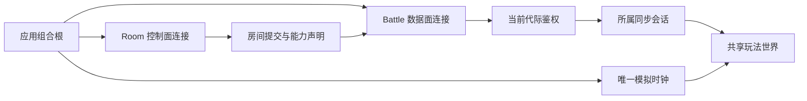
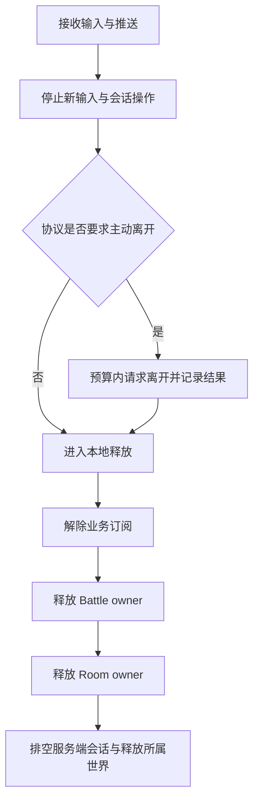

# 07 · 多人联网 SDK 接入指南

> 文档类型：跨包接入指南
> 事实基线：2026-11-25，当前仓库工作区源码；不是不可变发布 tag
> 核校状态：部分核校；本轮核对通用包的职责、双连接交接、鉴权、订阅、输入/下行和清理边界；业务世界与项目部署未全量重核
> 目标读者：为新玩法接入 Room/Battle、选择同步 Profile 并定义项目恢复契约的开发者

## 1. 目标、范围与前置条件

目标是形成可验证的连接、房间、战斗与恢复装配。通用 SDK 可复用连接生命周期、请求匹配、推送分发和会话组合；新项目仍须提供协议身份、业务 codec、服务端 handler、世界驱动、同步控制器和验收配置。连接成功、房间流程结束、请求成功回执与世界可恢复是不同交付条件，不能合并成一个“已进战斗”标志。

准备客户端/服务端匹配的版本与依赖、可用端点、登录方式，以及服务端实际支持的 gameplay/ruleset/config/protocol/world 身份。不要把教程示例字符串、RoomType 别名或历史默认模板作为新项目已注册的能力。包根 README 负责安装与第一步；API、默认值和失败行为以各包 `Documentation~/Usage.md` 为准，本文只持有跨包关系。

## 2. 职责、所有者与源码入口

| 层次 | 使用契约与源码入口 | 组合根必须明确的所有者 |
| --- | --- | --- |
| 协议定义 | [Protocol](../../../Unity/Packages/com.abilitykit.protocol/Documentation~/Usage.md)、[Room Protocol](../../../Unity/Packages/com.abilitykit.protocol.room/Documentation~/Usage.md)；仓库源为 [Room catalog](../../../Protocols/Catalogs/room.protocol.yaml) 与 [WireSchemas](../../../Protocols/WireSchemas/) | 消息身份、版本和生成结果的维护者；DTO 不拥有连接或世界 |
| 连接与 SDK | [Network Runtime](../../../Unity/Packages/com.abilitykit.network.runtime/Documentation~/Usage.md)、[SDK](../../../Unity/Packages/com.abilitykit.network.sdk/Documentation~/Usage.md) | 每条物理连接一个请求匹配链、Tick 来源、dispatcher 和唯一释放者 |
| Room 控制面 | [Room](../../../Unity/Packages/com.abilitykit.network.room/Documentation~/Usage.md) | 登录/建房/入房/恢复流程、阶段钩子、token 与 Room 会话 |
| Battle 数据面 | [Battle](../../../Unity/Packages/com.abilitykit.network.battle/Documentation~/Usage.md)、[Config](../../../Unity/Packages/com.abilitykit.network.battle.config/Documentation~/Usage.md) | 代际鉴权、输入 codec、推送订阅、业务恢复控制器 |
| 双连接组合 | [Client](../../../Unity/Packages/com.abilitykit.network.client/Documentation~/Usage.md) | Room/Battle 的交付、关闭顺序与单一订阅 owner |
| 玩法装配 | [Game Battle Runtime](../../../Unity/Packages/com.abilitykit.game.battle.runtime/Documentation~/Usage.md)、[Host](../../../Unity/Packages/com.abilitykit.host/Documentation~/Usage.md) | 阶段执行、系统创建、世界及唯一模拟时钟；计划/状态报告不自动执行 |
| 服务端 | [Network Host](../../../Unity/Packages/com.abilitykit.network.host/Documentation~/Usage.md)、[Host Network](../../../Unity/Packages/com.abilitykit.host.network/Documentation~/Usage.md) | listener、session、认证绑定、业务 handler、共享世界串行化与停止 |
| 可选 GameFramework 桥接 | [GameFramework Network](../../../Unity/Packages/com.abilitykit.gameframework.network/Documentation~/Usage.md) | 外部 manager 的 Update 与终止、wrapper 的独占 channel 和释放 |

推荐先按现有双连接组合建立职责，而不是复用同一 SDK 后让多个消费者争抢推送。底层允许的其他组合须显式验证订阅键、Tick 和所有权；不能凭“同一 endpoint”推断可共享。GameFramework factory 复用同名 channel 不验证 helper，wrapper 会覆盖 default handler；此外须额外满足 Network Runtime 依赖，并持续驱动 GameFramework Update，详见其包内契约。

## 3. 步骤一：固定协议与配置来源

先定义 catalog、方向、opcode、请求/响应或推送身份、codec 与 schema 范围，再编写业务消息。Room DTO 字节、NetworkFrameCodec 成帧和 gameplay payload 是不同层；不要把 DTO Serialize 的结果直接当完整 socket 帧，也不要按 opcode 一个字段猜测响应 DTO。

协议源及生成入口由[协议目录专题](11-ProtocolCatalogAndTrafficObservability.md)和[工具索引](../../../tools/README.md)维护；`compile-protocol-catalogs.ps1` 默认写回，`-Check` 才是只读核对。不要手工改 `Runtime/Generated/`，也不要在文档整理期间运行默认生成写回。Wire Schema、catalog revision、协商的消息版本与固定基线的内层投影版本互不代替。

配置按服务端支持范围创建 launch spec 与 Battle config，先设置匹配预设，再补业务 codec/身份映射。Config Build 返回同一可变 options，只有部分校验；Build 成功不证明所有 codec、opcode、ID 映射或恢复策略正确。运行后不要并发修改该对象。

预期结果：客户端与服务端能定位相同的消息定义和项目能力来源；每个生成物知道其源文件和重建入口。诊断 decoder 注册与业务 codec 覆盖分别验收。

## 4. 步骤二：完成 Room 流程并交接 Battle

Room 流程通过阶段与钩子组合登录、建房/加入/恢复、准备、选角、加载、开战和订阅；具体顺序、跳过规则及结果由当前 flow 决定，不按历史“固定八阶段”推断所有操作都发生。项目仍需在合适钩子加载资源、验证 manifest/能力、报告进度与处理失败，不能把 flow 当成资源加载器。

先决定 Room SDK 的来源、借用/拥有关系、dispatcher 与真实墙钟 Tick。默认 dispatcher 不保证回到 Unity 主线程；使用队列 dispatcher 时，宿主仍要持续泵送。网络墙钟用于心跳、等待与重连，不用暂停/加速后的模拟 delta 代替，也不由两个 owner 重复 Tick 同一 SDK。

使用 `MultiplayerClientSession` 时，从 Room 结果传递实际 roomId、battleId、token 与能力声明，`configureBattle` 回调的签名是 `(config, sessionResult)`；配置已预填连接来源和相关身份，回调只补业务契约，不另 Build 或换成另一场战斗身份。

若必须在初始推送到达前绑定接收器，采用分步挂接：

1. 完成 Room 会话并构造客户端组合，按[Client 使用指南](../../../Unity/Packages/com.abilitykit.network.client/Documentation~/Usage.md)的所有权规则交付。
2. 调用 `AttachBattle(configureBattle, connect: false)`，先注册状态/输入帧/可靠事件或 raw 接收路径，再显式 Connect。
3. 在当前代际鉴权和所属同步链初始恢复成功后放行输入与运行。

一站式 `EnterAsync` 返回前已经 Connect；返回后才订阅可能错过同步到达的初始事件。`attachBattle: true` 会跳过 Room 侧 SubscribeStateSync，Room 结果的 Subscribed=false 属预期。该 observerKey 的推送订阅归 Battle 数据面，不能随后由 Room 再订阅覆盖它。具体单双链路策略由服务端协议和组合决定，不由方法名推断同步模式。

预期结果：Room 身份与 Battle 身份一致，推送只有一个有效接收 owner，初始消息不依赖返回后“足够快地”订阅；取消或挂接失败已取得的本地资源有明确清理者。

## 5. 步骤三：鉴权、输入与下行

`ConnectionEstablished` 只表示传输建立，早于 RenewSession/PostAuthentication。等待当前连接代际的 `ConnectionAuthenticated`/IsAuthenticated；旧代际异步完成不能放行新代际。鉴权成功也不证明世界已恢复，Create/Join/Leave 等调用的应用门控另行安排。

输入发送方式与主同步模式独立：

| 选择 | 当前含义 | 不能据此推断 |
| --- | --- | --- |
| `SendInput` | void 接口；按是否配置响应 decoder 选择直接发送或内部请求响应路径 | 必然 fire-and-forget，或只供帧同步 |
| `SendInputAsync` | 要求输入序列化与回执反序列化，返回最终业务回执 | 只供状态同步，或服务器已应用到某个世界帧 |
| typed 下行 | 配置 frame/snapshot/reliable events decoder 和对应回调 | 已深复制、已导入世界或只有一种同步模式 |
| raw 下行 | 保留原始推送身份与 payload，由项目 apply 管线处理 | 自动关闭 typed 路由，或天然更安全/零分配 |

业务 raw apply 管线使用 `WithRawDownlinkOnly` 等现有入口清空 typed decoder，防止同包双重应用。raw 回调在 typed 分发前执行且异常可能阻止后者；typed 匹配按 frame→snapshot→reliable events 短路，避免 opcode 冲突。借用 payload 或复用 DTO 的嵌套数组要跨异步、跨帧持有时先复制，外层 struct 不是深快照。

输入预算包含鉴权等待和请求尝试时，使用明确的总 timeout/取消入口。配置允许且提供帧改写器时只对要求重试的回执最多重试一次，不是所有拒绝都自动重试。分别处理业务拒绝、TransportError、TransportTimeout、主动取消和回调异常，参数与默认值回查 Battle 使用指南。

预期结果：每次输入有清楚的接受/拒绝/超时含义；每类推送只有一条应用路线；回执、解码成功和业务状态提交分别可观测。

## 6. 步骤四：选择权威来源与恢复契约

主同步模式由服务端最终模板/Profile、能力声明及会话策略共同确定，不由 transport、typed/raw、void/Task 或是否携带快照决定。Room 能力绑定与 Profile 装配负责验证声明和控制器选择，不提供一个自动切换所有预测算法的通用 session engine。coordinator 的历史统一执行器不是当前可用能力，见[会话协调专题](05-SessionCoordination.md)。

| 维度 | 帧同步链 | 状态同步链 |
| --- | --- | --- |
| 权威来源 | 权威输入帧；按该链时钟推进 | 权威实体状态及快照基线 |
| 本地执行 | 按已定义顺序消费输入，可按项目契约预测 | 按项目契约插值/预测并接收权威纠正 |
| 恢复 | 验证检查点与历史，恢复完整帧末 N，再从 N+1 重演 | 验证 generation/基线，重建完整权威状态并成功导入后提交接收位置 |
| 状态推送 | 可附带，但不接管帧时钟 | 是状态接收的一部分，仍需验证重建与提交 |
| 单独不能证明恢复的信号 | 连接已重建、收到 FramePacket、可靠事件已确认 | 收到 snapshot、解码成功、full resync 请求已接受 |

固定步长、实体生命周期、移动与技能规则是共享世界能力；会话/宿主选择时钟、输入路线与恢复策略，不按同步模式复制玩法执行链，也不把某条链的协议游标或回滚策略塞入共享世界。共享能力发生实现变化时，必须分别验证两条真实调用路径；本轮只修文档，没有改变这些实现。

确定性要求按权威执行、预测重演、状态比较和跨端预算定义。稳定输入/系统顺序、时间和随机源、完整检查点与数值行为需要明确；“无堆分配”是性能要求，不是确定性的充分或必要定义。不能把状态同步概括成完全不需要重演一致性，也不能仅凭浮点类型就替项目完成跨端结论。

snapshot ID、可靠事件水位、帧同步确认帧、状态同步输入确认与连接 generation 属不同身份空间，不能互代。固定基线 codec 校验成功只说明信封可解析；持有正确基线、重建、导入和成功后提交由会话负责。详细算法与失败语义回查[预测与回滚专题](03.2-FrameStatePredictionRollback.md)、[FrameSync](../../../Unity/Packages/com.abilitykit.world.framesync/Documentation~/Usage.md)、[StateSync](../../../Unity/Packages/com.abilitykit.world.statesync/Documentation~/README.md)。

MOBA/Shooter 的默认模板、人数、快照节奏与表现策略属于项目，不在本文复制静态表。选型从[同步能力地图](00-SynchronizationCapabilityMap.md)进入对应专题，并核对当前服务端配置；地图历史章节也不是本轮全量部署证据。

## 7. 步骤五：接入服务端并设计停止

先选择已有 listener/host 入口，注册对应协议 handler 与会话认证，把 token/成员身份绑定到权威世界路由。单 session 请求串行不代表多个 session 对同一世界串行；共享世界调度、输入帧归属、反压和取消仍由宿主明确。

普通 FramePacket 传输与特定 Orleans 结算协议不互相替代。不能把从客户端收到的通用帧信封直接当作权威结算源，相关信任边界由[Host 扩展与 Battle 协议边界](17-HostExtensionBattleProtocolBoundaries.md)持有。所有排查只使用本仓库代码、本地生成数据与可控测试，不连接或解析外部来源网络数据。

图示为职责顺序，具体异常处理按 owner 的实际契约。Client Dispose 不代发 LeaveRoom；取消、本地释放或连接关闭都不撤销服务端已接受的副作用。Room/Battle 各自的部分清理失败要保留日志；不要假定重复 Dispose 一定重试。服务端网络停止也不自动销毁世界。GameFramework manager 仍由外部 owner 终止。

重连后重新建立当前代际认证、订阅及所属链的恢复资格；staged restore 标志只描述下一步，不自动恢复世界。RestoreFirst 的 fallback 不能代替业务对取消、重复入房或遗留成员的判断。

## 8. 验证、证据与排错

验收按层记录，不把底层成功升级成端到端通过：

| 范围 | 应检查的结果 | 证据边界 |
| --- | --- | --- |
| 协议本地往返 | 身份、长度、类型、版本、坏输入、临时缓冲区使用 | 本地 E3 不证明双方发布兼容 |
| 连接与会话 | 单一请求链、先订阅后建连、当前代际鉴权、关闭与失败清理 | fake/进程内测试不证明真实网络或弱网 |
| Room→Battle | 实际 room/battle/token、订阅 owner、加载/开战、取消 | 通用包测试不证明某项目世界可启动 |
| 两条同步链 | 各自权威来源、缺帧/缺基线、导入失败、不提前提交与重演 | 一条链通过不能替代另一条链 |
| 部署与发布 | 指定环境/日期/配置的 Smoke artifact、CI 实际 job 与阻断 | E4/E5 分别需要真实执行，不由文档日期或配置存在推断 |

2026-11-25 本批运行 `network-sdk` 的 Room 与 SDK 选定步骤，分别为 77/77 与 149/150；另运行 Battle Runtime 6/6 及 GameFramework fake-channel 消费者 1/1。SDK 失败仍是 Room movement-proof request/response 缺诊断 decoder，未修改 runtime/生成物或放宽断言。选定步骤不是完整 gate。

完整本地示例与静态检查、命令及日志位置统一见[D3 支撑批次记录](../../../plans/2026-11-24-DocumentationSystemInventory.md#11-d3-支撑契约与多人接入指南核校记录2026-11-25)。本轮未运行在线完整教程、双成员开战、Unity、浏览器、真实 Gateway、弱网/性能、跨端恢复、隔离安装、CI 或发布，不新增 E4/E5。

| 症状 | 优先检查 |
| --- | --- |
| 首个推送丢失或重复 | 是否先订阅再 Connect、Room 是否覆盖 Battle observer、raw/typed 是否重复 apply |
| 已连接却不能发送输入 | 当前代际是否鉴权、配置 codec 是否配齐、所属链是否完成恢复 |
| tick 正常但超时不前进 | 网络是否使用真实墙钟、dispatcher 是否泵送；GameFramework 是否另有 Update |
| 解码成功但世界错位 | 世界/session/generation、基线持有与重建、导入成功后才提交、确认空间是否混用 |
| 关闭后服务端仍有人/世界 | 是否需要显式 Leave、请求是否已接受、服务端世界 owner 是否执行释放 |

## 9. 历史入口与迁移

本文件保留原路径，取代 v3.1 的接入指导。旧文中的“固定八阶段”“十行完整进战斗”“Build 即完成配置”“FrameSync=typed/void、StateSync=raw/awaitable”“无分配即确定性”等表述不再作为现行契约。根 README 中的 API 正文已归位各包 Usage；旧 BattleTransport 设计保留为历史，当前接口使用 Game Battle Runtime 使用指南。

v3.1 的 SDK 96/96、Room 36/36 及旧多进程通过记录只属于其原日期和源码，不是 2026-11-25 重跑证据；本轮结果见第 8 节与批次记录。回退只按本批文档差异恢复，不据历史正文恢复退役代码。

文档类型：跨包接入指南 | 事实基线：2026-11-25 | 证据等级：源码 E0，已执行的局部 E3；未新增 E4/E5

*文档版本：v4.0 | 最后更新：2026-11-25*
