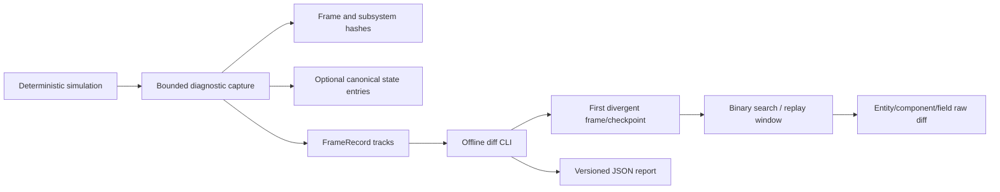

# 帧同步不一致诊断工具方案

> **文档类型：Canonical 方案与实现边界**  
> **适用对象：** 使用确定性定点数模拟的帧同步战斗，包括 MOBA 客户端、服务端和回放验证。  
> **当前基线：** FrameRecord v4、FrameRecordDiffAnalyzer report schema v2、AbilityKit.Record.Tools。

## 1. 目标

发生 desync 后，工程师需要在不依赖 Unity Editor 的环境中回答：

1. 两份运行记录第一次在哪个逻辑帧、哪个检查点分叉？
2. 分叉前后收到的输入、随机状态和模拟状态是什么？
3. 哪个实体、组件、字段的值首先不同？定点数差异必须能查看 raw long，不能只看 float 视图。
4. 同一份记录能否在另一个构建、运行时或平台重放，并生成可归档、可比较的诊断报告？

诊断应是可选观测能力。生产帧循环只做有界哈希/快照采集，不做反射、JSON 格式化、磁盘 IO 或跨线程等待。网络同步协议不携带完整诊断快照。

## 2. 当前能力与边界

仓库已有 `FrameRecord` 的 inputs、state-hash、snapshot 三条轨道，`FrameRecordDiffAnalyzer` 按 `(frame, ordinal)` 找到首个哈希分歧並提取相邻帧上下文；`AbilityKit.Record.Tools diff` 输出 JSON 並以 `0/1/2` 表示一致/分歧/工具错误。MOBA `MobaReplayValidator` 能按 Actor 比较位置、旋转、HP、速度和队伍字段。

当前哈希只有 32 位，碰撞可能性不适合作为逐字段证据；FrameRecord 的 snapshot payload 由 OpCode 对应领域 codec 解释，通用 analyzer 只输出其大小和 SHA-256，不能从任意二进制 payload 推断字段名称。MOBA replay validator 的视图快照也不等同于全量模拟态，float 视图会丢失定点 raw 的低位。因此现有工具能定位“首个不同检查点/帧”，字段级根因需要新的结构化诊断轨道。

## 3. 方案结构



### 3.1 分层检查点

第一层以低成本逐帧记录 world hash。第二层在发生差异后按需记录 subsystem hash，建议按固定顺序：输入消费、随机数、技能/触发器、属性/效果、运动/碰撞、实体生命周期。第三层只在复现模式或选定帧输出结构化状态条目。哈希用于筛查和二分定位，不能替代状态值证据。

每个检查点使用稳定键 `(frame, phaseId, subsystemId, entityId, componentId, fieldId)`。标识使用固定数值 ID 或注册表生成的稳定 ID，不使用运行时类型名、对象地址、字典迭代顺序或本地化文本。遍历排序规则是协议的一部分。

### 3.2 Canonical state entry

诊断状态条目 v1 至少包含：

| 字段 | 约束 |
|---|---|
| `schemaVersion` | 诊断 schema 版本；未知版本必须拒绝或显式降级 |
| `frame` / `phaseId` | 逻辑帧和固定模拟阶段 |
| `entityId` / `componentId` / `fieldId` | 稳定数值标识 |
| `valueKind` | `signed`、`unsigned`、`fixedRaw`、`bool`、`enum`、`bytes` |
| `rawValue` | 十进制整数文本或有定义字节序的 bytes；`fixedRaw` 必须保存 Q32.32 原始 long |
| `displayValue` | 可选，仅供人读；不参与一致性判断 |

数值格式必须避免 JSON 数字对 64 位整数精度的损失，因此 `rawValue` 使用十进制字符串。字段注册表提供 `componentId/fieldId` 到名称、类型、单位、定点格式的离线映射。实体缺失、组件缺失、字段缺失与字段值变化是不同的差异类型。

### 3.3 报告

报告沿用当前 report schema 版本演进策略，输出左右记录的构建/平台/运行时/配置摘要、输入差异、共同帧区间、首个 world/subsystem/entity/component/field 差异、raw 值、可读值、哈希版本和相邻上下文。报告中只记录必要的输入摘要；原始输入与快照留在记录文件，避免报告复制敏感 payload。

## 4. 采集与性能约束

- 默认生产模式只采集每帧 world hash；hash 算法和版本必须显式记录。
- 诊断等级可配置为 `off / frame / subsystem / state`。`state` 仅用于复现、测试或受控灰度。
- 每帧采集有最大条目数和最大字节数；超限必须在记录元数据中标记截断，不得静默形成“无差异”结论。
- 快照生成在明确的模拟阶段边界执行，字段顺序稳定；不在字段 getter 中触发计算或变更状态。
- 分析和 pretty JSON 写盘在离线工具进程完成。运行时记录器只负责有界缓存及已有 FrameRecord writer 接口。
- 定点字段比较严格比较 raw long。float 展示允许作为辅助，但不允许容差掩盖 lockstep 差异。

## 5. 排查工作流

1. 服务端/客户端或两个构建在相同 match seed、配置摘要和输入流下生成 FrameRecord。
2. 运行 `AbilityKit.Record.Tools diff left right --context 8 --output desync-report.json --indented`，先确认首个不同帧、hash 版本、输入窗口和快照是否齐全。
3. 若只有 world hash 差异，用同一输入流做确定性重放；以二分帧或 subsystem hash 缩小首个分歧区间。
4. 对目标区间启用 state 级采集，再次重放并输出 entity/component/field raw diff。
5. 根据第一个阶段/字段差异回查输入排序、随机调用顺序、系统执行顺序、配置/代码版本、定点边界转换和未纳入回滚的状态。
6. 将输入记录、双方诊断记录、report、commit/build/config 摘要作为缺陷证据归档，并转成固定 seed 回归用例。

记录缺失 state hash 时，工具必须返回 `NoComparableStateHashes`，不能将其报告为一致。WorldId 不同则停止内容比较并报告元信息不匹配。

## 6. 分阶段交付

### M0：可用的录制对账

已具备：FrameRecord inputs/hash/snapshot 轨道，首个哈希差异分析、上下文 JSON、CLI 和退出码。CLI 使用 `FrameRecordCodecs.Current` 读取 `.bin` 与 JSON 录制。M0 用于确认同步故障发生的首帧以及比较两份已有记录。

### M1：可解释的 MOBA 状态

**已落地通用比较内核与 `state-diff` CLI**：canonical state v1 按稳定数值键比较，并报告 raw 值、结构增删、重复键、非法数值、schema/world 不匹配及有界差异列表。`fixedRaw`、signed、enum 使用十进制整数文本解析校验，64 位原值不经过 JSON number，因此不会丢精度。示例：

```powershell
dotnet run --project src/AbilityKit.Record.Tools -- state-diff left.state.json right.state.json --max-differences 64 --output desync-state-report.json --indented
```

当前输入由 `CanonicalStateFile`/`CanonicalStateEntry` 表示，`state-diff` 输出首个差异和最多 N 条差异；输入兼容 camelCase/PascalCase 属性名和枚举字符串，报告保留左右 `buildId/configHash` 摘要；退出码仍为 `0=Identical`、`1=Diverged/不可比较`、`2=usage/IO/格式错误`。此批还没有将 MOBA runtime 字段映射到 canonical entry，也没有将该轨道嵌入 FrameRecord 文件。

后续接入稳定字段注册表和 MOBA 模拟态诊断快照生产者；先覆盖 actor 生命周期、transform/motion raw、HP/resource raw、skill/buff runtime 与 RNG 状态。不得直接复用仅含 float 的表现层 `MobaWorldSnapshotPayload` 作为完整状态证明。

M1 runtime coverage now includes the explicit `MobaCanonicalStateExporter` entry point. It captures stable actor ordering, transform float bit patterns, and resource `Fixed64` raw values plus `AttributeId.RawId`, with world/build/config metadata. The exporter is intentionally called by diagnostic or replay code; per-frame scheduling, FrameRecord persistence, skill/buff runtime state, RNG state, and automatic upload remain future work.

### M2：缩短复现定位时间

实现 subsystem checkpoint 与区间重放/二分工具；支持按首个分歧帧窗口重新导出 state 级诊断数据。扩展 CI determinism gate，固定种子重放比较 hash 与 canonical state。

### M3：编辑器与线上证据

按需提供 Unity Editor 报告查看器和服务端受控采样配置。线上默认关闭字段级 payload；开启时必须限制采样窗口、大小、保留时间与访问范围。Editor 只是 report viewer，不拥有另一套比较逻辑。

## 7. 验收标准

- 同一输入、seed、配置和构建重复运行，逐帧 hash 与 canonical state 完全一致。
- 修改指定实体的一个 `fixedRaw` 字段，报告定位到正确 frame/entity/component/field，并保留左右原始 long。
- 新增/删除实体或组件能作为结构差异报告；轨道缺失和 schema 不兼容不得误报为 clean。
- JSON 与 optimized binary 录制输入都能由 CLI 分析；退出码稳定为 `0=Identical`、`1=Diverged/不可比较`、`2=usage/IO/格式错误`。
- 生产默认采集不执行反射、格式化和磁盘 IO；所有额外内存/字节预算有显式上限和截断标记。
- CI 至少有同 seed 重放、单字段 raw 注入差异、缺失 hash、结构变化、损坏记录和 CLI JSON 输出覆盖。

## 8. 明确不做的事

- 不把诊断状态同步到对端，也不改变战斗协议或同步权威模型。
- 不声称 32 位状态 hash 可以解释字段差异或绝对避免碰撞。
- 不从 opaque snapshot bytes 猜测 C# 字段布局。
- 不以容差比较定点模拟状态；若比较表现层 float，应使用单独且显式标注的 validator。
