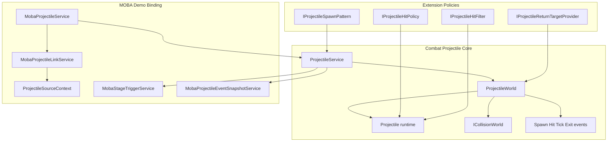
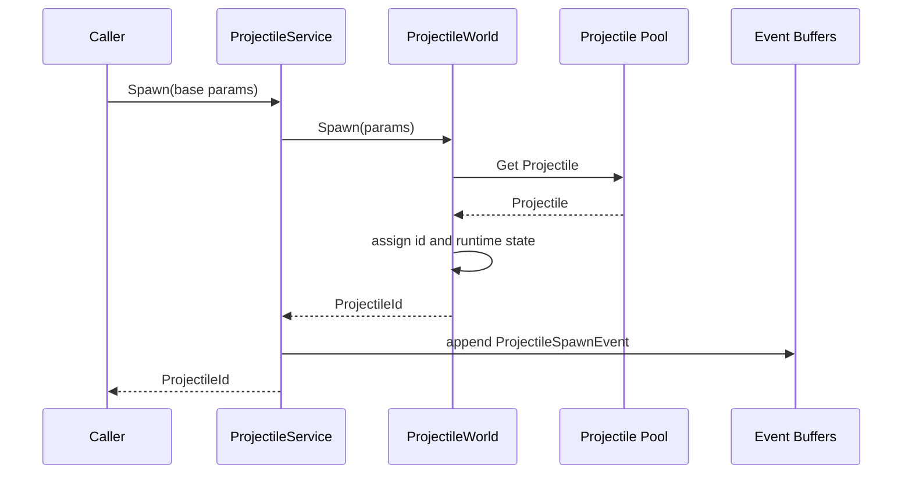
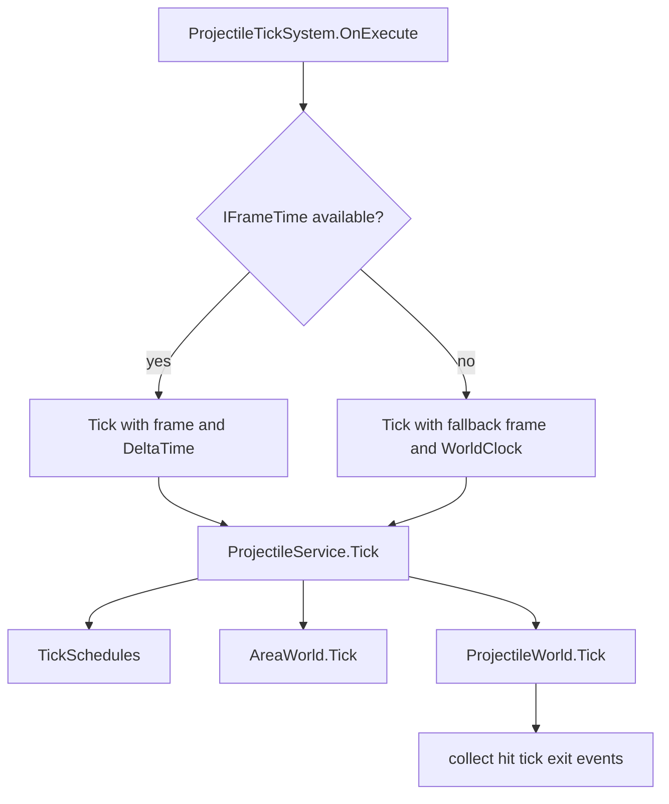
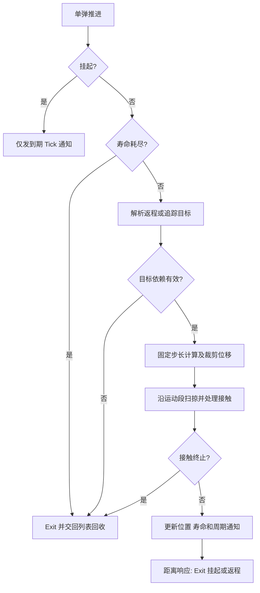
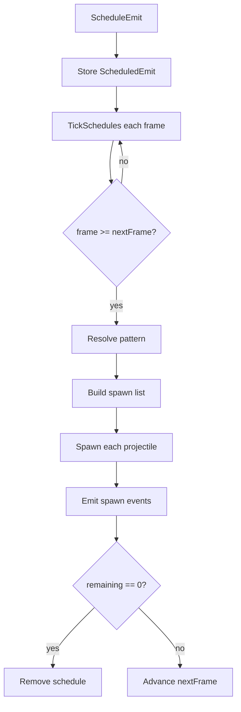
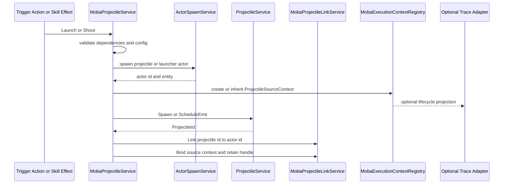
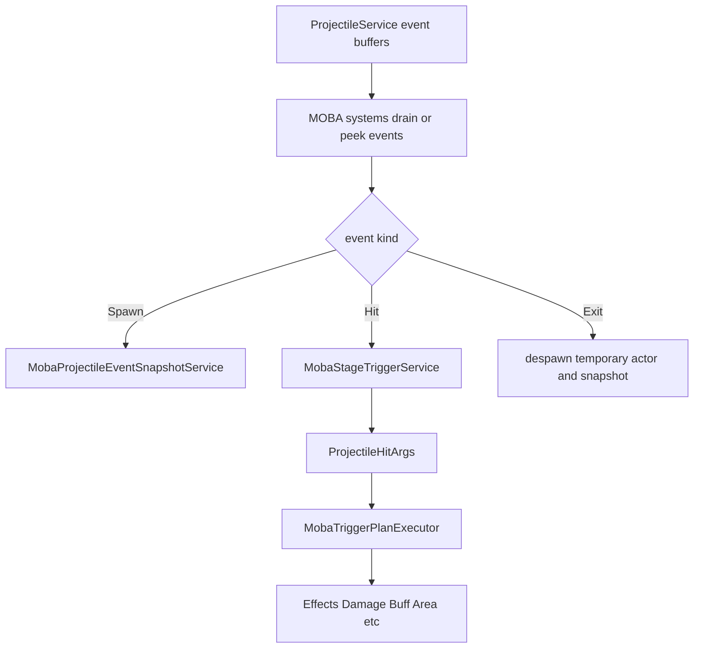

# 8.4 投射物系统

> 文档类型：Canonical 设计（Projectile 跨模块边界）
> 事实基线：2026-11-25，当前工作区 Runtime（含单弹推进/碰撞拆分）
> 核校状态：限定核校公共服务的时钟、通知、调度、清理与恢复；MOBA 绑定及历史批准范围不作新验收
> 文档版本：v3.1
>
> 本文从源码出发说明 AbilityKit 中投射物能力的真实边界：它不是“发射一个飞行物”这么简单，而是由 [`ProjectileWorld`](../../../Unity/Packages/com.abilitykit.combat.projectile/Runtime/Projectile/Runtime/ProjectileWorld.cs#L16) 负责的投射物运行时、[`ProjectileService`](../../../Unity/Packages/com.abilitykit.combat.projectile/Runtime/Projectile/Services/ProjectileService.cs#L11) 负责的调度与事件编排、以及 Demo 层的 MOBA 绑定服务共同组成的一套可回滚、可追踪、可扩展的战斗子系统。

---

## 目录

- [8.4 投射物系统](#84-投射物系统)
  - [目录](#目录)
  - [1. 能力定位](#1-能力定位)
    - [1.1 职责归属与接入边界](#11-职责归属与接入边界)
  - [2. 源码入口](#2-源码入口)
  - [3. 设计总览](#3-设计总览)
  - [4. 核心数据模型](#4-核心数据模型)
    - [4.1 `ProjectileSpawnParams`](#41-projectilespawnparams)
    - [4.2 `Projectile`](#42-projectile)
  - [5. 生命周期主线](#5-生命周期主线)
    - [5.1 创建与调度](#51-创建与调度)
    - [5.2 每帧推进](#52-每帧推进)
    - [5.3 单个投射物推进](#53-单个投射物推进)
  - [6. 命中、穿透与过滤](#6-命中穿透与过滤)
  - [7. 发射调度与散射模式](#7-发射调度与散射模式)
  - [8. 回滚与快照](#8-回滚与快照)
  - [9. MOBA 示例协作](#9-moba-示例协作)
    - [9.1 发射流程](#91-发射流程)
    - [9.2 事件转译](#92-事件转译)
  - [10. 扩展点与约束](#10-扩展点与约束)
  - [11. 证据与关联文档](#11-证据与关联文档)
    - [11.1 证据状态与已知限制](#111-证据状态与已知限制)

---

## 1. 能力定位

投射物系统解决的是“战斗中存在一类具有飞行、命中、持续、穿透、回收、结束原因和回滚要求的临时实体”这一问题。

它的职责不是把伤害公式塞进飞行物里，而是提供稳定的投射物执行底座：

- 统一创建、移动、命中、结束、销毁流程。
- 提供碰撞过滤、命中策略、冷却策略、回收策略。
- 提供每帧事件输出，供上层系统转译成表现、触发器或状态同步事件。
- 支持回滚快照，便于确定性模拟和重演。
- 允许 Demo 层在不改底层模块的前提下，挂接角色、来源上下文、技能运行时和触发器协作。

底层核心是 [`ProjectileWorld`](../../../Unity/Packages/com.abilitykit.combat.projectile/Runtime/Projectile/Runtime/ProjectileWorld.cs#L16)，面向外部的统一入口是 [`ProjectileService`](../../../Unity/Packages/com.abilitykit.combat.projectile/Runtime/Projectile/Services/ProjectileService.cs#L11)。

### 1.1 职责归属与接入边界

| 层级 | 稳定职责 | 项目策略 |
|------|----------|----------|
| Projectile 框架 | 生成与调度、运动推进、碰撞候选、命中过滤/策略、生命周期事件和核心快照 | 不解释阵营、技能效果、Actor、表现、权威同步或来源上下文 |
| 项目应用层 | 碰撞世界与目标过滤、命中效果、Actor 投影、事件消费顺序、附加绑定快照及恢复 | 必须定义 drain 所有权、确定性输入和回滚完整性 |
| MOBA 示例 | `MobaProjectileService`、链接服务、Trace/runtime retain、Trigger 转译和协议快照 | 证明一种完整接法，不是公共包默认事件总线或实体模型 |

只有运动、命中与生命周期这类跨项目语义稳定的部分进入框架。伤害、Buff、阵营与表现始终通过事件由项目接管，从而避免投射物包成为新的战斗应用层。

---

安装、完整发射示例与操作契约见[包内指南](../../../Unity/Packages/com.abilitykit.combat.projectile/Documentation~/Usage.md)。本文维护碰撞、世界驱动、投射物、业务绑定及恢复之间的责任边界。

## 2. 源码入口

| 角色 | 类型 | 源码 |
|------|------|------|
| 单弹帧状态 | `ProjectileWorld.TickProjectile` | [ProjectileWorld.TickProcessing.cs](../../../Unity/Packages/com.abilitykit.combat.projectile/Runtime/Projectile/Runtime/ProjectileWorld.TickProcessing.cs) |
| 碰撞接触处理 | `ProjectileWorld.SweepProjectile` | [ProjectileWorld.Collision.cs](../../../Unity/Packages/com.abilitykit.combat.projectile/Runtime/Projectile/Runtime/ProjectileWorld.Collision.cs) |
| 服务级恢复 | `ProjectileService` partial | [ProjectileService.Rollback.cs](../../../Unity/Packages/com.abilitykit.combat.projectile/Runtime/Projectile/Services/ProjectileService.Rollback.cs) |
| 投射物运行时 | `ProjectileWorld` | [`ProjectileWorld.cs`](../../../Unity/Packages/com.abilitykit.combat.projectile/Runtime/Projectile/Runtime/ProjectileWorld.cs#L16) |
| 对外服务 | `ProjectileService` | [`ProjectileService.cs`](../../../Unity/Packages/com.abilitykit.combat.projectile/Runtime/Projectile/Services/ProjectileService.cs#L11) |
| 投射物实体 | `Projectile` | [`Projectile.cs`](../../../Unity/Packages/com.abilitykit.combat.projectile/Runtime/Projectile/Runtime/Projectile.cs#L6) |
| 生成参数 | `ProjectileSpawnParams` | [`ProjectileSpawnParams.cs`](../../../Unity/Packages/com.abilitykit.combat.projectile/Runtime/Projectile/Runtime/ProjectileSpawnParams.cs#L11) |
| 生命周期事件 | `ProjectileSpawnEvent`、`ProjectileHitEvent`、`ProjectileExitEvent`、`ProjectileTickEvent` | [`ProjectileEvents.cs`](../../../Unity/Packages/com.abilitykit.combat.projectile/Runtime/Projectile/Runtime/ProjectileEvents.cs#L5) |
| 命中策略 | `IProjectileHitPolicy` | [`IProjectileHitPolicy.cs`](../../../Unity/Packages/com.abilitykit.combat.projectile/Runtime/Projectile/Policies/IProjectileHitPolicy.cs#L3) |
| 命中过滤 | `IProjectileHitFilter` | [`IProjectileHitFilter.cs`](../../../Unity/Packages/com.abilitykit.combat.projectile/Runtime/Projectile/Filters/IProjectileHitFilter.cs#L5) |
| Tick 入口 | `ProjectileTickSystem` | [`ProjectileTickSystem.cs`](../../../Unity/Packages/com.abilitykit.combat.projectile/Runtime/Projectile/Systems/ProjectileTickSystem.cs#L9) |
| MOBA 发射服务 | `MobaProjectileService` | [`MobaProjectileService.cs`](../../../Unity/Packages/com.abilitykit.demo.moba.runtime/Runtime/Application/Services/Projectile/MobaProjectileService.cs#L22) |
| MOBA 来源上下文 | `ProjectileSourceContext` | [`ProjectileSourceContext.cs`](../../../Unity/Packages/com.abilitykit.demo.moba.runtime/Runtime/Application/Services/Projectile/ProjectileSourceContext.cs#L6) |
| MOBA 链接服务 | `MobaProjectileLinkService` | [`MobaProjectileLinkService.cs`](../../../Unity/Packages/com.abilitykit.demo.moba.runtime/Runtime/Application/Services/Projectile/MobaProjectileLinkService.cs#L10) |
| MOBA 事件快照 | `MobaProjectileEventSnapshotService` | [`MobaProjectileEventSnapshotService.cs`](../../../Unity/Packages/com.abilitykit.demo.moba.runtime/Runtime/Application/Services/Projectile/MobaProjectileEventSnapshotService.cs#L13) |

---

## 3. 设计总览

投射物能力分成四层：

1. **运行时内核**：[`ProjectileWorld`](../../../Unity/Packages/com.abilitykit.combat.projectile/Runtime/Projectile/Runtime/ProjectileWorld.cs#L16) 持有对象池、活动列表和碰撞世界引用，负责推进每个投射物。
2. **服务编排层**：[`ProjectileService`](../../../Unity/Packages/com.abilitykit.combat.projectile/Runtime/Projectile/Services/ProjectileService.cs#L11) 负责对外 API、发射调度、事件收集、区域协同和回滚接口。
3. **系统驱动层**：[`ProjectileTickSystem`](../../../Unity/Packages/com.abilitykit.combat.projectile/Runtime/Projectile/Systems/ProjectileTickSystem.cs#L9) 将投射物推进挂接到逻辑世界执行序列中。
4. **Demo 绑定层**：MOBA 场景通过 [`MobaProjectileService`](../../../Unity/Packages/com.abilitykit.demo.moba.runtime/Runtime/Application/Services/Projectile/MobaProjectileService.cs#L22)、[`MobaProjectileLinkService`](../../../Unity/Packages/com.abilitykit.demo.moba.runtime/Runtime/Application/Services/Projectile/MobaProjectileLinkService.cs#L10) 和 [`MobaProjectileEventSnapshotService`](../../../Unity/Packages/com.abilitykit.demo.moba.runtime/Runtime/Application/Services/Projectile/MobaProjectileEventSnapshotService.cs#L13) 把投射物纳入技能、表现、溯源与同步体系。

---

## 4. 核心数据模型

### 4.1 `ProjectileSpawnParams`

[`ProjectileSpawnParams`](../../../Unity/Packages/com.abilitykit.combat.projectile/Runtime/Projectile/Runtime/ProjectileSpawnParams.cs#L11) 是投射物创建时的完整输入，包含：

| 字段组 | 代表字段 | 说明 |
|--------|----------|------|
| 归属关系 | `OwnerId`、`TemplateId`、`LauncherActorId`、`RootActorId` | 用于区分投射物所有者、配置模板、发射器实体和根角色 |
| 时空状态 | `SpawnFrame`、`Position`、`Direction`、`Speed` | 决定初始帧、初始位置、方向和速度 |
| 回收逻辑 | `ReturnAfterFrames`、`ReturnSpeed`、`ReturnStopDistance` | 支持飞出后回到发射器或来源点 |
| 生命周期 | `LifetimeFrames`、`MaxDistance` | 限制最大存在帧数和最大飞行距离 |
| 碰撞 | `CollisionLayerMask`、`IgnoreCollider` | 限定碰撞层并跳过自身碰撞体 |
| 命中策略 | `HitPolicy`、`HitsRemaining`、`HitPolicyKind`、`HitPolicyParam` | 控制命中后退出或穿透 |
| 周期事件 | `TickIntervalFrames` | 让投射物在飞行中周期性产生 tick 事件 |
| 过滤与冷却 | `HitFilter`、`HitCooldownFrames` | 控制阵营过滤、重复命中冷却等规则 |

源码还提供 [`ProjectileSpawnParams.WithDirection()`](../../../Unity/Packages/com.abilitykit.combat.projectile/Runtime/Projectile/Runtime/ProjectileSpawnParams.cs#L96) 与 [`ProjectileSpawnParams.WithSpawnFrame()`](../../../Unity/Packages/com.abilitykit.combat.projectile/Runtime/Projectile/Runtime/ProjectileSpawnParams.cs#L123)，用于发射模式构造多个方向或调度帧。

### 4.2 `Projectile`

[`Projectile`](../../../Unity/Packages/com.abilitykit.combat.projectile/Runtime/Projectile/Runtime/Projectile.cs#L6) 是内部运行时对象，不对外暴露。它实现对象池接口，保存当前帧需要推进的全部状态：位置、方向、速度、剩余帧、剩余距离、命中次数、命中冷却、回收状态、命中策略等。

这个设计把“配置输入”和“运行时可变状态”分开：外部只提交不可变生成参数，内部再把它转成可 tick 的投射物对象。

---

## 5. 生命周期主线

### 5.1 创建与调度

投射物可以通过两条路径创建：

1. 直接调用 [`ProjectileService.Spawn()`](../../../Unity/Packages/com.abilitykit.combat.projectile/Runtime/Projectile/Services/ProjectileService.cs#L56)。
2. 通过 [`ProjectileService.ScheduleEmit()`](../../../Unity/Packages/com.abilitykit.combat.projectile/Runtime/Projectile/Services/ProjectileService.cs#L97) 以模式和计划延迟或重复发射。

Spawn 的通知帧固定为 0，参数 SpawnFrame 仍进入物理状态；需要记录实际发射帧时用 ScheduleEmit，由到期 Tick 写入当前帧。取消任务只阻止未来生成，不删除已发射对象。

### 5.2 每帧推进

[`ProjectileTickSystem`](../../../Unity/Packages/com.abilitykit.combat.projectile/Runtime/Projectile/Systems/ProjectileTickSystem.cs#L25) 每帧调用 [`ProjectileService.Tick()`](../../../Unity/Packages/com.abilitykit.combat.projectile/Runtime/Projectile/Services/ProjectileService.cs#L67)。服务层先推进发射计划和区域，再推进投射物世界。

宿主必须保证 Tick 的唯一驱动者。ProjectileWorldModule 仅注册服务；ProjectileSystemsModule 会另安装 TickSystem，与自动发现不能重复安装。TickSystem 优先使用 IFrameTime；fallback 的本地递增帧不是已纳入恢复的权威时钟。服务固定依次执行 schedules、Area、Projectile；业务消费通知后创建的 Area 等到下一次正常物理帧检测，不补跑本帧。

### 5.3 单个投射物推进

活动列表遍历与对象池回收仍由 ProjectileWorld.Tick 负责，单弹状态在 TickProcessing partial，接触循环在 Collision partial。该拆分不增加时钟或业务入口。

挂起时不消耗寿命；到达目标挂起发一次 Arrival，保留对象且不能 Resume。非正位移分支消耗寿命但不执行移动后的周期通知。位移按剩余距离/返程目标裁剪，追踪弧线以分段扫掠处理。各分支以当前源码为准，不把旧的单一 Raycast 示意当作所有轨迹的行为。

---

## 6. 命中、穿透与过滤

碰撞世界负责几何候选，Projectile 负责接触身份和生命周期，业务 filter/provider 负责阵营资格、Actor 映射及确定性目标选择。当前实现分层如下：

| 层级 | 入口与职责 |
| --- | --- |
| 几何扫掠 | [ProjectileCollisionQueries](../../../Unity/Packages/com.abilitykit.combat.projectile/Runtime/Projectile/Runtime/ProjectileCollisionQueries.cs)，按运动段及碰撞半尺寸查询，忽略自身/本步已处理 Collider |
| 分类响应 | IProjectileCollisionResponseResolver 返回 Ignore/Hit/Block/SupportContact/HitAndContinue/HitAndStop；未提供时使用 IProjectileHitFilter |
| 身份与冷却 | Collider、OncePerActor、OncePerActorPerLeg；Actor 策略需要身份 provider，不从 ColliderId 猜 ActorId |
| 命中策略 | ExitOnHit、Pierce、Bounce；Bounce 需稳定目标选择及追踪依赖，不能仅凭枚举名完成接入 |

Block 退出且无普通 Hit；Ignore 跳过。HitAndContinue / HitAndStop 走已接纳命中语义，分别跳过策略预算继续或强制退出；SupportContact 不能被上层直接当作伤害资格。旧 Hit 继续委托命中策略。业务内容的合法组合以既有领域批准和发布校验为准，不借文档整理扩大范围。

单步最多处理 8 次接触扫描，并记录本步 Collider，避免重复接触或无限循环；不等同于无限密度穿透保证。碰撞包的 Grid 容量、32 位掩码及几何近似限制也会传递到本包，见[碰撞设计](../13-FrameworkCore/01-CollisionSystemDesign.md)。

---

## 7. 发射调度与散射模式

[`ProjectileService`](../../../Unity/Packages/com.abilitykit.combat.projectile/Runtime/Projectile/Services/ProjectileService.cs#L11) 不只支持单发创建，还支持 schedule：

发射模式由 [`IProjectileSpawnPattern`](../../../Unity/Packages/com.abilitykit.combat.projectile/Runtime/Projectile/Patterns/IProjectileSpawnPattern.cs#L5) 构建多个 [`ProjectileSpawnParams`](../../../Unity/Packages/com.abilitykit.combat.projectile/Runtime/Projectile/Runtime/ProjectileSpawnParams.cs#L11)。内置模式包括单发、连发、扇形、散射等。MOBA 层还通过 [`MobaModifierProjectileSpawnPatternProvider`](../../../Unity/Packages/com.abilitykit.demo.moba.runtime/Runtime/Application/Services/Projectile/Launch/MobaModifierProjectileSpawnPatternProvider.cs#L5) 在发射时读取技能参数修饰器，动态改变每次发射数量和扇形角度。

---

调度迟到时，每个任务每次 Tick 最多发一批，下一帧游标基于本次 frame + interval；不会补发错过的全部批次。PatternProvider 返回 null 时保留任务。模式/Provider 实例作为引用保留，回调异常会向外传播，已生成对象不自动补偿。

## 8. 回滚与快照

普通世界可不启用回滚。启用时必须区分公共服务状态和宿主业务状态，不能从类名或单个子载荷推定整个世界可恢复。

| 载荷 | 当前范围与版本 |
| --- | --- |
| ProjectileWorld | 当前子载荷 18：活动弹体、分配器、定点状态、冷却/命中历史、返程/到达与过滤描述 |
| AreaWorld | 当前导出子载荷 5：区域、重叠和边界采样、组资格、分配器 |
| ProjectileService | envelope 2：组合上述两项及未来任务名单、次序、游标、模式/过滤描述、NextScheduleId |
| 服务临时通知 | 不捕获；成功 Import 清空十类队列，不补 Spawn/Hit/Enter 等历史通知 |
| 宿主依赖 | 碰撞世界、目标及身份 provider、世界随机流、Actor/Cast/来源绑定、技能 retain、伤害与表现不由公共包自动恢复 |

内建 SingleShot/Burst/Fan/Scatter 使用值描述；自定义模式/Provider 需快照描述及 IProjectileSchedulePatternResolver。计划发射显式 HitPolicy 实例不能导出，应使用可恢复的 kind/param。自定义过滤器按稳定 key 或值描述绑定当地服务，缺依赖明确失败，不能降级默认过滤。

非空服务载荷只接受 envelope 2 并验证帧、名单、allocator 及依赖；null/空导入维持静默清空语义。预检不承诺任意外部 resolver 副作用或跨 Provider 事务；恢复失败由宿主收敛。ProjectileRollbackProvider 适配可选恢复端口，不决定主同步模式：帧同步仍按权威输入与检查点重演，状态同步按权威基线重建/导入，两者游标不得互换。

通知由唯一 drain 者消费后分发；Drain 向调用方 List 追加，Peek 不消费。Dispose 只清通知和任务，不移除活动弹体/区域；结束前应显式删除或空载荷静默清空，再释放项目引用。上述公共行为不代表业务绑定、外部效果和表现消费也已恢复。

---

## 9. MOBA 示例协作

MOBA 示例没有直接把“技能命中”和“投射物命中”写死在核心投射物模块里，而是做了一层业务绑定。

### 9.1 发射流程

[`MobaProjectileService`](../../../Unity/Packages/com.abilitykit.demo.moba.runtime/Runtime/Application/Services/Projectile/MobaProjectileService.cs#L22) 在发射时会：

1. 校验投射物服务、角色注册表、实体管理器、Actor 生成服务等依赖。
2. 创建投射物 Actor 或发射器 Actor。
3. 将配置转换为 [`ProjectileSpawnParams`](../../../Unity/Packages/com.abilitykit.combat.projectile/Runtime/Projectile/Runtime/ProjectileSpawnParams.cs#L11)。
4. 选择发射模式并提交给 [`ProjectileService`](../../../Unity/Packages/com.abilitykit.combat.projectile/Runtime/Projectile/Services/ProjectileService.cs#L11)。
5. 通过 [`MobaProjectileLinkService`](../../../Unity/Packages/com.abilitykit.demo.moba.runtime/Runtime/Application/Services/Projectile/MobaProjectileLinkService.cs#L10) 绑定 `ProjectileId` 与 ActorId。
6. 绑定 [`ProjectileSourceContext`](../../../Unity/Packages/com.abilitykit.demo.moba.runtime/Runtime/Application/Services/Projectile/ProjectileSourceContext.cs#L6)，保留来源、根上下文和技能运行时引用。

### 9.2 事件转译

底层产生的投射物事件会被 MOBA 层消费：

- [`ProjectileSpawnEvent`](../../../Unity/Packages/com.abilitykit.combat.projectile/Runtime/Projectile/Runtime/ProjectileEvents.cs#L5)：用于表现和网络事件。
- [`ProjectileHitEvent`](../../../Unity/Packages/com.abilitykit.combat.projectile/Runtime/Projectile/Runtime/ProjectileEvents.cs#L51)：转换为 `ProjectileHitArgs`，再进入 Triggering/Effect 执行链。
- [`ProjectileExitEvent`](../../../Unity/Packages/com.abilitykit.combat.projectile/Runtime/Projectile/Runtime/ProjectileEvents.cs#L82)：驱动临时 Actor 清理、表现退出和快照输出。

[`MobaProjectileEventSnapshotService`](../../../Unity/Packages/com.abilitykit.demo.moba.runtime/Runtime/Application/Services/Projectile/MobaProjectileEventSnapshotService.cs#L13) 会把底层 spawn/hit/exit 事件转换成 MOBA 协议快照，让客户端表现层以事件方式还原投射物生命周期。

---

## 10. 扩展点与约束

| 扩展点 | 用法 | 约束 |
|--------|------|------|
| `IProjectileSpawnPattern` | 自定义单次发射产生几个投射物、方向如何分布 | 需要保持确定性，避免依赖非确定随机 |
| `IProjectileSpawnPatternProvider` | 每次调度时动态生成 pattern | 可读取修饰器，但要保证同一帧输入一致 |
| `IProjectileHitFilter` | 阵营过滤、友军过滤、不可命中过滤 | 不应直接造成副作用，只返回是否命中 |
| `IProjectileHitFilterResolver` | 回滚时按稳定 key 重建过滤器实例 | 旧过滤器沿用 key 契约；无法解析时必须显式失败 |
| `IProjectileHitFilterSnapshotSource` / `IProjectileHitFilterSnapshotResolver` | 保存过滤器的值描述，恢复时绑定目标世界服务 | 只序列化版本化值数据，不保存 registry 或旧世界引用；缺失 resolver 显式失败 |
| `IProjectileHitPolicy` | 命中即消失、穿透、多段命中 | 通过 `hitsRemaining` 保持状态可序列化 |
| `IProjectileReturnTargetProvider` | 回旋镖、返回发射器、返回角色 | 返回目标丢失时会触发 `ReturnTargetLost` 退出 |
| 事件 drain/peek | 表现层、触发器、快照系统消费事件 | drain 会清空缓冲，需要明确消费顺序 |
| Rollback import/export | 帧同步、预测、回滚 | 业务层附加绑定不由底层自动恢复 |

投射物系统的核心约束是：底层只关心“运动 + 碰撞 + 生命周期事件”，业务层效果必须通过事件转译进入 Triggering、Damage、Buff 或表现系统。这样可以避免底层模块反向依赖 MOBA 规则，也让同一投射物内核可用于不同玩法。

### 10.1 可配置拦截响应（2026-11-12 用户批准）

MOBA 投射物生产表的可选 `CollisionRules` 通过现有复杂数组列投影至 DTO/MO。按配置顺序首项匹配：`Role` 1=冻结追踪目标、2=其他 Actor、3=静态世界；`MainType`、`UnitSubType` 沿用既有分类，0 为任意；`Relation` 0=任意、1=敌方、2=友方、3=中立/未分队。`Response` 沿用公共枚举 0=Ignore、1=Hit、2=Block。Ignore 不发 Hit/不耗命中预算；Block 退出且无伤害；Hit 继续走原命中次数/贯穿/弹射。自身始终忽略，Hit 不放宽既有友伤/单位类型资格；世界规则不允许 Hit 或 Actor 分类。空规则保留既有默认响应。

MOBA filter 在发射时复制规则和冻结目标身份，借助可选值快照接口保存；目标世界 resolver 重新绑定当地 registry。公共包只处理字节描述及响应接口，不依赖 MOBA 分类。未知枚举、非法世界规则和超过 256 条规则明确拒绝。碰撞层掩码仍先决定是否参与碰撞，规则只处理参与碰撞的对象。主动拦截墙、护盾、反射及耐久不在本批批准范围。

`OncePerActor` 是独立可选的命中身份策略：由注入 provider 解析 Actor，在 Hit 被接受与消耗预算前进行整段弹体寿命去重，集合随快照恢复；默认按 Collider 保持兼容。Block/Ignore 先执行，不受 Actor 去重改写。配置与批准记录见 `plans/VeigarQerClosure.2026-11-12.md`。

---

## 11. 证据与关联文档

### 11.1 证据状态与已知限制

- **E0**：当前 ProjectileWorld 主文件、TickProcessing、Collision partial 及 ProjectileService/Area/恢复实现逐项核对。
- **E1–E2**：MOBA 发射、链接、来源上下文与事件转译主链只读定位；这是一种项目接法，不是本包默认业务模型。
- **E3**：2026-11-25 Windows / .NET 10 Release，经 `core-stability` 的 `Combat projectile deterministic kinematics tests` 单步运行直属 suite，97/97。含定点运动、命中身份、弹射、到达、Area、调度及恢复预检等现有 fixture；非完整业务矩阵。
- **完整示例 E3**：包内指南原样提取，验证定时发射、命中/退出及服务检查点恢复后的相同执行；目标碰撞世界由示例预先构造，未验证宿主恢复。
- **限制探针**：本地确认 Peek/Drain 追加、Dispose 保留活动物理状态、空载荷导入静默清空；没有修改运行时。
- **E4/E5**：本批未运行 Unity、真实场景、干净 UPM 安装、跨平台、完整 gate 或 CI。历史 P0 Smoke artifact 及 2026-08-16 直属 8/8 只保留日期化含义，不能作为当前全能力验收。

实际日志、TRX、示例与探针在 `local/Logs/documentation/D4-Combat-20261125-134952/`，范围见[批次记录](../../../plans/2026-11-24-DocumentationSystemInventory.md#14-d4-战斗索引碰撞与投射物核校记录2026-11-25)。未覆盖完整 Actor/来源/retain 恢复事务、输出提交、多消费者顺序、性能预算或双同步链端到端。

- [属性系统](05-AttributeSystem.md)
- [伤害计算](06-DamageCalculation.md)

下列历史批准记录保留其日期与范围，不能据此为新增机制或全部内容配置授权。

## 区域清理及生成失败补偿

### 到达目标后挂起（2026-11-13 已批准）

`ProjectileSpawnParams.MaxDistanceResponse` 默认为 `Exit`。`SuspendAtDestination` 将移动裁剪至剩余距离，记录 `ArrivedFrame`，挂起模拟并发出一次 `ProjectileArrivalEvent`，不触发 Exit 或移除实体。已到达投射物不能恢复飞行，仍可显式销毁、随所有者清理或世界释放。挂起保留既有寿命暂停契约，不执行飞行碰撞。`IProjectileArrivalEventSource` 公开到达事件，不改变既有服务桩。回滚载荷版本 17 包含响应和到达帧；旧版在清空当前世界前失败。到达回调及其产生的 Area/Cast 状态必须在战斗帧末回滚捕获前消费完成。

MOBA 到达触发器使用原投射物来源及实际到达位置执行。投射物角色保留原 Cast 直到移除。Area 可继续作为唯一玩法计时器及终结认领者，而投射物 HFSM 动作等待到达、等待显式原 Cast 数值，并在配置的表现尾段后移除投射物。这些动作携带回滚状态，不检查英雄或资源身份。

`AreaWorld` 明确提供两条移除路径：

- `DespawnArea(id, frame)` 是玩法移除，追加 `AreaExpireEvent`，由 `MobaAreaSyncSystem` 消费并可能转为配置的到期触发器。
- `IAreaRollbackService.CancelArea(id)` 是创建失败或回滚清理，静默移除底层 Area，绝不追加到期事件。

MOBA 区域创建仅在底层 Area 存在后注册服务元数据。若注册失败，补偿先无事件取消底层 Area，再移除运行时元数据、索引、延迟标记、执行上下文及技能运行时保留引用。下一次同步因此不会遇到元数据已移除的过期 `AreaExpireEvent`。

金克丝 E 等多区域技能需要此契约：后续生成失败不能触发此前陷阱的到期事件，取消施法也不能表现为正常玩法到期。普通移除动作继续使用 `DespawnArea`，保留既有玩法语义。

### 距离返程、辅助接触及分段身份

[已批准的拉克丝扩展](../../../plans/LuxImplementationReadiness.2026-11-13.md) 增加 `MaxDistanceResponse.ReturnToSource`（2）。去程步进停在实际最大距离边界，再进入既有返程阶段并跟踪来源提供者。距离返程与定时返程互斥。返程到达裁剪最后一步，包括停止距离为零的情况。来源死亡由原 Cast 子对象清理处理，不从变换提供者推断。

`HitIdentity.OncePerActorPerLeg`（2）分别维护去程及返程角色集合。转向绝不清除既有 OncePerActor 或 Bounce 历史。无限贯穿沿用负数剩余预算约定，每帧碰撞扫描限制仍生效。

`SupportContact`（3）仅由显式友方英雄碰撞规则接纳。它向存活友方发出具有普通归因的接触，不改变敌方 Hit 验证或允许友伤。自身护盾通过发射及成功返程回调处理；忽略敌人或墙不消耗接触预算。

投射物快照格式现为 **18**（此前 17），包含返程角色历史及阶段验证。版本 17 载荷直接拒绝，不部分恢复。两端必须使用匹配代码及快照。测试覆盖去程及返程恢复、移动来源跟踪和既有身份行为保留。

### 逐接触继续及终止（D3，2026-11-15 已批准）

碰撞响应追加 `HitAndContinue`（4）和 `HitAndStop`（5），保留 0..3 的值。两者使用普通目标资格、角色身份及命中冷却，记录已接纳 Hit 并递增 TotalHitCount。Continue 跳过 HitPolicy 且不消耗 HitsRemaining；Stop 在该接触的 Hit 后发出一次 Exit(Hit)，再移除投射物。护盾吸收及控制免疫不改变碰撞终止。旧 Hit 仍委托给配置的 HitPolicy。

MOBA 规则不能绕过自身、友方队伍或 HitUnitSubType 保护。StaticWorld 仅允许 Ignore/Block。首批批准配置范围是直线、不返程的 ExitOnHit/Pierce 投射物；不兼容的弹射、弧线或返程配置被拒绝。规则及角色历史沿用既有发射冻结及快照布局；新增响应值不增加二进制字段。内容选择分类，框架只消费响应。

文档类型：Canonical 设计（Projectile 跨模块边界） | 事实基线：2026-11-25 | 证据等级：E0、消费者 E1–E2、局部 E3；历史场景按日期限定

*文档版本：v3.1 | 最后更新：2026-11-25*
