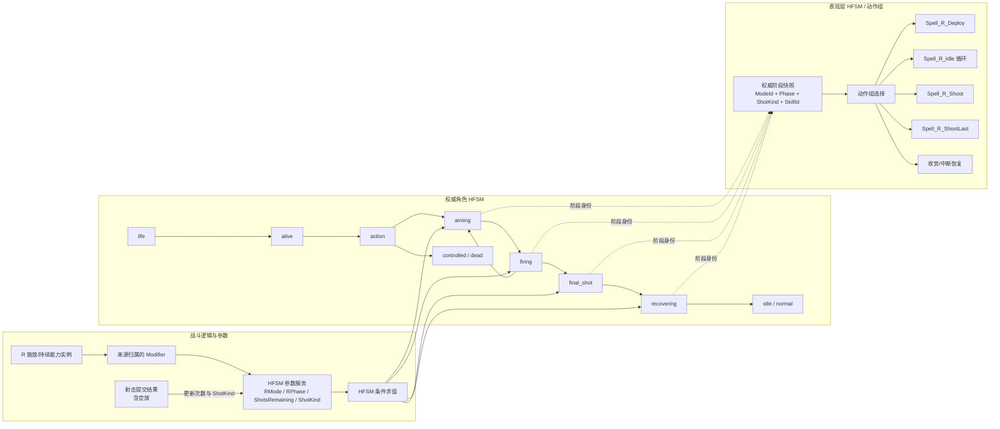
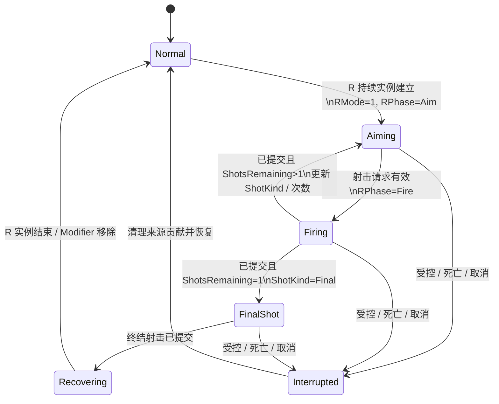
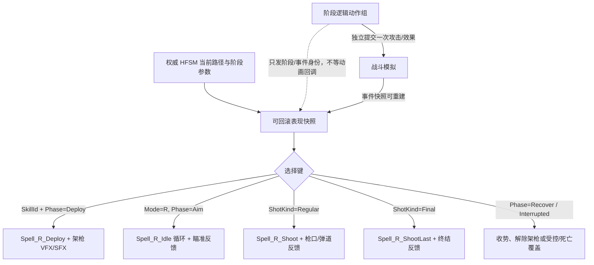

# 烬 R：修改器驱动 HFSM 阶段与表现接入设计

## 结论

烬 R 的多发射击应以“持续修改器改变 HFSM 参数，HFSM 按转换条件自动进入相应状态”为主模型。修改器的职责是贡献/撤销状态机参数；HFSM 的职责是依据当前参数和运行事实推进阶段；阶段内的逻辑动作与表现动作分别由可组合的动作组执行。不能把修改技能槽候选当成这套机制的主要实现，也不应把连续多发本身包装成一个 SkillFlow Repeat。

每次射击仍可由阶段触发一次独立的攻击结算/技能效果；若它自身是单次施放、跨时间持续并需整体取消或回滚的组合生命周期，才使用 SkillPipeline。纯粹因连续攻击而产生的阶段推进归 HFSM 状态转换负责。

## 与当前系统的关系

仓库已有 `MobaContinuousModifierTargetKind.StateMachineParameter` 目标类型，通用 HFSM 参数驱动示例也展示了“修改器写参数、HFSM 根据参数条件切状态”的设计意图。烬应沿用这一体系。

当前 MOBA 角色 HFSM 参数桥接已接通：持续修改器可按来源向参数服务投影贡献，运行时条件从同一参数服务读取合成后的有效值，并支持来源清理与回滚重投影。`AttackSlot`（ID 10）与 `RPhase`（ID 11）已注册；Authoring 已包含四个普攻槽、换弹槽，以及 R 的 `aiming/shooting/final_shot` 阶段转换，所有转换由参数条件驱动。

角色 HFSM 和表现动作运行器也要区分：战斗权威 HFSM 决定当前玩法阶段；表现层按已同步/可重建的阶段身份选择动作组，并消费每次施放的 SkillId、阶段参数和事件。表现层动画结束不能推进权威状态、消耗射击次数或决定伤害。

## 职责关系

下面分成三条链：参数链只改变 HFSM 的有效输入；HFSM 转移决定当前玩法阶段；表现层根据权威动作身份选择模型动作。三条链通过阶段身份和事件关联，不让动画回调承担玩法推进。



目标图中的 `aiming/firing/final_shot/recovering` 已映射到当前生产 HFSM 的 `r.aiming/r.shooting/r.final_shot`。R 入口结束后由持续 Modifier 保持阶段参数；普通射击和终结射击各自是独立 slot-5 技能流程。

```text
R 施放
  └─ 建立 R 持续实例 / 持续修改器
       └─ 修改 HFSM 参数（R 模式、剩余发数、当前射击类别等）
            └─ 角色 HFSM 按参数条件自动进入 Aim / Fire / Final / Recover 等通用阶段
                 ├─ 逻辑阶段动作组：接受本次射击、选择本发攻击内容、提交效果、推进参数
                 └─ 表现阶段动作组：架枪、瞄准、开火、后坐、终结、收势

R 持续实例结束/被打断
  └─ 移除其参数贡献，HFSM 根据剩余参数与角色事实自动回到常态路径
```

修改器应采用来源归属明确的增删语义：R 实例进入时添加参数贡献，退出、死亡、控制打断或回滚恢复时按来源撤销/重建。若参数由多来源共同影响，HFSM 读取的是确定性合成后的有效值；状态切换必须由权威模拟帧驱动并进入快照/回滚语义。

## 烬 R 的阶段建模

参数驱动关系建议按下图理解。参数值是状态机的输入；Modifier 不直接命令“切换到 firing”，触发事件只在权威提交之后更新参数，随后由 HFSM 条件自然进入下一阶段。



**当前状态**：`AttackSlot` 五个槽位（1~4 普攻、5 换弹）和 `RPhase`（aiming/shooting/final_shot）已经在 Authoring、Unity/Console 发布产物与运行时默认图中落地，转换由参数条件驱动。烬被动 Source 监听 `skill.basic_attack.launched`，空放也计数；槽位状态的逻辑进入/退出动作会触发换弹、计数和清理效果。R 入口 Flow 只负责短暂架枪提交并建立 R 模式，连续射击由 HFSM 阶段参数驱动；每发普通射击和终结射击使用独立技能身份，终结参数可从 `r.aiming` 直接进入 `r.final_shot`。Unity 消费验收已覆盖 R 三阶段模型动作与独立射击时间轴 VFX。

建议把阶段状态做成通用能力，而不是把状态名写死为烬专属：角色 HFSM 可以包含 `normal` 与通用的持续攻击模式/攻击阶段；模式内部根据参数判定 `aiming`、`firing`、`final_shot`、`recovering`。具体状态名取决于现有状态机定义的层级能力，重点是阶段可由参数组合驱动，且优先级能正确处理死亡、受控和移动等外层状态。

烬 R 的持续实例为状态机参数提供诸如 `RModeActive`、`ShotsRemaining`、`CurrentShotKind` 或等价的参数。这里仅是语义示意，具体参数类型、修改操作、参数 ID/配置权威源应复用现有 HFSM 参数契约，不应另造一套与持续修改器并行的技能循环游标。参数至少要明确：

- 每发何时被权威地接受/消耗，空放、取消、未命中是否扣次。
- 哪个参数条件选择普通射击或终结射击，最终一发后如何进入收势。
- R 模式如何退出，以及死亡、控制打断、施法失败和回滚时如何清理/恢复来源贡献。
- 玩家输入或自动节奏如何请求下一次 `firing`；输入请求不直接越过 HFSM 条件或绕开施放校验。

射击效果仍由明确的逻辑动作组执行。若每发需要独立 SkillId 及其目标、伤害、减速、弹道配置，可以由当前阶段参数/动作组选择对应攻击定义；每发效果执行完后通过逻辑提交更新持续状态参数，HFSM 下一次评估时自动转换。槽位候选能力可以在玩法确实要改变可施放槽位时共同使用，但它不能替代 HFSM 阶段参数，也不应成为射击次数和阶段生命周期的隐式权威来源。

## 阶段动作组与表现层

表现衔接按“逻辑阶段身份选动作组，动作组组合播放”设计：



动作资源已在烬模型控制器中：普攻 `AutoAttack_1..4`、装填 `AutoAttack_Reload`、R `Spell_R_Deploy/Idle/Shoot/ShootLast`。当前 `character_view_actions.json` 已接入 idle/moving/dead、Q/W/E、四种普攻、装填和 R 架枪、普通射击、终结射击动作组；Unity EditMode 消费测试验证了这些状态可以由权威快照驱动 Animator。

每个 HFSM 阶段允许配置多个动作并组合执行，不要求“一阶段一个动作”。逻辑动作组可组合输入门控、施放请求、一次效果提交、参数更新和事件发出；表现动作组可组合角色动画、武器姿态、枪口特效、音效、镜头反馈及循环/恢复动作。动作组内部应明确顺序、并行关系、失败处理和阶段退出清理。

表现层 HFSM 应消费权威阶段状态/模式快照，并能根据快照帧重建或 seek。单发动作可以叠加在持续瞄准姿态之上：进入 R 模式后维持架枪/瞄准循环；每次 `firing` 根据 `CurrentShotKind` 或有效 SkillId 播放对应动作组；回到瞄准态；终结射击播放专属动作后进入收势。受控、死亡和回滚恢复应中断或恢复动作组而不重复逻辑效果。

当前 `CharacterPresentationActionCatalog` 已按角色、技能身份和 HFSM 路径选择覆盖动作，动作 runner 支持按快照帧求值。后续应检查其状态身份是否包含足够的阶段/模式参数；若没有，应扩展权威表现快照或动作组选择键，使它能区分持续瞄准、普通射击、终结射击和收势，而不是依靠动画回调推进玩法。

## SkillFlow / SkillPipeline 边界

| 需求 | 负责机制 |
|---|---|
| R 持续期间修改 HFSM 参数，驱动多次通用阶段转换 | 持续修改器 + HFSM |
| 阶段条件满足后执行可组合逻辑动作 | HFSM 阶段动作组 / Trigger 或现有逻辑动作执行入口 |
| 一次施放内有蓄力、延迟、等待、并发、提交点或整体取消语义 | SkillPipeline |
| 架枪、瞄准、开火、后坐、特效和恢复等动画组合 | 表现层动作组 / 表现 HFSM |
| 修改实际施放槽位的有效技能身份 | SkillSlotCandidate（按需，作为独立能力） |

## 接入推进顺序

1. **确认现有 HFSM 参数契约**：定位 `StateMachineParameter` 的参数定义、类型/操作、合成规则、消费者绑定和 rollback 约定；确认状态机转换如何读取这些有效参数。不要先新增烬专属机制。
2. **补 MOBA 运行时桥接**：让持续实例投影参数到对应角色 HFSM 参数容器；让条件绑定读取同一权威有效参数；覆盖来源移除、快照、回滚、确定性排序和调试检查。状态机结构与条件仍由 HFSM 定义控制。
3. **定义通用持续攻击阶段**：在角色 HFSM 中配置模式与阶段转换，优先级覆盖死亡/受控等情况；明确输入/自动节奏的阶段请求以及射击参数提交点。
4. **接入烬 R 配置**：R 创建并持有持续参数贡献；普通射击、终结射击的逻辑动作组读取阶段参数并提交一次攻击结果；结束/打断时撤销来源贡献。若单次 R 施放本身需要等待输入并整体取消等长生命周期，再单独评估 SkillPipeline，不用于替代 HFSM。
5. **接入表现动作组和模型特效**：表现消费权威阶段快照与本次攻击身份，完成架枪循环、普通开火、终结开火、收势及中断恢复。
6. **按生产链路发布和验收**：按 `moba-skill-authoring` 与 `Docs/MobaSkillPipeline.md` 的权威来源、发布次序、标签检查及验收门禁验证。重点覆盖参数进入/移除、状态自动转换、每发恰好一次逻辑提交、普通到终结阶段、控制/死亡中断、回滚重演和表现重建。

## 验收标准

- 持续修改器参数贡献发生变化后，HFSM 按配置条件自动切换到预期状态，不由 Buff/表现回调直接切换状态。
- 多来源修改器的优先级、叠加、移除及 rollback 结果确定且可重演。
- 一次射击提交只产生一次攻击逻辑；空放、未命中与中断的扣次语义符合设计。
- 普通射击阶段能按参数自然转换到终结射击和收势，离开 R 模式后返回正常 HFSM 状态。
- 表现层能从阶段快照恢复架枪、瞄准、射击和终结动作，不重复伤害、扣次或触发器效果。
- 只有存在单次施放级持续组合生命周期时才引入 SkillPipeline；连续多发本身不以 Flow Repeat 建模。
