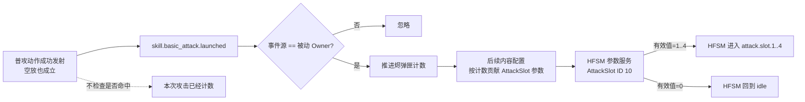
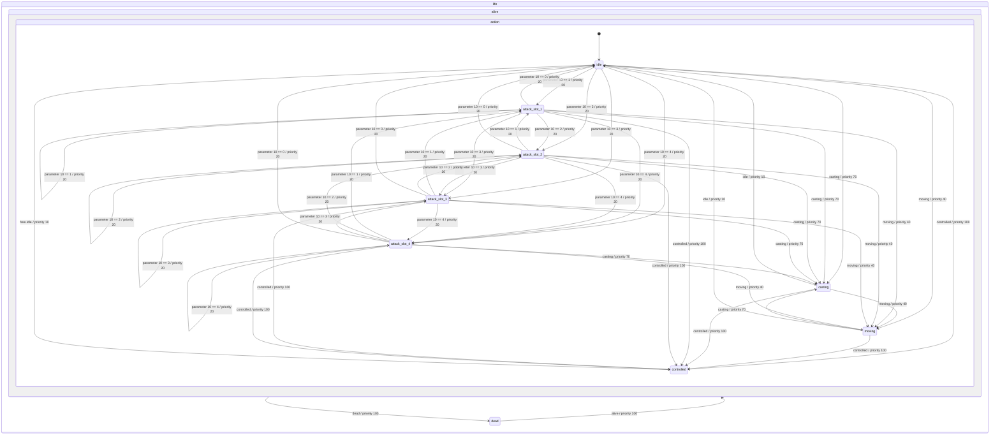
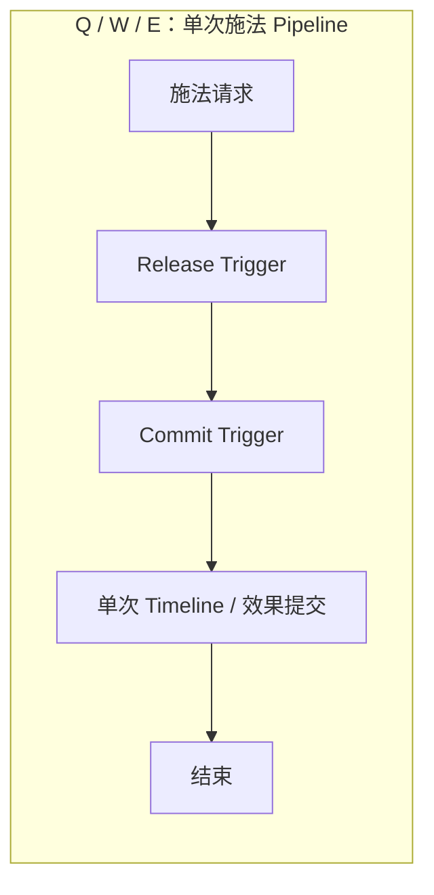

# MOBA 英雄 HFSM 规划与烬动作映射

## 目标

为新英雄先规划通用角色状态层级，再把英雄技能机制和模型动作映射到状态/阶段动作组。HFSM 管理权威玩法状态与阶段；持续修改器只贡献参数，条件绑定读取有效参数并驱动状态机转换；逻辑动作组提交战斗效果，表现动作组播放动画、特效和音效。动画播放完成不能直接推进战斗阶段或结算技能。

## 2026-10-31：Unity 表现消费验收补充

本节记录本批运行验证；下文初期规划中的“当前”“待接入”属于历史基线，现行配置以 Authoring 和已发布资源为准。本批不改变 HFSM 管理长期阶段、Modifier 贡献参数、Pipeline 管理单次施放的职责边界。

新增 `JhinUnityPresentationConsumptionTests`，使用 Resources 中的真实烬模型和 Q 粒子资源验证 Unity 消费端：

- 将角色动作快照交给 `BattleCharacterHfsmComponent` / `MonoCharacterHfsmView`，确认第四发普攻状态实际进入 Animator 的 `AutoAttack_4`，随后 R 瞄准状态进入 `Spell_R_Idle`。
- 通过 `PresentationUnityBackend` 创建 Q 粒子，确认角色挂接、局部偏移、按预制体基础缩放叠乘，以及默认播放参数下 100ms 生命周期结束后的句柄和对象清理。
- 修复 `PresentationPlaybackSpec.Default` 的结构体零初始化问题：默认使用速度 1、播放一次、就绪播放；显式速度 0 仍表示暂停。补充 .NET 默认播放和暂停恢复回归。
- 后端在运行模式使用 `Destroy`，EditMode 使用 `DestroyImmediate` 清理自身创建的表现对象。

`tools/test-gates.json` 的 `moba-jhin-unity` 已同时包含英雄技能验收和真实 Unity 模型/特效消费。配置加载测试改为对照发布的 Trigger ID 集合，保留两端内容一致性、ID 唯一性和完整加载断言，避免新增内容仅因旧固定总数导致失败。

本批验证结果：

| 验证 | 结果 |
|---|---|
| `moba-jhin-unity` | 技能验收 26/26；模型/特效消费 2/2 |
| `moba-content-contracts` | 全部步骤通过，含资源引用与有效区域时序检查 |
| Presentation Core .NET | 106/106 |
| 六英雄首技能冒烟 + `MobaLubanConfigPipelineTests` | 22/22 |
| `export_pipeline.py --check-published` | 通过 |

Unity 门禁产物在 `local/Logs/test-gates/20261031-144948-moba-jhin-unity/moba-jhin-unity/`；内容门禁产物在 `local/Logs/test-gates/20261031-144048-moba-content-contracts/moba-content-contracts/`。

验收边界：本批新增测试分别验证动作快照消费与粒子后端，不等同于完整战斗输入到画面的端到端验证。Unity 使用 `-nographics`，不证明材质、光照和最终视觉质量。下一批优先扩展四种普攻、换弹、Q/W/E 和 R 各动作的真实 Animator 消费，再将真实施放产生的快照、时间轴和特效统一接入场景联调，检查打断、退出和回滚恢复时的表现清理。

## 初期规划基线（历史记录）

生产角色状态机 Authoring 在 `Unity/Packages/com.abilitykit.demo.moba.view.runtime/Configs/MobaStateMachineAuthoring/character_hfsm.json`。框架/MOBA 参数桥接已可把带来源的持续 Modifier 投影到角色 HFSM 参数服务，条件从同一有效值求值；已注册 `AttackSlot`（ID 10）和 `RPhase`（ID 11），并覆盖多来源合成、来源清理及连续修改器回滚重投影。Authoring 与两端发布产物已包含 R 的 `r.aiming/r.shooting/r.final_shot` 阶段状态及参数转换。

攻击槽状态已加入 Authoring：`life(alive/dead)` 下的 `action` 包含 `idle/moving/casting/controlled` 与 `attack.slot.1..4`；`parameter.10.eq.1..4` 分别选择攻击槽，值为 0 时回到 idle。控制、施法、移动转换优先级高于攻击槽选择。它是可被状态参数驱动的通用示例，烬被动实际给 `AttackSlot` 的贡献仍需在内容配置中接好。

### 弹匣计数与空放

烬被动 Source 中的 Trigger `30010001` 已改为订阅 `skill.basic_attack.launched`，并校验事件源属于当前 Owner 后推进计数。该事件在普攻成功发射/提交后产生，不依赖后续命中或正伤害，所以**空放也计数**，命中及伤害结果仍由伤害事件处理。当前 Source 已体现新语义，但 Trigger Authoring Module 和运行时 `ability_trigger_plans.json` 尚需按生产流程生成/发布；在发布前不要将其描述为已在运行时生效。



注意区分已完成和待办：攻击提交事件及 Source 事件名已明确；Source 中推进计数已配置；弹匣计数如何生成/撤销 `AttackSlot` 持续 Modifier、生成 Module 和发布 Runtime Plan 是接入待办。计数使用攻击已提交事件，命中伤害修正继续使用伤害事件，二者不互相替代。

## 当前 Authoring HFSM 图



四种攻击槽之间当前配置的是参数驱动的自/互转；表中为可读性合并了各个槽位重复的 controlled/casting/moving 转换。状态图只表达状态选择，不等同于动画播放或攻击效果提交。

### 参数契约状态

| 参数 | ID | 当前情况 | 写入/读取职责 |
|---|---:|---|---|
| `AttackSlot` | 10 | 已注册；Authoring 条件已驱动 `attack.slot.1..4` 与 `idle` | 烬被动弹匣 Modifier 待配置并发布；HFSM 只读合成有效值 |
| `RPhase` | 11 | 已注册，0=inactive、1=aiming、2=shooting、3=final_shot；Authoring 已配置阶段条件与转换 | R 持续实例/逻辑阶段提交更新贡献；HFSM 按值转换 |
| R 模式是否激活 | 待确定 | 设计概念，不能据此假设已有参数 ID | 用来区分普通动作与架枪模式；需定类型和 Modifier 退出值 |
| 剩余射击次数 | 待确定 | 设计概念，尚未确认参数 ID / 权威来源 | 每次已提交射击递减；空放扣次、未提交不扣次 |
| 射击类别（普通/终结） | 待确定 | 设计概念，尚未确认参数 ID / 合成规则 | 选逻辑攻击内容和表现动作组；最后一发由权威次数/阶段判定 |

参数 ID、类型、有效值合成、来源优先级及清理值需写入正式参数契约，并和条件绑定、Modifier Authoring 同步；文档中的 `RMode/Phase/ShotKind/RemainingCount` 目前只表示语义，并不代表已注册完成。

## 推荐的通用角色层级

```text
life
├─ alive
│  └─ action
│     ├─ locomotion（idle / moving）
│     ├─ interaction（free / controlled）
│     └─ ability（inactive / casting）
│        └─ cast_phase（prepare / commit / recover）
│           └─ skill-specific action group selected by SkillId and phase
└─ dead
```

这是职责分层，不要求把每个维度都机械地做成互斥子状态。当前运行时是单活动路径的层级状态机，移动、控制与施法之间的优先级必须通过转换条件明确表达。优先级建议为死亡 > 强制控制 > 施法阶段 > 移动 > idle；是否允许某类控制期间施法由玩法规则显式决定。若需要真正并行的 locomotion 与 ability 分支，应先确认 HFSM 引擎支持并行子状态，不要以嵌套互斥状态模拟并行。

持续模式采用可复用语义，例如 `sustained_action`，由持续能力提供 `ModeActive`、`Phase`、`ShotKind`、`RemainingCount` 等参数。具体英雄只配置参数贡献和阶段动作组，不在全局状态图中加入 `jhin_r_...` 之类英雄专名。参数应有稳定 ID、类型、合成规则、来源归属、撤销和回滚行为；条件只读合成后的有效值。

每个英雄开工前先写出：

1. 生命周期状态（alive/dead/respawn）和最高优先级打断。
2. 常态动作（idle/move）及允许并行的动作维度。
3. 瞬时施法的 prepare/commit/recover 阶段与提交点。
4. 持续能力模式、参数、阶段条件及退出/打断路径。
5. 每个阶段的逻辑动作组和表现动作组，以及快照重建所需身份。

## 烬技能与模型动作映射

当前动作配置中的角色实体码为 `3001`。可见动作身份及资源配置如下：

| 技能/阶段 | 当前 Animator 状态 | 配置帧数 | 当前接入情况 |
|---|---:|---:|---|
| 常态 idle | `Idle` / `Jhin_Model_Idle` | 238，循环 | 已有角色动作覆盖 |
| 普攻组 | `AutoAttack_1`–`AutoAttack_4` / `Jhin_Model_Attack1`–`Attack4` | 4 种独立动作 | 已绑定到 `attack.slot.1..4` 表现动作组，由攻击槽参数选择 |
| 被动装填 | `AutoAttack_Reload` / `Jhin_Model_Reload` | 单次 | 已接入 `attack.slot.5` 表现动作组 |
| moving | （未见专用 Run clip） | — | 当前用 `Idle` 覆盖；后续可用移动混合或补动作 |
| controlled | （未见专用受控 clip） | — | 当前用 `Idle` 覆盖；模型动作待补/确认 |
| dead | `Death` / `Jhin_Model_Death` | 227 | 已有角色动作覆盖 |
| Q | `Spell_Q` | 156 | 技能身份覆盖已配置 |
| W | `Spell_W` | 77 | 技能身份覆盖已配置 |
| E | `Spell_E` | 38 | 技能身份覆盖已配置 |
| R 架设 | `Spell_R_Deploy` | 43 | R 施法开场已配置 |
| R 架设后瞄准待机 | `Spell_R_Idle` / `Jhin_Model_SpellR_Idle` | 60，循环 | 当前配置在 casting 动作序列尾部；应成为 R 模式的独立瞄准阶段表现 |
| R 普通射击 | `Spell_R_Shoot` / `Jhin_Model_SpellR_Shoot` | 单次 | 已绑定到 `r.shooting` 表现动作组 |
| R 终结射击 | `Spell_R_ShootLast` / `Jhin_Model_SpellR_ShootLast` | 单次 | 已绑定到 `r.final_shot` 表现动作组 |

这些资源可通过 `Resources/ChampionVfx/13.Jhin_Battlecast` 软链接查看。Animator Controller `Animations/Jhin_Battlecast_Model.controller` 确认存在 `AutoAttack_1`–`AutoAttack_4`、`AutoAttack_Reload`、`Spell_R_Deploy`、`Spell_R_Idle`、`Spell_R_Shoot` 和 `Spell_R_ShootLast` 等状态；对应模型动画 clip 也在同目录。模型资源本身可用，当前缺口是把 R 射击的真实施放快照和特效联到场景。

烬技能对应的玩法规划：

| 技能 | 权威玩法阶段规划 | 表现动作组规划 |
|---|---|---|
| 普攻 | 作为独立攻击技能/攻击槽身份，由普攻与被动状态机参数切换攻击槽；不借 R 的阶段循环 | 按有效攻击槽选择 `AutoAttack_1`–`AutoAttack_4`，装填阶段播放 `AutoAttack_Reload`；四种动作均已在模型中 |
| Q | 单次施法：prepare → commit（弹跳伤害提交）→ recover | `Spell_Q` 与弹跳/命中特效、音效 |
| W | 单次施法：瞄准/准备 → commit（命中或标记交互）→ recover | `Spell_W`、射线/命中特效 |
| E | 单次施法：部署 → commit（陷阱区域建立）→ recover | `Spell_E`、陷阱部署与区域表现 |
| R | 持续能力修改通用 HFSM 参数；状态机在瞄准、普通射击、终结射击、收势阶段间切换 | `Spell_R_Deploy` → `Spell_R_Idle` → `Spell_R_Shoot` → 再瞄准；终结发使用 `Spell_R_ShootLast` → 退出/收势。架枪后的普通与终结射击两种模型动作均已存在，需接入动作组 |

R 的每次射击应由输入或规则请求阶段转换，HFSM 按有效参数判定当前普通/终结阶段。阶段逻辑动作组在权威提交点执行当发攻击并更新次数/类别参数；HFSM 随后评估下一状态。R 不用 Flow Repeat 表示连续多发。当前实现已经按此边界拆分：R 入口是短 Pipeline，架枪后由 `RPhase` 参数驱动 `r.aiming -> r.shooting -> r.final_shot`，普通射击和终结射击分别是独立技能流程。单次 R 若另有必须整体取消/回滚的长施法时序，才评估 SkillPipeline；各发阶段本身归 HFSM。

### 技能施法流程与阶段边界

Q/W/E 当前各自使用单次 Pipeline：先 Release、再 Commit，再用单个 Timeline 提交技能效果。这种 Flow 是一次施放内部的短流程，和普攻槽位轮换、R 多次开火不是同一职责。



R 当前发布的 `skill_flows.json` 已拆为：入口 `30010401` 的短架枪流程、普通单发 `30010501` 和终结单发 `30010502`。连续射击次数与阶段由 HFSM 参数和 Modifier 驱动，Pipeline 不再持有跨输入 Repeat。

```mermaid
flowchart TD
  subgraph Current[当前 R Flow：待迁移]
    RStart[R 施法] --> RRelease[Release] --> RCommit[Commit]
    RCommit --> Repeat[Repeat ×3\n普通射击 Timeline]
    Repeat --> LastShot[终结射击 Timeline] --> FlowEnd[Flow 结束]
  end
  subgraph Target[目标：单次入口 + 持续 HFSM]
    Cast[R 施法请求] --> Pipeline[Pipeline\nRelease / Commit / 架枪提交]
    Pipeline --> Modifier[建立 R 持续实例\n贡献 RPhase 等参数]
    Modifier --> Aim[HFSM: aiming]
    Aim -->|玩家/规则请求| Fire[HFSM: firing]
    Fire -->|已提交且仍有次数| Aim
    Fire -->|已提交且到最后一发| Final[HFSM: final_shot]
    Final --> Recover[recovering / 结束]
    Recover --> Cleanup[移除 Modifier 参数贡献]
  end
```



目标图里空放会在“已提交”节点扣除一发；未提交的施法失败或被打断不应扣次。未命中与零伤害不回滚已提交的一发。精确的提交点由 R 射击动作逻辑组定义，表现层动画结束只负责视觉收尾，不能消费次数。

## 表现状态身份

当前表现选择键支持实体码、技能 ID 和 HFSM 路径，动作快照包含路径、状态实例、技能身份及角色模式身份。建议阶段动作选择至少可区分：

- `life/alive/action/casting/cast_phase/prepare`
- `.../commit` 或以阶段动作事件选择当发动作
- `.../recover`
- 持续攻击模式下的 `aiming`、`firing`、`final_shot`、`recovery`

如果当前快照/动作选择器不能携带阶段参数，应扩展权威动作身份或表现快照，使每次确定性求值能根据 `ModeId/Phase/ShotKind` 选到正确动作组。回滚重建只恢复表现，不再次提交伤害或消耗射击次数。

## 落地次序与验收门槛

1. 完成并发布烬被动计数配置：由 `skill.basic_attack.launched` 计数，验证空放计数、Owner 过滤、计数上限/回绕及回滚；生成 Trigger Module 和 Runtime Plan。
2. 将弹匣状态转为来源明确、可撤销的 `AttackSlot` 持续 Modifier 贡献，验证计数变化时 HFSM 自动进入四个槽位之一、装填后清零回 idle；避免在被动动作或表现回调中直接切状态。
3. 在 HFSM Authoring 中补齐通用持续攻击阶段（R 模式、瞄准、普通射击、终结射击、收势）和参数转换条件，写明玩家/规则请求入口、已提交扣次、空放扣次、未提交不扣次以及死亡/控制/取消清理。将 R Flow 的 Repeat 多发迁到 HFSM，Pipeline 留给单次 R 施放启动与部署。
4. 基于实际 Animator Controller 完成四种普攻、装填、R 架枪/瞄准/普通射击/终结射击动作组。现有控制器状态名为 `AutoAttack_1..4`、`AutoAttack_Reload`、`Spell_R_Deploy/Idle/Shoot/ShootLast`；确认 VFX/SFX cue 与状态进入/退出的绑定。
5. 用 Authoring Publisher 执行 `Publish` 与 `Check`，再运行 `python LubanConfig/Moba/export_pipeline.py --check-published`，确认发布副本一致。
6. 验证参数贡献加入/移除、多来源合成、普通到终结的状态切换、空放扣次、每发恰好一次逻辑提交、死亡/控制中断、回滚重演和表现恢复；分别检查 Q/W/E 单次 Flow 与 R 持续 HFSM 边界。

发布状态图前确保它读取的参数、事件源和 Modifier 内容链已可用；不让 Authoring 图展示完整 R 阶段、运行时却没有驱动这些参数的配置。

## 2026-11-01：R 射击回滚后的表现重建

扩展 `R_ShotInterruptedBackToAimingReleasesProjectileVfx`：真实施放得到 R 射击快照并启动投射物特效后，将表现游标回退到该快照之前，确认旧特效销毁；重新应用同一权威射击快照后，确认时间轴创建新的特效实例；再切回仍保留 R 模式的瞄准快照，确认重建的特效也被释放且模型恢复 `Spell_R_Idle`。这覆盖了 R 射击的回滚重放与随后打断清理，不触发第二次逻辑施放或重复战斗效果。

验证：`moba-jhin-unity` 通过，技能验收 26/26、模型与特效消费 29/29。门禁报告位于 `local/Logs/test-gates/20261101-115637-moba-jhin-unity/moba-jhin-unity/`。Unity `-nographics` 验证资源实例与状态消费，不代表最终渲染质量。