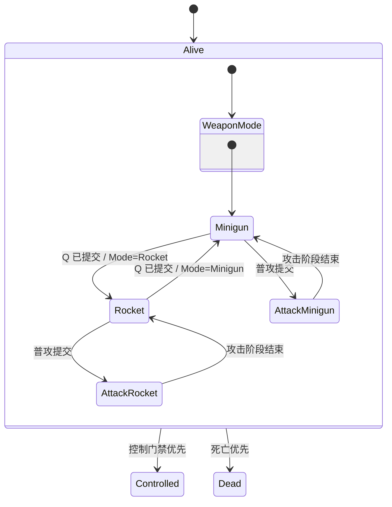
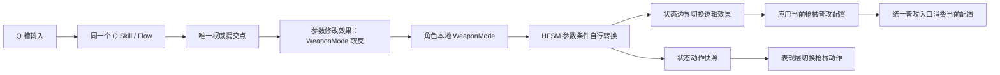
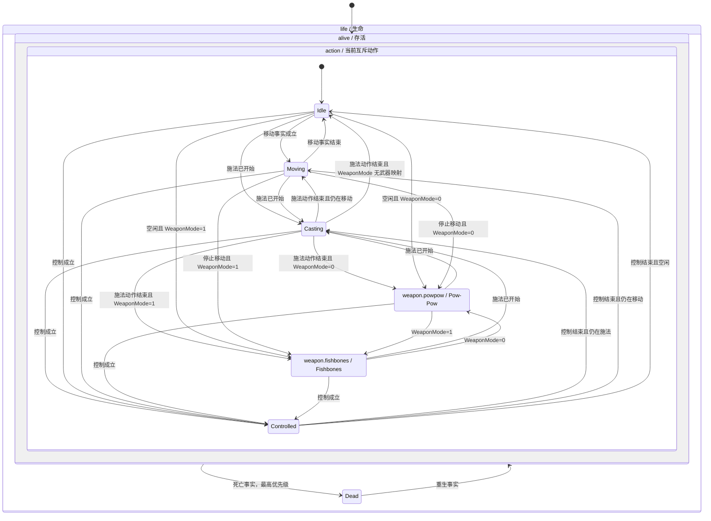
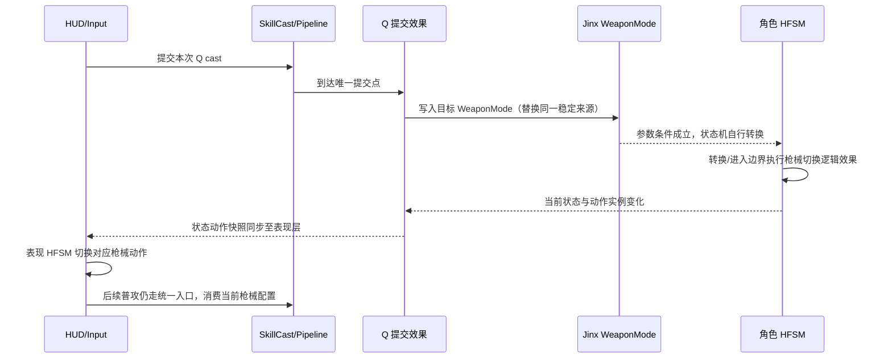
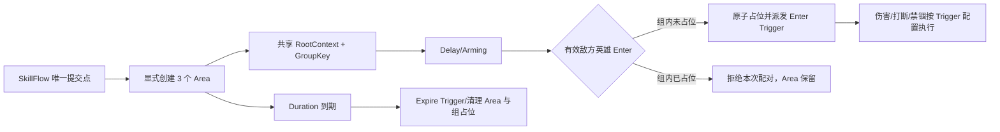

# 金克丝技能需求与资源分析

> 文档状态：实现推进稿。采用 Riot Data Dragon `16.22.1 en_US` 作为机制基线；Jinx 角色/模型、Passive/Q/W、基础与模式普攻及 E 逻辑配置已发布。E 的 Battle Scenario 与 Luban 发布检查通过，可以开始 R 的运行契约实现规划；E 的 Unity 指示器、三点落位、位置化 VFX、Root 画面和回滚仍待验收，不作为 R 逻辑工作的前置阻塞。Q/W 的本地输入验收已覆盖按钮提交、W DirectionLine 释放和首目标伤害，但 HUD 实际绘制、模型动作/VFX 和回滚仍待验收；被动完整玩法也仍未闭环。
> 规则核查日期：2026-11-09；实现状态更新：2026-11-09。本轮 R 机制核对只使用 Riot Data Dragon `16.22.1` 和 Riot 官方英雄页；早期 CommunityDragon/Meraki 内容仅保留作历史记录，不能作为本轮规则或生产数值依据。链接见文末。

## 目标与当前边界

以当前 MOBA 配置链实现一名可运行、可回滚并可在 Unity 中呈现的金克丝，覆盖被动「罪恶快感」、Q「枪炮交响曲」、W「震荡电磁波」、E「嚼火者手雷」和 R「超究极死神飞弹」。完整体验的核心不是五个互不相关的技能，而是 Q 改变的长期武器模式、模式对普攻的持续影响，以及被动击杀/目标摧毁后的短期强化。

当前仓库已登记 Jinx 角色 `3002`、模型 `3002`、属性模板、Passive、两种模式普攻、Q/W 技能及对应运行配置。Q Flow/Trigger 和 W 投射物/命中链已发布；`moba-jinx-unity` 还通过本地战斗的 HUD 按钮与 `BattleInputFeature` 验收 Q 模式提交、W DirectionLine 瞄准释放及命中伤害，并检查发布配置的方向、射程、宽度和预览资源。该证据不包含指示线实际绘制像素/空间轮廓、动画/VFX 消费、回滚或完整 HeroReady；E/R 与被动玩法仍未闭环。

### 2026-11-08 Area C 批次结果

本批先完成了金克丝 E 依赖的通用 Area 组占位和配置参数链路，未登记金克丝 E 的伪生产数据。`SpawnAreaSchema` 现在解析 `area_group_key` 与 `claim_targets_within_group`，`SpawnAreaPlanActionModule` 将其连同 RootContext 传入 `AreaWorld`，运行时元数据可保留组配置；`MobaAreaSyncSystem` 在有效敌方英雄 Enter 时进行稳定顺序和原子占位。

语义已经固定为两条彼此独立的规则：组占位保证同一施法组内一个目标只由一枚陷阱处理；`ConsumeOnFirstEnter` 只决定单枚 Area 是否在首次有效 Enter 后关闭。金克丝 E 需要“同组重复目标不重复触发，但幸存陷阱还能影响另一个敌方英雄”，所以 E 的未来 Area 配置必须使用 `ClaimTargetsWithinGroup=true`、`ConsumeOnFirstEnter=false`。占位在有效敌方英雄 Enter 时立即发生，不等待伤害/控制 Trigger 的结果。

证据：`AreaArmingAndConsumptionTests` 当前 `13/13` 通过，包含同一 Area 处理多个不同目标、同组重复目标拒绝、同帧稳定排序、隔离和回滚；Unity `MobaSkillCastRuntimeServiceDiagnosticsTests.SpawnAreaSchema_ParsesGroupClaimWithoutMakingAreaOneShot` 与 `MobaAreaDiagnosticProducerTests.RuntimeMetadata_RetainsAreaGroupClaimConfiguration` 为 `2/2` 通过。该批仍未证明 `MobaAreaSyncSystem` 接入真实敌方 Actor、Trigger 派发、禁锢/伤害结果或 Unity E 表现。

权威源复核结果：当前 `moba-skills.trigger.json`、SkillFlow Authoring、Jinx acceptance fixture 和 Luban 发布表中未找到金克丝 E 的技能/Flow/Trigger/Area 登记；现有 `3002` 生产链只覆盖 Passive、Q、两种普攻和 W。因此下一批必须先在权威工作簿和 Authoring 源登记 E 的 ID、三枚 Area 的参数、Enter/Expire Trigger 及 Flow 提交点，再执行 Import/Publish/Check 和真实 Battle Scenario；在这些源数据存在前，不得编辑 `Resources/luban`、`skill_flows.json` 或 `ability_trigger_plans.json` 充当 E 实现。

### Riot 官方资料边界（2026-11-09）

本轮只采用 Riot 官方来源：Data Dragon `16.22.1` 的 `Jinx.json`（`en_US`、`zh_CN`）和 Riot 金克丝英雄页面（含官方 E 技能视频）。两者共同确认：E 创建 3 枚陷阱，沿线投放；陷阱持续 5 秒；敌方英雄接触时触发；触发会禁锢并造成附近魔法伤害；施法距离为 925，法力消耗为 90，冷却为 `24/20.5/17/13.5/10`。

官方资料没有给出可直接登记的 `totaldamage`、`rootduration`、`grenadeduration` 数值，也没有给出陷阱碰撞半径、三枚陷阱的间距/偏移或武装延迟。Data Dragon 的这些字段仍是模板占位符，`effect` 数组为零值；英雄页面只有文字说明和视频，不提供参数表。因此不能把详细快照、演示视频中的视觉距离或其他英雄配置作为 E 的生产数值。

在 Riot 官方版本化数值出现前，E 的生产登记门禁保持关闭。可以继续完成的内容只限于不依赖数值的通用验收设计：显式创建三个 Area 请求、共享 `RootContext + GroupKey`、组级目标 claim、`ConsumeOnFirstEnter=false`、Enter/Expire 生命周期、同帧稳定决胜、幸存陷阱影响第二目标以及回滚清理。任何 fixture 中的伤害、半径、间距和延迟只能使用测试私有常量，不能被复制到 Luban、Trigger 或 Flow 生产源。

### 占位值结构验收结果（2026-11-09）

已新增测试专用 `moba-jinx-e-three-area-acceptance.trigger.json`，并运行 `MobaTriggerSkillHeadlessTests.JinxEPlaceholderContract_CreatesThreeAreasClaimsTargetsAndExpiresAsAGroup`。Unity EditMode 结果为 `1/1 passed, 0 failed`，日志：`Unity/local/Logs/jinx-e-placeholder.xml`。

该验收只验证机制骨架：一次执行显式创建三枚 Area；三枚 Area 共享同一组级目标 claim；武装前不触发 Enter；同一敌方英雄只由一枚陷阱接受；幸存陷阱可以影响第二个敌方英雄；所有 Area 到期后清理。测试中的半径和生命周期是私有占位值，不能视为 Riot 数值，也不能同步到 Luban、Trigger、Flow 或表现资源生产配置。

本轮 game-res 目录中可见 `08.Jinx_Arcanist` 至 `14.Void_Annie` 等七个英雄资源目录。本文只登记金克丝资源包，并把它视为表现输入，不据此推导战斗机制已经实现。

## 需求拆分

| 机制 | 玩法需求（待版本确认细节） | 推荐权威落点 | 主要风险 / 待核 |
|---|---|---|---|
| 被动「罪恶快感」 | 对英雄、史诗级野怪、炮塔或水晶枢纽完成击杀/助攻类 takedown，且此前短时间内伤害过该目标后触发；获得衰减移速与限时攻速强化；英雄 takedown 还可继续增加被动层数 | 归属明确、可去重的 takedown/目标摧毁事件由 Trigger 消费；移速和攻速由限时 Buff/Modifier 贡献；层数与到期状态参与回滚 | 详细快照含 3 秒参与窗口、6 秒持续/衰减和最多 5 层等数值，但必须按选定版本重核；区分史诗野怪/普通野怪、建筑类型、击杀与助攻、首层与额外层；当前事件字段与属性上限契约待查 |
| Q「枪炮交响曲」模式 | Q 切换普攻形态而非独立伤害技能。Pow-Pow 普攻刷新并增加逐层衰减的攻速层；Fishbones 普攻攻速更慢、距离更远、耗蓝并对主目标附近溅射。切到 Fishbones 后首发如何承接已有机枪层需保留规则 | 两个互斥模式 Buff 承载长期模式；添加目标 Buff 时立即移除对侧 Buff，各自的 Modifier 覆盖角色本地 `WeaponMode` HFSM 参数；HFSM 按有效参数迁移，普攻权威提交按同一参数解析模式候选 | 模式不能由动画状态决定；核验普攻配置是否能依有效参数路由并原子提交法力/主次目标伤害；攻速层到期、切枪保留和首发规则需按版本冻结 |
| W「震荡电磁波」 | 直线电击弹命中首个敌方目标后造成物理伤害、减速并短暂揭示该目标 | SkillFlow 管施法/提交；Projectile 管直线运动和首个有效碰撞；命中 Trigger 管伤害、减速与可实现的揭示 | 视野/揭示不是已确认的现成战斗域能力；须定揭示对谁可见、持续多久及回滚语义。若首版无观察者视野规则，应显式延期玩法揭示，不可将客户端标记称为权威显形 |
| E「嚼火者手雷」 | 在目标位置沿线布置三枚陷阱；陷阱落地后延迟武装，接触敌方英雄时爆炸、造成魔法伤害、打断位移/引导并禁锢；未触发陷阱到时限后爆炸。一次施放中同一英雄最多被一枚陷阱影响 | 一次 Flow 提交三枚独立 Area；Area 生命周期处理落地/武装/到期；Enter Trigger 处理命中，Buff 门禁控制禁锢；施法实例级去重状态保证同一目标只受一枚影响；实体增删按回滚契约处理 | 三枚是不同模拟实体，不只是三个表现点；共享命中集合与同帧重叠触发需确定性排序并回滚；核对部署坐标、Enter、爆炸时伤害/半径、生产表字段；陷阱视野也是额外能力依赖 |
| R「超究极死神飞弹」 | 向全图方向发射飞弹；飞行距离提高基础伤害，命中首个敌方英雄后爆炸并伤害周围敌人；伤害含目标已损失生命比例，次级目标伤害较低且按各自生命状态计算 | SkillFlow 冻结方向并提交发射；Projectile 负责全局距离飞行与“首个有效敌方英雄”碰撞；命中逻辑按冻结的技能等级/发射时基础伤害、确定的飞行距离和各受击者 HP 计算主/溅射伤害 | 不能被小兵/普通单位提前终止（按目标版本核准）；距离系数不可自动套在缺失生命附加项；次级伤害应逐目标读取 HP；野怪上限、方向/施法位置冻结与回滚均需测试 |
| 普攻表现 | 模式对应不同持枪待机、普攻动作、枪口和弹道/爆炸反馈 | 表现 HFSM / Character View Actions 消费权威模式和普攻事件；VFX 随模拟发射/命中事件播放 | 表现不能决定模式、弹药消耗、攻击速度、命中或伤害；攻击动画完成不能作为普攻提交条件 |

## 逐技能规则对照后的实现要求

与原分析相比，金克丝的机制不能压缩为“换枪、范围伤害、陷阱、远程弹”：

- **被动是带参与归属的击杀反馈。** 仅收到击杀事件不足以判断金克丝是否在有效窗口内参与；应分别对 champion takedown、史诗野怪、炮塔/水晶枢纽摧毁定义 owner 与参与者，并用事件唯一键防止击杀和助攻通知双重触发。移速衰减曲线与攻速层数/上限是不同贡献，不能混为一个数值效果。
- **Q 把模式、普攻与资源结算绑在一起。** Fishbones 不是换一发视觉不同的子弹：主目标攻击、额外攻击速度修正、普攻间隔、攻击距离、蓝耗、主目标伤害规则和次级溅射规则相互关联。详细快照中主目标仍是普攻伤害，溅射是独立默认伤害，不继承吸血/on-hit；主目标暴击与溅射暴击规则也不能混为一谈。Pow-Pow 的攻速层随普攻增加、刷新并逐层到期；切枪期间层数如何衰减，以及切到 Fishbones 的首发如何读取剩余层，需单独验收。
- **W 的“首个命中”与揭示都是玩法语义。** 不可让穿透弹对多个目标逐个结算；首个碰撞目标选择、墙体阻挡、命中后揭示的可见对象都要明确。
- **E 有一次施放范围内的共享限制。** 三枚陷阱分别产生爆炸，但同一敌方英雄一次施放最多被一枚咬住。仅为每个 Area 配独立 Enter Trigger 会重复控制目标；需要施法实例范围内共享的“已影响目标”确定性状态，或经评审确认等价通用机制。陷阱触发会打断位移/引导并禁锢英雄，不表示把目标击退；陷阱本身与爆炸还提供局部视野，不能只验禁锢。详细快照称法术护盾不阻止陷阱爆炸，需明确爆炸是否发生、伤害是否被挡、控制是否被挡三个结果。
- **R 的主次目标公式不可混算。** 飞行距离提高基础弹伤，缺失生命附加项独立计算；爆炸次级目标另有伤害比例。若按各受击者生命比例附加，主目标的生命百分比不能复用于周围单位。详细快照称法术护盾不阻止飞弹爆炸；需分开验证命中/爆炸、主目标伤害与周围伤害门禁。快照还给出飞行中和爆炸区域的短暂视野提示；观察者范围需明确。技能等级、基础伤害和目标生命取样时点须按指定版本确认。
- **表现资源命名不决定机制。** R Prefab 有普通/Final 分支，但英雄规则摘要没有因此定义“终结弹”；不能因为模型/特效存在 Final 变体就新增玩法阶段。

详细快照还提供数值示例（例如 Q 攻速层/维持时间、E 三枚布置与武装时间、R 基础伤害随飞行距离变化），但不是项目目标版本来源。生产数值须在实现阶段 0 按同一版本重新核准。

### 详细快照中的参数（仅作核对清单）

以下是核查时的详细快照值，**不是待照抄的生产配置**：

| 技能 | 快照规则/参数 | 实现前要重新确认的边界 |
|---|---|---|
| 被动 | 对目标造成伤害后 3 秒内 takedown；移速加成 175%，6 秒衰减；被动攻速层最多 5 层、每层 25% 总攻速并允许超过一般攻速上限；只有英雄 takedown 可获得首层以外的额外层 | 助攻窗口和目标种类；移速曲线、攻速算法/上限；多次 takedown 是否刷新持续时间及层数衰减 |
| Q | Pow-Pow 层持续 2.5 秒、最多 3 层，后续层按半效贡献；Fishbones 的快照耗蓝为每次攻击 20，额外射程随 Q 等级为 80/110/140/170/200；Fishbones 攻击承受 10% bonus attack speed 惩罚，切换后的首发可受已有 Rev'd Up 影响 | 命中还是攻击提交时叠层；逐层到期；射程基准/攻击距离上限；法力预扣语义；首发攻击速度与机枪层剩余时长 |
| W | 揭示与减速 2 秒；直线弹速度快照为 3300，宽度 120；施法时长随额外攻速变化 | 速度/宽度单位及碰撞盒；施法时长公式；揭示对团队还是仅自身；减速数值与控制免疫 |
| E | 3 枚；0.4 秒落地、0.75 秒武装、5 秒后自动爆炸；触发英雄禁锢 1.5 秒；快照影响范围半径 225；每枚可提供周围视野 | 每枚真实 Area 尺寸、三枚间距、重叠触发顺序、自动爆炸伤害、视野接收者及生命周期；数据快照中范围字段可能不等同于运行时碰撞半径 |
| R | 全图目标方向；快照施法 0.6 秒，飞弹速度字段为 1700/2200；飞行和爆炸区域有约 2 秒视野提示；主目标基础伤害随飞行距离由 10% 到 100%；次级目标基础伤害为主目标基础伤害的 80%；命中单位的 missing-health 附加项按各自生命计算，野怪附加伤害上限 1200 | 距离归一化/上下限、飞行速度阶段、主/次伤害分别公式、额外伤害的野怪上限、视野接收者、发射时锁定哪些成长量，以及飞行期间属性变化是否影响结果 |

这些数字用于发现实现漏项，不等同于版本基准。Data Dragon 和社区数据源可能滞后或呈现测试服状态；阶段 0 必须固定正式服版本与采集日期，再决定具体数值。

## 武器模式与 HFSM 草图

Q 的枪械选择是跨多次普攻持续存在的玩法状态。两个互斥模式 Buff 是唯一配置化来源；其 Modifier 分别贡献角色本地 `WeaponMode` 参数值，HFSM 按该有效值自动进入对应武器状态。Q 的唯一提交点添加另一模式 Buff，Buff 添加效果立即移除对侧 Buff，撤销旧 Modifier 后由新 Modifier 驱动参数和 HFSM 转移。Q 不直接指定 HFSM 目标状态，也不另建模式裁决服务；Buff、有效参数、HFSM 状态与普攻候选必须在同一提交和回滚链路中保持一致。



这是目标行为模型，不是当前已配置 HFSM。实际层级需适配现有 Authoring 的状态层级能力，并明确 `controlled/dead/casting/moving` 与攻击阶段的优先级。HFSM 阶段变化只决定模式和动作组；逻辑攻击提交、法力扣除、伤害与爆炸仍通过权威技能/战斗链路执行。

需在实现前冻结这些问题：

- 初始武器模式、切换是否有施法时间/冷却/法力成本，切换是否能在受控、施法或攻击前后摇时进行。
- 机枪攻速层数/上限、保持窗口、每次普攻何时加层、移动或切枪是否清层，以及不同来源攻速上限。
- 火箭普攻法力消耗的预扣/命中扣费时点、法力不足时是否自动退回机枪，以及爆炸对主目标是否只结算一次伤害。
- 被动击杀与助攻的判定窗口、建筑类型、效果持续时间、刷新/叠加和角色死亡后的行为。
- E 同次施放共享的已影响目标集合如何处理同帧多陷阱命中，以及打断位移/引导是否在首版实现。
- Q 的主目标 on-hit/暴击/吸血与次级溅射的伤害分类；命中和未命中的攻速叠层/法力扣费时点。
- W 揭示的玩法范围；如果当前不建设视野系统，应把玩法效果标为延期。
- R 的碰撞目标、飞行距离取值、爆炸范围、主目标伤害与溅射伤害关系、低生命倍率和施法者死亡后的投射物策略。
- 本次交付是否要求四个技能槽完整输入/UI；若不包含，仍应以程序化施放验收 R，并把 HUD/Console 输入列为单独集成项。

## 资源核查

权威资源仓库是 `game-res`。`tools/link_game_res_resources.ps1` 将 `08.Jinx_Arcanist` 链接到 MOBA 包 `Resources/ChampionVfx`。本机提取审计记录为 20 个直接激活事件 Prefab、9 个模型动画片段；当前范围如下：

| 资源类别 | 已找到内容 | 接入要求 |
|---|---|---|
| 模型 | `Jinx_Arcanist_Model.prefab` | 模型表登记稳定模型 ID 和 PrefabPath；Unity 创建/绑定验收 |
| 模型动画 | 9 个动画片段：两种 Idle、两种普攻、Q 两种切枪、W/E/R | Controller 状态名包括 `Idle_Minigun`、`Idle_Rocket`、`AA_Minigun`、`AA_Rocket`、`Spell_Q_MiniToRocket`、`Spell_Q_RocketToMini`、`Spell_W`、`Spell_E`、`Spell_R`；表现动作映射按模型控制器实际状态核验 |
| 普攻 VFX | 机枪/火箭 Cast、Projectile、火箭 Hit | 每次普攻逻辑提交分别派发表现事件；弹体位置、朝向、移动和命中时点由权威投射物/事件驱动 |
| Q VFX | Q 火箭 Cast、Projectile、Hit，另有 Q 汇总容器 | 只在切换到火箭模式的正确分支使用；机枪切火箭与火箭切机枪动作要与参数切换保持一致 |
| W VFX | W 汇总容器、W Hit、独立 W 动画/VFX 动画 | W 方向、命中目标和 VFX 命中时点不由动画曲线决定 |
| E VFX | 汇总容器；center/left/right 三种 Activation 与 Hit | 多陷阱分布和中心/左右变体由玩法配置决定，不能依赖原演示场景摆放 |
| R VFX | 汇总容器、Cast、普通/终结 Projectile、普通/终结 Hit | 普通/终结变体按权威发射/命中身份选择；“最终弹”是否属于金克丝玩法需要规则核实，不从素材命名推断额外机制 |

资源审计状态为 `PARTIAL`：原始演示资源未提供被动触发专属 VFX/强化普攻表现；Unity 导入和空场景可视化验收尚未完成；模型与挂点的 Unity 实际对齐也待检查。事件 Prefab 根节点已经归一化，Runtime 负责挂点、世界位置、方向、飞行和生命周期。不要修改 `game-res` 以外的资源副本，也不要把原演示场景曲线/放置方式当作玩法权威来源。

## 当前系统基线与实现前核验

- 权威生产源按 `.claude/skills/moba-skill-authoring/SKILL.md`：模型/VFX/技能数据在 Luban 工作簿，Flow 在 `SkillFlowCO.asset`，Timeline 在 ActionEditor JSON，事件效果在 Trigger Authoring，角色阶段在 HFSM Authoring。发布产物不可作为编辑源。
- Q 模式由角色本地 HFSM 参数表达，不应长时间占有 SkillPipeline。当前已有 HFSM 参数服务、状态边界逻辑 Trigger 执行和带来源快照回滚；槽位候选服务不拥有模式权威，但已经能在 CastPrepare 按角色有效 HFSM 参数筛选候选。两个互斥 Buff 的 Modifier 是该参数的配置来源：OnAdd 立即移除对侧 Buff，旧来源撤销后由新 Modifier 贡献模式值；`MobaCharacterHfsmRuntime` 按 `WeaponMode` 参数迁移，普攻统一入口消费同一有效参数解析出的候选。
- Pow-Pow 的攻速贡献优先用 Buff/Continuous modifier 表达；当前 modifier 支持按层计算数值，但不能据此推断“每层独立到期、第三层半效、跨模式保留时间”都已有生产配置路径。逐层计时若无法由现有 Buff 生命周期准确表达，应补通用的逐层持续 modifier 能力。
- E 会创建多个短期区域。创建/销毁应遵循回滚实体重放约定；Area 相关表现事件快照不等于模拟 Area 状态快照，组级去重、幸存实体寿命和触发状态都必须确认其模拟回滚所有者，不通过表现端创建陷阱。
- 被动事件映射已登记 `unit.die` 与 `structure.destroyed`；`UnitDieEventPayload` 目前有受害者、击杀者和伤害来源，但没有助攻参与者列表或近期伤害贡献窗口。建筑事件可继续审计其 `SourceActorId`/结构种类；英雄参与与史诗野怪类别不能仅凭当前死亡 DTO 宣称支持。
- R 的 `AdjustDamageNumber` 已有按受击目标当前缺失生命比例调整数值的通用动作；距离系数、野怪上限、主/次目标分类和首个有效英雄碰撞仍需证明能通过发射物命中上下文、TargetQuery 与 Trigger 组合。`ProjectileHitPolicyFactory` 当前提供项目侧策略注册点；只有内置策略无法表达“忽略非英雄并继续飞行”时才增加通用策略，不为金克丝硬编码碰撞分支。
- Area 每枚实例可配置武装延迟、首次有效 Enter 消费和生命周期；`MobaAreaSyncSystem` 在消费前先排除非敌方目标。同一次施法三枚陷阱的共享目标去重还需要施法组范围状态，不能把每枚 Area 自己的一次性门禁当作满足规则。
- 已检索的 MOBA Runtime/视图 Runtime 没有权威视野/揭示服务；VFX 不是视野。Riot 快照中的 W/E/R 短时视野效果应列为本期延期，除非单独建设以观察者×目标为作用域的可回滚/可同步能力。
- 普通 HP 护盾 `MobaShieldService` 不等于一次性法术护盾。E/R 护盾交互要由通用命中/效果门禁覆盖爆炸发生、伤害吸收/阻挡和控制阻挡，并单独验证是否消费护盾；若当前战斗链没有此契约，应明确延期而不伪装成普通护盾。
- 现有能力矩阵记录基线日期为 2026-09-14，部分条目已过期；实现前按 Skill 指引查当前消费者并做端到端配置验证，不把矩阵旧结论作为当前事实。

## 生成编排与实体创建职责边界

金克丝 E 暴露出“生成多个对象”和“创建哪一种战斗实体”是两个不同问题。后续所有英雄技能都按下面两层理解，避免把发射器、召唤物和区域互相替代：

| 层 | 负责内容 | 不负责内容 | 当前实现证据 |
|---|---|---|---|
| 通用生成编排 | 数量、稳定序号、间隔、相对施法原点的空间布局、来源上下文继承、逐个创建的成功/失败汇总，以及同一提交内的组 ID | 不决定实体的碰撞、命中、Brain、移动、寿命或 Enter 语义 | `ProjectileLauncherMO` 已消费数量/扇角/间隔/持续时长；`spawn_area` 和 `spawn_summon` 目前由 Trigger 动作各自执行一次（目标查询分支可针对多目标展开），没有统一的批次编排对象 |
| 实体类型专属创建与生命周期 | 投射物的飞行/命中策略，Area 的形状/武装/Enter/到期，召唤物的 Actor/归属/Brain/存活期 | 不负责替调用方决定生成几个、如何排成阵型，也不跨实体类型共享生命周期实现 | `AreaWorld`/`MobaAreaSyncSystem` 负责 Area 生命周期；`MobaProjectileService` 负责投射物；`MobaSummonService` 负责召唤 Actor。三者的回滚和事件类型不同 |

当前字段不能推导出尚未实现的能力：召唤模板虽然保存 `count/interval/formation` 等描述字段，`SpawnSummonPlanActionModule` 当前仍只调用一次 `TrySummon` 并回写一个结果；不能把它当作批量召唤已接通。类似地，多个 `spawn_area` 动作可以由 Flow 手工重复调用，但这不等于存在可复用的批次布局、稳定序号或组级失败补偿。

### 金克丝 E 的实体裁定

E「嚼火者手雷」的玩法本体是落地后延迟武装、敌方英雄 Enter 触发、控制/伤害/到期消费的短期范围实体。因此：

1. **陷阱本体使用 Area。** Area 直接承载半径/形状、武装延迟、敌方过滤、首次 Enter 门禁、到期事件和销毁；三个陷阱是三个独立的模拟 Area，不是三个表现点，也不是三个拥有 Brain 的召唤 Actor。
2. **Projectile 只作为可选的部署过程实体。** 如果最终规则需要手雷飞行、飞行时间或落点命中，可以由一次性 Projectile 负责这段过程并在到达时提交 Area 创建；若技能 Flow 已经能确定落点并直接创建 Area，则不为表现强行增加 Projectile。Projectile 不拥有陷阱的触发和寿命。
3. **不使用 Summon 作为陷阱本体。** 召唤物会引入 Actor、归属、Brain、移动和召唤生命周期，这些不是 E 的玩法语义；只有未来某个英雄确实需要可被选取、可移动或自主行动的实体时，才使用 Summon。

因此 E 的首版实现顺序应是“单次 Flow 提交三枚 Area → 每枚 Area 延迟武装/Enter/到期 → 组级目标去重 → 结果与表现验收”。在通用批次编排能力获准前，可以用三个显式 `spawn_area` 动作临时接线，但必须把它登记为过渡配置，不能把重复动作当作长期 API。

### 待评审的通用扩展提案

以下三项是可以服务多个英雄的基础能力，但都会改变运行时数据、所有权或回滚契约；本节只记录方案，不代表已获准实施。

**提案 A：批次生成编排（Batch Spawn Plan，暂缓）。** 后续若至少两个用例需要相同能力，再评审通用批次描述：`entity_kind`、`template_id`、`count`、`layout`、`root_context_id`。首版不加入 `interval_frames`（避免跨帧待生成队列、取消和回滚状态），不加入 `layout_seed`（固定确定性布局没有随机输入）。编排器按 `ordinal=0..count-1` 生成稳定子请求，并把请求交给 Area/Projectile/Summon 专属服务。需要先定义部分失败契约；推荐保留已成功实体并返回 `requested_count/created_count/failed_ordinals`，首版不提供事务模式。每个子实体继承同一施法根上下文，但拥有独立实体上下文和生命周期。

**提案 B：沿瞄准方向的确定性布局（暂缓到批次场景确认）。** 首版只讨论 `Line`，暂不定义 `Fan`、`Ring`、`ExplicitOffsets`。位置公式需在批准前固定：以施法提交快照中的落点为锚点、归一化瞄准方向为轴，按 `(ordinal - (count - 1) / 2) * spacing` 居中排列；XZ 平面的 Y 高度取落点高度。零方向回退到施法者权威朝向快照，不能读取表现 Transform。布局结果在创建前一次性算定；越界与阻挡由 Area 创建规则拒绝或接受，不让布局器隐式投影/挪位。E 使用三枚 Area 的稳定 ordinal，实际间距和边界规则仍需按游戏版本需求确认。

**提案 C：Area 组范围的目标占位（首个运行时扩展候选）。** Area 组必须有独立、确定性分配的 `AreaGroupId`；不能直接用 `RootContextId`，因为同一来源链可以创建多个逻辑组，复用 root 会让组间错误互斥。占位键为 `(AreaGroupId, targetActorId)`，组身份由创建方显式传入/建立，并随 Area 元数据和快照恢复；策略默认关闭。Enter 先解析有效目标、再查组占位；已占位目标产生的后续 Enter 只拒绝本次 Area-目标配对，不消费陷阱自己的 one-shot 门禁，该陷阱仍可接收其他未占位目标。首版只处理可由稳定 AreaId 排序的 Area 组，不要求 Batch Spawn Plan 或 ordinal 字段；只有未来需要同帧稳定创建顺序与布局时再引入 A/B。

占位时点已确认采用 **有效敌方英雄 Enter 即占位**：该时点可在 AreaWorld 门禁前完成，语义确定，不依赖后续 Trigger 是否存在、是否通过免疫或是否配置成功；结果是即使伤害/禁锢被免疫，目标也算本次施法已被陷阱影响。备选的 **伤害或控制至少一个实际生效后才占位** 暂不采用，因为它需要 Trigger 执行结果回传并定义伤害与控制分开生效、完全免疫、Trigger 失败、多个同步副作用时的事务边界，会把 Trigger 执行结果与 AreaWorld 消费耦合。

当有效 Enter 需要占位时，AreaWorld 必须提供同一模拟步骤内的原子裁决：查找活动 Area 且未消费 → 检查 `(AreaGroupId,targetActorId)` → 若已占位则拒绝且不消费 Area → 否则占位并消费 Area → 派发唯一 Enter Trigger。占位和 Area one-shot 状态一起进入 rollback 快照；恢复后重放不能重复派发副作用。Area 移除时更新组存活成员，最后一个 Area 结束后清理组占位。派发 Trigger 失败或实体在派发期间被移除时的补偿行为必须在运行时接口中有明确结果，不能通过表现层或普通 Buff 伪造。

提案 C 的验收先使用显式创建的多个 Area：两个独立 AreaGroup 即使共享 root 也互不影响；同组重复目标不重复触发且不消费后续陷阱；第二个目标可触发幸存陷阱；同帧重叠按 AreaId 稳定决胜；AreaGroup 最后一个 Area 到期后清理；回滚前后结果一致。批次/布局验收属于后续 A/B 批次，不作为 C 的前置条件。只有组占位契约及其发布检查、测试完成后，才允许 Jinx E 使用该策略。

### 推荐推进顺序

1. **先完成单 Area 行为证据。** 使用显式 `spawn_area` 请求验收落点、延迟武装、敌方 Enter、伤害/禁锢、到期销毁和 Unity 表现；此步不声称满足同次施法去重。
2. **实现并验收提案 C。** 多 Area 仍由显式请求创建，只增加通用 AreaGroup 身份、目标占位、门禁原子顺序和快照/回滚契约。占位时点已确认是“有效敌方英雄 Enter 即占位”；完成双组隔离、重复目标保留陷阱、另一目标触发、到期清理和回滚测试。
3. **再评审提案 A+B。** 当其他英雄/玩法证明有批量创建需求后，先定义部分失败语义与创建结果，再实现 `Line` 和各实体适配；`interval_frames`、随机布局及事务回滚不进首版。
4. **接入金克丝 E 生产配置和表现。** AreaGroup 行为先通过通用契约后，配置三枚陷阱及资源表现，再完成本地运行验收；批量编排只有在 A/B 已批准并通过后才替换显式请求。

## 与当前 MOBA 战斗开发流程的对应

以下按仓库当前生产源、发布器和运行时消费者对齐。表中“可配置”表示机制入口存在，不代表金克丝数据已经配置或该端到端行为已经验收。

| 开发阶段 | 权威编辑源 | 运行时消费者/职责 | 发布与检查 |
|---|---|---|---|
| 角色长期模式 | `Configs/MobaStateMachineAuthoring/*.json`；MOBA State Machine Authoring 编辑状态层级、参数条件、优先级、逻辑/表现动作键 | `MobaCharacterHfsmRuntime` 消费发布后的角色 HFSM；Continuous Modifier 投影 HFSM 参数，状态边界的 Trigger 不能直接指定下一状态 | `MobaStateMachinePublisher.Publish` 后执行 `MobaStateMachinePublisher.Check`；HFSM/参数回滚 Provider 纳入状态快照 |
| 持续模式及普攻行为 | `Configs/MobaStateMachineAuthoring/*.json` 定义模式参数、转换条件和枪械状态边界逻辑动作；Q Flow 添加另一模式 Buff，对侧移除和 Modifier 参数贡献来自权威 Buff/Trigger 配置 | HFSM 参数决定状态；枪械状态入口/出口效果更新普攻使用的模式行为；角色动作快照同步给表现层 | 检查 Buff 与 Modifier 来源切换、状态转换与动作快照同帧一致；证明转换效果可回滚/重演且无重复副作用，普攻提交只消费当前状态配置 |
| 单次施放时序 | `Configs/Moba/SkillFlowCO.asset`；需要逻辑/表现轨道时编辑 `Resources/moba/action_timeline/skill_*.json` | SkillPipeline 执行校验、等待、CommitPoint、RulePlan、取消等本次施放时序；Timeline 的逻辑导出可提交权威动作，表现轨道不拥有玩法结果 | 先导出 ActionEditor；再 `MobaSkillPipelineExporter.Apply/Check`；Flow 发布后才运行 Luban `export_pipeline.py --apply` |
| 命中与事件效果 | `Configs/MobaTriggerAuthoring/Packages/*.Module.asset`，与 `Sources/*.trigger.json` 同步 | Trigger Authoring 订阅 skill/area/projectile/damage/unit/structure 事件；PlanAction 消费带类型的 payload，Attribute/Modifier/Buff/Area/Projectile 服务处理效果 | 按 `Docs/MobaTriggerAuthoring.md` 发布并 Check；不可运行会从迁移文件覆盖模块的 `GenerateBatch` |
| 数值和资源引用 | `J-角色表.xlsx`、`J-技能表.xlsx`、技能等级参数表、Buff/Area/Projectile/Launcher/TargetQuery 表、`M-模型表.xlsx`、`T-特效表.xlsx` | Luban 配置数据库被施法准备、目标查询、伤害/投射物/区域和表现模板解析服务消费 | Pipeline 与 Trigger 先就绪后运行 `python LubanConfig/Moba/export_pipeline.py --apply`，再 `--check-published`；不编辑生成 JSON/bytes |
| 英雄验收 | `Heroes/Jinx/JinxSkillAcceptanceTests.cs`；`tools/moba-hero-acceptance-coverage.json`；`tools/test-gates.json` | `MobaAcceptanceTestBase`/headless harness 从生产 Flow、Trigger、Projectile/Area 和战斗结算路径断言结果 | 当前尚无 Jinx fixture、manifest 项或 `moba-jinx-unity` gate；覆盖校验还需更新 `tools/validate_moba_hero_acceptance_coverage.ps1` 的硬编码英雄清单 |

### 当前能力与缺口判定

| 金克丝需求 | 当前可复用机制与证据 | 判定 | 若验证失败，按当前架构扩展 |
|---|---|---|---|
| Q 切换枪械并持续改变普攻行为 | Q 提交点添加互斥的目标模式 Buff；Buff 添加效果立即移除对侧 Buff；各 Buff Modifier 覆盖角色本地 `WeaponMode` 参数，HFSM 自动转移，普攻候选消费同一参数 | **双向 Buff 切换、HFSM 状态和两种普攻候选通过 headless 验收；本地 HUD 点击也已通过 `BattleInputFeature` 提交并切到 Fishbones。提交前取消、回滚和实际动作表现仍待验收** | 使用同一个普攻入口，由有效 `WeaponMode` 参数选择对应候选；互斥 Buff 是参数贡献的唯一模式来源，不另建模式裁决，不按模式替换 Q SkillId，不让 HUD/动画反向决定模式。 |
| Pow-Pow 叠层攻速与 Fishbones 法力/射程/溅射 | Buff/Continuous modifier、属性贡献、Trigger、目标查询和伤害数值修改均已有通用入口 | **数值入口已有，时序语义待审** | 先逐项证明叠层、刷新、上限、扣蓝时点、火箭首目标普攻分类与周围伤害可配。若需要每层独立计时/异质贡献，新增通用逐层 Buff/Modifier 生命周期与快照；若溅射只能复用主目标 on-hit，则扩展通用范围伤害目标执行契约。 |
| 被动击杀/助攻参与窗口 | 已有 `unit.die`、`structure.destroyed` 事件和对应 payload accessor；被动技能有注册/生命周期系统 | **击杀与结构事件已存在；assist/takedown 不完整** | 先查战斗归属/助攻服务。若无统一契约，增加通用 CombatParticipation 聚合：记录来源-目标的有效伤害帧，死亡时生成含 killer/assists、单位类别、事件唯一键的 takedown payload；史诗野怪与结构类型用配置/稳定分类映射。纳入回滚并让 Passive Trigger 消费，不以单次伤害事件代替击杀。 |
| W 首个碰撞、伤害/减速 | SkillPipeline、Projectile、命中事件、Damage/Buff Trigger 已有 | **首个合法目标的一次伤害及后方目标未命中通过 headless 验收；本地 HUD DirectionLine 释放也已命中训练目标。墙体遮挡、减速/控制效果及实际绘制尚未覆盖** | 用 TargetQuery/碰撞策略配置验证首个有效敌方目标、墙体遮挡、伤害独立于减速免疫。缺目标过滤时扩展通用 TargetFilter 或已注册 hit policy，不把视野表现混进伤害触发。 |
| W/E/R 揭示视野 | 当前未发现权威可见性服务或观察者作用域快照 | **缺失，建议延期** | 若纳入范围，先设计 Viewer×Target 的可见性来源/到期/遮蔽/优先级关系服务，再接服务查询、同步快照、回滚和观察者测试；展示 Prefab 或 Trigger Cue 不算视野能力。 |
| E 三陷阱与同次施法目标去重 | `spawn_area` 单次请求可创建一个 Area；Area 支持 `GroupKey` 与组内目标占位；延迟武装、有效敌方英雄过滤、每 Area 首次 Enter 门禁和到期事件已有运行时入口 | **提案 C 已接入通用运行时；三陷阱生产配置、发布检查和 Unity 实战验收未完成。批次生成/Line 布局 A/B 仍暂缓** | 先用多个显式 Area 请求验证组级占位及完整单体生命周期，再接入 Jinx E 权威配置；不依赖 A/B。E 配置 `ConsumeOnFirstEnter=false`，让幸存陷阱可以影响其他目标；其他技能仍可独立启用单 Area 一次性消费。 |
| E/R 法术护盾交互 | 有 HP Shield 服务和控制免疫/标签规则，但未证明有一次性 Spell Shield 契约 | **不能等价复用 HP Shield** | 先确定 spell-block 是阻断一次效果、伤害、控制还是发射物命中，并确定是否消费；扩展通用 EffectGate/SpellBlock 状态，在 Trigger 执行前对效果类别作一次确定性仲裁并回滚护盾消费。 |
| R 首个敌方英雄与距离/缺失生命伤害 | Projectile 可注册项目侧命中策略；`AdjustDamageNumber` 已按当前受击者 HP 计算缺失生命比例；可用 Trigger/TargetQuery 组合命中与爆炸效果 | **可复用一部分，目标规则和距离上下文待证明** | 先尝试配置现有 TargetFilter + hit policy。缺能力时注册通用“跳过不合格碰撞并继续、首个匹配目标终止”策略；若 hit payload 不含飞行距离快照，扩展通用命中上下文/伤害修饰值并定义采样时点。主/次目标用独立类别与逐目标计算，不复用主目标 HP。 |
| Unity 模型、动作与特效 | 七个新资源包中已发现 Jinx 模型、9 个动画片段与 20 个直接激活事件 Prefab | **资源发现完成，接入验收未完成** | 按模型/VFX Luban 表、Character View Actions 和 ActionEditor 表现轨道接入；状态快照映射模型动作，战斗事件映射投射物/VFX。先 Unity 导入和挂点验收，再维护英雄表现覆盖账。 |

### 提案 C 的运行时上下文与已确认玩法结果

当前运行时已保留实现该规则所需的来源上下文，并已接入跨 Area 的目标占位：`SpawnAreaPlanActionModule` 将来源的 `EffectiveRootContextId` 与显式 `GroupKey` 传入 `MobaAreaRuntimeService`，`AreaWorld` 按 `(RootContextId, GroupKey)` 建立独立组身份；Area 事件随后把来源上下文带入 `AreaEventArgs`。`MobaAreaSyncSystem` 按 `AreaId/ColliderId` 稳定顺序处理 Enter，先过滤有效敌方英雄，再通过 `TryAcceptAreaEnter(areaId, targetActorId)` 原子执行组内目标占位。占位使同一施法组内的重复目标不会触发后续陷阱，但不消费其他陷阱的机会；单枚 Area 是否只响应首次 Enter 仍由 `ConsumeOnFirstEnter` 独立控制。金克丝 E 采用 Enter 时立即触发且保留 Area 继续影响其他有效敌方英雄，因此配置 `ClaimTargetsWithinGroup=true`、`ConsumeOnFirstEnter=false`。

现有 `has_buff` 条件按固定 Buff ID 和目标角色查询，不比较 `RootContextId`。用一个普通标记 Buff 可以跨事件去重，却会把同一目标在后续 E 施法中的合法触发也挡住；按短时长移除则无法保证覆盖陷阱剩余生命周期。因此 Buff/标签可以继续表达武器模式等长期状态，但不等价于这条按施法范围限定的命中占位。

占位策略挂在通用 Area 组上下文，而不是由每个 Area 各自保存一份规则；未启用时保持原有 Area 语义。启用时使用组内 `targetActorId` 作为占位键，在伤害/控制 Trigger 执行前确定性地占位；只有配置了 `ConsumeOnFirstEnter` 的 Area 才同时关闭自身 Enter 门禁。多个显式 `spawn_area` 请求必须携带相同 `RootContextId + GroupKey` 才属于同组，不同 root 或不同 key 的组互相隔离。占位集合在组仍有 Area 存活期间保留，最后一个 Area 移除或到期时清理；回滚快照保存并恢复相同集合。多枚 Area 同帧命中同一目标时按稳定 Area ID 顺序决出唯一生效者。

**玩法结果已由用户确认（2026-11-08）**：一次施法中，已经被一枚陷阱影响的目标再次进入其他陷阱时，后续陷阱不重复伤害/控制，也不消耗自身；后续陷阱继续存活，直到它影响本次施法尚未影响过的另一个目标或自然到期。若目标 A 进入陷阱 1、陷阱 2 随后接触 A、目标 B 再进入陷阱 2，则陷阱 2 只对 B 生效并在此时消费。实现顺序必须是：检查 Area 仍可接受 Enter → 检查/争取 `(RootContextId,targetActorId)` 占位 → 只有争取成功才消费该 Area 的 one-shot 门禁并派发伤害/控制 Trigger；重复目标拒绝不能占用陷阱的 one-shot 门禁。若同帧多枚 Area 命中同一目标，先按稳定 Area ID/ordinal 排序，最先成功者占位，其余保留。

这个玩法决定解决了“重复目标如何处理”，但没有自动确认提案 A/B 的批次生成字段或布局算法。通用 AreaWorld 组占位、组隔离和回滚快照已实现并有基础测试；下一步应验证运行时组清理、敌我/单位过滤、同帧冲突与 Trigger 派发，再接入 Jinx E 权威配置。批次生成和 Line 布局不是 C 的前置条件，也不应阻塞显式多请求方案。接入 E 时必须把三枚 Area 的 `ConsumeOnFirstEnter` 明确设为 `false`，否则会错误地把“同组去重”变成“每枚陷阱只能命中一次”。

上表的代码路径是审计入口，不是允许绕开权威编辑源直接改 Runtime 的授权。只有经过“配置可否完整表达”验证仍有缺口时，才按下一节选择扩展层。

## 缺失机制的通用扩展路线

扩展顺序遵循 `.claude/skills/moba-skill-authoring/SKILL.md` 的内容→Pipeline→Trigger→PlanAction→领域服务/系统判定：

1. **纯数值或现有动作参数**：扩展 Luban 字段/Trigger Action 参数，补 Authoring 描述符、Schema 校验、导出依赖检查与内容契约；不加运行时分支。
2. **本次施放内时序**：优先复用 `SkillFlowCO.asset` 的 RulePlan、Wait/AwaitEvent、CommitPoint 和已支持 phase。只有新增的是可复用、短生命周期阶段语义时才扩展 Pipeline phase，并同步序列化/反序列化、runner 回滚、编辑器校验、Unity/Console 发布与 phase 测试。
3. **事件效果动作**：先组合现有 Trigger 动词。若确实缺通用动作，按 PlanAction 注册链补 Args、Schema、Module、`TriggeringConstants.Actions`、Module order、Editor `RegisterActions` 描述符、Source Generator manifest 覆盖测试；按 `PlanActions/README.md` 完成余下注册/验证步骤。不得只加 C# 类或手改生成清单。
4. **共享/跨实体/每帧模拟状态**：建立纯数据领域服务或 Runtime，而非英雄组件；明确 key 作用域、冲突排序、结束清理、事件唯一键、快照版本与 rollback provider。若要过网络同步，再扩展 Protocol OpCode/编解码、Snapshot emitter/consumer 和观察者范围测试。
5. **表现能力**：只消费状态快照、动作游标和权威战斗事件。新逻辑动画状态要在状态机 Authoring 与表现动作绑定中同步；不可由 Animation Event 决定伤害、区域生成或模式切换。

任何新 Trigger payload 字段还需同步 `MobaTriggerEventAttribute` 映射、payload accessor/字段白名单、Authoring 可选字段、运行时 validator 和触发器契约测试。任何可变模拟状态还需明确预测回滚重演时“恢复状态但不重复执行已提交副作用”的规则。

## 需求验收原则

每项玩法验收都断言状态、数值、资源和回滚的真实结果：模式参数、技能槽选择、法力、普攻速度、目标列表、伤害、Buff、区域生命周期、冷却和发射物状态。动作播放、Trigger trace 或 VFX 出现只能作为表现检查，不能单独代表机制通过。需要覆盖至少一次预测回滚/恢复后的模式、计数、区域和飞弹一致性。

## 资料来源与适用范围

- Riot Games，金克丝英雄页：<https://www.leagueoflegends.com/en-us/champions/jinx/>。用于确认技能名称、官方定位和机制概述。
- Riot Data Dragon Jinx 数据：<https://ddragon.leagueoflegends.com/cdn/16.22.1/data/en_US/champion/Jinx.json>，与七英雄机制对照采用同一版本。初稿中的 `16.21.1` 已由此版本替代；Data Dragon 只作为规则核对基线，不代表已确认所有客户端交互细节。
- CommunityDragon/Meraki 详细机制快照：<https://cdn.merakianalytics.com/riot/lol/resources/latest/en-US/champions/Jinx.json>。核查时可见资源元数据为 `15.9.1`；仅作交互细节参考，不作为目标版本或平衡数值依据。

实现计划需在阶段 0 选择并归档一个明确游戏版本及其规则/数值来源。若该版本行为与本文参考快照不同，以选定版本资料和实测结果更新本文，不保留冲突规则。


## ????????????2026-11-01?

### ??

???????????????????????????????????**????????????????? Q ? W ? E ? ??/R ???????**???????? `27-MobaHeroSkillIntegrationBaseline.md` ???? Trigger?Flow ???????????????????? Payload?????? Action??????????/????? P0-P5 ??????????????????????HFSM ???Q ???????????????????????????????? Flow/Trigger?

???????????????????? HFSM?Modifier?? Pipeline?Trigger Authoring?ActionEditor ??????????????????????????????????????????????????????????????

### ?????????????

| ??/????? | ??????? | ???? |
|---|---|---|
| ?????????? | ?? Flow/Trigger/runtime ??????????????????? Action???? P0-P5 ???? | **????**????????? Authoring ??????????????? |
| HFSM ??/????? | Q ???????? R ???????????????????????????????? | **???**?????????????????????? |
| ??????????? Pipeline | Q ???????/????????? `Repeat`???????? Modifier/HFSM ?? | **???**?????????????? `TryResolveSlot` |
| ????/??????? | E ???R ??????????????????????????? | **E/R ??????**???????????????? |
| ??? Payload ????? | W ?????E Area claim?R ??/??????? `Object` ???????? | **????**????????? |
| ???????????????? | R ??????????????????????????????? `ProjectileHitPolicy` | **?????**?????????????? Jinx runtime ? switch |
| P0-P5 ??????? | ?? VFX?Action trace ????????????? | **??????**??????????? |

### ??????????

| ?? | ??? | ????????? | ????????? |
|---|---:|---|---|
| ?????/???????? | C-??????? | **???????** | ??? `CombatParticipation` ??????? killer?assist???/????/????????????????????????? takedown key???/???????? Modifier??? Jinx ??????? |
| Q?Pow-Pow/Fishbones | B | **???????????** | ??? `WeaponMode`?`AttackSlot`?`QActive` ?????? HFSM ??????? Q ??? Flow??? Modifier????????????? Flow?????????????????/?????/??/????? |
| W?????? | B | **?? Q ???????** | ???? Projectile???????????? Trigger???????????????????????????????????????????????????? Prefab ?????????? |
| E?????? | B+ | **???? AreaGroup ????** | ?? Area ????? Flow ??????????????????????????? `AreaGroupId/RootContextId + TryClaimTarget`??? Area ???claim ????/???????? expire??? Jinx E? |
| R???????? | C | **?????????? Projectile ??** | ???????????????????????/?????????????????????? hit policy ???????????????/????????????????????? Jinx ???????????????????????? |
| ???? | B??????? | **??????????????????** | ?????? VFX ? Luban/Character View Actions/ActionEditor ????????? PARTIAL??? Unity ???????????generation???/????? |

### ???????????????

??? Jinx Trigger?SkillFlow ? runtime ?????????????????????????????????????

1. `HeroId`??????????/????? ID?
2. ?? `life/alive/dead/controlled/casting/moving` ??? Jinx ? `weapon_mode`?`q_active`?`passive_boost`?R ?????
3. ???????????????????????? snapshot ???
4. ??? Pipeline ??? Commit ????/???/??/??/?????
5. Trigger ? Modifier ? HFSM ??????? Trigger ??????????
6. ?? entry/exit Action ??? entry/exit Action ??????
7. Q ????W Projectile?E AreaGroup?R Projectile ???? Payload ??????
8. P0-P5 ???????????????????????????????

?????????? Q ???????? `Implementation Ready`??????Jinx ????????? `Contract Ready`?

### ???????

**?? 0?????????** ????????????????????HFSM ?????/Trigger/?? ID ????????????????????? Loadout/`TryResolveSlot`??????? Jinx ?? runtime ???

**?? 1?Q ???????** ?? Q ?? Modifier/HFSM ??????? Flow?????????????????????????/??/???????????????????????????????? HFSM???????

**?? 2?W Projectile?** ???????????????????????????????????????????????? W ??????

**?? 3?E AreaGroup?** ???????????????????????????Enter?????????Area ???????????????????????

**?? 4??????** ? CombatParticipation/takedown ???????????????????????????????????/???????????????

**?? 5?R Projectile ?????** ???? Projectile ??????????????????/???????????????????????????AOI ?????????????????

### ?????????

?? MOBA ?????????????????????????????????????????????????????????????????????????????????????**??????????????????????? Q ??????W ??????E ????? AreaGroup ???R ???????????????????????????**

## 运行真实差距后的结论：先完善英雄 Skill 开发闭环，再开始金克丝生产实现

烬的现状说明，当前“测试通过”与“游戏内可用”之间还存在一层没有被门禁强制覆盖的验收。现有烬测试已经能证明不少重要事实：`JhinSkillAcceptanceTests` 覆盖了真实技能调用、显式目标与方向瞄准、投射物首个有效命中、伤害与 Buff 结果、R 模式和射击阶段、回滚后表现重建；`JhinUnityPresentationConsumptionTests` 还覆盖了模型动作、时间轴特效、普攻槽表现和 R 投射物表现的消费。但这些测试主要从 headless/fixture 的确定输入出发，不能自动证明玩家在运行游戏中看到的指示器、输入阶段和释放反馈与实际碰撞几何一致。

因此当前成熟度应分开评价：

| 能力层 | 当前判断 | 说明 |
|---|---|---|
| 配置、发布和逻辑技能链 | 阶段性稳定 | Pipeline、Trigger、Projectile、Area、Buff、HFSM 和双通道表现已有可复用边界，适合继续铺量 |
| 确定输入下的战斗结果 | 基本可验收 | 烬测试能断言目标、命中次数、伤害、Buff、状态和回滚结果 |
| 玩家输入到指示器的交互闭环 | 尚未达到稳定铺量 | 还需验证 Press/Hold/Release/Cancel、鼠标/摇杆更新、指示器清理和失败反馈 |
| 指示器与实际命中几何的一致性 | 尚未形成强制契约 | 预览长度、宽度、半径、方向、目标候选必须和 Projectile/Area 使用同一份查询参数或可审计快照 |
| 表现与战斗结果的真实场景闭环 | 部分完成 | 已有资源消费和时间轴测试，但需要场景级输入、释放、结果、表现、打断和清理证据 |
| 英雄批量接入门禁 | 可用但需要加严 | P0-P5 和英雄 manifest 已存在，仍需把“交互闭环”和“指示器闭环”列为必填证据 |

结论是：**先整理并落地英雄 Skill 开发规范，再开始金克丝的生产接入；不需要暂停基础框架，也不需要大规模重构。** 应先把缺少的验收层和开发顺序补齐，否则金克丝会重复烬的问题：逻辑 trace 通过，但运行中的瞄准、释放、命中和收尾不一致。

### 单技能必须完成的闭环

每个技能在进入下一个技能前，必须按以下顺序完成，并在同一份验收记录中关联生产源、发布物、运行时消费者和证据：

1. **机制契约冻结**：技能版本、技能 ID、输入阶段、目标规则、资源/冷却、打断规则和明确延期项。
2. **输入阶段**：Press、Hold、Release、Cancel 的状态转移、重复输入、受控/死亡/资源不足时的结果。
3. **指示器与瞄准**：创建、跟随输入更新、方向/长度/半径/目标候选、不可用反馈、取消隐藏和释放后清理。
4. **目标查询**：预览使用的目标过滤、排序、墙体/遮挡和命中几何必须可追溯到实际 Projectile/Area 查询。
5. **唯一 Commit 点**：一次释放只能提交一次；提交前取消不产生战斗副作用，提交后打断按契约保留或回滚结果。
6. **战斗结果**：Projectile/Area/Trigger/伤害/Buff/位移等权威结果，以及资源、冷却和技能槽变化。
7. **状态变化**：HFSM 参数、Modifier 来源、叠层/计数、进入/退出状态和死亡/控制优先级。
8. **表现双通道**：逻辑 Action 和表现 Action 分离；模型、特效、音效、UI cue 消费权威状态或事件。
9. **异常收尾**：空放、未命中、无目标、重复输入、打断、死亡、控制、回滚、重演和实体销毁都清理指示器、投射物、区域及表现句柄。
10. **真实场景证据**：至少一条 Unity 场景或等价运行时 fixture，覆盖从玩家输入到最终表现的完整链路；不能只用 Action trace 或资源存在性代替。

其中第 3、4、9 项是这次必须补到英雄开发规范的内容。它们不改变 Pipeline/Trigger 的职责，只要求在 Skill 交付时把 View/Input/Targeting 的消费关系显式验收。

### 金克丝的推荐实现批次

| 批次 | 目标 | 完成标准 | 暂不进入的内容 |
|---|---|---|---|
| 0. 公共样板 | 建立一个可复制的“输入→指示器→释放→结果→表现→清理”样板，并补英雄基线、manifest、coverage、gate | 能用同一套证据证明指示器更新、Commit 唯一性、结果和回滚清理 | 金克丝专属数值与复杂被动 |
| 1. Q + 普攻链 | 先完成 Pow-Pow/Fishbones 模式、技能槽解析和一发真实普攻闭环 | Q 切换后模式参数、攻击距离/速度/蓝耗、主次目标伤害、表现和切换取消一致 | 被动击杀层数、复杂火箭溅射扩展 |
| 2. W | 作为标准直线指示器和首个有效目标 Projectile 样板 | 指示器宽度/长度/方向与实际碰撞一致；首个目标、墙体、伤害、减速、释放失败和清理可验证 | 揭示视野，除非先完成 Viewer×Target 可见性契约 |
| 3. E | 验证区域指示器、三枚 Area、落地/武装/触发/到期和一次施法去重 | 三个真实 Area 按稳定顺序创建；同一目标同次施法最多受一枚影响；打断、过期、回滚和表现清理正确 | 视野与法术护盾，除非通用能力先落地 |
| 4. 被动 | 接入通用 CombatParticipation/takedown 归因 | killer/assist、目标类别、参与窗口、事件唯一键、层数/衰减和回滚均有证据 | 在归因契约稳定前不要写金克丝专属 Trigger |
| 5. R | 最后接入全图方向指示器和 Projectile | 方向/距离预览、首个有效英雄、距离快照、主次伤害、爆炸、AOI/回滚和表现完整 | 先不把视野提示伪装成普通 VFX cue |

每一批只允许把一个技能推进到“闭环完成”，不能以“所有技能都有 Flow/Trigger”作为完成标志。若某一批发现缺少通用能力，应先记录为框架扩展项，完成该能力的 Authoring、发布、运行时消费、回滚和测试，再回到英雄实现。

### 指示器专项验收契约

金克丝从 W 开始必须把以下项目列为独立断言：

- Press 创建指示器，Hold/鼠标或摇杆变化更新方向和终点，Release 使用最后一个已确认瞄准快照。
- 指示器显示的长度、宽度、半径和目标候选与实际 Projectile/Area 的碰撞参数来自同一配置或同一冻结 Payload。
- 目标无效、超出距离、被墙体阻挡、资源不足、受控或技能不可用时，指示器给出失败状态并在 Cancel/Release 后清理。
- 技能提交后指示器只由 cast instance/generation 管理；打断、死亡、回滚和重演不能留下旧指示器或旧目标高亮。
- 预览命中不产生伤害、Buff、计数、冷却或被动参与记录；只有权威 Commit/Projectile/Area 结果才能产生这些副作用。
- 运行时日志至少能关联 `inputId`、`castInstanceId`、`generation`、目标查询摘要、Commit 结果和清理原因，便于把“看起来不对”定位到输入、预览、逻辑或表现层。

### 对当前 Skill 规范的具体补强

在 `27-MobaHeroSkillIntegrationBaseline.md` 的每个英雄登记中新增以下字段，并在 `tools/moba-hero-acceptance-coverage.json` 与英雄 gate 中强制填写：

- `inputPhases`：Press/Hold/Release/Cancel 及其状态转移；
- `indicatorContract`：形状、参数来源、目标查询、更新频率和清理责任；
- `commitContract`：唯一提交点、提交前取消和提交后打断语义；
- `runtimeScenarioEvidence`：真实场景输入到结果的证据路径；
- `cleanupEvidence`：指示器、Projectile、Area、Buff、表现句柄和回滚清理证据。

coverage 的能力键建议从现有 `repeatedRelease/buff/projectile/area/presentation` 扩为 `inputPhases/indicator/commitResult/cleanup`。旧英雄可以先标记 `deferred` 并记录原因，但新英雄（包括金克丝）在进入 Skill/Trigger 生产实现前必须至少完成 `inputPhases`、`indicator`、`commitResult` 和 `cleanup` 的契约评审。

### 阶段性准入判断

当前可以继续推进金克丝，但准入点应改为“先完成公共 Skill 闭环样板和金克丝基线登记”，而不是立即批量制作五个技能。完成样板后，优先做 Q 的一发普攻闭环，再做 W 的指示器/直线投射物闭环；只有这两条链在真实场景中稳定，才继续 E、被动和 R。这样可以用最小成本验证当前架构是否真的能承载英雄体验，并把烬暴露出的验收缺口修复在通用规范层，而不是在金克丝完成后再批量返工。

对烬验收的进一步核对也支持这个判断：`JhinSkillAcceptanceTests` 中可以找到 `Q_AimReleaseCanResolveAnInitialTargetWithoutExplicitActorId`，它验证的是给定方向/世界状态下目标查询能解析目标；在烬英雄验收目录中没有发现独立的 Indicator/TargetPreview、Press/Hold/Cancel、鼠标或摇杆更新测试。也就是说，烬已有“瞄准参数进入逻辑释放”的证据，但还没有“玩家交互产生指示器并与释放结果一致”的证据。这正是金克丝应先补进公共 Skill 规范的缺口。

## 当前推进记录：第 0 批公共闭环样板

已用鲁班一技能补充一条可复用的闭环验收：`Skill10080101_IndicatorGeometryMatchesReleasedArea`。该测试同时检查技能指示器形状/点选模式、指示器宽度与 Area 半径一致，并通过真实释放确认 Area 最终落在指示器选定点。它把静态指示器配置和真实 Area 结果连接起来，作为金克丝 W/E 的前置样板。

本批验证结果：

- 新增测试通过，证明当前已有“点选指示器 → 技能释放 → Area 生成位置”的最小闭环能力。
- `moba-hero-acceptance-coverage` 校验通过，鲁班 Area 证据已关联该测试。
- `moba-luban-unity` 本次完整回归仍有 3 个既有鲁班被动扫射测试失败，失败集中在原有计数/扫射时序，不是新增指示器闭环测试；因此该 gate 当前不能标记为全绿，需在后续批次单独处理。

第 1 批金克丝 Q 的进入条件现在明确为：先完成金克丝英雄基线、生产 Hero/Skill/SkillButtonTemplate/普通攻击槽位 ID 和 `moba-jinx-unity` fixture，再把 Q 拆成“切换模式闭环”和“模式下第一发普攻闭环”两个可独立验收的子批。没有这些权威 ID 和 fixture 时不直接写金克丝专属 Flow/Trigger，避免把样板验证误写成英雄接入完成。

### 已完成的通用槽位生命周期加固（不承担 Q 模式切换）

此前的通用槽位生命周期加固仍然有效，但它不构成金克丝模式切换方案，也不是 Q 依赖的槽位模式入口。该能力仅清理其它机制通过 Continuous Modifier 投影的技能候选；Q 模式切换改由 HFSM 状态边界切换效果负责。

当前已完成：

- `MobaSkillSlotCandidateService.RemoveActor(actorId)`：删除该 Actor 的全部槽位候选并推进 revision；
- `MobaActorDespawnCleanupSystem.ReclaimActorState`：与技能、Loadout、参数 Modifier 同一销毁边界清理槽位候选；
- 单元证据 `Slot_candidates_are_cleared_when_actor_is_removed_before_id_reuse`：验证旧候选清除、基础普攻恢复、同一 Actor ID 重用后不会继承旧模式；
- 原有优先级、暂停/恢复、结束回退测试继续覆盖多个 Modifier 同时存在时的确定性选择。

这项修复只完善通用生命周期，不代表金克丝 Q 已完成。正式 Q 实现仍必须在权威生产数据建立后证明：Q Flow 创建/撤销两个模式 Modifier、普攻输入通过 `MobaSkillLoadoutService.TryResolveSlot` 消费有效 Skill ID、有效普攻的射程/攻速/资源/伤害与 Fishbones 目标查询一致，并在死亡、打断、回滚和实体重用后恢复基础普攻。后续 Jinx fixture 应把“模式切换后释放第一发普攻”和“销毁/重生后基础槽恢复”列为独立场景，而不能只断言 Modifier 存在。

## 2026-11-06 推进记录：Jinx HFSM 已发布，下一步接 Q 配置

Jinx 状态机定义现在是角色级 Authoring 配置，不是共享到 Jhin 的全局参数。`character_hfsm_3002.json` 定义 `WeaponMode` 参数 ID `4`，无来源贡献时为 `0`（Pow-Pow）；值 `1` 表示 Fishbones。参数条件分别选择 `weapon.powpow` 与 `weapon.fishbones`。死亡状态优先于存活动作；存活动作中控制优先级 `100`、施法 `70`、移动 `40`、武器模式 `20`，所以移动或施法期间保留武器模式参数，动作结束后 HFSM 再恢复对应武器状态。

本批证据：

- `MobaStateMachinePublisher.Publish` 已将 `moba.character.3002` 发布到 Unity 与 Console；`MobaStateMachinePublisher.Check` 日志明确报告源文件与两端产物一致，batchmode 以 return code `0` 结束。
- 本轮 Unity NUnit XML `Unity/local/Logs/jinx-hfsm-weaponmode-current.xml`：`total=1, passed=1, failed=0, skipped=0`。`JinxWeaponModeIsHeroLocalAndResumesAfterMovementAndCast` 验证参数只属于 Jinx 定义，并验证模式变化不会打断移动或施法，结束后恢复对应武器状态。
- 该用例验证的是 HFSM/参数边界，不代表 Q 输入已经写入参数，也不代表金克丝普攻、技能或角色生产表已完成。

### ID review: 30020101

The authoritative projectile workbook uses `30020101` for Xiao Qiao's fan projectile. That consumes the `projectile` namespace only. The registry rule is type-scoped: the same integer may be reused by a different resource namespace, while remaining unique inside each namespace.

Jinx's frozen hero family is `30020000-30020999`. Therefore `30020101` is a valid `skill-family` candidate after checking the skill-family sources. It must not be rejected merely because the projectile table contains the same integer. Jinx projectile resources must still receive IDs checked against the projectile namespace.

| Namespace | Jinx candidate policy |
|---|---|
| Hero / Model | Check Hero and preview-model independently; model registration does not register the Hero row. |
| Skill / Flow / SkillLevelTable | Allocate and validate in `skill-family`; aligned IDs are allowed across these source files by the registry policy. |
| Projectile | Allocate separately in `projectile`; the Xiao Qiao record remains unrelated to Jinx skill IDs. |
| Launcher / Query / Area / Presentation | Scan and allocate from each namespace's own range. |

Q remains a single Jinx skill identity. Its authoritative effect writes the actor-local HFSM `WeaponMode` through a rollback-capable modifier; HFSM performs the state transition and attack resolution consumes the resulting mode.
## 2026-11-06 推进记录：Jinx Q 模式槽位解析与 Modifier 生命周期审计

以下“参数驱动 Loadout 映射”是 2026-11-06 曾考虑的方案，现标记为**已废弃，不作为实现要求**。虽然 `MobaSkillSlotCandidateService.Resolve(owner, slot, baseSkillId)` 本身只按槽位和优先级仲裁，但这不意味着应让 Loadout 再建一套模式裁决；枪械转换时应由 HFSM 状态边界效果应用枪械行为配置。

正确职责是：`WeaponMode` 是唯一模式权威，HFSM 转换是模式变化的唯一状态路由；进入/离开武器状态时执行配置的切换效果，将当前普攻行为配置应用到通用普攻消费者。Q 本身不按模式变成两个不同 SkillId；它只在提交点写目标参数。模式参数具有稳定来源、默认、重置和回滚语义。只有机制本身需要限时、可驱散等 Buff 生命周期时才让 Buff 提供参数贡献，不能仅为驱动 HFSM 强制引入模式 Buff。



开始生产配置前应确认：角色本地参数如何被权威效果更新并在回滚后恢复；枪械状态边界效果如何应用/撤销普攻配置；状态动作快照如何驱动表现层重建；统一普攻入口如何消费该配置。禁止把 HFSM 状态名写进 Trigger，也不由表现动作切模式。若采用带来源 Modifier 表达模式值，则来源清理与基础值回退必须定义清楚；这只是可选实现，不要求建 Buff。

本批审计确认的生命周期能力包括：Continuous 管理器注册了 `StateMachineParameter` 与 `SkillSlotCandidate` 投影器；两者在 `Clear` 时按 owner 和 source 撤销贡献；`MobaSkillSlotCandidateService.RemoveActor` 与 Actor despawn 清理已处理 Actor ID 重用；显式 `TryCastSkill(actor, skillId, slot)` 也会校验传入 ID 必须匹配槽位基础或有效候选。以上是通用基础能力，不等于 Jinx 的 Trigger、Buff 或 Loadout 已发布。

Q 的生产验收按两段闭环执行。模式切换用例从默认 Pow-Pow 开始，通过真实 Q 槽输入触发同一个 Q Skill，提交前取消不改变参数；提交后 `WeaponMode=Fishbones`，HFSM 自动转入 Fishbones 状态，枪械状态边界效果被执行，角色动作快照同步表现层。再次按 Q 完成反向闭环。普攻闭环在两种状态下各使用同一普攻输入入口，断言当前状态切换效果所应用的攻击配置、攻击间隔/射程/蓝耗、主目标伤害、Fishbones 次级目标伤害及 Projectile/命中事件。生命周期场景覆盖提交后打断、参数来源、Actor 销毁与 ID 重用、快照回滚/重演，以及两名不同英雄并行时的参数隔离。死亡后是否保留当前武器模式需按目标游戏规则单独冻结；Actor despawn 必须清理其所有来源。

当前仍未进入生产配置：Jinx Hero/Model/Skill/SkillButtonTemplate/普攻槽数据尚未登记，Q 的 Flow/Trigger、普攻两条战斗链与 `moba-jinx-unity` fixture 也未发布。因此当前这批的产物是可实施的生产配置契约与准入测试矩阵，不把规划 ID 或机制审计冒充已接通。下一步先确认通用参数驱动 Loadout 的契约，再按 Luban 权威工作簿流程落实并核对 Hero/Model/Skill/按钮模板/槽位数据，接入 Q 参数切换与两条 Q Flow/Trigger，随后加入真实 HUD 输入验收；没有可消费的权威技能/槽位 ID 前，不提前发布残缺 Q 配置。

### 2026-11-08 架构决策：Buff 来源驱动 WeaponMode

此前“模式切换不要求 Buff 替换”的结论现已按用户决定修正：金克丝 Q 使用两种持续 Buff 表示枪械模式。Pow-Pow Buff 与 Fishbones Buff 分别通过来源 Modifier 对角色本地 `WeaponMode`（HFSM 参数 4）执行 `Override`，值为 0 / 1；每种 Buff 的 OnAdd Trigger 立即移除另一种 Buff。HFSM 仍只读取合成后的参数并自行转移，Buff 名称不参与 HFSM 判断，Trigger 不直接指定状态。

Q Trigger 以 `has_buff(Fishbones)` 为当前模式判定：存在时添加 Pow-Pow Buff，不存在时添加 Fishbones Buff。因此初始无模式 Buff 时第一次 Q 进入 Fishbones，之后交替切换。新 Buff 的 Modifier 先贡献目标参数，OnAdd 随后移除旧 Buff；Buff 移除队列必须在当前生命周期事务内同帧排空，确保旧来源撤销且最终只有一个模式 Buff。反复添加当前模式应由 Buff 的既有叠加/刷新语义保持幂等，不能堆叠出多个有效来源。

这项选择明确以 Buff 生命周期作为模式参数来源，替代此前计划中的 Q Trigger 直接 toggle 参数。它复用现有 Buff、Modifier、Trigger `has_buff` / `add_buff` / `remove_buff`、HFSM 参数合成和状态条件，不引入英雄专属运行时机制。普攻槽位候选继续读取同一个 `WeaponMode`，不再额外裁决模式。验收需要证明默认值、Q 双向切换、Buff OnAdd 移除对侧、旧 Modifier 来源撤销、HFSM 自动迁移、普攻候选同步、重复输入、死亡/重生与回滚恢复。

本决策取代本文件此前所有“Q 直接写 WeaponMode”“模式 Buff 不必要”及“模式 Buff 仅为备选载体”的旧表述；HFSM 结构、参数 ID/值域和通用消费者职责不变。

## 金克丝完整 HFSM 状态机设计基线

本节是后续 Jinx 技能配置、状态动作绑定、Battle Scenario 验收的统一状态机契约。它区分**持续角色模式**、**当前互斥动作状态**和**单次技能施放过程**，避免再因为某个下游消费者暂时缺接口，就把状态权威迁移到 Buff、动画或 Trigger。当前 `character_hfsm_3002.json` 是此设计的第一版草图：已有 `life/alive/action` 与 `life/dead`，并以 `WeaponMode` 驱动两个武器状态；投产前应按本节补齐经过审计的输入状态、参数写入、Loadout 解析和动作映射。

### 状态树与职责



逻辑定义采用当前 Authoring 的可表达边界：`life` 负责 alive/dead；alive 的子机 `action` 每次只处于一个互斥动作状态。武器模式参数在离开 `weapon.powpow` / `weapon.fishbones` 去 casting、controlled 或 moving 时仍保留；返回可行动状态后，状态机按参数恢复正确武器。攻击/施法期间不会并行播放武器待机动作。若后续需要武器姿态与施法/移动动画分层并行，必须先确认 HFSM `parallelBehaviorKeys` 和表现层可消费其独立状态，不通过复制 `casting.powpow`、`casting.fishbones` 等组合状态扩张状态图。

| 状态路径 | 进入条件/优先级 | 状态职责与退出条件 | 玩法写权限 |
|---|---|---|---|
| `life/alive/action/controlled` | `Controlled=1`，优先级高于普通施法/移动/武器状态 | 呈现受控；控制解除后依次选择仍有效的施法、移动、武器模式或 idle | 不改武器模式，不撤销 Q 已提交结果 |
| `life/alive/action/casting` | 权威 CastRuntime 表示当前施法动作；低于控制、高于移动和武器 idle | 承载 Q/W/E/R 与普攻的当前技能动作；动作生命周期由 cast 实例和播放游标约束，结束/取消后返回当前有效状态 | 状态机不提交命中、伤害、费用或 Q 模式；技能 Flow/战斗逻辑负责 |
| `life/alive/action/moving` | `Moving=1`，且没有更高优先级控制/施法 | 表示移动动作；停止后恢复对应 WeaponMode 状态 | 不清除或改写 WeaponMode |
| `life/alive/action/weapon.powpow` | `WeaponMode=0`，且当前无更高优先级动作 | Pow-Pow 持续待机/持枪表现；模式改为 1 时转 Fishbones；进入/退出边界需应用/撤销对应普攻行为配置 | 不直接产生普攻；状态转换只触发配置的边界效果，普攻仍由统一攻击入口提交 |
| `life/alive/action/weapon.fishbones` | `WeaponMode=1`，且当前无更高优先级动作 | Fishbones 持续待机/持枪表现；模式改为 0 时转 Pow-Pow；进入/退出边界需应用/撤销对应普攻行为配置 | 不直接产生普攻；状态转换只触发配置的边界效果，普攻仍由统一攻击入口提交 |
| `life/alive/action/idle` | 无控制、施法、移动，且 WeaponMode 没有匹配状态（仅错误/回退） | 安全回退和默认姿态；正常的两个有效 WeaponMode 不应长期停留在此态 | 不决定或修正参数 |
| `life/dead` | Alive 下死亡条件成立，最高生命优先级 | 停止存活动作及其表现；重生后回到 Alive 子机并按保留的模式恢复 | 死亡不自动清除模式；若目标规则要求死亡重置，必须由明确的权威规则动作改参数并有测试 |

状态机初始配置将 `WeaponMode` 默认设为 `0=Pow-Pow`。有效值只允许 `0` 和 `1`；未定义值必须由配置校验拒绝或落入显式安全回退，不能靠动画层猜测。`Controlled`、`Casting`、`Moving` 是通用事实参数；`WeaponMode` 是仅在 `moba.character.3002` 定义的英雄参数。不得在 Jhin、全局参数清单或通用枚举中加入 Jinx 的枪械语义。

### 转换优先级与参数契约

当前文件将控制设为 `100`、施法设为 `70`、移动设为 `40`、武器模式设为 `20`、idle 退出设为 `10`；死亡/重生在外层生命机为 `100`。配置时应保持如下仲裁：

| 次序 | 条件 | 处理规则 |
|---:|---|---|
| 1 | Alive → Dead | 立即退出 action 子机；不依赖表现完成 |
| 2 | 任意可行动态 → Controlled | 控制打断当前表现；战斗技能是否被打断仍由战斗规则/Flow 决定，不能从动画退出反推 |
| 3 | Idle/Moving/Weapon → Casting | 当前权威 cast 实例进入表现施放态；每次 cast 以 `castInstanceId` 识别 |
| 4 | Casting → Moving/Weapon/Idle | cast 表现完成或被逻辑终止后重新评估当前事实和参数，而非恢复进入 cast 前的旧状态快照 |
| 5 | 非控制态 → Moving/Idle | 按最新移动事实转换 |
| 6 | Idle/Weapon 间模式转换 | 只读有效 `WeaponMode`；新模式提交后允许在当前施法结束再更换姿态，但普通待机状态要及时反映模式 |

当前参数服务把角色参数建模为带 `owner/source` 的 Modifier 贡献，并提供快照；因此 Q 若用它写参数，须选择角色级稳定来源，而不能把一次 Q cast 的短命 cast ID 当持久来源。Q 的权威效果只负责在唯一提交点写入目标 `WeaponMode`；HFSM 根据参数条件自行转换。**状态转换/状态进入边界执行配置好的枪械切换逻辑效果**，把当前枪械的普攻行为配置（攻击类型、射程/攻速/费用等适用项）应用到通用战斗消费者；该效果不得再次写 `WeaponMode`，也不得由效果直接指定目标状态。HFSM 当前状态路径与实例变化由角色动作快照发布到表现层，表现 HFSM 据此切换待机/持枪动作。这样参数只有一个权威来源，状态转换负责执行切换副作用，快照负责呈现结果；不另建“参数条件→Loadout 技能候选”的并行判定链。

**运行时能力审计（2026-11-06）**：当前 `MobaCharacterHfsmRuntime.CreateBindings` 会注册状态上的 `logicEntryActionKeys` / `logicExitActionKeys`，但只接受 `trigger.enter.<id>` 与 `trigger.exit.<id>`，并通过 `MobaCharacterHfsmSystem` 执行对应 Trigger RulePlan；`transition.actionKey` 目前没有被该 Runtime 注册或消费。现有 Jinx Authoring 的两条枪械状态转换 `actionKey` 也为空，两个状态的 entry/exit action 列表为空。因此“状态边界切换效果已可配置并能更新当前普攻行为”是**目标契约，不是当前已接通能力**。在进入 Q 生产配置前，必须先沿权威效果执行链确认 Trigger 能否确定性地应用/撤销通用普攻配置、该配置由哪个统一攻击消费者读取、同帧切换与回滚如何处理；若现有机制承载不了，再扩展通用 HFSM 状态边界动作/效果契约并纳入 Authoring、发布、快照与测试，不能用 Jinx 专属硬编码或 Loadout 第二裁决补洞。

**本批继续审计（2026-11-06）**：当前普攻/技能按钮共用 `MobaSkillLoadoutService.TryResolveSlot`，它在施法准备时读取基础槽位并应用 `MobaSkillSlotCandidateService.Resolve` 的有效技能 ID；技能状态快照也消费解析后的 ID。候选目前由 Continuous Modifier 投影，支持 source 清理、Actor 清理和技能状态快照，但没有“由 HFSM 状态进入/退出直接应用一个当前普攻配置”的权威边界 API。`MobaSkillRuntimeAccess` 仍从基础 `ActiveSkills` 读取 cooldown runtime。故候选服务虽然已有消费者，仍不能直接证明其适合作为枪械状态切换的应用机制；把 `WeaponMode` 再映射到槽位候选会重建第二个模式裁决，也不是本批建议。

**架构修正**：上段所说“普攻配置投影”如果被理解为再建一个独立的模式/候选裁决器，就是多余的；我撤回“新增当前普攻配置投影服务”的建议。金克丝应复用烬已验证的通用骨架：角色本地、带来源且可快照的 Modifier 贡献 HFSM 参数 → HFSM 条件自动选状态 → 状态生命周期动作执行配置效果 → 动作快照同步表现。`WeaponMode` 是唯一的枪械模式裁决。枪械状态边界效果若将攻击配置或技能参数投影给统一普攻消费者，那只是该状态转换的派生效果/消费配置，不得再参与模式判定、竞争优先级或反向写回状态参数；同一边界效果应能幂等重放/撤销。现有 `MobaSkillSlotCandidateService` 可供其它有优先级候选语义的系统使用，但金克丝不需要再以它映射 `WeaponMode`。

需区分“可复用的烬方式”和“烬已完成证明的范围”：仓库已具备来源 Modifier → HFSM 参数条件 → 状态路径/动作快照的通用链；烬的 `AttackSlot` / `RPhase` 证明参数可由来源贡献驱动多个角色状态，烬文档也明确部分攻击槽参数内容尚待接入。它并未单独证明通用状态生命周期动作可以任意修改普攻运行配置。因此下一步仍需扩展的是**通用状态生命周期效果的可配置表达/消费**（当前绑定只识别 `trigger.enter/exit`），而不是第二套模式服务。优先复用已有 Trigger RulePlan：枪械状态 entry/exit 调用通用配置效果，并验证该效果与同一个来源贡献/清理和快照契约一致；若 Trigger 无法表达，再扩展通用状态动作接口。`transition.actionKey` 仍不能假定已经受支持。

### 技能状态归属：状态机不按技能数量膨胀

| 能力 | HFSM 的职责 | 单次战斗/表现职责 | 禁止的重复建模 |
|---|---|---|---|
| Q 枪炮交响曲 | 保存/消费 `WeaponMode`；由参数条件在 Pow-Pow 与 Fishbones 状态间自行转换 | Q Flow 在唯一提交点写目标参数；枪械状态转换边界执行已配置切换逻辑效果；状态动作快照通知表现层切枪 | 不用 Buff 名或 `QActive` 成为第二份模式真相；不由 Trigger/动画直接指定状态 |
| Pow-Pow 普攻 | `WeaponMode=0` 对应 Pow-Pow 枪械状态与动作组 | 普攻使用统一攻击入口；枪械状态的切换逻辑效果配置当前普攻行为，单次 cast 负责攻击间隔、发射、命中和攻速层 | 不建永久 `attacking.powpow` 模式；每次攻击必须是独立 cast/战斗事件 |
| Fishbones 普攻 | `WeaponMode=1` 对应 Fishbones 枪械状态与动作组 | 同一普攻入口消费当前枪械状态配置；单次 cast 负责扣蓝、射程、主目标/溅射 | 不以 presentation Animator 当前 clip 决定技能或耗蓝 |
| W 震荡电磁波 | 无持续专属 HFSM 状态；施放时复用 Casting | Flow/指示器处理方向与范围；提交/命中逻辑负责伤害、减速及确认可实现的视野效果；表现动作按 SkillId variant 映射 | 不把瞄准阶段做成永久角色状态；预览不产生玩法副作用 |
| E 嚼火者手雷 | 无持续专属 HFSM 状态；施放时复用 Casting | 单次 Flow 管放置序列；区域、武装、控制、命中由领域系统处理；表现消费提交与区域事件 | 三枚陷阱不是三个角色 HFSM 状态；区域触发不反向更改武器模式 |
| R 超究极死神飞弹 | 无持续专属 HFSM 状态；每次 R cast 复用 Casting | Flow/Projectile 负责瞄准、飞行、首个有效英雄命中和爆炸结算；技能专属动作按 SkillId 映射 | 飞弹自己的 Projectile HFSM 不得混入角色 HFSM；R 阶段不复用烬的 `RPhase` 语义 |
| 被动罪恶快感 | 不新增永久 HFSM 状态；移动速度变化仍通过权威属性/Modifier 反映 | takedown/结构摧毁事件启动有期限的增益；若增益改变移动动画，表现消费移动速度事实 | 不用“被动激活”动作状态代替参与归属、期限或叠层逻辑 |
| 死亡/复活 | life 子机切换 dead/alive；恢复时按既定 WeaponMode 规则继续 | 死亡清理当前 cast 表现句柄；战斗系统处理复活时冷却、资源和场景状态 | 不把所有 Buff/Modifier 因死亡一概清除；不从 Die 动画结束判断复活 |

W/E/R 的施法动画共用 `casting` 状态路径，通过实体 `3002` 的角色表现资源按 `SkillId` 提供该路径下的 action variant；这样仍由 HFSM 决定角色处于可行动还是施法阶段，同时避免每个技能复制一组状态转换。普攻若需要不同动画也使用技能/模式表现 variant，命中、投射物发射和取消窗口仍由权威 Flow/Trigger 时间点决定，不由动画事件回写战斗状态。表现资源路径、动作名与有效生产 SkillId 的登记在 ID 与资源源表具备后再做，不在此处臆造 Animator 状态名。

### Q 切枪的确定性流程



Q 的输入解析不需要按枪械模式替换成两个不同 Q SkillId；同一个 Q 请求在准备时捕获当前模式，并在唯一权威提交点写入相反目标值。取消/提交点之前被打断不切枪；提交之后即使剩余收尾表现被打断，模式仍保持已提交值。并发/重复 Q 输入必须由 cast 准入与参数版本校验避免基于过期模式重复提交。HFSM 负责参数到枪械状态的转换并执行状态边界配置的切换逻辑；角色动作快照把状态变化同步给表现层。表现层只播放对应枪械动作，不能写参数或决定切换；动画状态名和 VFX 完成都不能改变玩法状态。

### 状态与表现绑定、验证闭环

逻辑状态路径固定后再登记 `moba/character_view_actions`：`life/alive/action/weapon.powpow` 与 `weapon.fishbones` 使用各自循环待机；`moving`、`controlled`、`casting` 分别消费移动、受控和当前 cast；casting 根据 SkillId variant 区分普攻、Q、W、E、R；`life/dead` 消费死亡动作。状态 entry/exit action 只发出定义好的逻辑边界动作或管理表现句柄，不提交伤害、费用、Buff 或武器模式。动作取消、死亡和回滚时依状态 path + 实例 ID 清除旧表现，恢复时由权威快照重新选动作。

这套设计进入生产配置前应由以下测试逐层证明，而不是只检查 JSON 能解析：

1. **定义/作用域**：发布前校验参数唯一、WeaponMode 只在 `moba.character.3002`、默认与有效枚举值合法、转换端点和条件存在；Jhin/default 不出现 Jinx 专属状态或参数语义。
2. **参数到状态**：输入 0/1 时分别处于对应武器状态；移动、普攻、Q/W/E/R 施法与受控状态结束后，按最新值恢复；模式在 cast 期间切换时结束后采用新值。
3. **真实输入闭环**：HUD Q 输入使用同一个 Q Skill；提交前取消不改模式；提交后参数驱动 HFSM 自动转换、枪械状态边界效果执行、状态快照同步表现；随后统一普攻入口检查当前枪械配置、费用、射程、Projectile 与伤害。
4. **生命周期/回滚**：死亡/重生、Actor 销毁与 ID 重用、预测回滚/重演不复制或遗留参数贡献、技能候选或表现句柄；死亡后保留模式按设计恢复，只有明确配置的重置规则可改变它。
5. **表现消费**：Unity 单机中对照模式待机、两种普攻、Q 切枪、W/E/R、移动、受控、死亡与打断；同时断言玩法状态不依赖动画播放完成。

发布仍遵循状态机 Authoring 的 Publish/Check 与 Unity/Console 副本一致性流程；技能、Trigger、Flow、Luban 数值和表现动作各自从其权威源发布。此设计只冻结职责、参数和状态契约；具体数值、施法可移动性、控制打断哪些施法、死亡重置规则及动画映射均须在对应需求/资源有证据时冻结，不以文档推断游戏细节。

### 开始后续技能前的状态机准入结论

答案是**需要先规划完整状态机，但不需要先把所有技能实现完**。烬阶段已经暴露出同一类流程风险：HFSM/参数单测通过，不能证明真实输入、权威效果、状态边界副作用、技能/普攻消费者和 Unity 表现已连成闭环。金克丝当前也已有完整的目标状态图草案，却还缺枪械边界效果与统一普攻消费者的运行时契约；若现在直接铺 Q/W/E/R 配置，会把这个缺口复制到多条技能链。

| 烬阶段的经验教训 | 金克丝上的对应风险 | 开工前固定的规则 |
|---|---|---|
| 状态参数和动作状态若混为一谈，局部配置会不小心变成跨角色约定 | `WeaponMode` 已限定在 `moba.character.3002`，后续不能把 Pow-Pow/Fishbones 语义塞进通用参数或烬定义 | 参数 ID/值域/默认值都属于角色定义；通用运行时只提供参数条件与快照机制 |
| 状态机测试通过不等于技能输入与表现闭环通过 | 当前 Jinx 用例只验证参数条件和移动/施法恢复，不验证 Q 写参、枪械边界副作用、普攻链或 Unity 实际动作 | 每一批以输入→权威提交→状态迁移→战斗消费者→表现消费的端到端场景作为完成标准 |
| HFSM 状态动作和技能 Flow 的短期施放不可相互冒充 | Q 是长存模式切换；W/E/R 和每次普攻是短期施放。状态边界切枪也不能成为攻击提交 | HFSM 持有模式/动作阶段；Pipeline 持有单次施放时间线；Trigger 处理领域事件/效果；表现只消费权威快照 |
| 状态退出/恢复和回滚路径经常比正向路径更容易漏 | 模式可能在施法或移动中改变，死亡、控制、Actor 回收、回滚还会重放边界效果 | 状态切换副作用必须幂等或有明确撤销/重建方式；恢复状态时根据参数重算配置，不恢复过时的动作前快照 |

因此按下列门禁推进：

1. **冻结状态机规格**：状态树、状态互斥/分层边界、参数表、初始与重生规则、转换条件/优先级、施法/普攻/控制/移动/死亡的打断和恢复规则。未从游戏规则确认的细节明确标为待决，不臆造。
2. **证明通用边界效果链**：先做一个最小的可配置状态边界效果，从状态进入/退出驱动一个可回滚的角色战斗配置消费者，并在同帧重复转换、回滚重演和销毁重建中验证。当前代码仅注册 `trigger.enter/exit` 状态动作，不能假设 `transition.actionKey` 已可用；若 Trigger 可表达该效果，也要验证通用攻击消费者确实读取到它。
3. **证明角色参数输入链**：用 Jinx 的本地 `WeaponMode` 完成参数写入、HFSM 自动转换、快照恢复和双角色隔离。所有权威改变只能发生在技能提交效果或明确的游戏规则效果中，HFSM 仅按条件迁移。
4. **完成 Q+普攻垂直切片**：同一 Q 输入双向切换，Pow-Pow/Fishbones 仍走同一普攻入口并各自产生符合配置的完整攻击；断言模式、攻击查询/资源/伤害和画面动作一致。先通过 Battle Scenario 逻辑断言，再在 Unity 单机画面验收。
5. **再逐项接 W、E、R、被动**：每个技能按指示器/瞄准→提交→命中/领域效果→表现和取消/回滚验收闭环推进；复用已冻结的通用状态职责，不因单个技能的局部缺口更改状态权威。

当前可以继续完善 Jinx 状态机及边界效果的通用基础，但**不应宣称已有完整可玩的 Q，也不建议先铺其余技能配置**。本轮文档修正明确了目标契约和当前实现缺口；下一批应先核实/实现通用状态边界效果到普攻消费者的确定性链路，再以 Q+普攻作为首个玩法闭环。

### 2026-11-06 参数切换基础进展

`set_hfsm_parameter` 现在支持可选的 `toggle`、`alternate_value` 配置。Toggle 要求显式提供稳定正数 `source_id`，将它同时用作 Modifier 来源和长期 owner；运行时仅在当前有效值与 `value` / `alternate_value` 之一完全匹配时切换到另一值。该规则复用角色 HFSM 参数声明、Override 合成、即时重评和参数服务快照，不引入 Buff、QActive 或独立模式裁决。普通固定值配置仍保持原有语义。参数服务已有单测验证稳定来源替换、Profile 隔离与快照恢复。

此能力目前是通用运行时基础，尚未接入 Jinx 的生产 Trigger Module/Source，也未完成真实 Q 输入、提交点取消规则、HFSM 枪械边界效果、普攻消费者或 Unity 画面验收。后续先依生产工作簿核定 Jinx Skill/Button/等级/模型数据及 ID，再按 Skill 规定顺序发布 Q Flow 与 Trigger 配置；若提交点无法保证一次 Q 仅执行一次，必须在 Flow/施法准入处提供明确的单次提交保证后才能使用 Toggle。Unity Authoring 与生成产物目前未发布。

### 2026-11-06 生产 ID 与导出门禁审计

按 `.claude/skills/moba-skill-authoring/SKILL.md` 对 `Production/Datas/*.xlsx` 检查后，当前权威生产数据仍没有金克丝登记：`J-角色表.xlsx` 角色表仅有 ID `1001–1008`、`1010`、兵线单位及烬 `3001`；`M-模型表.xlsx` 仅有已登记模型 `1001–1008`、`1010`、兵线模型及烬 `3001`；技能与被动表无 Jinx 技能行；`moba-skill-level-parameters.xlsx` 也没有金克丝技能的等级参数。故历史文档里提及的 `1009xxxx` 只能视作候选段，尚不能据此落生产行，也不能凭现有数据决定模型 ID、属性模板、技能 ID、图标、技能数值或资源路径。

技能表现表当前已有 `1=instant_click` 通用按钮模板。它是无瞄准点按类配置的候选，不代表 Q 已可用：Q 的真实输入、提交点唯一性、切换参数写入、状态边界战斗效果及普攻消费者均未闭环。后续新增技能需先由 Pipeline 发布其 Flow，再引用 `CastFlowId`；等级参数仅在对应技能数值经需求资料确定后登记，空缺值不以示例或推测填充。

本次只运行了非发布模式的 `python LubanConfig/Moba/export_pipeline.py`，没有修改工作簿或发布目录。Luban schema 和业务投影完成读取，但引用图校验失败，错误为 `skill_flows/10100001/Phases/0/Timeline/Events/0` 引用了缺失 Trigger ID `10100001`（安妮技能）。在该既有引用缺口修复并通过引用报告前，不能把生产导出视作通过，也不应执行 `--apply` 来发布金克丝配置。此问题与金克丝 ID 缺失相互独立，是下一次生产配置发布前必须先清理的门禁。

### 导出门禁追查：安妮基础攻击的引用来源

进一步追查后，`10100001` 不是金克丝配置，也不是一个已经存在但 scope 错误的 Trigger：安妮迁移脚本将它登记为 `BasicAttackSkillId`，同时在 `SkillFlowCO.asset` 为该技能创建了 `annie_basic_attack` 时间轴事件；但脚本的 `update_trigger_sources()` 只注册 Q/W 与被动 Trigger，没有注册 `10100001`。Trigger Authoring 的 `moba-skills.trigger.json`、`moba-passives.trigger.json` 中也没有这个 ID。因此这是安妮普通攻击作者源不完整导致的真实引用缺口，导出器正确拒绝了它。

不能简单删除该时间轴事件来让导出通过：安妮角色配置确实把 `10100001` 指定为普通攻击技能，删掉事件可能让该普通攻击没有发射/结算入口。也不能把 `SkillId` 当作可执行的 `EffectId` 处理，或仅凭嬴政的 `10060001` Trigger 复制一份：当前安妮生产数据没有为基础攻击定义独立的弹体、发射器、目标查询与命中 Trigger；贸然克隆会引入未经契约确认的战斗行为和 ID 引用。

故本批不改安妮配置，也不运行 `--apply`。解除门禁需要按安妮普通攻击契约补齐一条最小但真实的链路：确定其攻击形态与目标策略，核对已有通用普攻运行时是否已承担发射/命中，再决定 Flow 事件应引用哪个 `Global` Callable Trigger；若通用普攻系统已完整处理结算，则从权威 Flow 作者源移除冗余事件，并验证常规普攻仍可运行。完成作者源修改后按 Skill 规定导入/发布/检查，再重跑 `export_pipeline.py`。在此之前，导出失败仍是已定位的安妮基线阻塞，不是金克丝实现失败，也不能视为通过。

### 2026-11-06 下一批：Q + 普攻 Battle Scenario 验收契约

生产数据和资源 ID 确认后，首个可执行 Scenario 应围绕一个角色、一个敌方目标、一次 Q 输入和一次普攻提交建立端到端闭环。Scenario 使用届时登记的真实 ID；在 ID 尚未进入权威工作簿前，不把候选 ID 写成 fixture 常量，也不拿已有英雄的弹体/伤害配置代替 Jinx 数据。

| 用例 | 输入与环境 | 权威断言 | 需要记录的证据 |
|---|---|---|---|
| 初始模式 | 新建 Jinx，读取角色默认 HFSM 参数 | 参数值、HFSM 当前攻击状态、普攻槽解析结果三者均指向 Pow-Pow；重建 Actor 后仍按角色默认值初始化 | 参数快照、HFSM 状态、Loadout Candidate |
| Q 切到 Fishbones | 对 Q 按钮提交一次有效施法，推进到唯一提交点 | 角色本地 `WeaponMode` 变为 Fishbones；HFSM 自行迁移；同一普攻槽解析到 Fishbones 技能；只发生一次模式变更 | Cast/Commit trace、参数 modifier source、状态迁移、槽候选 |
| Fishbones 普攻 | 在目标处于实际配置射程内时提交普攻 | 普攻使用 Fishbones 技能身份及其查询/投射物/伤害配置；每项结算只发生一次；成功发射事件与命中/伤害事件分别断言，不把发射等同命中 | Skill trace、发射/命中 trace、目标生命变化、弹体快照 |
| Q 切回 Pow-Pow | 再次有效提交同一 Q 按钮 | `WeaponMode` 返回 Pow-Pow；普攻槽解析回 Pow-Pow 技能；旧来源被替换/撤销，不叠加出第三种状态 | 修改器来源集合、HFSM 状态、槽候选 |
| 移动与其他施法 | 切换模式后移动，或完成一次不改变模式的主动技能 | 移动/主动技能阶段可以临时覆盖动作状态，但不能改写长期 `WeaponMode`；恢复时 HFSM 与普攻槽回到当前模式 | 参数前后快照、转换 trace、恢复后的槽候选 |
| 单次提交与回滚 | 在 Q 提交点重复驱动同帧输入，再回滚到提交前并重演 | 每次权威施法实例只写一次参数；回滚后 Modifier 来源和模式一起恢复；重演得到相同模式与普攻解析结果 | cast sequence、modifier source、rollback snapshot、重演 trace |
| 角色隔离 | 同时创建两个 Jinx，令其模式不同 | 参数、HFSM 状态、Loadout 解析和回滚互不污染 | 两 Actor 参数与槽候选并列快照 |

正式 Scenario 还要分别覆盖无法提交、被控制打断、死亡/重生、目标超出 Pow-Pow 与 Fishbones 各自射程、Fishbones 资源不足、普攻被打断、命中与空放。它们的预期结果必须先由逐版本需求契约确定；未知的切换费用、攻击提交边界、攻击速度叠层/持续时间、射程数值及资源不足时行为保留为待核准项，不能在测试断言中默认化。

Scenario 的逻辑门禁通过后，再用同一场景 ID 开 Unity 单机录像验收：至少同时显示 Q 按钮模式反馈、角色 HFSM 动作、两种普攻出手/弹道、目标受击结果。录像用于核验表现消费与逻辑事实一致，不替代 Scenario 断言。

### 安妮普攻门禁的可执行修复目标

安妮现有链路应保持 `BasicAttackSkillId=10100001 → CastFlowId=10100001 → Timeline.EffectId=10100001`。HUD 的 `SkillButtonTemplateId` 只管按钮模板，不能通过改它修复战斗结算。缺失点是 Trigger Authoring 中没有 `10100001` Global Callable Trigger；修复时应在权威 Trigger Module/Source 登记这个 ID，并让它连接到安妮经需求确认的普攻发射与命中结算资源。嬴政的 `10060001/10060011` 不能直接作为安妮 Trigger 或命中归因，因为其 Effect 使用嬴政的固定投射物、固定命中 Trigger 和技能归因。安妮作者源目前没有独立普通攻击资源链，因此还需从其技能制作契约中确认/创建该链，随后按 Import → Publish → Check 顺序同步发布，最后重跑 Luban 引用图校验。


### 2026-11-08 Q/W HUD 输入与 DirectionLine 验收

生产配置修正了 `JinxPowPowAttackSlot` 与 `JinxFishbonesAttackSlot` 的目标槽位：两者从错误的槽位 `2` 改为普攻槽位 `3`，使 W 保持在槽位 `2`。通过 Luban `--apply` 发布到 Unity/Console，并通过 `--check-published`。

`moba-jinx-unity` P2 gate 于 `local/Logs/test-gates/20261108-183206-moba-jinx-unity/` 执行 `5/5`、失败 `0`。覆盖 `WeaponMode` 角色隔离与 HFSM 动作选择、Q 通过互斥 Buff Modifier 双向切换、Pow-Pow/Fishbones 两种普攻的候选解析/投射物/伤害闭环、W 对首个合法目标造成一次伤害并在后方目标前结束，以及本地 HUD/InputFeature 闭环：Q 点击提交后进入 Fishbones；W DirectionLine 按钮接收配置，拖拽释放提交方向快照，生产投射物命中训练目标。用例核对了方向模式、瞄准落点、射程、宽度和预览资源配置。

这批将 coverage 中 `hudInput` 和 `indicatorGeometry` 登记为 `covered`；后者证明按钮解析到发布的 DirectionLine 形状/范围/宽度配置，不等于验证实际屏幕像素或线段空间轮廓。Q 提交前取消、回滚恢复、Animator/VFX 消费与清理仍为 `not-covered`。W 的 ActionEditor presentation timeline 尚未创作；本地测试精确期待缺失时间轴诊断，不把它当成表现通过，也不手工创建空导出文件。另修复 `MonoCharacterHfsmView` 对同一次缺失时间轴施法重复报错的问题，当前每次施法只报告一次。

### 2026-11-09 E Area 运行时证据与生产登记准入

本批完成了 E 所依赖的通用 Area 组行为的最小证据，但没有把测试 fixture 当作金克丝生产配置。以下三个独立测试结果均为 `total=1, passed=1, failed=0`：

| 证据 | 验证内容 | 对 E 的意义 |
|---|---|---|
| `Unity/local/Logs/jinx-area-oneshot-final.xml` | 单枚 Area 延迟武装、首次有效 Enter、一次性消费和到期清理 | 保留现有单陷阱/一次性 Area 语义，供其他技能复用 |
| `Unity/local/Logs/jinx-area-persistent-final2.xml` | `ConsumeOnFirstEnter=false` 时同一 Area 可处理不同敌方目标，重复 Enter 不重复派发 | 证明 E 的陷阱可以在影响一个目标后继续等待另一个目标 |
| `Unity/local/Logs/jinx-area-group-enter-final3.xml` | 同一 RootContext + GroupKey 下两枚 Area 共享目标占位；重复目标只由稳定顺序的第一枚处理，幸存 Area 可处理另一个目标 | 证明“一次施法同一英雄最多被一枚陷阱影响”的通用门禁 |

`moba-grouped-persistent-area-skill.trigger.json` 是测试专用的两个真实 Area 请求，不是 E 的长期生产源。它显式传入同一 `area_group_key` 和 `claim_targets_within_group=true`；`SpawnAreaPlanActionModule` 继承当前执行根上下文，`AreaWorld` 以 `(RootContextId, GroupKey)` 隔离组，`MobaAreaSyncSystem` 在有效敌方英雄 Enter 时原子占位。`ConsumeOnFirstEnter=false` 只控制单枚 Area 是否关闭，不能被误读为组级去重开关。

当前工作簿复核结果如下：

| 权威表/源 | E 现状 | 本批决定 |
|---|---|---|
| `J-技能表.xlsx` | 已有角色 `3002`、Passive/Q/W 和两种普攻；没有 E Skill 行 | 不追加候选行 |
| `moba-skill-level-parameters.xlsx` | 没有 E 的等级参数 | 不把 Data Dragon 快照数值写入生产 |
| `J-投射物表.xlsx` 的 Area sheet | 已有其他英雄 Area，未登记 Jinx E Area | 等 E 的伤害、半径、部署间距和资源 ID 确认后再追加 |
| Trigger Authoring/SkillFlow | 没有 Jinx E 的 Enter/Expire Trigger 或 Flow | 不改发布 JSON，不伪造生成产物 |
| `T-特效表.xlsx`、`M-模型表.xlsx` | Jinx 资源目录和已登记模型/特效输入可审计，但 E 的生产资源映射尚未冻结 | 先登记稳定资源 ID，再接表现 |

候选保留段只用于评审和迁移脚本设计，不能被 fixture 或运行时直接消费：技能/Flow 可考虑 `300203xx`，Trigger 可考虑同一技能段的 `3002030x/3002031x`，Area 可考虑 `420203xx`，表现资源可考虑 `90032xxx`。具体 ID、名称、伤害/控制数值和资源映射必须由工作簿现有保留规则或产品需求确认；若任一 ID 已被其他英雄占用，迁移脚本必须拒绝而不是覆盖。

E 的首个生产切片只接受下面这条闭环：



在进入生产表前必须补齐并冻结：三枚 Area 的真实 `AreaId`、`DelayMs`/`DurationMs`、半径和布局位置；Enter Trigger 的伤害、打断和禁锢效果；到期爆炸是否另有伤害 Trigger；目标过滤、法术护盾交互、视野接收者；以及 E 的 Flow 提交/取消边界。三枚 Area 必须是真实模拟实体，不能用一个 Area 加三个 VFX 点代替。延迟武装前不得触发；同一目标重复进入不得重复伤害/控制，也不得消耗幸存陷阱；不同目标可以由幸存陷阱触发；到期后所有 Area 和组占位都必须清理并可回滚。

生产接线顺序固定为：

1. 在 `Production/Datas/*.xlsx` 和对应 Authoring Source 登记 E Skill、等级参数、三枚 Area、Enter/Expire Trigger 及资源引用；迁移脚本只允许幂等追加保留段，并在发现冲突/部分行时终止。
2. 执行 Trigger Import → Trigger Publish → Trigger Check；再导出/发布 SkillFlow，最后执行 Luban Import/Publish/Check。任何一步失败都不能继续到 Unity 验收。
3. 先运行 headless Battle Scenario，断言三 Area 创建、位置/方向、延迟武装、组级目标去重、幸存 Area、到期清理和回滚；再接多 Ghost E 指示器，不能用单个 `TargetCircle` 冒充最终预览。
4. 在同一 Scenario ID 下录制 Unity 单机录像，核对三枚陷阱的模型/VFX、Enter 命中、控制表现和清理。录像只验证表现消费，不替代 headless 玩法断言。

截至本记录，前两步的输入源仍不完整，所以本批的完成标准是 Area 通用能力有证据、E 的生产准入条件清晰，而不是宣称金克丝 E 已可施放。下一批应先解决 E 的权威 ID/数值/资源登记；若这些信息仍未确认，则继续补充 Scenario fixture 和发布前引用检查，不直接写入生成目录。

### 2026-11-09 E 占位生产配置发布结果

用户确认未有明确 Riot 数值的字段可以先以可替换占位值写入 Luban 和 Trigger，保证正式链路完整。随后迁移脚本以保留 ID 幂等追加 E Skill `30020301`、部署/Enter Trigger `30020303/30020313`、Area `42020301`、Root Buff `32020301` 与 VFX 模板 `90032006`，并将 E 加入角色技能列表。布局偏移 `3/5/7`、Area 半径 `1.25`、Root `1000 ms` 是项目占位值；持续时间 `5000 ms`、三枚陷阱、技能射程 `925`、耗蓝 `90` 和等级冷却来自 Riot Data Dragon `16.22.1`。E 的 Root/伤害同时作用于 Area Enter 的事件目标；组级 claim 使同次施法同一目标只被一次处理，幸存 Area 保留给其他目标。

首次 Trigger Import 因 E 新节点 ID 与旧 Trigger 节点 ID 重复而失败，发布流程立即停止。更换 E 自身两个重复节点 ID 后，`JinxESkillSync.SyncAndPublish` 顺序完成 Import → Flow Apply/Check → Trigger Publish/Check，Unity batchmode 返回码为 0；没有改写被重复的既有节点。Luban `--apply-prerequisites`、完整 `--apply`、`--check-published` 均通过；Unity 与 Console 的 Trigger runtime 文件 SHA-256 一致，均包含两个 E Trigger。

当前证据分层如下：生产源导入、Flow/Trigger/Luban 发布与交叉引用检查已通过；焦点 Unity EditMode 测试 `JinxEPlaceholderContract_CreatesThreeAreasClaimsTargetsAndExpiresAsAGroup` 精确执行 `1/1` 并通过，验证的是 fixture 的三 Area、共享 claim、延迟武装、多个敌人、到期释放合约。该测试不代表生产 Flow/Trigger 实战通过。仍需一个 Battle Scenario 真正施放 E，验证生产 Trace 与三个落点、Enter Root/魔法伤害、幸存 Area、生命周期和目标占位清理；之后需用同一 Scenario 做 Unity 单机录像，核对模型/VFX 可见、朝向/排列、控制表现及退出清理。数值、半径、布局及 VFX 资源目前均有待游戏内调试，不能标成最终复刻完成。

### 2026-11-09 E 生产 Battle Scenario 与槽位冲突修复

以已发布生产配置运行 `BattleScenarioRealSkillTests.Run_JinxE_DeploysTrapsAndProcessesEnterAndExpiry`。Scenario 从 Jinx 的槽位 `3` 发送方向技能输入，观察到 `SkillCast:30020301`、三条 `AreaSpawn:42020301`、有效 `AreaEnter`、Root Buff `32020301`、伤害结算，以及三条 Area 到期清理。聚焦 .NET 测试结果为 `1/1 passed, 0 failed`。这补齐了前一节所列的“生产 Flow/Trigger 尚未进入实战 Scenario”证据缺口。

排查过程中发现 `J-效果表.xlsx` 中 Pow-Pow/Fishbones 普攻候选 Modifier `2000008/2000009` 错误指向槽位 `3`，与 E 冲突，导致按 E 槽位发出的输入被解析成普攻。已将两个 Modifier 的槽位改为 `4`，保留 W=`2`、E=`3`；并将 Jinx Unity 验收 fixture 的基础普攻槽同步改为 `4`。Luban `--apply` 与 `--check-published` 均通过。该修复是配置槽位纠错，不新增运行时机制。

当前 E 的结论是“生产逻辑 Scenario 闭环通过，Unity 画面验收未完成”。Scenario 证明技能输入能正确解析为 E，并完成三 Area 创建、目标 Enter 效果与寿命清理；它不验证屏幕指示器的形状/朝向/长度，Area 在真实战斗场景中的三点落位，陷阱模型/VFX 是否可见，Root 表现时序或回滚。Unity EditMode 本轮未执行：检查发现当前 Unity Editor 进程打开的是另一个项目 `C:\Workspace\poker\UnityPro`，根据测试规范不启动第二个 Editor 实例。下一批应在 AbilityKit 的 Unity 项目可用后运行 `moba-jinx-unity` 聚焦验收，并用同一 E Scenario 录制单机画面；若画面不符，再按实际结果修正 Indicator/部署表现配置。占位偏移 `3/5/7`、Area 半径 `1.25`、Root `1000ms` 和 VFX 资源映射仍需画面调试，不应描述为最终复刻数值或资源。

### 2026-11-09 E 表现验收准入检查

对发布后的技能、按钮模板和 VFX 映射复核得到以下当前事实：

| 检查项 | 当前生产配置 | 证据边界 |
|---|---|---|
| E 按钮瞄准 | Skill `30020301` 引用模板 `2`；模板为 `direction_line`，`UsePointMode=1`，宽度 `1.5` | 能提供方向与射程的单线反馈；不能表示三枚陷阱的三个 Area 圆形及其实际间距 |
| E VFX | Skill 与 Area 引用 `90032006`；资源表路径仍为 `ChampionVfx/08.Jinx_Arcanist/Jinx_Arcanist_E_placeholder` | 当前仓库资源 Junction 指向 GameRes 提取目录，目录实际有 `Jinx_Arcanist_E.prefab` 及 center/left/right 三组 Activation、Hit prefab；只有配置中的 `_E_placeholder` 路径不存在。Area/Trigger 尚未选择并消费位置化资源 |
| 生产逻辑 | Battle Scenario 从 E 槽位 3 完成施放、三次 AreaSpawn、Enter Root/伤害与三次 AreaExpire | 这是权威生产配置的 headless 逻辑证据，不提供屏幕 HUD、世界空间网格或模型/VFX 可见性证据 |
| Unity 运行环境 | 检查时 Unity Editor 打开 `C:\Workspace\poker\UnityPro` | 不启动第二 Editor；本轮没有新的 EditMode 或 Play Mode 画面结果 |

因此 E 当前不能进入“表现闭环通过”或 `RuntimeClosed`。逻辑测试中的方向向量确认不了客户端瞄准组件的屏幕输入、相机地面投影以及三 Area 的最终空间坐标；单个 `direction_line` 也不应被标记为三陷阱范围预览。

#### 下一批表现闭环评审（共享 HUD 扩展待确认）

候选做法是在通用技能预览层增加一个由权威施法快照驱动的多 Area 布局预览：解析该 Skill 所引用的 AreaSpawn 请求，在同一预测落点和方向下应用每个请求已有的局部偏移与 Area 半径，显示三个落点/范围；释放、取消、输入丢失或技能不可施放时统一清理预览对象。它属于表现层预览，不创建逻辑 Area、不改变命中判定，也不复制 Jinx 技能身份规则。布局配置仍由现有 AreaSpawn Modifier 数据提供，预览消费者不另存一份偏移。

这会扩展通用 HUD 预览从“单一几何形状”到“多个由生产配置派生的几何实例”，需要评审其 Authoring/DTO、瞄准坐标来源、相机投影、生命周期及回放输入契约后再实现。现阶段未新增字段或代码。资源检查确认 `Resources/ChampionVfx/08.Jinx_Arcanist` 是有效 Junction，目标为 GameRes 的 `Unity/Assets/extractedprefabs/08.jinx_arcanist`；正式聚合 E prefab 与 center/left/right Activation、Hit prefab 均已存在。当前缺口是 `90032006` 的生产 Resource 仍写着不存在的 `_E_placeholder`，且每个 Area 只能引用一个 VfxId，尚无配置将三个不同位置变体分别接到三个请求。不能把聚合 prefab 盲目挂到每枚 Area，也不能任选 center prefab 冒充完整的三位置表现。应先核对 VFX 运行时是否可从 Trigger/状态动作选择位置化事件 prefab，再按现有通用消费契约更新资源映射；如需增加按部署序号/位置选择 prefab 的机制，先提交通用方案并确认。确认资源路由与 HUD 方案后，使用同一 E 场景验证三圆位置、方向/间距、有效/取消状态、三个 Activation/Hit 变体的实例化与释放清理，并录制最终 Play Mode 画面。
### 2026-11-09 R 通用运行契约审计与待确认方案

R 可以开始进入需求和运行链审计，但现有共享机制不足以直接配置成完整闭环。本节只记录已查证事实和提案，不代表已经批准新增运行时机制。

Riot Data Dragon `16.22.1` 的 `JinxR` 确认：飞弹跨地图飞行、飞行首秒增加伤害、首次碰撞敌方英雄后爆炸；直接目标受到物理伤害并按其已损失生命增加伤害；附近目标按比例承受伤害；对野怪的已损生命加成受上限约束。数据中的 `basedamage`、`maxdamage`、`percentdamage`、`aoedamagemult`、`monsterexecutemax` 都是 tooltip 占位符，不能当作数值。用户已允许官方未公开数值先使用可替换项目占位值写入正式链路，数值来源必须标记为项目占位值，后续可替换。

资源目录已找到 R 发射、飞行、终点飞行与命中 Prefab；这只证明资源存在，不代表其生产 VFX 映射、挂点和动画触发已接通。候选 R Skill/Flow ID `30020401` 尚未写入生产配置，其他 Projectile/Launcher/Trigger/VFX ID 仍须逐表扫描并登记。

**运行链核查事实**

- 通用 Projectile hit policy 的输入只有碰撞事件和剩余命中数，内置行为只有首命中退出、穿透和弹跳；策略本身无法解析英雄分类。
- MOBA Projectile hit filter 将敌方 Actor 统一作为可命中对象、友方忽略、未注册 Collider 作为静态世界阻挡。它无法表达“非英雄忽略并继续，首个敌方英雄接受后终止”。
- `ProjectileHitEvent.Distance` 是当前碰撞步的距离，不是发射后的累计距离；`ProjectileHitArgs` 没有累计距离或飞行时间。投射物保留剩余最大距离，但没有把其差值投影到命中 Trigger。
- 命中 Trigger 当前以单个直接目标建立上下文。`adjust_damage_number` 可在伤害计算时按该目标的当前缺失生命比例修改数值，但没有 R 爆炸主目标与次目标的目标集合/角色标记，也没有排除主目标避免重复结算的契约。
- 当前配置字段或动作名称不能单独证明机制覆盖。新碰撞分类、事件快照字段、目标集合和伤害角色属于共享语义扩展，需按 `Docs/MobaMechanismGovernance.md` 先确认。

**建议审阅的通用方案**

```text
Projectile travel
  ├─ enemy non-champion -> IgnoreAndContinue (does not spend terminal hit)
  ├─ ally -> existing Ignore
  ├─ static world -> Block / stop according to collision contract
  └─ first eligible enemy champion -> AcceptHit -> ExitOnAcceptedHit
                                      ├─ primary = direct champion
                                      └─ secondary = configured explosion query, stable order, primary excluded
```

1. 碰撞 eligibility/response 应由通用投射物内容配置选择目标分类与响应；命中策略只在 `AcceptHit` 后决定是否退出，不能根据 HeroId、SkillId、ProjectileId 或专属 profile 执行。
2. Projectile 从生成帧起累计权威飞行距离与帧数，在命中事件和 rollback snapshot 中保存/传递；R 选择使用飞行时间或距离作为首秒增伤输入，并在一秒处封顶。不得用当前 tick 碰撞距离代替总路程。
3. 英雄碰撞后形成一次显式 impact target set：直接命中者标记为 primary；按配置查询爆炸次级目标，稳定排序并排除 primary。每个目标独立执行一次伤害上下文，次目标不可重放主目标的 on-hit。
4. 伤害组成需保留基础/飞行增量、缺失生命附加、野怪上限和主/次倍率的明确顺序。野怪上限只限制缺失生命附加部分，不误伤基础项。缺少统一单位分类或伤害分量能力时，继续先提交通用机制设计，不为金克丝加专属分支。
5. Projectile 所有飞行输入由 Projectile 状态持有并纳入回滚；接受命中后的目标集合和伤害结果必须确定性重演。英雄碰撞后即使其伤害免疫也不应让飞弹继续穿过，除非选定版本规则另有明确依据。法术护盾与普通伤害免疫不同，当前仍是单独待设计/延期项。

验收至少包括：小兵后方英雄、首个与第二个英雄、野怪与英雄顺序、队友和墙体、首秒内外距离/时间边界、主次目标公式及排除、次目标稳定排序、野怪加成封顶、免疫/法术护盾政策、无命中最大射程到期，以及回滚重演事件与 HP 一致。Unity 验收另行检查 R 发射/飞行/命中特效消费和清理；headless 通过不等于画面闭环。

**待用户确认：**是否批准上述共享碰撞 eligibility/response、累计飞行快照和 primary/secondary impact target set 三部分的机制契约，作为金克丝 R 的通用基础实现范围？确认前不修改 runtime/schema/生产配置；可继续做官方资料和 ID/资源扫描。
