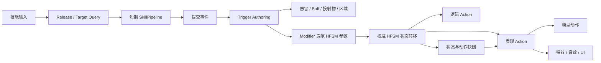
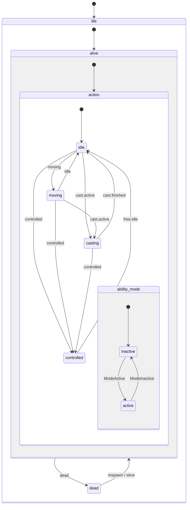

# MOBA 英雄技能接入基线

> 文档类型：通用接入基线与英雄映射模板  
> 适用范围：所有接入 `com.abilitykit.demo.moba` 的英雄、被动、技能、HFSM、ActionEditor、模型动作和特效  
> 权威规则：本基线只定义职责、顺序和证据要求；具体字段与命令以 [`moba-skill-authoring`](../../../../.claude/skills/moba-skill-authoring/SKILL.md)、[`MobaSkillPipeline.md`](../../../MobaSkillPipeline.md)、[`MobaTriggerAuthoring.md`](../../../MobaTriggerAuthoring.md) 和 Luban 生产文档为准。

## 1. 目标和判断标准

机制准入统一遵循 [`MobaMechanismGovernance.md`](../../../MobaMechanismGovernance.md)：共享执行链禁止英雄专属算法；规范未覆盖、冲突或需新增/改变机制时，先提交可审阅通用方案，用户明确确认后再实现。已有英雄特例和开放注册点不能替代确认。

一个英雄“接入完成”必须同时满足四个条件：

1. **玩法契约完整**：技能输入、状态、参数、提交点、取消/打断、清理和资源映射都有明确归属。
2. **权威链路闭合**：生产源、发布产物和运行时消费者可以逐项对应，不能只修改生成 JSON 或只让编辑器预览成功。
3. **逻辑与表现解耦**：逻辑层决定伤害、计数、Buff、状态和结束；表现层消费状态快照并播放动作、特效、音效。
4. **分层证据齐全**：配置契约、发布一致性、运行时逻辑、表现资源和英雄端到端场景分别有验收证据。

最终链路固定为：



## 2. 四层职责边界

| 层 | 负责 | 不负责 | 主要权威源 |
|---|---|---|---|
| 角色 HFSM | 长期模式、跨输入阶段、优先级、打断、恢复和状态动作组选择 | 直接计算伤害、直接依赖表现回调 | `Configs/MobaStateMachineAuthoring/*.json` |
| Modifier / 参数 | 以来源贡献参数，激活、更新和撤销参数贡献 | 直接指定目标状态，绕过 HFSM 条件 | Trigger/Continuous/Buff 配置及运行时 Modifier |
| SkillPipeline | 一次技能释放的短期流程：准备、等待、提交、取消、结束 | 持有跨多次输入的模式，使用 Repeat 模拟长期状态 | `Configs/Moba/SkillFlowCO.asset` |
| Trigger Authoring | 事件条件、效果、计数、Buff、投射物、区域和逻辑 Action | 直接切换 HFSM 状态，交给表现回调改变玩法 | `TriggerAuthoring/Packages/*.Module.asset` + `Sources/*.trigger.json` |
| 逻辑 Action | 在确定的状态边界执行已发布的 Trigger 或参数更新 | 播放本地动画、读取客户端对象 | HFSM state entry/exit action keys |
| 表现 HFSM / Action | 消费状态快照，播放模型动作、特效、音效和 UI | 决定命中、伤害、计数、状态退出 | `character_view_actions`、ActionEditor 双通道导出 |
| Excel / Luban | 英雄、技能、等级、Buff、投射物、查询、模型和特效 ID 映射 | 保存 Pipeline 长流程或编辑器临时状态 | `LubanConfig/Moba/Production/Datas/*.xlsx` |

### 2.1 归类规则

- **跨多个输入继续存在的模式**归角色 HFSM；例如架枪、变身、武器模式、弹匣槽位和换弹状态。
- **一次输入内有明确开始与结束**归 SkillPipeline；例如 Q/W/E 的准备、投射物提交和结束。
- **每次命中、发射、区域触发或状态边界产生的结果**归 Trigger；Trigger 通过 Modifier 影响 HFSM 参数，而不是直接跳转状态。
- **同一状态进入时必须发生一次的逻辑结算与表现播放**，配置为 HFSM 的逻辑/表现双通道 Action。
- **固定时间轴内的动作事件**可放 ActionEditor；它只描述该次技能片段的时间关系，不替代长期 HFSM。
- **特效模板**由通用特效表管理资源、挂点、偏移、缩放、跟随、层级、持续时间和 UI/世界目标；时间轴只引用模板 ID 和触发时机。

## 3. 接入前置：先写英雄契约

每个新英雄先建立一份映射表，未完成前不得继续堆 Trigger 或生成产物。

| 契约项 | 必填内容 | 最小验收 |
|---|---|---|
| 机制准入 | 每个机制的规范条款、消费者、复用/待确认/已确认/既有违规状态；需要时附用户确认依据 | 未确认机制不进入实现；共享链无英雄身份驱动的特殊执行逻辑 |
| 技能清单 | 英雄、被动、普通攻击、强化攻击、Q/W/E/R 及拆分技能 ID | ID 唯一，Excel 可引用 |
| 状态层级 | life/alive/dead、locomotion、interaction、ability、英雄模式子状态 | Authoring 可发布，转移优先级无环 |
| 参数表 | 参数 ID、类型、默认值、有效值、来源、合成、撤销、状态映射 | 多 Modifier 同时存在与撤销结果确定 |
| 提交点 | 发射、命中、伤害、Buff、生效、结束的唯一提交时刻 | 空放、未命中、被打断均有定义 |
| Pipeline 边界 | 每个 Flow 的开始、阶段、提交点、取消点和结束点 | 无长期 Repeat 冒充 HFSM |
| Trigger 链 | 事件、条件、逻辑 Action、Modifier、清理 Trigger | 事件到消费者可追踪 |
| 双通道 Action | 逻辑 entry/exit 与表现 entry/exit 的对应关系 | 表现不能改变玩法结果 |
| 模型动作 | 动作名、单次/多次、循环、串行/并行、打断恢复 | 动作注册表可解析 |
| 特效模板 | 模板 ID、资源、挂点、空间、偏移、缩放、层级、持续时间 | 运行时能创建和清理 |
| Payload | 强类型对象、字段 ID、字段类型、兼容规则 | 不依赖 `Object` 或未声明字段 |
| 验收场景 | 正常、空放、未命中、重复输入、打断、死亡、回滚/恢复 | 逻辑结果和表现恢复分别断言 |

## 4. HFSM 规划基线

通用角色层级使用以下职责分层，英雄只扩展模式和阶段参数，不复制一套专属状态机语义：



每个英雄必须补充以下内容：

- 状态进入/退出的逻辑 Action key 和表现 Action key。
- 状态转移的来源参数、条件和优先级。
- 打断状态的优先级和恢复目标。
- 参数贡献被撤销后的回退状态。
- 快照恢复时只重建当前状态和表现游标，不重复提交伤害、计数或 Buff。

## 5. 参数契约

参数是 Trigger、Buff、技能流程和状态机之间唯一的长期连接点。建议采用如下表结构：

| 字段 | 说明 |
|---|---|
| `parameterId` | 稳定整数 ID，不按英雄临时分配 |
| `type` | `bool`、`int`、`fixed`、枚举或框架已支持类型 |
| `defaultValue` | 没有贡献来源时的值 |
| `effectiveValueRule` | 优先级、最大/最小、覆盖、叠加或计数规则 |
| `sourceKey` | Modifier/Buff/技能实例的稳定来源键 |
| `removeRule` | 来源结束、被打断、死亡、释放或回滚时如何撤销 |
| `stateMapping` | 有效值对应的 HFSM 状态或动作组 |
| `snapshotRule` | 是否进入权威快照及恢复时如何重建 |

约束：

1. Trigger 只能写入 Modifier/参数，不得直接写目标状态 ID。
2. 表现动作完成不得写入参数，也不得触发伤害或计数。
3. 同一参数的多来源贡献必须可独立撤销，不能用“清零”误伤其他来源。
4. 参数有效值必须在 HFSM 条件中被完整覆盖；未知值进入安全回退状态并记录诊断。

## 6. Pipeline、Trigger 和 HFSM 的组合模板

### 6.1 单次技能模板

```text
Input
  -> Release（合法性、目标查询、快照瞄准）
  -> Prepare（可选等待）
  -> Commit（唯一逻辑提交点）
  -> Trigger（伤害/Buff/投射物/区域）
  -> Recover
  -> Pipeline End
```

`Commit` 只能执行一次。取消、死亡、控制和重复输入必须定义是回滚提交、终止未提交阶段，还是保留已提交结果。

### 6.2 长期模式模板

```text
入口 Pipeline（只负责激活模式）
  -> 创建持续 Modifier
  -> HFSM 根据 Mode/Phase 参数进入模式状态
  -> 每次输入创建独立短 Pipeline
  -> Trigger 更新计数/阶段参数
  -> 参数达到结束条件
  -> 移除 Modifier
  -> HFSM 回到普通状态
```

不要把多次普通攻击、R 多发射击、弹匣循环或变身持续时间放进一个长 `Repeat` Flow。每次输入必须拥有独立的技能 ID、提交点、Trace 和回滚语义。

## 7. 双通道 Action 和 ActionEditor 规则

ActionEditor 的导出单位是“一次技能片段的时间轴”，而不是整个英雄状态机。每个时间轴应导出：

- `*.moba.logic.json`：逻辑提交、Trigger 调用、参数修改或确定性事件。
- `*.moba.presentation.json`：模型动作、`PlayParticle`、音效、镜头和 UI Cue。

同一状态可以有相同的 HFSM 路径，但两个通道的 Action 列表可以不同。逻辑通道必须在权威边界执行一次；表现通道可被打断、重建和重播。

模型动作配置至少支持：单次播放、指定播放次数、循环、串行、并行、打断策略和恢复游标。这里的“播放次数”表示可串联多个单次 Action，不等价于把次数塞进 loop 参数。

`PlayParticle` 只保存模板 ID、触发时机和可选上下文。层级、挂点、空间、缩放、偏移、跟随、排序、生命周期和 UI/世界目标由特效模板与表现管理器解释。UI 特效不得假定能挂到世界模型上。

## 8. Payload 类型基线

所有 Trigger/Action 参数必须声明字段类型和字段 ID。运行时消费顺序为：

1. 优先读取声明的强类型 `SkillCastContext`、`AttackInfo`、`AttackCalcInfo`、`DamageResult` 等对象。
2. 仅为已发布的兼容版本保留 legacy 字段 ID 映射。
3. 对缺失字段报告 `fieldId`、期望类型、实际类型和生产来源。
4. 禁止把 `Object` 的反射字段查找作为正式契约；它只能用于迁移诊断。

## 9. 权威源与发布顺序

| 顺序 | 操作 | 权威源 | 产物/检查 |
|---:|---|---|---|
| 1 | HFSM Authoring | `Configs/MobaStateMachineAuthoring/*.json` | `MobaStateMachinePublisher.Check/Publish` |
| 2 | SkillFlow / ActionEditor | `SkillFlowCO.asset`、`action_timeline/*.json` | Flow exporter、双通道 JSON |
| 3 | Trigger Authoring | `Packages/*.Module.asset`、`Sources/*.trigger.json` | `GenerateBatch`、Trigger runtime plan |
| 4 | Excel | `Production/Datas/*.xlsx` | `python LubanConfig/Moba/export_pipeline.py --apply` |
| 5 | 发布一致性 | 以上全部 | `--check-published`、引用/标签/资源校验 |
| 6 | 运行时验收 | fixture、Unity/Console gate | 分层报告和英雄端到端证据 |

禁止直接编辑 `Resources/ability/ability_trigger_plans.json`、`Resources/moba/*.json`、`Resources/luban/` 和生成代码来修复玩法问题。

## 10. 分层验收门禁

| 层级 | 目的 | 必须回答的问题 |
|---|---|---|
| P0 结构 | ID、引用和 schema | 能否加载、发布、解析、注册？ |
| P1 配置 | 来源与产物一致 | Excel、Flow、Trigger、HFSM、动作和特效模板是否同一版本？ |
| P2 逻辑单链路 | 一个机制的确定性 | 提交一次是否只结算一次？空放/未命中/打断是否符合契约？ |
| P3 参数/HFSM | 长期状态 | Modifier 激活、叠加、撤销、死亡和恢复是否正确转移？ |
| P4 表现 | 动作和特效 | 状态进入是否播放正确动作，打断/恢复是否清理并重建表现？ |
| P5 英雄旅程 | 完整体验 | 普攻、被动、Q/W/E/R 在真实运行中是否闭环？ |

每个门禁都要保存：输入、权威状态、参数贡献、Trigger/Effect 结果、HFSM 转移、逻辑 Action、表现 Action 和最终资源实例。只保存 Action trace 不能证明玩法正确。

## 11. 烬的基线映射（第一个完整样板）

| 机制 | 归属 | 当前 ID/参数 | 接入要求 |
|---|---|---|---|
| 四槽普通攻击 | HFSM + 独立短 Pipeline | `30010601..30010604`，`AttackSlot=10` | 空放也计数；每次输入独立提交；槽位由参数选择 |
| 换弹 | HFSM 状态 `attack.slot.5` | 入口 Trigger `30010006/30010014` | 逻辑 Action 负责换弹结算，表现 Action 播放 `AutoAttack_Reload`；动画不能决定换弹完成 |
| 被动第四发 | Trigger + Modifier | 被动 `30010000`，相关 Trigger `30010001..30010004` | 计数与伤害提交分离；第四发增强由参数/效果表达 |
| Q | 单次 SkillPipeline | `30010101` | 投射物提交、命中和弹跳均由逻辑链处理 |
| W | 单次 SkillPipeline + 标记 Buff | `30010201`、标记 `30010221` | 先读标记，再执行命中/控制规则；表现不能代替标记 |
| E | 单次 SkillPipeline + 区域/减速 | `30010301`、减速 `32010301` | 区域生命周期、命中去重和清理独立验收 |
| R 架枪 | 短入口 Pipeline + 持续 Modifier | `30010401`、R 模式 `32010404` | 入口结束后 HFSM 继续管理架枪状态 |
| R 普通射击 | 独立短 Pipeline + HFSM 阶段 | `30010501` | 由阶段/次数参数选择 `Spell_R_Shoot` |
| R 终结射击 | 独立短 Pipeline + HFSM 阶段 | `30010502` | 使用 `Spell_R_ShootLast`，提交后清理 R 模式 |

烬不应再用一个长 Flow 的 Repeat 表示 R 的多发射击；R 的连续性来自 HFSM 参数和 Modifier，单发技能 Flow 只负责该发射击的短期流程。

### 11.1 当前自动化证据快照

以下记录说明“自动化链路覆盖到哪一层”，不等于最终游戏画面已验收。测试代码位于 `JhinSkillAcceptanceTests.cs` 和 `JhinUnityPresentationConsumptionTests.cs`；具体运行结果以本次 NUnit XML 为准。

| 技能 | 逻辑 / HFSM 验收 | Unity EditMode 表现消费验收 | 仍需画面确认的项目 |
|---|---|---|---|
| Q | 目标范围与锁定释放、真实投射物命中/弹跳和伤害有 acceptance 覆盖 | 真实施法快照播放模型动作/时间轴 VFX；投射物 VFX 创建、跟随与释放有消费测试 | 子弹相对目标的视觉轨迹、命中特效时序和实际观感 |
| W | 指向施法朝向、瞄准快照、投射物命中/伤害、标记与定身条件有 acceptance 覆盖 | 施法动作/时间轴 VFX、投射物 VFX 跟随与释放有消费测试 | 指向器与射线观感、角色转向和命中特效时序 |
| E | 发射后飞行、抵达才部署、延迟武装、伤害/减速和区域移除有 acceptance 覆盖 | 真实投射物快照创建陷阱 VFX、绑定 Actor；`Spell_E` 部署 trigger 从头播放 Deploy；Projectile Exit 后释放跟随 VFX | 飞行起点/落点、飞行时长、部署动画与落地特效的空间关系 |
| R | HFSM 瞄准/射击/终结/退出，多发方向和伤害参数有 acceptance 覆盖 | 瞄准、普通/终结射击动作与弹道 VFX；打断后回到瞄准并清理弹道 VFX 有消费测试 | 枪架姿态、准星/扇区、角色朝向、弹道和终结表现时序 |

本轮 E 的定向复验结果：`E_ArmsAfterDelayHitsOneEnemyAppliesDamageAndSlowThenRemovesArea` 与 `E_RealProjectileSnapshotsPlayAndReleaseConfiguredTrapVfx` 各运行 1 条、通过 1 条、失败 0 条，分别见 `local/Logs/jhin-e-flight-contract-rerun.xml` 和 `local/Logs/jhin-e-projectile-vfx-consumption-verified.xml`。E 消费测试还验证了一个容易漏掉的接线：prefab 的 Animator 使用 `Spell_E` 驱动 Deploy，因此 spawn VFX handler 必须消费这个 trigger；只验证 prefab 实例化会漏掉部署动作未播放的问题。

当前可下的结论是：四技能的核心机制/HFSM 和主要表现消费链有自动化覆盖；本快照没有证明画面观感、空间挂点/缩放、指示器外观或最终时序，故不能据此把四技能或烬整体标成 `RuntimeClosed` / `HeroReady`。用户暂缓启动有画面的 Unity 验收时，应将这些项目明确登记为 deferred visual acceptance。

2026-11-06，烬 W 的真实 HUD 输入闭环新增通过：`W_LocalBattleHudReleaseFlowsThroughInputFeatureAndDamagesEnemy` 经本地 Battle HUD/InputFeature 提交技能，并断言敌方 HP 下降；NUnit 结果 `total=1, passed=1, failed=0`，见 `Unity/local/Logs/jhin-hud-session-closure-recheck2.xml`。这证明 W 的按钮输入到逻辑伤害链，不替代 W 指示器画面验收、E HUD 输入验收或烬全技能 `RuntimeClosed`。

### 11.2 金克丝 Jinx 接入基线（进行中）

| 契约项 | 当前约定与证据 | 尚缺内容 / 下一步 |
|---|---|---|
| 规则版本 | 采用七英雄对照的 Riot Data Dragon `16.22.1 en_US` 作为规划基线 | 客户端碰撞、切换资源时点、普攻边界等未被 Data Dragon 确定的规则，逐批核准后才进入数值配置 |
| HeroId / ModelId | Jinx HFSM、角色表、属性模板和模型 `3002` 已登记；模型指向 Arcanist prefab | 继续核对 Animator、动作资源和角色表现绑定；不要重复创建模型行 |
| HFSM | `Configs/MobaStateMachineAuthoring/character_hfsm_3002.json`；角色本地参数 `WeaponMode`，ID `4`，`0=Pow-Pow`、`1=Fishbones`；源与 Unity/Console 副本一致 | 长期模式由 Modifier→HFSM 参数→状态迁移管理；仍需补完整逻辑/表现动作组和回滚验收 |
| HFSM/Q/攻击验收 | `JinxSkillAcceptanceTests`：`Unity/local/Logs/jinx-acceptance-20261108.xml`，`4/4` 通过；覆盖本地参数、Buff Modifier 切换、两种普攻候选和投射物伤害、W 首目标伤害 | 这些是 headless production-path 用例；不证明 HUD/InputFeature、提交前取消、回滚或实际画面表现 |
| 技能 ID | 生产表已有 `30020000–30020201` 中的 Passive、基础/模式普攻、Q 与 W；`30020301/30020401` 仍是 E/R 规划 | Projectile、Launcher、Area、VFX 使用各自命名空间；新增行按已核准机制和数据逐批登记 |
| Q 输入与指示器 | Q 是点按武器切换，无瞄准指示器；Q Flow `30020101` 与 Trigger 已发布，Q 模式切换 headless 验收通过 | 补真实 HUD/InputFeature、提交前取消与回滚验收；两种普攻槽和 HFSM 读取同一角色本地 `WeaponMode` |
| 模式化普攻 | Pow-Pow/Fishbones `30020002/30020003` 已接入；候选 Modifier `2000008/2000009` 均目标槽位 `3`，W 保留在槽位 `2` | 后续核准攻击速度、射程、费用与范围伤害规则；补本地画面、动作/VFX 与打断清理验收 |
| W 震荡电磁波 | `30020201` 及方向投射物链已发布；首目标伤害一次、后方目标不受击通过 Unity headless 验收 | 补真实指示器几何、HUD 输入、墙体/空放边界与实际 VFX 画面验收 |
| 表现 | 已有 Jinx 角色资源目录；HFSM 运行状态可供表现层消费 | 仍需模型行、武器待机/攻击/切枪动作映射、挂点与 VFX；逻辑验收后按动作资源做 Unity 画面验收 |
| 验收门禁 | `moba-jinx-unity` P2 已执行 `JinxSkillAcceptanceTests`；覆盖 Q、两种普攻与 W 的 headless 逻辑结果 | gate 不覆盖真实 HUD 输入、rollback、指示器形状和画面表现；通过 headless gate 不等于 `RuntimeClosed` |

Jinx 完整状态树、参数取值、动作优先级、Q 的唯一模式提交点、技能状态归属和逐层验收均以[金克丝完整 HFSM 状态机设计基线](25-JinxSkillAndResourceAnalysis.md#金克丝完整-hfsm-状态机设计基线)为准。该状态机设计优先于后续单个技能的实现草案；若技能实现发现状态图或参数契约不足，先修订这份共同基线，再进入对应技能配置，避免每个技能采用不同的长期模式方案。

下一批顺序为：**Q/W 真实 HUD/InputFeature 输入 → 指示器与模型/VFX 画面验收 → 模式来源清理、打断与回滚 → 按已确认规则推进 P/E/R**。Q 不做指示器；W 的 headless 方向投射物与首目标伤害逻辑已通过，不代表指示器和画面闭环完成。

#### 2026-11-08 用户决策：金克丝 Q 使用互移 Buff 驱动模式

用户明确选择用两个模式 Buff 承载金克丝 `WeaponMode`：各 Buff 添加时通过 OnAdd Trigger 立即移除对侧 Buff，并由各自的 Modifier Override HFSM 参数 4 为 0/1。此决定仅覆盖金克丝 Q 模式来源，取代 2026-11-06“Q 直接写角色参数、Buff 替换不需要”的方案；HFSM 仍只以有效参数值转移，普攻候选仍读取同一个参数，不增加第二套模式裁决。Trigger 修改须同步 Source 与 Module，并验证 Buff 移除在当前生命周期事务内完成、旧 Modifier 来源撤销及回滚恢复。

## 12. 新英雄复用模板

复制本节作为英雄登记表，所有空项在开始实现前填完：

```text
HeroId / Name:
RuleVersion:

1. Skill IDs:
2. Passive IDs and event sources:
3. HFSM machines and states:
4. HFSM parameters (id/type/default/source/merge/remove):
5. Long-lived modes owned by HFSM:
6. One-shot Pipelines and commit points:
7. Trigger -> Modifier -> HFSM event chains:
8. Logic entry/exit actions:
9. Presentation entry/exit actions:
10. Model clips and serial/parallel/repeat policy:
11. VFX template IDs and mount/space/scale/offset/lifetime:
12. Strong payload fields and compatibility IDs:
13. P0-P5 evidence paths:
14. Known gaps and explicit deferred scope:
Mechanism admission (per mechanism):
    rule/source/consumer/evidence;
    reuse / awaiting user decision / approved / existing violation;
    proposal path, approved scope and user confirmation reference when needed.
```

## 13. 推进顺序

后续每个英雄按以下批次推进：

1. **契约批**：填写技能清单、HFSM 图、参数表、Pipeline 边界和资源映射；只做 Authoring 校验。
2. **逻辑批**：先跑一条最小单链路，验证强类型 Payload、Trigger、Effect 和确定性提交。
3. **状态批**：接入 Modifier 与 HFSM，覆盖激活、叠加、撤销、打断、死亡和恢复。
4. **表现批**：接入模型动作、双通道 Action、特效模板和时间轴预览。
5. **英雄批**：补齐所有技能和边界场景，再运行完整英雄 gate。
6. **复用批**：新发现的通用缺口先提方案、获得用户确认，再更新本基线/机制契约并实现扩展点；禁止先接入后补规范，也禁止在英雄文档中复制流程规则。

任何门禁失败先定位到上述层级，再回溯“来源 → 发布物 → 消费者 → 证据”，不要直接改运行时生成文件或继续叠加英雄专属补丁。

## 14. 真实技能闭环补充契约（新英雄必填）

P0-P5 之外，每个主动技能还必须登记以下运行时交互字段；没有这些字段的英雄只能停留在 `Contract Ready`，不能进入批量 Skill/Trigger 制作：

```text
15. Input phases:
    Press / Hold / Release / Cancel;
    repeated input, unavailable input, controlled/dead input behavior.
16. Indicator contract:
    shape, length/width/radius, parameter source, update cadence,
    target query/filter/order, invalid state feedback, owner and cleanup.
17. Aim snapshot:
    snapshot frame, aim position/direction, target candidate summary,
    geometry/query version, release-time freeze rule.
18. Commit contract:
    unique commit point, pre-commit cancel, post-commit interrupt,
    resource/cooldown timing and duplicate-submit guard.
19. Runtime scenario evidence:
    input -> indicator -> release -> result -> presentation path.
20. Cleanup evidence:
    indicator, projectile, area, buff, presentation handle and rollback cleanup.
```

新增验收结果必须区分以下状态：

- `Configured`：来源表、Flow、Trigger、HFSM 和资源引用存在；
- `LogicVerified`：确定输入下的 Commit、Trigger 和战斗结果正确；
- `InteractionVerified`：输入阶段、指示器更新、瞄准快照和取消反馈正确；
- `RuntimeClosed`：真实场景中表现、清理、打断和回滚与权威结果一致；
- `HeroReady`：全英雄 gate 及 P0-P5 证据齐全。

只有 `RuntimeClosed` 才能把单个技能标记为完成；只有所有纳入范围的技能达到 `RuntimeClosed`，英雄才可标记为 `HeroReady`。动作 trace、Prefab 可加载或静态资源寻址只能提升到 `Configured`/`LogicVerified`，不能替代 `InteractionVerified` 和 `RuntimeClosed`。

指示器必须与实际命中几何共享配置或共享冻结 Payload。预览阶段不得写入伤害、Buff、计数、冷却、被动参与或其他不可逆副作用；释放后由 `castInstanceId + generation` 负责生命周期，Cancel、Interrupt、Death、Rollback 和 Replay 都必须清理旧实例。

#### 2026-11-06 方案记录（已由 2026-11-08 用户决策取代）

早期方案曾提出由 Q 直接写角色本地 HFSM 参数，并据此认为模式切换不需要 Buff。该方案不再是当前契约。2026-11-08 已确认以两个互斥模式 Buff 作为唯一模式来源：添加目标 Buff 时由其 OnAdd Trigger 立即移除对侧 Buff，各自 Modifier 覆盖同一角色本地 `WeaponMode` 参数；HFSM 按参数自动迁移，普攻候选读取同一有效参数。不要按旧段落实现直接参数写入，也不要增加第二套模式裁决。详见上方“2026-11-08 用户决策：金克丝 Q 使用互移 Buff 驱动模式”。

早期关于 ReplaceBuff 的讨论同样不构成当前实现要求。这里使用已有 Buff/Modifier/Trigger 配置组合；不新增通用 ReplaceBuff 动词或金克丝专用运行时分支。当前待验项是提交前取消、Buff 来源撤销与回滚、真实输入和表现闭环。
