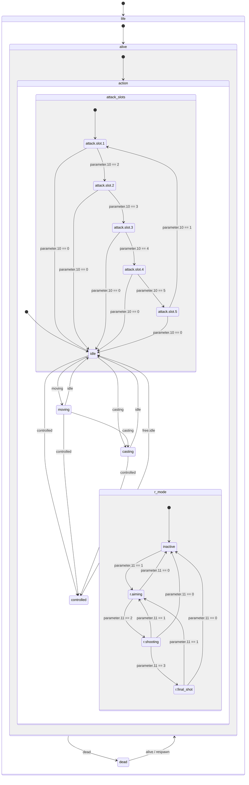

# 烬（Jhin）英雄技能接入契约

> 本文是烬接入 AbilityKit MOBA 的单英雄契约表。它把 Excel、SkillFlow、Trigger Authoring、角色 HFSM 和表现动作之间的边界固定下来，作为后续运行时修复和 Unity 验收的基线。

## 1. 权威来源与发布顺序

| 内容 | 权威编辑源 | 本契约中的职责 |
|---|---|---|
| 技能、被动、技能等级、目标查询 | `LubanConfig/Moba/Production/Datas/J-技能表.xlsx` | 烬的技能 ID、Flow 引用、目标查询和空放规则 |
| 单次技能流程 | `Unity/Packages/com.abilitykit.demo.moba.view.runtime/Configs/Moba/SkillFlowCO.asset` | Release、Commit、Shot 等一次施放内的短流程 |
| 事件、计数、Buff、投射物和 Modifier | `Configs/MobaTriggerAuthoring/Sources/*.trigger.json` | 玩法结果和 HFSM 参数贡献 |
| 角色状态机 | `Configs/MobaStateMachineAuthoring/character_hfsm.json` | 长期模式、攻击槽、R 阶段和恢复路径 |
| 模型动作 | `Resources/luban/moba/character_view_actions.json` | 状态快照到 Animator 动作组的表现映射 |
| 时间轴片段 | `Resources/moba/action_timeline/skill_*.json` | 单次技能片段的逻辑/表现事件，不拥有长期状态 |
| 特效资源 | Luban VFX 表和通用特效模板 | 挂点、层级、偏移、缩放、生命周期和 UI/世界目标 |

发布顺序固定为：HFSM Authoring → ActionEditor 双通道片段 → Trigger Authoring → SkillFlow → Luban 导出 → 静态契约检查 → Unity EditMode/无头门禁。生成的 `Resources/moba/*.json`、`Resources/luban/` 和 `ability_trigger_plans.json` 只能作为发布物检查，不能作为编辑源。

## 2. 技能 ID 映射

| 领域 | ID | 名称/语义 | 所属机制 |
|---|---:|---|---|
| 被动 | 30010000 | Whisper | 计数、四发弹匣、换弹和普攻槽选择 |
| 被动 Trigger | 30010001 | 普攻发射事件 | 每次成功发射后产生计数事件，空放也计数 |
| 被动 Trigger | 30010002、30010003 | 被动效果/状态更新 | 被动持续效果及计数相关更新 |
| 被动 Trigger | 30010004 | 空放弹匣计数 | 只按 `skill.basic_attack.launched` 和技能 ID 计数 |
| 被动 Trigger | 30010006、30010014 | 换弹表现入口 | 只负责换弹表现提示；换弹玩法结果由逻辑 Action/Trigger 完成 |
| Q | 30010101 | Dancing Grenade | 一次短 Pipeline |
| W | 30010201 | Deadly Flourish | 一次短 Pipeline |
| E | 30010301 | Captive Audience | 一次短 Pipeline，部署区域后结束 |
| R 入口 | 30010401 | Curtain Call | 架枪入口短 Pipeline；结束后由 Modifier 保持 R 模式 |
| R 普通射击 | 30010501 | Curtain Call Regular Shot | 每发一次独立短 Pipeline |
| R 终结射击 | 30010502 | Curtain Call Final Shot | 最后一发独立短 Pipeline |
| 普攻槽 1～4 | 30010601～30010604 | Basic Attack 1～4 | 每次独立短 Pipeline，由 `AttackSlot` 选择 |

R 的入口、普通射击和终结射击不是一个长 Repeat Pipeline。入口 Flow 结束后，R 模式 Modifier 贡献 `RPhase=aiming`；每次输入再启动 30010501 或 30010502，提交后由 Trigger/Modifier 更新下一阶段。这样多个 Flow 在玩家体验上连续，但生命周期仍由 HFSM 管理。

## 3. 角色 HFSM 契约

当前 Authoring 已有 `attack.slot.1..5`、`r.aiming`、`r.shooting`、`r.final_shot` 和 `life/alive/dead`。图中的分组表示职责，不要求运行时把攻击槽和 R 模式实现成两个互相独立的活动路径；如果当前引擎使用单活动路径，必须通过明确的优先级和条件表达同样的结果。

## 4. 参数契约

| 参数 | ID | 类型/默认值 | 有效值 | 来源与合成 | 撤销/清理 | HFSM 作用 |
|---|---:|---|---|---|---|---|
| `AttackSlot` | 10 | int / 0 | 0..5 | 被动计数或普攻逻辑 Trigger 贡献；按来源合成，单一有效槽位 | 弹匣耗尽、换弹完成、死亡或施放被取消时清理 | 1～4 选择四种普通攻击，5 选择换弹 |
| `RPhase` | 11 | int / 0 | 0..3 | R 模式/射击 Modifier；0 inactive、1 aiming、2 shooting、3 final_shot | R 结束、取消、死亡或控制打断时撤销 | 选择架枪、普通射击、终结射击阶段 |
| `CommittedAttackSlot` | 12 | int / 0 | 1..5 | 当前攻击 Cast 在提交点锁定；不能被下一次计数提前覆盖 | Cast 完成、取消或打断后清理 | 表现层锁定当前动作组，避免 `AttackSlot` 提前变化导致动作跳变 |

参数规则：Modifier 只贡献参数，不直接写目标状态 ID；HFSM 条件只读取合成后的有效值。每个来源必须可以独立撤销。`AttackSlot` 的技能/候选槽位定义（例如 Modifier `2000003..2000007`，Target Kind 5）属于技能槽位域，不等于 HFSM 参数 10（Target Kind 2）。当前 `200003/200006/200007` 分别是 R 模式、射击、终结阶段的 HFSM 参数贡献；射击计数不再另外持有阶段来源。

## 5. 普攻、换弹与空放边界

1. 普攻每次以 30010601～30010604 的一个独立技能实例提交；提交事件是 `skill.basic_attack.launched`，不以命中或造成伤害为计数条件。
2. 空放只要完成发射提交，同样推进弹匣计数；未通过施放校验、被打断或没有提交点则不计数。
3. `CommittedAttackSlot` 在当前 Cast 的逻辑 Commit 点写入，表现层读取它播放对应动作；`AttackSlot` 可以在同一时间被下一次计数更新。
4. 弹匣达到换弹条件后，HFSM 参数进入槽 5。槽 5 的逻辑 entry Action 触发换弹结算/清理，表现 Action 播放 `AutoAttack_Reload`，两者都只执行一次。
5. 换弹动画完成不能直接决定玩法状态；逻辑 Action/Trigger 完成后撤销槽 5 来源并贡献下一个 `AttackSlot` 值，HFSM 再回到对应普攻槽或 idle。

## 6. R 阶段和射击边界

2026-11-15 续接：用户已确认 `plans/JhinNextMechanismDecision.2026-11-15.md` 的 D3/D4。W/R 配置为沿途小兵、野怪受伤并继续，首敌英雄受伤后停止；两种 R 射击绑定 InputWithinStateCone，保留入口轴、逐发读取输入，以明确批准的半角 30 度示例基线校验。R 模式 Buff 配置 10000ms，移除时清理候选与阶段 Buff，由既有 Modifier 撤销和 HFSM 退出。10 秒及完整 60 度参考 Meraki latest 补充资料，不声称来自 16.22.1 的展开原始值。新增机制的验证记录以该方案本轮验收为准，下文历史门禁不代替本轮证据。

| 阶段 | 权威状态/参数 | 逻辑动作 | 表现动作 | 生命周期 |
|---|---|---|---|---|
| 架枪入口 | 30010401，`RPhase=1` | Release/Commit 后贡献 R 模式 | `Spell_R_Deploy`，随后 `Spell_R_Idle` | 入口 Flow 结束后仍由 Modifier 保持 |
| 瞄准 | `r.aiming` | 接受 30010501/02 输入，校验剩余次数和扇区内当前方向，保留手动空放 | `Spell_R_Idle` 循环 | 可跨多次输入持续，受模式 10000ms 上限约束 |
| 普通射击 | `RPhase=2`，30010501 | 单次射击 Flow 在 Shot 提交点发射/结算，再更新次数 | `Spell_R_Shoot` 单次 | 当前射击 Flow 结束即结束 |
| 终结射击 | `RPhase=3`，30010502 | 独立提交末发，弹体 OnExit 清理 R 模式 Modifier | `Spell_R_ShootLast` 单次 | 命中首英雄后 Exit(Hit)，空放到距/到期也退出；模式到期始终可清理 |

R 的连续体验由 `RPhase` 和剩余次数等逻辑参数串联，不由长时间轴或 Pipeline Repeat 持有。表现完成回调不能写 `RPhase`、不能提交伤害，也不能替代 Trigger。

## 7. Q/W/E Pipeline 契约

| 技能 | 允许阶段 | 唯一提交点 | 结束条件 | 不允许承担 |
|---|---|---|---|---|
| Q 30010101 | release → commit → recover | 投射物/伤害 Trigger | 提交完成或取消 | 普攻计数、R 模式 |
| W 30010201 | release → commit → recover | 命中/标记 Trigger | 提交完成或取消 | 跨输入持续状态 |
| E 30010301 | release → commit → recover | 陷阱/区域创建 Trigger | 区域创建提交后 Flow 结束 | 用 Repeat 持有区域全生命周期 |

时间轴只配置本次片段中的触发时刻和 `template_id`。`PlayParticle` 只引用通用特效模板 ID；层级、挂点、偏移、缩放、跟随、持续时间及 UI/世界目标均由特效管理器解释。复杂 UI 特效使用独立 UI 逻辑，不把 UI 生命周期硬绑在模型时间轴上。

## 8. 双通道 Action 与模型动作

| HFSM 状态 | 逻辑通道 | 表现通道（entityCode 3001） | 播放策略 |
|---|---|---|---|
| `attack.slot.1..4` | 提交对应普攻结果、锁定 `CommittedAttackSlot` | `AutoAttack_1..4` | 单次，完成后等待 HFSM 下一状态 |
| `attack.slot.5` | 换弹结算、清理槽位、贡献下一槽位 | `AutoAttack_Reload` | 单次；逻辑和表现同一状态边界执行 |
| `r.aiming` | 维护可射击模式 | `Spell_R_Idle` | 循环 |
| `r.shooting` | 单次射击结果 | `Spell_R_Shoot` | 单次 |
| `r.final_shot` | 最后一发结果并退出 R | `Spell_R_ShootLast` | 单次 |
| Q/W/E `casting` 覆盖 | Trigger/Commit | `Spell_Q` / `Spell_W` / `Spell_E` | 单次，可串行等待 |

Action 支持单次、多次、循环、串行和并行组合。播放次数表示 Action 实例需要播放几次；它不是用一个长期 Loop 代替多次独立技能提交。逻辑 Action 和表现 Action 可以来自同一 HFSM 状态快照，但逻辑通道拥有玩法结果权，表现通道只消费快照并管理动作、特效、音效和 UI。

## 9. 特效与 Payload 契约

- 时间轴事件只保存特效模板 ID、触发时间和必要的目标上下文；模板表保存资源、层级、挂点、偏移、缩放、跟随、持续时间、回收策略和 UI/世界目标模式。
- 逻辑 Payload 使用强类型字段，例如 `skill.id`、`actor.id`、`target.id`、`cast.instance.id`、`shot.index`、`is.final.shot`；字段 ID 和类型由 Payload schema 注册表定义。
- Trigger 条件不得依赖未声明的 `Object` 或字符串字段。发现 `Numeric payload field not found` 时，先修 schema/导出，再修运行时消费。
- `PlayParticle`、播放 UI 和模型动作均不得反向修改 HFSM 参数或战斗结果。

## 10. 当前状态、缺口和验收顺序

### 10.1 Q 投射物表现闭环

Q 的投射物表现已补充端到端验收：真实施法产生 `ProjectileEvent` spawn，通用 `BattleProjectileViewEventHandler` 根据投射物模板 `32010101` 解析 `VfxId=90013001`，实例化 `ChampionVfx/13.Jhin_Battlecast/Jhin_Battlecast_Q`，并通过 `ProjectileActorId` 跟随权威投射物；收到 Exit snapshot 后，跟随特效实体必须被释放。该验收不依赖 Q 时间轴中的施法特效，覆盖战斗投射物到 Unity VFX 的独立表现通道。

## 10.2 W HUD 输入到命中闭环

W 的新增验收从 `BattleHudInputEventDispatcher` 的 Start/Update/End 拖拽生命周期产生最终 Release 快照，检查技能槽、释放方向和瞄准投影，再将该快照交给真实 `SkillCastCoordinator`，验证 W 投射物命中最终方向上的首个敌人且不会穿透伤害后方敌人。该测试证明 HUD 输入状态到 W 逻辑施放与战斗命中的数据契约；`BattleHudInputEventBridgeTests` 单独覆盖 `SkillButtonView` 的 PointerDown/PointerUp 绑定与预览事件。它不替代运行时画面验收，仍需在本地模式确认指示器随指针更新、Release 后关闭，并检查模型动作与 W 特效的实际观感。

当前生产表中 `32010101.OnHitVfxId=0`、`OnExpireVfxId=0`。因此 Q 的命中点/退出点专属特效尚未接入，不能把通用占位或施法时间轴特效当作 Q 命中特效验收。后续若确认美术资源和产品需求需要命中特效，应新增 VFX 表记录并从生产表发布，再增加 Hit snapshot 的资源实例和生命周期验收。

| 项目 | 当前结论 | 下一步验收 |
|---|---|---|
| 技能/被动 ID | 已在 Excel 中存在 | Luban 发布后检查 ID、Flow 引用唯一 |
| HFSM 参数 10/11/12 | 服务和 Authoring 已存在 | 修复 AttackSlot 语义后跑参数迁移/回滚测试 |
| R 三阶段状态 | Authoring 与动作映射已存在 | 无头验证入口结束、每发切换、终结退出 |
| 四种普通攻击动作 | 现有发布动作已映射 `AutoAttack_1..4` | 验证 `CommittedAttackSlot` 不被提前计数覆盖 |
| 换弹动作 | `attack.slot.5` 已映射 `AutoAttack_Reload` | 验证逻辑 entry Action 和表现 Action 双通道只执行一次 |
| 普攻空放计数 | Source 已使用 `skill.basic_attack.launched` | 重新发布 Trigger Plan 并验证空放计数 |
| R/Q/W/E Flow | SkillFlowCO 已有关键 Flow | 验证每个 Flow 只有一次权威提交点 |
| Q 投射物表现 | `32010101` / `90013001` 使用通用 snapshot -> VFX 跟随和 Exit 清理 | Unity 真实施法验收 spawn、命中、退出和 prefab 生命周期；`OnHitVfxId`/`OnExpireVfxId` 为 0，专属命中特效待资源确认 |
| W HUD 输入与命中 | Release 快照已覆盖真实 W 首目标命中及后方目标不受伤 | 本地模式目视确认指示器更新/关闭与 W 动作特效时序 |
| 特效模板 | Trigger 已有表现入口，模板管理仍需逐项核对 | 验证挂点、缩放、生命周期和清理 |
| Unity 无头门禁 | 2026-11-03：技能验收 31/31、模型与特效消费 30/30 通过 | 本地模式目视核验动作观感、朝向、挂点与 HUD；Q 专属命中特效待确认资源 |

### 10.3 Unity 无头验收基线

无头门禁 `tools/run_test_gate.ps1 -Gate moba-jhin-unity` 是烬技能接入的发布前基线，必须在 Unity 编辑器目视验收前通过。门禁分为两段：技能验收夹具验证 Q/W/E/R 的真实施法、指示器输入、朝向、投射物命中、标记/控制、普攻四槽、换弹和 R 架枪/射击/终结/中断；Unity 表现夹具验证模型 Prefab、Animator 状态、ActionEditor 双通道时间轴、通用 VFX 模板实例化、投射物跟随和 Exit 释放。

W 的完整闭环至少包含以下断言：

- `30010201` 的权威施法快照选择模型动作 `Spell_W`，并消费 `Jhin_Battlecast_W_Cast` 枪口时间轴特效；
- `32010201` Spawn 快照解析 `VfxId=90013020`，实例化 `Jhin_Battlecast_W_Projectile`，可见节点首帧激活并跟随权威投射物 Actor；施法时间轴单独使用 `90013002` / `Jhin_Battlecast_W_Cast` 枪口特效；
- 首个目标命中后产生 Hit/Exit 快照，投射物不穿透后方目标，Exit 后 VFX 实体被释放；
- W 的 HUD Release 方向、角色转向和逻辑命中结果与表现快照使用同一份冻结输入。

E 的飞行 `90013003` / `Jhin_Battlecast_E_Projectile` 仅显示闭合陷阱；落地后由 Area 持久 cue 使用 `90013019` / `Jhin_Battlecast_E_Trap`，播放四臂展开并保持末姿势，Area 结束后释放。两者统一小尺寸（模型主体直径约 0.6m），施法时间轴不再重复生成完整陷阱资源。

R 模式 Buff `32010404` 绑定持续表现模板 `90013021` / `Jhin_Battlecast_R_Ground`，使用原左右地面分支与部署材质动画；跟随施法者位置和朝向，跨入口与各次射击 Cast 保留。模式 Buff 结束 cue 立即释放地面特效，资源动画完成不结束玩法模式。配置与验收见 [E/R 表现补充](../../../../plans/JhinERPresentationFollowup.2026-11-15.md)。

2026-11-15 的 W/E 修复增加隔离相机 GPU 图像与空间断言，验证实际可见像素、锚点、模型大小和落地展开；详见 [W/E 表现修复与验收](../../../../plans/JhinWEPresentationRepair.2026-11-15.md)。其余无头门禁证明资源加载、状态选择、快照消费和生命周期，完整对局的指示器、HUD 与整体观感仍需本地模式目视检查。

完成标准分为 P0～P5：P0 契约与来源一致；P1 发布物结构完整；P2 逻辑参数与 Trigger 链路正确；P3 模型/特效表现消费正确；P4 打断、取消、死亡和快照恢复正确；P5 正常、空放、未命中、重复输入、R 终结和换弹场景在 Unity 中跑通。
