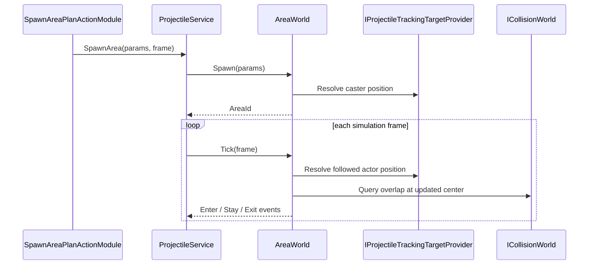

# MOBA attached area runtime foundation

## Purpose

This batch makes an authoritative combat area able to follow a live actor. It supplies the runtime foundation for persistent fields and ground effects whose collision region moves with their configured attachment. The work is shared infrastructure for the seven resource-backed heroes; it does not implement a hero-specific skill.

## Configuration meaning

`Aoes.AttachMode` is consumed by both the simulation and area presentation paths. The current presentation resolver defines `0` as world placement and `1` as attachment to the area event's owner actor. `SpawnAreaPlanActionModule` now follows that same contract: mode `0` creates a fixed world area; mode `1` follows the caster (`input.CasterActorId`). A selected target is not implicitly used as the attachment target. This keeps presentation and authoritative collision attached to the same actor.

The area center at spawn remains the configured center. When a tracking provider can resolve the caster, the runtime stores `Center - CasterPosition` as a world-space offset. Each simulation tick, before overlap queries, it sets the center to `CasterPosition + FollowOffset`. Thus an area can retain a spawn offset while translating with its owner.

## Runtime flow



`ProjectileService.OnInit` wires the same actor-position provider already used by homing projectiles into `AreaWorld`. A missing provider or an actor that becomes unavailable causes a followed area to expire and be removed on its next armed simulation tick. This prevents collision from silently remaining at a stale location. Fixed world areas do not require a provider.

Area rollback state now includes the follow flag, followed actor ID, world-space offset, center, and overlap history. `ProjectileService` exports projectile and area state in one versioned rollback payload, so restoring a frame resumes both simulation objects together. Transient area events are cleared after restore, consistent with projectile events.

## Scope and constraints

- The current `AttachMode` runtime contract is `0` (world) and `1` (caster). Other positive values are not interpreted as a target attachment mode; presentation currently resolves only mode `1`.
- Following updates the area center. It does not rotate the area's `Forward` vector or rotate its offset into the actor's local space. This batch therefore covers translation-following circles and world-oriented shapes; actor-relative rotation needs a rotation-capable tracking contract before it can be used for directional attached areas.
- Attachment is simulation-authoritative. The view continues to use `BattleAreaAttachResolver`; visual attachment does not substitute for collision tracking.
- This feature does not change radius, collision mask, delay/arming, target filtering, or area event policy.

## Source and verification

Implementation entry points are `AreaSpawnParams`, `AreaWorld`, `ProjectileService`, and `SpawnAreaPlanActionModule`. `AreaArmingAndConsumptionTests` covers following movement, spawn offset preservation, rollback restoration, and followed-actor removal. The focused command is:

```text
dotnet test src/AbilityKit.Combat.Projectile.Tests/AbilityKit.Combat.Projectile.Tests.csproj --no-restore --filter FullyQualifiedName~AreaArmingAndConsumptionTests
```

