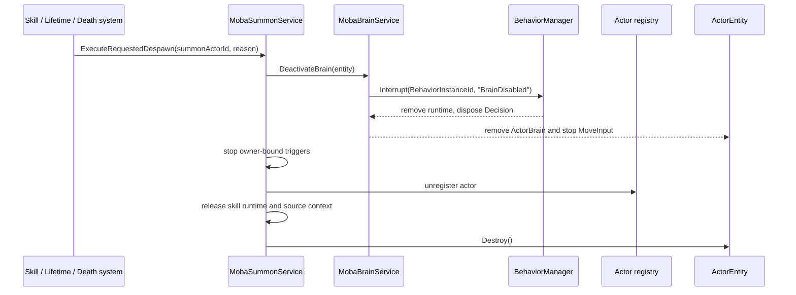

# MOBA summon brain lifecycle foundation

## Purpose

This batch closes the ownership boundary between a temporary summon actor and its AI Brain runtime. A summon configured with a Brain creates a `BehaviorRuntime` in `MobaBrainService`; destroying the Entitas actor alone does not destroy that runtime. The summon lifecycle now releases the Brain before unregistering and destroying the actor, so summon behavior trees can be used safely by hero skills that create, replace, or expire temporary units.

## Previous failure mode

`MobaSummonService.ExecuteRequestedDespawn` already stopped owner-bound trigger plans, released retained skill runtime handles, removed the actor from `MobaActorRegistry`, and destroyed the entity. It did not clear `ActorBrain` or interrupt the corresponding `BehaviorRuntime`. After destruction, `BehaviorManager` still held the decision and blackboard. Depending on system order, `MobaBrainSystem` could also tick a runtime whose owner actor no longer existed. This caused a leak and made summon death/expiry nondeterministic for behavior-driven summons.

## Authoritative destruction flow



`DeactivateBrain` is used instead of directly reaching into `BehaviorManager`. It handles both a running and a paused runtime, removes the `ActorBrain` component, clears brain-owned movement input, and removes failed-creation suppression for the actor. `BehaviorManager` then invokes its existing cleanup path, including `IDisposable` decision cleanup and removal from owner indexes. The service reference is optional so isolated summon tests or worlds that intentionally do not install Brain support retain their existing behavior; in a normal MOBA world the scoped `MobaBrainService` is injected.

## Ordering contract

1. Read owner, root-owner, summon, and Brain metadata while the entity is valid.
2. Deactivate Brain and its behavior runtime.
3. Stop owner-bound trigger plans.
4. Unregister the actor and update summon tracking.
5. Consume source context, release retained skill runtime, publish lifecycle/diagnostic events, then destroy the entity.

No new Brain can be created for the summon after step 2 because `ActorBrain` is removed before the entity is exposed as destroyed. The existing `MobaBrainSystem` remains responsible for creating and ticking Brain runtimes for live actors; it does not need a destroyed-actor query or a second cleanup sweep.

## Coverage for the seven resource-backed heroes

This is shared infrastructure for any mechanism that spawns a controllable or autonomous unit: Annie's Tibbers-like summon, pets, traps with a behavior tree, temporary minions, and future multi-unit ultimates. It supports lifetime expiry, owner death cleanup, overflow replacement, and explicit skill cancellation because all paths converge on `ExecuteRequestedDespawn`.

The runtime still requires each summon template's `BrainId` to resolve through the Brain catalog. Missing definitions remain a configuration error and do not create a runtime. HFSM-owned actors continue to use the existing state-machine ownership branch; this change only releases a summon actor's `ActorBrain` behavior runtime and does not alter the Jhin state machine.

## Verification

`MobaActorBrainChaseSmokeTests.Summon_with_chase_brain_moves_toward_nearest_enemy` now executes an explicit summon despawn after the Brain has ticked and asserts that the captured `BehaviorInstanceId` is no longer present in `MobaBrainService`. The focused command is:

```text
dotnet test src/AbilityKit.Demo.Moba.Tests/AbilityKit.Demo.Moba.Tests.csproj --no-build --no-restore --filter "FullyQualifiedName~MobaActorBrainChaseSmokeTests"
```

The test passed (1/1). Existing package restore and analyzer warnings are unrelated to this lifecycle change.

