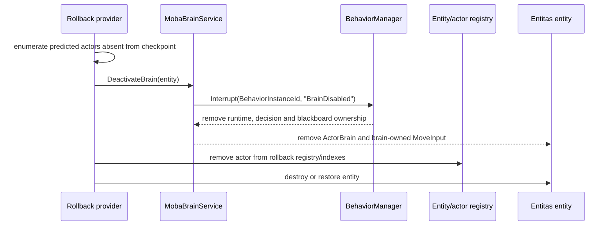

# MOBA rollback Brain lifecycle foundation

## Purpose

Prediction rollback removes actors by restoring an earlier checkpoint. That path is deliberately different from a gameplay despawn: it removes an Entitas entity directly and must not publish a gameplay death, summon-expired trigger, or ordinary presentation despawn event. Before this change, deleting a predicted summon could leave its `BehaviorRuntime` and blackboard registered in `BehaviorManager`. The next Brain tick could then address an actor that no longer existed, and a later actor could inherit stale owner indexes.

This batch makes rollback deletion release the Brain runtime before the entity is removed. It complements the normal summon destruction contract in `35-MobaSummonBrainLifecycleFoundation.md`; it does not merge rollback into the gameplay despawn flow.

## Two destruction paths

| Path | Entry point | Gameplay events | Brain cleanup |
| --- | --- | --- | --- |
| Normal lifetime/death/cancel | `MobaSummonService.ExecuteRequestedDespawn` | Publishes the configured lifecycle/despawn events and, where applicable, a presentation snapshot | Deactivates Brain first, then releases summon bookkeeping and destroys the entity |
| Prediction rollback | `MobaEntitasEntityRollbackProvider` | Restores checkpoint state; does not emit a new gameplay despawn | Deactivates Brain first, then unregisters/removes the entity through rollback |

The distinction is important for Annie Tibbers-like summons. Expiration or owner death is an authoritative gameplay result and may show a death effect. A rejected prediction is state correction; replay should reconstruct the summon from the checkpoint instead of playing a second death.

## Authoritative rollback ordering



The Brain is deactivated while the entity is still valid, so `ActorBrain` can be read and removed and the behavior manager can use the original `BehaviorInstanceId`. Once the entity is destroyed, only structural rollback cleanup remains possible; it cannot reliably recover the Brain handle. The provider therefore receives an optional scoped `MobaBrainService`. Worlds that do not install Brain support continue to use the existing rollback behavior.

## Cleanup boundaries

Rollback owns structural state correction:

* `MobaEntitasEntityRollbackProvider` removes the predicted actor and invokes Brain deactivation when the actor is absent from the checkpoint.
* `MobaRollbackRegistryBuilder` resolves the world Brain service and supplies it to the provider.
* Actor registry, EntityManager membership, and rollback checkpoint membership are corrected by the existing provider.

Gameplay services retain their own ownership:

* `MobaSummonService` owns owner/root-owner indexes, summon limits, lifecycle events, source context, and retained skill runtime handles for normal despawn.
* `MobaBrainService` owns `ActorBrain`, `BehaviorRuntime`, decision disposal, behavior-manager indexes, and Brain-owned movement input.
* Snapshot services own network/view snapshots. Rollback deletion must not be converted into an ordinary `ActorDespawn` snapshot; the next checkpoint replay supplies the correct spawn/despawn state.

This separation prevents duplicate owner-death triggers and duplicate view effects while still guaranteeing that no behavior runtime survives a structural entity deletion. If a future rollback implementation removes a summon through `MobaSummonService`, it must pass an explicit rollback reason and suppress gameplay events rather than calling the normal path implicitly.

## Prediction summon timeline

1. A predicted skill creates a summon entity, records owner/root-owner and summon metadata, and activates its Brain.
2. The Brain system may tick for several frames and write a behavior instance and blackboard.
3. The server checkpoint does not contain that actor, so rollback marks it for removal.
4. The rollback provider deactivates the Brain, removing the runtime before deleting the actor.
5. On replay, the skill either creates the summon again from the checkpointed command stream or remains absent. No stale Brain, summon behavior, or duplicate presentation event remains from the rejected prediction.

The same sequence applies to temporary pets, autonomous traps, and multi-unit ultimates. It does not change HFSM ownership or the Jhin state-machine work in progress.

## Verification

`MobaEntityRollbackBrainLifecycleTests` creates a predicted actor, activates its Brain, rolls back to a checkpoint without that actor, and verifies both entity removal and removal of the corresponding `BehaviorRuntime` from `MobaBrainService`.

```text
dotnet test src/AbilityKit.Demo.Moba.Tests/AbilityKit.Demo.Moba.Tests.csproj --no-restore --filter "FullyQualifiedName~MobaEntityRollbackBrainLifecycleTests"
dotnet test src/AbilityKit.Demo.Moba.Tests/AbilityKit.Demo.Moba.Tests.csproj --no-build --no-restore --filter "FullyQualifiedName~MobaEntityRollbackBrainLifecycleTests"
```

Both focused runs pass (1/1). The repository still reports pre-existing nullable, analyzer, package compatibility, and package vulnerability warnings; they are not introduced by this rollback lifecycle change.
