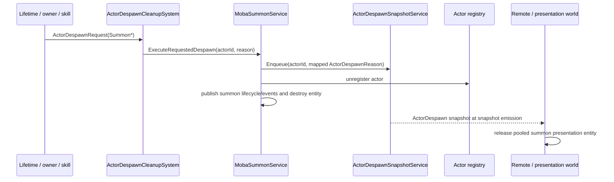

# MOBA summon despawn snapshot foundation

## Purpose

Temporary summons have a dedicated cleanup path because their owner links, summon limits, Brain runtime, skill-runtime retain, and lifecycle events must be released together. That path returns from `MobaActorDespawnCleanupSystem` before the system's generic `ActorDespawn` snapshot enqueue. A summon could therefore disappear from the logic registry while the remote or presentation world still retained its pooled entity.

The shared summon service now emits the same `ActorDespawn` snapshot contract that ordinary actors use. The fix is intentionally at the service boundary, so timeout, owner death, limit replacement, manual removal, killed summons, and scene cleanup all follow one rule.

## Before and after



The enqueue happens while the actor id and summon reason are still available, before registry removal and entity destruction. `MobaSummonService` maps `SummonDespawnReason` to the existing `ActorDespawnReason` values (`SummonTimeout`, `SummonOwnerDead`, `SummonReplacedByLimit`, `SummonManualRemove`, `SummonKilled`, or `SceneCleanup`). No new protocol type or view adapter is required.

## Ordering and duplicate rules

`MobaActorDespawnCleanupSystem` must keep its current order: it resolves the request, deactivates Brain, and delegates summon metadata to `ExecuteRequestedDespawn`. The generic enqueue remains for ordinary actors and linked projectiles; the summon branch returns after the service completes, so it cannot enqueue twice.

Direct callers such as `MobaSummonService.TryDespawn`, owner-death cleanup, and replacement overflow also converge on the same request and service. Repeated execution cannot duplicate a snapshot because the registry lookup fails after the first successful unregister. Rollback remains separate: rollback actor removal must not emit a gameplay despawn snapshot, as described in `36-MobaRollbackBrainLifecycleFoundation.md`.

For Annie's Tibbers-like summon this gives the required sequence: authoritative expiration or death releases Brain and summon bookkeeping, emits lifecycle/VFX events, and sends one actor-despawn snapshot so every client releases the same presentation object. A prediction rollback still suppresses that gameplay path and reconstructs from checkpoint state.

## Verification

`MobaActorBrainChaseSmokeTests.Summon_with_chase_brain_moves_toward_nearest_enemy` now resolves `MobaActorDespawnSnapshotService`, explicitly despawns the Brain-driven summon, decodes the pending snapshot, and verifies the summon actor id and `SummonManualRemove` reason. The focused commands are:

```text
dotnet test src/AbilityKit.Demo.Moba.Tests/AbilityKit.Demo.Moba.Tests.csproj --no-restore --filter "FullyQualifiedName~MobaActorBrainChaseSmokeTests"
dotnet test src/AbilityKit.Demo.Moba.Tests/AbilityKit.Demo.Moba.Tests.csproj --no-build --no-restore --filter "FullyQualifiedName~MobaActorBrainChaseSmokeTests"
```

Both runs pass (1/1). Existing package, nullable, and analyzer warnings remain unrelated to this snapshot lifecycle change.
