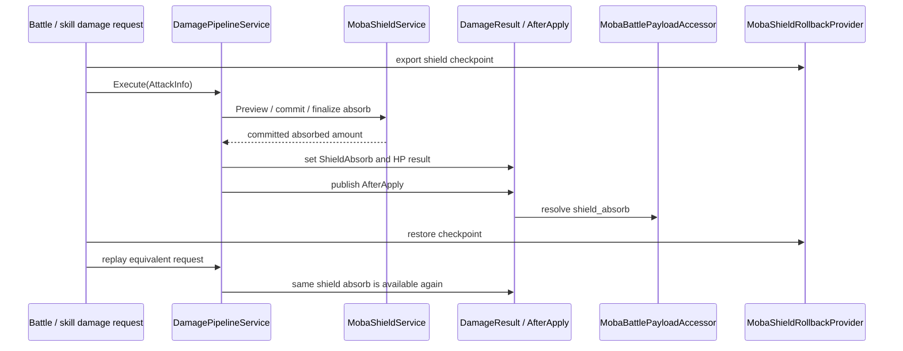

# MOBA shield absorb, damage payload, and rollback foundation

## Goal

This foundation verifies that an ordinary shield layer participates in the committed damage path as one coherent result: the shield service consumes value, `DamageResult` records the amount actually absorbed, the `AfterApply` subscriber receives that same result, the battle payload accessor exposes the absorb amount, and shield rollback restores the layer for deterministic replay.



`ShieldAbsorb` on `AttackCalcInfo` is the calculation-side value. The final `DamageResult.ShieldAbsorb` is populated from the committed calculation before `AfterApply` is published, so event consumers do not need to retain an earlier calculation object. `MobaShieldRollbackProvider` restores both personal layers and shared pools; this representative check uses a personal layer to keep the contract small.

## Verified behavior

`MobaShieldDamagePayloadSmokeTests.Damage_after_apply_exposes_committed_shield_absorb_and_rollback_restores_it_for_replay` creates a real Console battle, adds a six-point shield, and submits ten points of true damage. It verifies that:

- the returned damage result reports six points absorbed;
- `AfterApply` receives the same result instance;
- the `shield_absorb` payload field resolves to six through `MobaBattlePayloadAccessor`;
- the depleted shield is absent from the presentation snapshot;
- restoring the shield checkpoint restores six visible points, and an equivalent second damage request reports and publishes the same absorb amount.

The targeted test command is:

```text
dotnet test src/AbilityKit.Demo.Moba.Tests/AbilityKit.Demo.Moba.Tests.csproj --no-restore --filter "FullyQualifiedName~MobaShieldDamagePayloadSmokeTests"
```

Result: 1/1 passed. This is a service-level shield rollback and event-payload fixture, not a full frame-coordinator replay test.

## Use for hero skills

Annie E and Lux W can use the existing shield layer and payload contracts as their absorb foundation. Their skill flows still own legal target selection, shield grant values and durations, Buff/Modifier relationships, damage reflection rules, presentation cues, and skill-specific failure behavior. An absorb amount is not itself a reflection event: a later Annie contract must separately identify which incoming event qualifies, preserve attacker/source attribution, deduplicate multi-hit behavior, and prevent reflection recursion.

## Remaining boundary

This fixture does not prove production `add_shield` authoring and publish coverage, shared-pool policy, expiry and refresh combinations, client shield snapshot rendering, shield change VFX, full coordinator rollback, or Annie/Lux acceptance. It demonstrates that the existing core path can carry one committed absorb value through result, event, payload access, and shield-state restoration.
