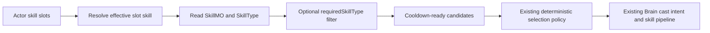

# MOBA Brain normal-attack candidate foundation

## Goal

Give a behavior tree a small, reusable way to select a configured normal-attack skill for a summon or other actor without changing the default combat tree. This is a candidate-filtering primitive: the normal skill-slot cast pipeline remains responsible for target validation, cooldown commitment, damage, and events.

## Selection contract

`moba.selectReadySkill` already enumerates the actor's current skill slots, resolves effective slot replacements, checks the configured skill and cooldown, then ranks the ready candidates with the selected deterministic policy. It now accepts an optional `requiredSkillType` property:

| Value | Behavior |
|---|---|
| `0` or omitted | Keep the existing behavior and allow any configured skill type. |
| Positive `SkillType` value | Keep only candidates whose resolved `SkillMO.SkillType` equals that value before policy ranking. |

The skill type is the published skill configuration field, represented by the generated `moba_luban.SkillType` enum. A pet tree can set `requiredSkillType` to `NormalAttack` (currently value `1`) and leave skill ID/tag unrestricted. A specific pet can still use `skillId` and `requiredTag` to narrow that set further. If no ready skill of the requested type exists, the selector leaves `candidateSkill.valid` false, as it does for any empty candidate set.



## Verified behavior

`MobaBrainSkillSelectionPolicyTests.Btree_can_filter_to_normal_attack_for_pet_combat` gives a test actor one active skill and one normal attack, then verifies that a tree configured with `requiredSkillType = 1` selects the normal attack in slot 2 and writes its type to the standard blackboard candidate fields. `Normal_attack_filter_does_not_use_other_skill_range_for_approach_fallback` verifies that the approach-range fallback also respects the type filter when the matching attack is cooling down.

The focused command is:

```text
dotnet test src/AbilityKit.Demo.Moba.Tests/AbilityKit.Demo.Moba.Tests.csproj --no-build --no-restore --filter "FullyQualifiedName~MobaBrainSkillSelectionPolicyTests" --verbosity quiet
```

Result: 7/7 passed. The existing unfiltered selection tests also pass, so omitting the new property retains prior candidate behavior. The .NET mirror currently has three unrelated `UnityEngine.Debug` references that prevent a plain build; the focused compile/test supplied a temporary minimal `UnityEngine.Debug` stub and removed it immediately afterward. A plain build remains blocked by those references.

## Use for summon behavior

This provides a shared building block for a future Tibbers behavior tree: an attack branch may request a configured normal-attack candidate and pass it through the same cast intent that applies other configured skills. Skill content remains data-driven; the change adds no summon ID checks or Annie-specific behavior.

## Remaining boundary

The candidate selector still does not implement a complete auto-attack state machine. It does not define attack cadence, wind-up, range recheck during wind-up, target-switch rules, animation cancellation, attack damage attribution, command recast, or summon rollback replay. Those rules need to be confirmed against the target game version and exercised in a summon battle fixture before claiming Tibbers combat fidelity.

The movement stop-range field is now carried from `moba.moveToEnemy` through intent arbitration and the canonical actor movement intent to `MobaBrainOutputApplySystem`. The apply system stops planar movement when the actor is within that radius of the requested target position. This gives the existing approach branch a usable generic approach boundary; legacy `MoveTo(target)` calls retain a zero stop range. It is still a direct-line movement request, not a pathing or attack-wind-up implementation.
