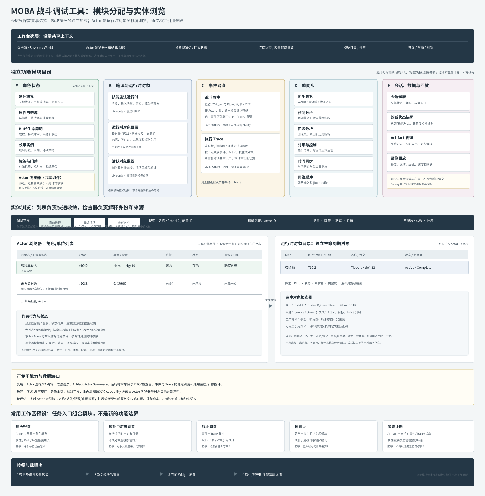

# MOBA 战斗调试工具模块化规划

> 状态：界面信息架构与模块分配规划稿。依据当前 `BattleDebugWindow`、`BattleDebugAnalysisModule`、Panels 和现有诊断能力整理；本文件只规划编辑器工具的信息架构与按需加载，不修改运行时诊断契约或战斗行为。



## 结论

应按具体调试任务拆成功能模块。模块不必隶属于某个固定页签；用户可以从模块目录独立打开，也可以把多个模块组合成工作区预设。顶层导航负责快速进入常见任务，模块目录负责按需发现工具，预设负责一键组合常用视图。

建议采用三层结构：

1. **工作台壳层**：数据源、会话/世界身份、Actor 和帧选择、连接状态、模块导航与轻量健康摘要。只保留低成本跨模块上下文。
2. **独立功能模块**：每个模块针对一个清楚的问题，有自己的数据能力声明、主视图/详情视图和刷新策略；未打开时不进行重型查询。
3. **工作区预设**：将常用模块组合成单个或并排视图，例如技能排查、帧同步排查、离线证据查看。预设只保存模块选择、布局和上下文，不改变模块语义。

建议的常用快捷导航是“角色”“施法与对象”“事件调查”“帧同步”“数据与回放”。它们是入口/预设，不是模块的所有权边界。功能若不属于当前快捷入口，仍可在模块目录单独打开，不必勉强合并进某个页签。

## 当前实现与问题

当前 `BattleDebugWindow` 已有五组导航、Actor/诊断实体列表、检查器、诊断帧游标、实时/离线来源、Artifact 导入导出和录像控制。`BattleDebugAnalysisModule` 也已经定义稳定 ID、来源支持、选择能力、主/次槽位和刷新策略；事件和 Trace 还分别提供多个 widget。

因此，工具并非缺少面板，而是“分类标签、导航组、具体模块、widget 和全局控制”在窗口里层级不够清楚。导航组现在承担了页签功能，类别直接决定用户从哪里找面板；会话健康和数据来源、Artifact 文件操作与录像回放又被放在一个概念附近。与此同时，技能运行时和对象目录被归入“技能与对象”，虽相邻但对应不同问题和数据查询。帧同步内部已有多个专项面板，却容易和其他诊断面板处在同一层级竞争注意力。

本规划将**独立模块**定义为可单独打开/关闭、声明所需数据能力、具备独立刷新与空态的调试单元；将**widget**定义为模块内部的表现切面；将**预设**定义为模块的布局组合。实现可以继续复用现有 Panel 和 Widget，不要求按模块概念机械拆文件。

## 模块分配

| 模块 | 独立解决的问题与保留功能 | 数据/上下文 | 现有实现映射与规划说明 |
|---|---|---|---|
| **工作台首页（壳层投影，不单独查询）** | 展示当前会话/数据源状态、Actor 摘要、最近失败或问题入口、常用模块快捷入口 | 只组合全局身份和轻量健康摘要 | 复用 Actor 状态与会话健康的轻量结果，不作为独立诊断模块，也不复制详细属性、Buff 或 Trace 内容 |
| **Actor 浏览器** | 搜索、过滤、列表选择、按 ID 定位 Actor | Actor 列表、当前数据源 | 作为通用导航组件；只列 Actor。调查模式按实体引用类型调用对应的 Actor 或运行时对象选择视图，不混排成无类型列表 |
| **Actor 状态** | 当前角色摘要、关键状态、最近活动和问题入口 | Actor + 当前/选定帧 | `BattleDebugOverviewPanel`；首选工作台内容 |
| **属性与修改来源** | 属性当前值、基础值/最终值/差值、修改器来源与计算解释；可选择单个属性查看基础值和最终值的最近帧曲线 | Actor + 帧；实时曲线需要 `IMobaBattleDiagnosticAttributeHistory`，离线数据通常只有 Artifact 中的采样点 | `BattleDebugAttributesPanel`；属性列表与修改器视图分开，属性曲线按需采样，来源字段按选择展开；原型用固定 Mock 点展示曲线、采样间隔、暂停和预期值对照 |
| **Buff 生命周期** | 活动 Buff、层数、计时、来源、效果/堆叠状态 | Actor + 帧 | `BattleDebugBuffsPanel`；只在打开模块或选择 Buff 后查询细节 |
| **效果实例** | 实体效果实例、层数、持续策略、已持续/剩余时间、周期时间和组件数量 | Actor + 含 ActorEffects 能力的诊断会话 | `BattleDebugEffectsPanel`；与 Buff 独立，按不同诊断能力查询 |
| **标签与门禁** | 有效标签、来源、门禁检查、规则命中及结果位 | Actor + 帧 | `BattleDebugTagsPanel`；展开某来源/规则时加载解释链 |
| **技能施法运行时** | 活跃施法、阶段、输入快照、黑板、挂起子对象和 Trace 跳转 | 实时会话；当前实现为 Live only | `BattleDebugSkillRuntimesPanel`；与对象目录分开，目标是解释“施法流程进行到哪里” |
| **运行时对象目录** | 投射物、区域、召唤物等对象的索引、状态、生命周期、完整度、来源/所有者和选中详情 | 诊断会话与 RuntimeObjects 能力；按来源能力过滤 | `BattleDebugRuntimeObjectsPanel`；列表与详情属于同一模块的主/检查器视图 |
| **活跃对象监视** | 当前实时世界里的投射物链接、活动区域、持续效果和最近参数解析 | 实时会话；当前实现为 Live only | `BattleDebugActiveObjectsPanel`；高频/活跃集合查询仅在模块激活时刷新 |
| **战斗事件调查** | 事件概览、筛选、事件列表和详情；按 Actor、帧、失败、关键词聚焦 | Live 或含 Events 能力的离线数据；Actor/帧/事件选择 | `BattleDebugDiagnosticEventsPanel` 的 overview、trigger-flow、list、details widgets；独立模块 |
| **执行 Trace** | 因果树、瀑布图、详情、错误/效果/进行中视图；跳转事件、Actor、配置和相关帧 | Live 或含 Trace 能力的离线数据；Trace 根/节点选择 | `BattleDebugDiagnosticTracePanel` 的 tree、waterfall、details widgets；独立于事件模块，但双向关联 |
| **帧同步总览** | 世界与最近帧、同步状态概览，进入专项分析的入口 | 实时战斗上下文 | `BattleDebugFrameSyncPanel`；主同步模块的首页 |
| **预测分析** | 预测状态、预测指标与时间范围 | 支持帧选择的 Live/Offline 来源 | `BattleDebugFrameSyncPredictionPanel`；单独加载预测指标视图 |
| **回滚分析** | 回滚频率、帧范围、原因和历史指标 | 支持帧选择的 Live/Offline 来源 | `BattleDebugFrameSyncRollbackPanel` |
| **对账与控制** | 对账诊断及现有显式启停/恢复控制 | Live runtime control；写操作显著标识 | `BattleDebugFrameSyncReconcilePanel`；只在用户打开时显示控制，保留当前权限/确认边界 |
| **时间同步** | 时间同步和每世界状态 | Live 来源 | `BattleDebugFrameSyncTimePanel`；按需查询专项统计 |
| **网络缓冲** | jitter buffer、网络输入/缓冲状态与指标 | Live/Offline 按当前模块能力声明 | `BattleDebugFrameSyncNetworkPanel` |
| **会话健康** | 诊断健康、采集状态、耗时和异常入口 | 当前诊断会话 | `BattleDebugDiagnosticsHealthPanel`；轻量摘要可投影到工作台，其详细指标留在模块 |
| **诊断状态快照** | 诊断状态/指标的快照查看、对比和完整度说明 | 当前诊断会话、帧游标 | `BattleDebugDiagnosticStatePanel`；与会话身份页分开，避免“状态”泛化 |
| **Artifact 管理** | 打开离线诊断 Artifact、导出当前实时诊断、展示来源文件和内容能力 | 文件/Artifact；只读离线分析或实时导出 | 目前入口在 `BattleDebugWindow` 工具栏；规划为独立数据模块，文件操作不再占据全局主工具栏 |
| **录像回放** | 播放/暂停、逐帧前进后退、seek、速度和诊断帧定位 | Replay session；保留表现/纯逻辑模式状态 | 目前回放控制在窗口工具区；规划为独立回放模块/工作区，因为它拥有播放游标和重演生命周期 |

模块是规划分类，不代表每一项都要新建一个 EditorWindow。默认仍可在 `BattleDebugWindow` 的模块工作区中停靠和组合；对 Replay 等拥有独立生命周期的功能，可评估独立窗口入口，但通过共享导航上下文互通。

## 界面体验审阅与原型分配

### 当前窗口实际承载的工作

当前窗口不是单纯的 Actor 状态面板。`BattleDebugWindow` 同时承载会话来源与状态、刷新间隔、实时/离线来源、Artifact 文件操作、Replay 播放控制、Actor/诊断对象列表、选择检查器、诊断帧游标、主/次诊断模块槽位、模块/Widget 切换，以及帧同步对账控制。模块元数据还表达来源支持、选择上下文、所需 capability、默认槽位和刷新策略。

当前导航只有“角色、技能与对象、事件与 Trace、帧同步、会话”五组。它们是分类入口，但页面内又混合了独立模块、模块内 Widget、实体选择器和全局命令；同时支持主/次模块并排。用户必须先知道功能属于哪组，再理解要选哪个面板或 Widget，导致目录大、分类重叠、选项名称偏实现化，也难以判断目前哪项内容影响了刷新和选择上下文。

原型因此按用户任务展示明确的工作区导航，再在工作区内列可单独打开的模块；常用预设只负责组合模块。全局壳层只显示来源、世界/战斗身份、连接或离线状态、当前 Actor 与帧、轻量健康和常用操作。Artifact 管理及 Replay 控制移出无差别的全局工具栏，放到各自拥有的工作区；任何可写的对账控制和只读诊断保持显著区分。

### 原型页面分配

| 工作区 | 主视图 | 旁路/关联视图 | 用户任务 |
|---|---|---|---|
| **角色检查** | Actor 浏览器 + 选中 Actor 的状态摘要 | 属性与来源、Buff 生命周期、效果实例、标签与门禁作为独立模块；详情只给摘要和跳转 | 找到对象，理解当前状态及其来源 |
| **施法与对象** | 施法运行时或运行时对象目录 | 活跃对象监视；从施法跳到对象、事件或 Trace | 查施法阶段、临时对象的来源与生命周期 |
| **事件调查** | 可组合的事件筛选、事件列表和事件详情 | Trace 树/瀑布可并排；事件选中后把 Actor、帧、Trace 根传给关联模块 | 从结果或失败事件追查因果 |
| **帧同步** | 同步总览 + 预测/回滚/时间/网络专项视图 | 对账与控制单独进入并强调写操作；帧游标可跳回事件或回放 | 查帧差异、预测/回滚、同步链路状态 |
| **数据与回放** | Artifact 来源、导入内容与 capability；Replay 时间轴和画面模式 | Replay 当前帧驱动事件、Trace、状态模块定位 | 从离线证据复现并定位问题 |
| **会话健康** | 采集健康和诊断状态快照 | 异常条目跳转到相关 Actor、帧、事件或模块 | 判断数据是否完整、可用和新鲜 |

工作区的页面不是新的运行时模块，也不要求每个模块占用一个固定页签。布局以“主要工作区 + 上下文侧栏 + 可选第二视图”为基线；模块目录用于搜索与独立打开，用户可以把适用模块放到主槽/次槽并保存预设。窄窗口下收起目录与检查器为抽屉，不把所有导航压成同一排小页签。

### 实体、Buff、Trace 的交互边界

实体检查器拥有身份、类型、状态、来源和关联摘要；它不承载完整的 Buff、效果、事件或 Trace 详情。Buff 生命周期是 Actor + 帧范围下的独立状态调查模块；执行 Trace 是以 Trace 根/节点为主选择、横跨 Actor/事件/运行时对象/帧的因果调查模块。二者都从实体检查器提供上下文快捷入口，但完整列表、时间线与节点树分别由目标模块负责。

从实体跳转到 Buff 时传入 Actor 引用和当前帧；从 Buff 来源可进入事件或 Trace。从实体/事件跳转到 Trace 时优先传入可信的 Trace 根/节点引用，Actor 与帧只作为辅助过滤。Trace 节点反向链接 Actor、运行时对象、事件和 Replay 帧。引用不存在或 capability 不支持时明确显示不可用原因，不从 ID 推断关系。若摘要数据已在当前模块加载，可显示数量和最近项；不得为检查器一直展开每个深层模块查询。

原型里的“相关诊断”区域应展示少量、与当前选中类型直接相关的快捷入口，例如“活动 Buff 3”“关联事件 5”“Trace cast-424”。入口可以跳到独立模块并设置过滤条件；不应把所有模块目录直接复制成实体检查器的一组按钮。Actor 和 Runtime Object 的身份继续分开，跨视图跳转携带各自稳定引用。

### 原型交互覆盖

- 所有工作区共用来源/战斗身份条、Actor 引用、帧游标、连接/离线状态和轻量健康提示；当前原型可用 Mock 驱动这些状态。
- Actor 浏览与运行时对象目录各有类型化筛选、搜索、总量/匹配数、排序、空结果与检查器；Actor、对象主键不得混排。
- Buff、事件和 Trace 之间可以双向跳转；列表选择会保留为共享上下文，目标页同步其 Actor/帧/Trace 引用。
- 事件模块和 Trace 模块允许并排以验证战斗调查预设；其他模块可单独进入，不必先通过预设。
- 预测/回滚和网络同步使用可读图表、异常时间线与所选帧详情；Artifact/Replay 页面显示来源与数据完整度，并提供播放/逐帧/跳转控件。
- 原型的所有字段与关系均视为 UI 假设数据，用于确定层级、密度、筛选和导航。它不宣称当前 Live DTO、服务器同步包或旧 Artifact 已提供每个字段；实际接入由数据源适配层映射并显示完整度。

此轮原型只验证界面结构、交互和视觉密度，不改 `BattleDebugWindow`、模块契约、runtime 采集/刷新、状态同步协议或玩法行为。后续 Unity 落地时按此页面图复用/重排已有 Panel 与 Widget；任何数据契约或采集行为变更另行评估。

## 实体浏览与筛选

### 先区分浏览对象

“战斗实体”在当前窗口里容易被理解成单一列表，实际上应提供两种不同视角，不能仅靠一个无类型的 ID 列表混在一起。Actor 与运行时对象不是互斥分类：例如召唤单位可能既是 Actor，也有一个带来源和生命周期的运行时对象记录；Actor ID 与 Runtime ID/Generation 各自保持主身份，通过显式关联互相跳转。

| 浏览入口 | 对象范围 | 用户要回答的问题 | 建议位置 |
|---|---|---|---|
| **Actor 浏览器** | 当前世界中可按 Actor ID 选择的角色/单位 | 这个单位是谁、处于什么状态、为何出现在当前战斗 | 工作台的通用导航组件；角色预设默认打开 |
| **运行时对象目录** | 投射物、区域、召唤物等有独立运行时身份和生命周期的对象记录 | 这个运行时对象由谁创建、关联哪个 Actor、当前走到哪一步 | 独立诊断模块；对象完整性预设默认打开 |
| **诊断实体选择** | 事件、Trace、Artifact 中可被引用的 Actor 或运行时对象 | 从当前证据跳到哪个实体/对象 | 事件/Trace 内的上下文筛选和关联跳转，不另造第三份实体目录 |

Actor 选择仍作为跨模块上下文组件复用，但 Actor 身份与运行时对象身份必须在列表、计数、筛选和检查器标题中显式区分。运行时对象可以关联 Actor；同一个召唤单位可能同时有 Actor 记录和运行时对象记录。跨视图跳转要保留各自主身份，不得因 Actor 选择变化而丢失对象自身的运行时 ID、代数和生命周期。

### Actor 浏览器默认布局

当前实时列表按 `EntitasActorIdLookup.ActorIds` 提供的 ID 枚举，行项主要显示 Actor ID；工具已有文本过滤、ID 跳转和前后选择，过滤表达式可使用 `id:`、`tag:`、`attr:`、`effect:`，但这些能力没有体现在明确的筛选控件中。当前高级表达式按空格分词，各 token 之间为 AND；未来增加同维度多选 OR 时应由结构化控件表达，不静默改变旧表达式语义。Artifact 的 Actor Summary 还可按 ID、配置 ID、类型和显示名称过滤。规划应优先把已有能力显式化，并以可扫描的列表取代大量 ID 按钮：

1. **默认收敛**：首次打开聚焦当前选中 Actor；提供“当前选择”“最近交互/诊断命中”“全部 N 个”范围切换。最近活动和范围切换只有在来源确实提供相应数据时开放；否则显示不可用原因，不以猜测替代。范围是显式状态，不偷偷隐藏匹配结果。
2. **快速检索**：顶部搜索支持名称、Actor ID、配置 ID；ID 跳转保留为独立命令并能接受精确 ID。键入时只更新列表筛选，不触发所有 Actor 的深层状态查询。
3. **组合过滤**：常用维度用可见的下拉/分段控件表达：单位类型、阵营/队伍、存活/死亡/移除状态、来源类别；需要时追加标签、属性、效果等高级条件。目标语义为“维度间 AND、同一维度多选 OR”，并显示可移除的活动条件与清空命令。当前 `tag:`、`attr:`、`effect:` 会为匹配计算查询诊断数据，应放在显式高级筛选中，按用户应用条件后批量/按需评估，不能对全部 Actor 的每次键入都触发深层查询。
4. **结果反馈**：显示“匹配数 / 总数”、排序项和稳定排序规则；零结果时保留筛选条件并给出清空入口。超大列表采用虚拟化/分页或分段加载，不能为了画出行项逐个读取详情。
5. **列表信息密度**：每行优先展示 `显示名（缺失时退回类型名/Actor ID）`、`Actor ID`、`类型/配置`、`阵营`、`简短状态`。来源或归属作为次级字段，仅在数据可用时展示；当前选中行固定高亮，避免只依赖滚动位置判断选择。
6. **选中摘要**：列表旁/下方的检查器先给身份摘要和关键状态，再链接属性、Buff、效果、标签等独立模块。切换 Actor 只更新选择上下文；各详情模块仍按自身激活策略查询。

过滤器必须支持从事件、Trace、运行时对象和场景选择上下文带入条件，例如“只看该事件参与 Actor”或“定位该对象的所有者”。这些是临时筛选条件，可见、可移除、可清空；不得覆盖用户原本保存的预设或把筛选状态伪装成数据源事实。应用筛选后若当前 Actor 被隐藏，保留当前检查器选择并提示“已被过滤”；若对象在来源中已不存在，则显示来源变化状态和最近可用引用，不静默切到别的对象。

### 身份、来源与可信度

检查器对每个对象采用稳定的身份摘要：**对象种类 + 运行时身份 + 定义/配置身份 + 来源/所有者 + 当前关联 + 生命周期状态**。Actor 与运行时对象字段按各自可用数据展示，不要求互相伪造字段。

| 信息 | Actor 浏览器 | 运行时对象目录 | 表达规则 |
|---|---|---|---|
| 运行时身份 | Actor ID | Runtime ID + Generation | 主标识；复制和跳转使用此标识 |
| 对象分类 | 类型/单位子类型 | 对象 Kind | 类型缺失时明确标记“类型未知” |
| 定义身份 | 配置 ID / 显示名（如果数据源提供） | Definition ID + 显示名 | 区分静态定义与运行时实例 |
| 来自何处 | 创建来源/拥有者（如果诊断数据提供） | Source / Owner、关联 Actor | 展示原始关联字段；不可据对象类型或 ID 推断 |
| 当前关联 | 最近目标、选中事件/Trace（按 capability） | 关联 Actor、目标、Trace 上下文 | 作为可点击引用，跳转前校验来源和引用有效性 |
| 生命周期 | 活跃/死亡/已移除/未知（按数据能力） | 状态、帧范围、结束原因、完整度 | 生命周期字段和时间范围都显示采集来源/帧上下文 |
| 数据可信度 | 数据源能力、字段缺失状态 | Completeness、关联完整度 | 区分“无值”“未采集”“不支持”“部分完整”，不把缺失解释为不存在 |

运行时对象目录已经能展示类型、运行时 ID/代数、名称、定义、状态、完整度、帧范围、来源/所有者，以及选中对象的关联 Actor、目标、Trace 上下文和结束原因，应直接复用。离线 Actor Summary 已有的类型/配置/显示名称字段也应复用。实时 Actor 索引目前只有 Actor ID，因此实时列表在拿到额外的诊断摘要前必须显示“名称/类型/配置未提供”，不能从 ID 推测英雄、召唤来源或对象种类。

若目标是让实时 Actor 列表也显示类型、配置、队伍、状态和来源，先另行核实这些字段的权威来源、采集代价、Live/Offline 一致性、历史 Artifact 兼容与缺失语义，再提出诊断数据契约方案。此处只记录数据需求，不授权修改运行时诊断 DTO、索引、采样或 Actor 身份模型；不新增按英雄或具体技能区分的展示/行为特例。

### 可复用能力与边界

| 可复用项 | 复用方式 | 不应复用/混淆的内容 |
|---|---|---|
| Actor 选择、ID 跳转、前后选择、稳定选择上下文 | 角色、属性、Buff、效果、标签、事件、Trace、帧同步等模块共享所选 Actor 引用 | 不让各模块各自缓存一份互不一致的 Actor 当前选择 |
| 现有过滤语法 `id:`、`tag:`、`attr:`、`effect:` | 作为高级文本查询入口，并将常用维度提升为显式控件 | 不把这些文本条件误认为实时列表已有类型/来源索引 |
| Artifact Actor Summary 的 ID/配置/类型/显示名字段 | 离线列表筛选和行项摘要 | 不假设实时来源或所有旧 Artifact 都提供这些字段 |
| 运行时对象目录 DTO、过滤器和检查器 | 对象 Kind、ID/代数、定义、来源/所有者、状态/完整度及关联跳转 | 不把临时对象加入 Actor ID 列表或复用 Actor ID 作为其主键 |
| 事件/Trace/诊断选择上下文 | 带入过滤条件和稳定引用；跨模块导航后由目标模块重新查询 | 不传递可变运行时对象，不因关联缺失推断“没有来源/目标” |
| 通用过滤控件、计数、排序、空态和复制引用 | 在 Actor 浏览和对象目录间复用交互组件 | 过滤字段、查询 capability、生命周期语义由各自模块声明 |

建议将功能名固定为 **Actor 浏览器** 和 **运行时对象目录**。Actor 浏览器是壳层组件，不新增模块 ID；运行时对象目录沿用 `diagnostics.runtime-objects`。若未来将过滤器做成可单独打开、可声明查询能力的跨领域模块，应先证明它有独立任务入口；默认仍作为浏览组件复用，不新增泛化的“实体管理”模块。

## 顶层导航与预设

| 快捷入口/预设 | 默认组合 | 用户常见任务 |
|---|---|---|
| **角色** | Actor 浏览器 + Actor 状态；按需打开属性、Buff、标签模块 | 当前 HP/属性/Buff/标签为何如此 |
| **施法与对象** | 技能施法运行时 + 运行时对象目录；需要观察活跃集合时加活跃对象监视 | 技能在哪一阶段、投射物/区域状态如何 |
| **事件调查** | 战斗事件调查为主，Trace 作为次视图；选中事件自动同步 Trace 根/节点 | 发生了什么，哪个执行上下文导致结果 |
| **帧同步** | 帧同步总览 + 预测/回滚/对账/时间/网络模块按需切换 | 客户端状态为何分歧、是否发生回滚 |
| **数据与回放** | Artifact 管理 + 录像回放；按需并列事件/Trace/状态快照 | 从离线产物定位问题并跳到回放帧 |

预设要可定制：用户可增加/移除主视图与次视图、调整模块排列、保存命名布局。模块目录提供搜索和能力标签（Live、Offline、需选 Actor、需选帧、可写控制），避免把所有模块一次性放入顶级标签栏。

## 共享上下文与跨模块跳转

壳层只持有稳定选择和来源身份：Session/World 引用、来源类型、Actor ID、诊断帧游标、Event/Trace 引用和预设布局。模块消费稳定引用并重新查询自己的视图数据，不跨模块传递可变运行时对象。

典型路径：

```text
Actor 状态发现异常
  -> 打开事件调查并带入 Actor + 帧过滤
  -> 选中事件打开对应 Trace
  -> Trace 节点跳转技能运行时/运行时对象
  -> 诊断帧跳转录像回放

离线 Artifact
  -> 事件/Trace/状态快照模块按能力开放
  -> 选择录像帧时打开兼容的 Replay session（若 Artifact 提供相应关联）
```

跳转只传选择上下文和可验证引用。目标模块不可用、来源不含所需能力或关联缺失时，显示明确原因，不以空白值推断数据不存在。

## 按需加载与刷新

按需加载分成四级，先作用于 Editor 查询、view model、排序/投影和重绘；不隐含要求改变 runtime 采集：

1. **壳层常驻**：来源、Session/World、Actor/帧选择、连接或回放状态、低成本健康摘要。
2. **模块激活**：模块打开时才查询该模块数据并启动其周期刷新；离开模块后暂停高频刷新，保留轻量布局和选择。
3. **视图激活**：模块内当前选中的 widget 才执行昂贵查询，例如 Trace 瀑布图或同步历史指标；主/次窗口都显示时分别维护节流。
4. **对象/区段展开**：仅在选中对象、展开来源链、查看详情或跳转后生成深层解释。

刷新策略由模块声明：`OnDemand` 用于显式按钮或切换时；`WorkspaceChanged` 用于上下文变化时；`Periodic` 只在模块可见且激活时轮询。全局刷新间隔控制 Editor 查询/重绘频率，不改变底层诊断采样频率。

数据源能力也由模块显式声明：Live、Offline 或两者。Live only 模块在离线模式下保留目录项，但显示不支持的原因和所需来源；其余模块可根据 Artifact capability 标记不可用项。对账控制等写入能力必须和只读观察清晰分区，避免普通页签切换或过滤触发运行时操作。

## 模块边界判定

拆成独立模块，当一项功能至少符合以下两项，并且有清楚的用户入口：独立排查目标；不同的数据能力/来源；独立刷新节奏或明显成本；不同生命周期/控制语义；需要单独组合或常被多数用户忽略。

保留为同一模块内 widget/子视图，当内容只是同一任务的不同呈现，并共享主要查询与选择上下文。例如事件列表/详情属于事件调查模块；Trace 树/瀑布/详情属于 Trace 模块；属性数值与修改来源属于属性模块。模块拆分按用户问题来定，不按类数、文件数或每个字段机械拆分。

## 命名规范

命名必须先区分四种对象，避免把页签、模块、widget 和预设都叫成“面板”：

| 对象 | 用途 | 命名约定 | 示例 |
|---|---|---|---|
| **快捷入口** | 用户一键打开一个常用组合 | 短、任务导向，不暴露实现术语 | `角色`、`施法与对象`、`事件调查`、`帧同步`、`数据与回放` |
| **功能模块** | 可单独打开、声明来源/能力/选择与刷新策略的单元 | 中文用“领域 + 任务”；独立显示时使用完整名 | `属性与来源`、`效果实例`、`运行时对象`、`执行 Trace`、`网络缓冲` |
| **Widget / 子视图** | 模块内部的视图方式 | 在模块名已可见时用短名；保持同一模块内词义并列 | 事件模块：`概览 / Trigger 与 Flow / 列表 / 详情`；Trace 模块：`流程树 / 瀑布图 / 详情` |
| **工作区预设** | 多模块的布局与选择组合 | 名称表达排查任务，不用实现类名 | `战斗调查`、`对象完整性`、`帧同步`、`离线证据` |
| **稳定 ID** | EditorPrefs、深链、预设和跨模块引用 | ASCII、小写点分层；作为持久化契约，不随显示文案变化 | `diagnostics.events`、`diagnostics.framesync.rollback` |

### 推荐显示名、稳定 ID 与当前实现

以下名称是统一后的建议文案。稳定 ID 栏标出兼容策略；目前已有的显式 ID 保持不变，Actor 面板还没有显式 ID 的部分应在引入持久化模块目录前迁移到明确的 ID。

| 层级 | 推荐显示名 | 当前稳定 ID / 建议 ID | 当前实现或复用定位 |
|---|---|---|---|
| 通用组件 | `Actor 浏览器` | 非独立模块，不分配模块 ID | 当前角色实体选择列表；复用选择上下文与过滤交互，不混入临时运行时对象 |
| Actor | `角色概览` | 当前回退 ID 为 `AbilityKit.Game.Editor.BattleDebugOverviewPanel`；建议 `diagnostics.actor.overview` | `BattleDebugOverviewPanel` |
| Actor | `属性与来源` | 当前回退 ID 为 `AbilityKit.Game.Editor.BattleDebugAttributesPanel`；建议 `diagnostics.actor.attributes` | `BattleDebugAttributesPanel` |
| Actor | `Buff 生命周期` | 当前回退 ID 为 `AbilityKit.Game.Editor.BattleDebugBuffsPanel`；建议 `diagnostics.actor.buffs` | `BattleDebugBuffsPanel` |
| Actor | `效果实例` | 当前回退 ID 为 `AbilityKit.Game.Editor.BattleDebugEffectsPanel`；建议 `diagnostics.actor.effects` | `BattleDebugEffectsPanel`；与 Buff 互相链接但不合并 |
| Actor | `标签与门禁` | 当前回退 ID 为 `AbilityKit.Game.Editor.BattleDebugTagsPanel`；建议 `diagnostics.actor.tags` | `BattleDebugTagsPanel` |
| 施法 | `施法运行时` | 保留 `diagnostics.skill-runtimes` | `BattleDebugSkillRuntimesPanel`；Live only |
| 对象 | `运行时对象目录` | 保留 `diagnostics.runtime-objects` | 当前 UI 为运行时对象面板；建议明确目录任务名，按 RuntimeObjects capability 开放 |
| 对象 | `活跃对象监视` | 保留 `diagnostics.active-objects` | `BattleDebugActiveObjectsPanel`；Live only |
| 调查 | `战斗事件` | 保留 `diagnostics.events` | Events widgets 继续使用既有 `diagnostics.events.*` ID |
| 调查 | `执行 Trace` | 保留 `diagnostics.trace` | Trace widgets 继续使用既有 `diagnostics.trace.*` ID |
| 同步 | `同步总览` | 保留 `diagnostics.framesync.overview` | 当前面板名“帧同步/总览”建议改为用户词汇 |
| 同步 | `预测` | 保留 `diagnostics.framesync.prediction` | `BattleDebugFrameSyncPredictionPanel` |
| 同步 | `回滚` | 保留 `diagnostics.framesync.rollback` | `BattleDebugFrameSyncRollbackPanel` |
| 同步 | `对账与控制` | 保留 `diagnostics.framesync.reconcile` | `BattleDebugFrameSyncReconcilePanel`；标注可写动作 |
| 同步 | `时间同步` | 保留 `diagnostics.framesync.time` | `BattleDebugFrameSyncTimePanel` |
| 同步 | `网络缓冲` | 保留 `diagnostics.framesync.network` | `BattleDebugFrameSyncNetworkPanel` |
| 会话 | `采集健康` | 保留 `diagnostics.health` | `BattleDebugDiagnosticsHealthPanel`；健康摘要可复用到壳层 |
| 会话 | `诊断快照` | 保留 `diagnostics.state` | `BattleDebugDiagnosticStatePanel` |
| 数据 | `诊断文件` | 新模块建议 `diagnostics.artifact` | 当前打开/导出 Artifact 工具入口；显示文件名、来源和能力 |
| 回放 | `录像回放` | 新模块建议 `diagnostics.replay` | 当前回放工具栏；拥有独立 Replay 游标和播放生命周期 |

以上包含 **20 个功能模块**；角色列表和工作台首页是壳层组件/投影，不计入模块数。模块显式 ID 应由 `BattleDebugModuleAttribute` 提供，不再依赖 CLR 类型全名回退。

快捷入口/预设也有稳定 ID。已存在 ID 应保留，用户看到的名称和组合内容可演进：

| 推荐显示名 | 当前稳定预设 ID | 当前组合 | 后续处理 |
|---|---|---|---|
| `战斗调查` | `combat-investigation` | 事件列表 + Trace 瀑布图 | 保留 ID；作为默认事件调查预设 |
| `触发调查` | `trigger-investigation` | Trigger/Flow + 事件详情 | 保留 ID；作为事件模块内的专项预设 |
| `对象完整性` | `runtime-integrity` | 运行时对象目录 + 事件概览 | 保留 ID；可增加活跃对象监视作为可选视图 |
| `帧同步` | `frame-sync` | 预测 + 网络缓冲 | 保留 ID；专项视图仍由用户增减 |
| `角色检查` | 新增建议 `actor-inspection` | 角色概览 + Actor 浏览器 | 新增 ID，不替代已有预设 |
| `施法与对象` | 新增建议 `skill-object-investigation` | 施法运行时 + 运行时对象目录 | 新增 ID；活跃对象监视按需加入 |
| `离线证据` | 新增建议 `offline-evidence` | Artifact + 事件/Trace/状态快照 | 新增 ID；只有 Artifact 能力满足时才启用相应视图 |

### 稳定 ID 与显示名兼容

- 显示名、分类中文名、排序名可以调整；稳定 ID 不能为了文案统一而原地改名。
- 显式稳定 ID 作为持久化契约：工作区预设、EditorPrefs、导航深链、事件跳转统一引用它。
- 内置预设 ID（当前 `combat-investigation`、`trigger-investigation`、`runtime-integrity`、`frame-sync`）按模块 ID 同等对待；改预设名称或重新布局不修改其 ID。
- 当前 Actor 面板没有 `BattleDebugModuleAttribute`，`BattleDebugModuleCatalog` 会退回 `Type.FullName`。在这些 ID 进入用户布局或持久链接前，为其建立显式 ID，并保留 `旧 FullName → 新 ID` 的一次性迁移映射。
- 如果未来合并或拆分模块，旧 ID 解析到兼容目标或显示“模块已迁移”提示；不要静默把旧 ID 指到含义不同的模块。
- 新模块 ID 采用 `diagnostics.<domain>.<task>`；兼容既有的 `diagnostics.events`、`diagnostics.health` 等扁平 ID，不强制全量重命名。Widget ID 放在模块命名空间下，预设 ID 使用任务词组，如 `actor-inspection`、`skill-object-investigation`、`offline-evidence`。
- C# 类型名采用 `BattleDebug<Domain><Task>Panel`，不把 UI 显示名硬编码到 preset 或查询逻辑中。

## 复用规划

复用分为基础组件、同一模块跨预设复用、跨来源复用三类。复用稳定选择、诊断 DTO、视图模型或 widget 契约；不要让不同领域模块共享一个庞大面板，也不要因为视觉相似就统一不同语义的查询。

| 可复用项 | 复用范围 | 约束 |
|---|---|---|
| 来源/会话身份条、连接状态、轻量健康摘要 | 全部工作区 | 壳层只读；详细会话健康仍由 `采集健康` 模块提供 |
| Actor/对象引用选择控件、过滤器、帧游标 | 角色、事件、Trace、帧同步和对象目录 | 复用交互与导航框架；Actor ID 和 Runtime ID/Generation 使用不同类型的稳定引用与查询适配，不合成一个无类型主键或混排列表 |
| 选择检查器、空态/错误/不支持能力提示、复制 ID、刷新命令 | 模块框架 | 统一交互和状态语义；展示内容由模块自己定义 |
| 事件模块与 Trace 模块 | `战斗调查`、`离线证据` 等多个预设 | 作为两个独立模块复用；共享 Event/Trace 选择导航，不共享面板状态或刷新周期 |
| 诊断事件查询、Trace 查询、状态/指标视图 | Live 和 Offline 来源（当 session capability 声明支持） | 按 capability 和完整度开放；不能把“不支持”显示成“没有记录” |
| 预测、回滚、网络指标模块 | Live/Offline 诊断来源及多个预设 | 各自声明来源支持；按选定帧查询，不合并查询成本 |
| 运行时对象目录 | 任意支持 RuntimeObjects 的诊断来源、对象完整性预设 | 复用只读目录与对象引用；当前 Artifact 若缺少能力则禁用并说明 |
| Actor 状态模块 | 实时会话和含 Actor 状态数据的离线来源 | 使用相同模块 ID 和选择契约；字段能力按来源裁剪 |
| 工作区布局与模块槽位 | 用户自定义预设、内置预设 | 保存稳定 ID、widget ID、布局和轻量选择；不持有 Unity 对象引用 |

以下功能需要保留领域专用边界：

- **施法运行时**依赖实时施法快照；**活跃对象监视**读取实时服务；它们可以互相跳转，但不能因显示在同一预设而伪装成一个统一查询模块。
- **Buff 生命周期**与**效果实例**有不同诊断 capability、DTO 和生命周期字段，应保持不同模块；可以复用 Actor 选择、时间格式和来源展示组件。
- **对账与控制**含运行时写操作，和预测/回滚的只读指标分开声明能力与视觉状态。
- **录像回放**拥有独立播放/seek 生命周期；不把播放器状态复用为所有分析模块的“全局帧状态”。共享的是导航帧引用，回放自身仍拥有播放游标。
- **Artifact 管理**负责文件导入导出和能力解析；Trace/事件/状态模块消费同一个 Artifact session，不各自重复实现文件读取。
- **场景 Gizmo、配置编辑器、隔离 Replay Runner、Web 分析器**有不同承载生命周期；只复用可序列化导航上下文和稳定资源引用，不复用 EditorWindow 内部对象。

复用判定应检查三项：相同领域语义、兼容的数据能力/来源、相同状态与生命周期。若仅 UI 外观相似，则只复用控件；若领域语义或恢复生命周期不同，则只通过导航引用联动。

## 分阶段落地

1. **模块目录和预设模型**：把当前五组导航改成快捷入口；模块目录展示独立模块及能力标签；保存用户模块组合。先复用既有稳定 ID。
2. **首批边界拆分**：将回放控制、Artifact 管理从通用工具栏中收拢为独立模块；把技能运行时、运行时对象目录和活跃对象监视明确分开；会话健康保留为壳层摘要 + 独立详情模块。
3. **按可见性调度查询**：连接模块激活态、widget 激活态与现有刷新策略；证明关闭/隐藏模块不会继续高频更新；主次视图并排时避免重复昂贵查询。
4. **打通关联导航**：Actor→事件→Trace→对象/技能运行时→回放帧；用稳定 ID 和来源能力控制跳转。
5. **用任务验收**：验证角色状态、施法/投射物、失败事件因果、帧同步异常、Artifact 到录像帧五类任务；实体浏览覆盖大量 Actor 的响应、组合过滤与计数、无结果清空、当前选择被过滤、选中对象消失、字段未采集/来源未知，以及召唤单位从 Actor 视图跳到对象来源视图仍保留两套身份。并验证 Live/Offline 能力不足、空数据和查询失败的差异状态。

## 约束与不在范围内的事项

- 按领域任务拆分调试模块，不按英雄、技能、Buff、投射物或资源 ID 改变共享调试行为。
- 不新增战斗玩法、诊断事件语义、运行时服务、快照/协议字段或回滚/重连语义。
- 本规划中的“按需加载”首先是 Editor 消费侧的惰性查询与刷新；改变底层采集启停契约需另行提出依据和方案。
- 场景 Gizmo、配置编辑、隔离 Replay Runner 和 Web Artifact 分析器维持各自工具入口；通过稳定上下文跳转，不强行塞入战斗诊断模块目录。
- 模块独立不等于必须新建窗口；只有生命周期、空间或控制权限确实不同，才评估独立 EditorWindow。

## 实现映射

规划依据为 `Unity/Packages/com.abilitykit.demo.moba.editor/Editor/BattleDebug/BattleDebugWindow.cs` 的导航、实体列表、帧游标、数据源和回放控制；`BattleDebugAnalysisModule.cs` 的稳定模块 ID、来源/选择能力、widget 槽位、预设与刷新策略；以及 `Editor/BattleDebug/Panels/` 下现有面板。

现有结构已支持多个关键模块概念，但“模块目录、可配置用户预设、回放/Artifact 独立模块入口、所有模块严格按激活态刷新”属于规划目标；落地前需逐项核验现有构造和查询调用，不能仅凭 descriptor 上存在 `RefreshPolicy` 就认定已经做到惰性加载。
