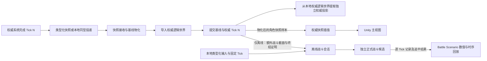
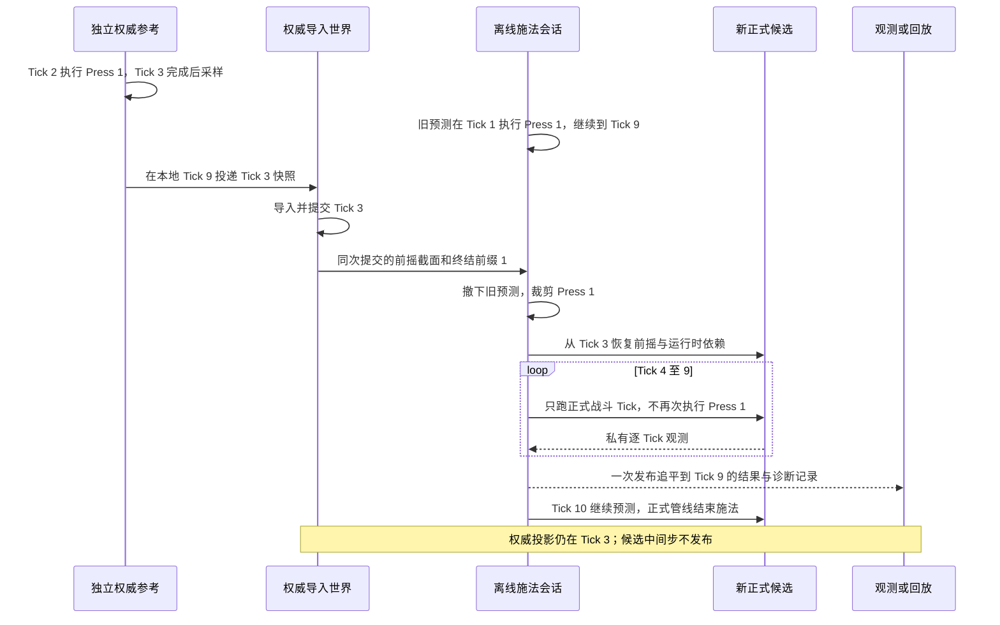
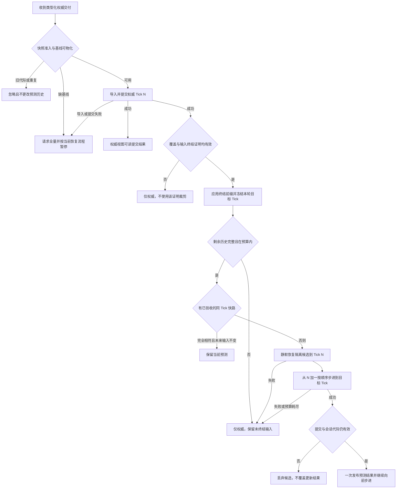
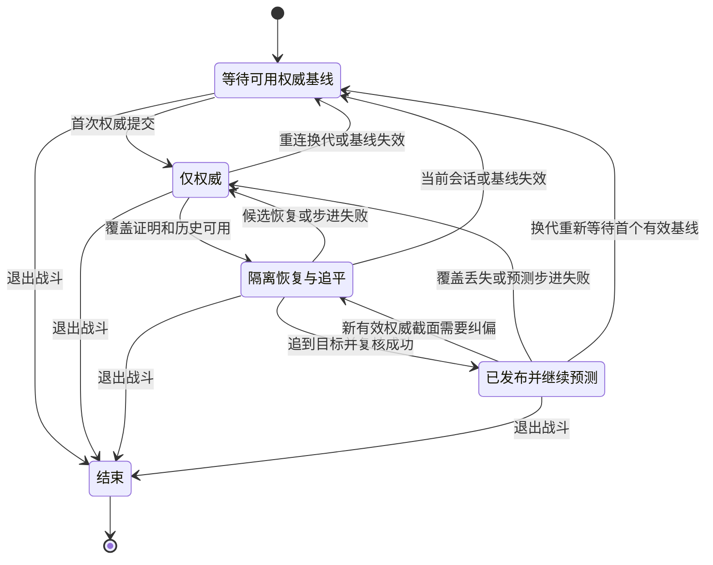

# MOBA 状态同步：客户端逻辑世界与预测和解

> 文档类型：实施设计与现状审阅 | 事实基线：2026-11-25  
> 状态：第 2–5 节为源码核校；第 6–9 节为待确认设计。现有离线验收不等于正式战斗预测已上线。

阅读顺序：初次了解先看第 1 节的弹体例子，核实现状看第 2–5 节，评审重点看第 6、9 节，接入及测试按第 8 节执行。「正式战斗候选」指复用正式玩法装配，不表示已经接入正式线上会话。

## 1. 从零理解：为什么存在三个世界视角

### 1.1 要解决的问题

玩家按下技能键时，如果客户端只等服务器的回复再播动作，操作就会延迟；如果客户端直接认定技能已命中，又可能提前显示一次实际被拒绝的伤害。状态同步的预测把这两件事分开：**允许客户端先计算可撤销的动作结果，但服务器仍决定最终战斗事实。** 「预测」是本地先跑正式逻辑，不是给动画猜一个位置；「回滚」是换到可信的较早起点，不是倒播放画面；「和解」是用这个起点与剩余输入重新算到当前本地模拟时刻。

**先提交权威快照到客户端权威逻辑世界；再以同一 Tick 的充分状态恢复隔离的预测候选；最后用正式战斗系统追到本地预测目标 Tick，成功才发布。** 逻辑上是把预测重置到权威截面再向前模拟；不需要把主视图所在的世界倒退再快进，也不把整个帧同步检查点交给状态同步。

请重点审阅三点：**权威决定基线里的对象与状态，终结证明决定哪些输入能重放，正式系统决定重放后发生什么。** 三者不能互相替代。

### 1.2 谁在运行，谁只读结果

| 角色 | 举例 | 时钟和所有权 |
| --- | --- | --- |
| 服务端权威参考 | 决定一次施法是否接受、是否产生弹体，以及最终生命值。本地验收用独立世界扮演它。 | 独立执行正式 Tick；每个截面只描述该刻已完成的状态。 |
| 客户端权威逻辑世界 | 在客户端保存已提交的角色和支持的权威领域状态。 | 只以快照对齐，不自作主张跑到预测 Tick；不会被预测候选覆盖。 |
| 客户端预测逻辑世界 | 提前响应本地输入；出现迟到快照时，先用一个隔离候选追平，再替换已发布预测。 | 本地独立固定步。候选和已发布预测是同一角色的两种生命周期状态，不是两个并行的玩法规则执行器。 |
| 表现层 | Unity 主视图、权威对照投影和预测投影，可有不同读源。 | 渲染／插值时钟只负责显示；不能决定逻辑 Tick 或向逻辑回写。 |

| 术语 | 本文含义 |
| --- | --- |
| `N`：权威 Tick | 已提交、已完成该 Tick 的世界截面；恢复后从 `N+1` 开始，不执行 `N` 第二次。 |
| `P`：本地已封存 Tick | 本地输入已封存（含明确无输入）的边界；即使预测降级，本地历史和已发布结果也要区分，不能把 `P` 总当成可见 Tick。 |
| `T`：本轮追平目标 | 取 `max(N, P)`；如果快照领先，以 `N` 重新起步。不是 Unity 渲染帧，也不是消息收到的时间。 |
| 快照 / 截面 | 快照是本轮交付的权威状态；截面是同一 Tick、同一提交的某个领域所需数据。可展示的角色快照不一定足以恢复技能运行。 |
| 终结 / 封存 | 终结表示权威已处置某个输入、客户端不再重演；封存表示本地某 Tick 可读取确定的输入列表。二者都不是「执行成功」。 |

### 1.3 用一颗弹体走一遍

这是**目标方案的示意**，不是已经验收的线上例子。客户端先预测技能按键 `#21` 发射弹体，已经跑到 `P=106`；此时一个迟到的权威快照说「我在 Tick 100 的真实状态如下」，同次终结证明说明 `#21` 已处置。

| 步骤 | 客户端做什么 | 玩家／调试视图能看到什么 |
| --- | --- | --- |
| 1. 输入时 | 按键记录原序号与计划 Tick，进入本地预测并正常提交给权威；逻辑只发射一次预测弹体。 | 可立即看到预测动作和弹体，不先显示权威伤害。 |
| 2. 快照到达 | 物化并提交权威 Tick 100。按对象覆盖确认有无弹体，按终结证明停止重演 `#21`。 | 权威视图采用 100 的状态；主视图仍走权威插值。 |
| 3. 候选恢复 | 若 100 明确有弹体，恢复它在 100 的精确状态；若覆盖名单明确为空，不从旧预测复制弹体。 | 候选尚不可见；不会因恢复而重播发射。 |
| 4. 追平 | 用正式逻辑按 Tick 101…106 步进，原位置重演其余仍待终结的输入。 | 调试记录可逐步显示，但预测视图不展示 101…105 的中间状态。 |
| 5. 发布 | 若仍是同一代际且追平成功，以 106 的结果替换预测源，107 继续跑。 | 若 106 存在同身份弹体则更新它；若不存在则撤销旧预测表现。一个对象正常在 106 前到期，也不等于施法被拒绝。 |

反例：如果 Tick 100 明确没有弹体，但计划在 Tick 103 的另一发输入**尚未终结**，追平到 103 时仍应由正式系统生成它。空名单描述的是 Tick 100，不是「以后也没有」，更不是输入拒绝证明。

服务端生成与当前配置见[权威状态同步战斗流程](46-MobaAuthoritativeStateSyncBattleFlow.md)；框架层两种同步的职责见[帧同步与状态同步预测回滚](../../07-NetworkSynchronization/03.2-FrameStatePredictionRollback.md)。本文只展开 MOBA 客户端，不替代上述契约。

## 2. 当前实现：三条数据路径



| 路径 | 本地实际推进什么 | 入口与证据边界 |
| --- | --- | --- |
| 正式权威导入 | 创建本地权威逻辑世界；状态同步宿主不装帧输入模块，不随渲染推进权威 Tick。 | `StateSyncWorldRuntime`、`AuthoritativeStateRecoveryRuntime`。 |
| 离线战斗预测 | `LocalStateSyncBattleCastWorld` 装配正式战斗系统，按固定 Tick 执行输入及世界步进。 | 显式 `AttachLocalBattleCast` / `CommitLocalBattleCastSnapshot`。覆盖双槽经济、前摇、隔离普通移动与单枚无碰撞直线弹体的限定配方；不含命中、伤害或正式客户端输入接线。 |

**Unity 主视图**使用已提交的快照插值；**`ShowConfirmedView`** 以已提交名单为边界从权威世界提取投影。Battle Scenario 的预测轨使用追平后发布的正式候选；当前线上状态同步会话没有启用独立预测投影，`ShowPredictionView` 不再接旧移动实现。帧同步的同名预测入口不受影响。

## 3. 当前实现：快照如何覆盖权威逻辑世界

1. **接收及预检。** `AuthoritativeStateRecoveryRuntime.HandleSnapshotCore` 在当前会话内接收 `GatewayStateSyncSnapshot`。本文只展开有固定基线的路径。`MobaAuthoritativeSnapshotState.PrepareFixed` 检查状态流、修订和基线依赖；全量构造新名单，增量以保留的基线为起点应用更新与显式删除，不把增量未列出的对象当成删除。基线失配请求全量，不用当前可见世界猜测缺口。
2. **导入。** `BattleAuthoritativeWorldRecoveryPort` 调用逻辑导入器。常规路径使用物化出的权威状态；待重建／重连路径要求全量，走 `TryImport` 并单独采用可靠事件基线。具体状态覆盖随当前快照 schema 与导入能力而定，不等于导入了一份完整战斗检查点。例如常规角色导入并不恢复持续 `MoveInput`，离线战斗候选启用移动时，从同次提交绑定的移动截面恢复。
3. **提交。** 导入成功并确认会话代际仍有效后，提交固定快照准入和基线，再通过 `StateSyncWorldRuntime.TryCommitTick` 对齐权威 Tick。没有对权威世界补跑中间 Tick。导入可能部分写入，现有代码走重置／恢复，不把它描述为可自动撤销的内存事务；失败不交付新的已提交证明。
4. **分发。** 提交后才向预测交付同次证明或离线回调；权威观察与表现采样也在这之后更新。常规快照的移动证明须对应其快照封套且相应角色仍在物化状态内，但不触发独立移动预测。离线战斗会话另外验证当前角色的实体生命周期及各类型化截面标记。这里说的「同次提交」是同一权威事实，不要求先等画面完成渲染。

| 数据 | 生产 → 消费 | 不能用来代替什么 |
| --- | --- | --- |
| 世界／状态流代际、快照修订、基线修订、Tick | 权威快照 → 准入、基线物化、权威逻辑时钟 | 快照修订不等于 Tick 或输入确认；重复提交不会事后补应用证明。 |
| 角色姿态、生命等字段、对象更新和删除 | 物化快照 → 领域导入 → 权威投影 | 展示字段不保证下一步模拟所需的流程、事务、调度和对象关联完整。 |
| 移动证明 | 权威域的姿态、持续意图、有效移速、移动资格及对象身份 → 随快照提交的证明观测（不驱动独立预测） | 不能从显示速度反推输入，不能推广为技能或碰撞预测证明。 |
| 施法覆盖、经济／在途截面 | 离线权威配方 → 绑定同 Tick／修订／会话和角色生命周期 → 候选准入及 Restore | `Settled` 是显式无在途声明，`InFlight` 带对应截面；缺失不能按空处理。 |
| 输入代际、序号、计划 Tick、终结前缀 | 首次准备输入 → 本地历史；权威终结证明 → 裁剪／重演判定 | 入队 ACK、最大消费序号、可靠事件水位、帧同步确认帧均不可代用。 |
| 可靠事件 epoch 和水位 | 重连恢复 → 可靠事件会话 | 与预测输入历史不是同一本账。 |

## 4. 当前实现：输入、同 Tick 比较与追平

### 4.1 移动复用

状态同步的正式离线配方在战斗候选世界中恢复普通移动截面，随后与施法一起由正式系统逐 Tick 推进。旧实现的独立姿态纠偏沙箱、输入旁路和发布开关已移除。通用窄域对账测试与历史回放仅保留作诊断，不是会话运行路径。

### 4.2 离线施法路径

- `LocalStateSyncCastSession.Advance` 按连续 Tick 记录 `SkillInputEvent` 或无输入 Tick，当前实现只接受该配方允许的 `Press`，保存原序号和计划 Tick。配方的权威采样和输入历史互不共享可变世界。
- 角色快照先导入权威世界。覆盖缺失或错配，不建立候选、不采用随附证明裁剪输入；覆盖匹配时才接受绑定本次提交的有效终结前缀。**合法终结证明可以在候选失败时依然生效**，不补发已终结输入，保留未终结输入供后续有效快照使用。落在 `N` 或更早又未终结的输入不能悄悄移到 `N+1`。
- 正式候选不使用位置匹配快路。会话先撤下旧预测，再在独立世界恢复权威角色、时钟、双槽经济状态及必要的前摇上下文／事务／管线；候选从 `N+1` 至 `P` 逐 Tick 调用正式系统，追平才发布，失败只观察权威。逐 Tick 的 `LastReplay` 是成功候选的诊断记录，不是对外发布多次。



这张图对应已跑通的受控前摇案例：不重扣法力、不重启冷却。另一双槽案例在本地 Tick 106 提交 Tick 100，在 Tick 102 只重演仍未终结的 E；已终结的 W 无论权威接受还是拒绝，都不靠再次执行来恢复。

离线会话收到新权威提交时，先撤下旧候选，再尝试释放。释放异常不撤销权威提交；若同次终结证明有效，仍裁剪已终结前缀，但这一轮只保留权威观测，不启动替代候选。未发布候选若在追平和释放时都失败，两项异常均保留供诊断；这不表示释放失败的资源已成功回收。

已挂接的离线候选在断线或进入全量恢复时立即撤下，保留同代已封存历史。连接恢复或全量请求应答本身不会开启预测：权威链须先提交有效全量并退出导入等待，候选随后仍须通过会话、角色生命周期、截面、终结证明和历史校验。旧增量不能解除等待；换代仍释放旧会话，不带入旧历史。这一接线不启用常规客户端预测。

## 5. 源码导航与证据

| 查什么 | 入口 |
| --- | --- |
| 谁提交快照、谁拥有权威 Tick | [AuthoritativeStateRecoveryRuntime](../../../../Unity/Packages/com.abilitykit.demo.moba.view.runtime/Runtime/Game/Battle/Client/Session/Features/StateSync/AuthoritativeStateRecoveryRuntime.cs)、[StateSyncWorldRuntime](../../../../Unity/Packages/com.abilitykit.demo.moba.view.runtime/Runtime/Game/Battle/Client/Session/Features/StateSync/StateSyncWorldRuntime.cs) |
| 全量与增量如何物化 | [MobaAuthoritativeSnapshotState](../../../../Unity/Packages/com.abilitykit.demo.moba.view.runtime/Runtime/Networking/Replication/MobaAuthoritativeSnapshotState.cs) |
| 通用窄域诊断（不接入 MOBA 会话） | [LocalMovementReconciler](../../../../Unity/Packages/com.abilitykit.world.statesync/Runtime/StateSync/Prediction/Reconciliation/LocalMovementReconciler.cs) |
| 离线施法历史、恢复、切换 | [LocalStateSyncCastSession](../../../../Unity/Packages/com.abilitykit.demo.moba.view.runtime/Runtime/Game/Battle/Client/Session/Features/StateSync/LocalStateSyncCastSession.cs)、[LocalStateSyncBattleCastWorld](../../../../Unity/Packages/com.abilitykit.demo.moba.view.runtime/Runtime/Game/Battle/Client/Session/Features/StateSync/LocalStateSyncBattleCastWorld.cs) |
| 本地参考世界、回放和投影 | [候选契约测试](../../../../src/AbilityKit.Demo.Moba.Tests/StateSync/MobaStateSyncBattleWorldCandidateTests.cs)、[Battle Scenario 正式施法录制](../../../../Unity/Packages/com.abilitykit.demo.moba.editor/Editor/BattleScenario/MobaStateSyncClientReplay.BattleCast.cs)、[预测视图入口](../../../../Unity/Packages/com.abilitykit.demo.moba.view.runtime/Runtime/Game/Battle/Client/Session/Features/Sim/BattleSessionFeature.SimTick.RemoteDriven.cs) |
| 主视图与独立权威视图取数 | [主视图插值入口](../../../../Unity/Packages/com.abilitykit.demo.moba.view.runtime/Runtime/Game/Battle/Client/Session/Features/Net/BattleSessionFeature.TransportFactory.cs)、[世界投影数据源](../../../../Unity/Packages/com.abilitykit.demo.moba.view.runtime/Runtime/Game/Battle/Presentation/BattleWorldProjectionViewSource.cs) |

上一轮 E3 定向回归：.NET 46/46、Unity EditMode 20/20；报告在 `local/Logs/dotnet/moba-cast-coverage-20261125-204931/regression.trx` 与 `local/Logs/unity-manual/moba-cast-coverage-20261125-204931/regression.xml`。可在「战斗测试用例编辑器 → 状态同步复现样例 → MOBA · 现场运行正式客户端」重放移动纠偏、正式双槽施法和正式前摇恢复。本次为文档核对，不重跑战斗测试；未验收线上、任意战斗对象恢复或场景交互画面。

## 6. 待确认：把已验证的流程扩展到正式战斗候选

### 6.1 职责边界

| 层级 | 负责 | 不负责 |
| --- | --- | --- |
| 状态同步会话 | 对象覆盖与输入证明准入，选择恢复起点和目标，保存本地历史，编排恢复／重演／切换。 | 不实现移动、施法、弹体或 Buff 规则；不持有帧同步确认帧和 Command journal。 |
| MOBA 状态同步适配 | 把提交的类型化数据映射到领域状态；确定预测范围，协调实体名单、组件／服务状态和运行依赖。 | 不把显示 DTO 当充分状态；不为每个英雄写恢复解释器。 |
| 正式逻辑世界与领域 | ECS／领域服务维护自己的状态，提供必要的静默导入和重绑原语；由同一套固定步系统执行正常玩法。 | 不知道当前是状态同步还是帧同步；不在 Restore 调用正常技能、历史发射或销毁事件来补状态。 |
| 表现层 | 只读对应事实源；稳定身份对账，区分权威、预测或不可预测；矫正视觉过渡，不反写玩法。 | 不发输入、不驱动 Tick、不把未发布候选的中间 Cue 当实时效果。 |

### 6.2 恢复输入：不能只给一张角色快照

以下是**逻辑合同，不是新增线上协议或代码 API**。同次提交的锚点、输入终结证明和重演历史分别校验；交付与消费走类型化数据。

| 数据组 | 需要的事实 | 恢复顺序及归属 |
| --- | --- | --- |
| 提交标记 | 世界、状态流、会话／输入代际、角色生命周期、快照修订、Tick；如果涉及可变规则，需能验证候选规则配置与采样一致。 | 会话先核对标记与当前代际；旧代际数据不装入当前候选。 |
| 对象覆盖 | 明确覆盖范围及对象名单，稳定 ID 与生命周期；缺席、范围外、显式删除、截面缺失可区分。 | MOBA 适配先核对依赖闭包，再建立骨架；不从增量中的缺项推断销毁，也不删除范围外对象。 |
| 后续步进的充分状态 | 已覆盖的姿态、移动意图和资格、经济、执行进度与事务；按域增量补入确实影响后续的对象、调度、分配器等状态。 | ECS／领域服务写入原位；派生缓存可确定性重建，引用按身份重绑，不触发玩法。计时与固定步必须对齐 N。 |
| 输入终结证明 | 截面对应的连续终结前缀；终结表示不再重放，不等于每个输入均成功。若界面需要显示接受或拒绝，另取明确结果，不从空名单推断。 | 会话校验身份、连续性与因果 Tick；按现有覆盖准入之后才更新可裁剪前缀。 |
| 本地历史与 Owner | 每个 Tick 的封存边界、原序号／计划 Tick／原参数；会话拥有当前发布代际和目标 Tick。 | 只读回放，不二次发送。缺失输入、未知 Tick 或依赖闭包不完整时，不猜测、不挪 Tick。 |

**哪些状态必须随锚点恢复？** 判断标准不是「界面是否会显示」，而是「丢了它，`N+1` 以后结果会不会不同」。例如法力是权威状态，冷却结束 Tick 和前摇进度是后续因果输入，执行上下文是身份与引用关系；UI 读值、可从已恢复状态重算的投影不是权威数据。必要来源或关联无法按身份重绑时，不能把该对象当作已恢复。领域拥有这些规则，状态同步只保存具名且有限的恢复覆盖，不收集任意 ECS 或服务对象图。

建议把交付拆成三份只读记录：**已提交锚点**（身份、`N`、修订、名单与领域截面）、**终结证明**（同一提交对应的连续前缀）、**本地历史**（序号、计划 Tick、原参数与每 Tick 封存状态）。发布再产生第四份记录：**预测版本**（会话代际、源修订、完成 Tick、只读投影）。不要把这四者塞进一个可修改 DTO，也不把世界实例、组件引用或对象池地址写进交付。它们是职责与数据约束，首批可沿用现有内部类型，不预造公共协议。

对同一权威 `N`，**有且可恢复**的对象进入基线；**完整覆盖名单明确无**或同生命周期显式删除的对象不进入基线。新候选自然不含旧预测实例；不在旧世界补发销毁。`N` 不存在的对象仍可能在 `N+1…P` 由未终结输入合法创建。展示层比较旧发布结果与新的**追平结果**，不能把 `N` 的缺席直接当成 `P` 的删除信号。[无命中逻辑弹体提案](../../../../plans/MobaStateSyncProjectileDecision.2026-11-25.md)是该合同的第一个对象切片，不是对命中、伤害或跨名单任意重建的授权。

### 6.3 一次和解的完整流程



1. 先提交 `N`。以该提交作为本轮锚点，使用同 Tick 的已预测事实作诊断。推荐首批**默认重建候选**；完整战斗只比较位置、血量或几个表面字段不允许跳过恢复。只有证明比较覆盖了后续所需状态及未来输入集合，才可单独开启复用快路。旧的普通移动快路已从 MOBA 会话退役。
2. 选定 `T = max(N, P)`。`N > P` 时直接以 `N` 为新起点；不会插值或伪造跳过的历史。`N < P` 时，所有待用的 `N+1…T` 都需要封存，包括无输入 Tick；落在 `N` 内仍未终结且需要重放的输入阻止本轮追平。
3. 在候选内静默恢复名单、状态、关系和时钟；候选必须具备运行下一个 Tick 的依赖。以原计划 Tick、稳定顺序注入未终结输入，然后用相同固定步调用正式系统。正常内部玩法照常执行，恢复和重演不能再次向传输提交命令或向外发布不确定 Cue。
4. 追平后复核代际、修订和目标 Tick，再切换预测来源。首版建议在会话驱动中串行完成，不引入后台重演线程：输入进入后续 Tick，不能改变本轮已封存历史。若以后分帧重演，候选须继续追上新的已封存边界，且新快照、换代、预算须能取消旧候选，不能发布过期结果。

### 6.4 发布与表现对账

- **权威视图**仍读权威投影 `N`；预测成功不会推动它跳到 `T`。当前主视图保持权威默认，预测继续作为可选投影；主视图以后是否让本地主控采用预测结果，应单独评审。
- **预测视图的目标取数源是已发布的正式战斗候选。** 正式候选统一产出移动与其他受支持的预测观测，不把位置纠偏结果写回战斗世界。候选从权威 `N` 追到本地预测目标 `T`，追平前不发布中间状态，之后正常向前预测；失败只显示权威。身份一致可更新已有句柄，追平结果确认缺席才移除旧预测句柄；视觉平滑不反写 ECS。
- **建议按信息类型分开发布。** 候选可输出已覆盖、可撤销的动作与对象表现，例如前摇、发射动作和弹体飞行。正式血量、护盾结果和死亡由已提交的权威状态驱动，不等待候选追平；伤害数字、确认命中与击杀提示只消费可归因、可去重的权威事件。若要求伤害数字与血条同次展示，需在对应权威状态提交后再消费事件；只有血量差值而没有事件时，只更新血条，不反推某次伤害。这里是表现契约建议，不假定当前已具备逐次伤害事件交付。
- **显示不预测，不等于逻辑跳过伤害。** 首批单弹体候选不支持命中或伤害，因此只准入不依赖它们的配方。以后若伤害会影响候选后续 Tick 的资格（例如死亡使目标失效），须先确认该逻辑能在隔离候选中正确恢复和推进，否则不预测这段交互；不能为了压制伤害数字而修改正式结算规则。本地预测的试算结果不成为权威展示。
- **Battle Scenario**展示「旧预测同 Tick 值 → 权威 `N` → 候选逐 Tick → 唯一发布点 → `T+1` 继续」。候选中间值是录制观测，不等于游戏画面闪回或补播历史。权威变暗等材质开关属于视图层，不参与恢复判定。

逻辑弹体配方在回放窗口直接播放正式角色模型和位置标记：权威标记深灰，预测标记橙色，没样本就隐藏；角色重合仅绘制原色模型。逐 Tick 模式仍可核对原数值轨道。该窗口消费已提交权威投影与已录制预测，不启动实战场景，也不播放正式弹体特效和技能动画。Instance2 带图形设备定向回归 9/9；拒绝前后实渲染帧和世界装配记录见 `local/Logs/20261127-002701-moba-state-flight-visibility/`。

### 6.5 主循环：正常预测、迟到纠偏与继续驱动

| 发生时机 | 会话操作 | 与别的路径不能混用的部分 |
| --- | --- | --- |
| 启动／重连 | 先能接收权威；首个有效全量基线与配套覆盖、证明有效后，才允许建候选。 | 不在只有主视图或只收到一个 delta 时开启战斗预测；不能用旧角色历史给新生命周期暖启动。 |
| 本地采集输入 | 按会话的计划 Tick 规则生成命令，用首次准备的序号和原参数入历史；正常提交与本地可预测判定可以并行，但命令只提交一次，传输重试不产生新命令。 | `预测不支持` 不等于 `不能向权威提交`。需要模拟却无法纳入历史的输入是覆盖缺口，不等于该 Tick 无输入。 |
| 固定步截止 | Seal 当 Tick 的输入列表，记录「有输入」「明确无输入」和「不可证明」的区别。已发布世界按同一固定步及正常阶段顺序处理可预测输入，读出该 Tick 结果。 | 已封存 Tick 不插写；迟到本地赋序或缺项不能偷偷改成下一 Tick。渲染更新可触发驱动，但不以渲染帧编号充当逻辑 Tick。 |
| 来了权威 `N` | 同 Tick 比较只对比身份及领域覆盖都一致的历史状态；对首批战斗候选，匹配只用于诊断，仍走重建。 | 不能比较 `N` 与 `P` 直接判错，也不允许仅比较血量或位置来跳过恢复。 |
| 候选追到 `T` | 用此轮固定的 `N`、`T`、修订和封存历史完成追平；同时校验生命周期与发布版本。 | 不在候选期间把历史命令重新传输，不让战斗系统直接写外部表现。 |
| 本轮交接 | 会话把已发布取数源切至新候选；旧世界不再被读后释放。随后这个世界走 `T+1` 的普通预测；不再继续 Tick 已被替换的旧世界。 | 角色姿态只由一个预测生产者供给；更新／撤销表现句柄以发布结果为准，不以恢复过程为准。 |

首版建议在**同一会话更新边界串行写入**：外部输入／快照回调只交给宿主排队，由宿主按稳定顺序消费；同一已封存 Tick 的输入使用既有稳定派发顺序。恢复和追平由会话持有候选的独占写权，不边导入边向 Unity 暴露可变组件。发布可用既有投影源切换或只读数据视图实现，不要求为每 Tick 深拷贝整世界；旧引用失效与释放顺序必须能测试。

以下伪代码说明**顺序和失败语义**，不是现有 API，也不承诺后台并行：

```text
OnAuthoritativeDelivery(delivery):
    result = MaterializeImportAndCommit(delivery)
    if result is rejected or failed: follow snapshot recovery policy and return
    anchor = result.committedAnchor
    publish authority independently of prediction

    if not ValidScopeCoverageAndTerminalProof(anchor, delivery.proof):
        suspend prediction without using this proof to trim history
        return

    trim only proven terminal inputs
    targetTick = max(anchor.tick, latestSealedLocalTick)
    if replay exceeds budget or remaining history cannot prove every required tick:
        suspend prediction and preserve still-pending history within its limits
        return

    candidate = try restore isolated official world at anchor.tick
    if restore did not succeed:
        discard candidate and suspend prediction; keep authority
        return
    for replayTick in anchor.tick + 1 through targetTick:
        if stepping official world with sealed nonterminal inputs fails:
            discard candidate and suspend prediction; keep authority
            return
        keep intermediate output private

    if the original scope or revision is no longer current:
        discard candidate without changing the newer session or publication
        return
    replace the prediction source once, then resume normal fixed steps
```

### 6.6 会话生命周期、保留规则与降级



| 条件 | 权威与对外表现 | 本地历史和候选 |
| --- | --- | --- |
| 同流重复修订／陈旧快照 | 不产生新提交，也不改变当前的有效发布。 | 不用重复消息补应用旧证明；不创建新候选。 |
| 基线缺失／权威导入失败 | 按现有恢复路径请求有效全量；不能向预测转交未提交状态。 | 暂停预测，不从导入半成品重建；权威重建与可靠事件恢复各用自己的合同。 |
| 已提交，但预测覆盖或证明缺失／错配 | 读最新有效权威；不采纳错配侧车。 | 不用这次证明裁剪；历史仍受预算限制。 |
| 有效证明，但历史缺 Tick、存在落在 `N` 内的未终结输入或超预算 | 继续只发布权威，不展示近似追平结果。 | 可裁剪确已终结前缀；未终结命令不能凭空挪 Tick、假定已完成或无限保存。被淘汰历史必须留下可拒绝的缺口标记。 |
| 候选中途失败／规则身份不匹配 | 权威提交仍有效；本次候选完全不发布。 | 丢弃候选与输出；只有此前有效证明允许裁剪。未来的提交若能覆盖缺口才重新建候选。 |
| 重连、换输入／状态流代际、角色更换或战斗关闭 | 不让过期预测覆盖新世界；释放旧投影关联。 | 取消旧候选，隔离／清理旧代际；重新建基线。不跨代际沿用序号或实体关联。 |

**资源上限。** 先限制预测 Tick 距离、历史跨度、待终结命令数和候选对象范围，再按本地实测评估耗时预算。正常预测应按固定步向前，落后或超预算时停止，不用可变步长跨 Tick。正式战斗首版需要单独给出样例规模和测量记录，不把旧常量当作性能通过标准。

**本地量测（2026-11-26）。** .NET Release 使用现有正式双槽施法配方（单角色、32 Hz、追平期间一条未终结施法指令），每个跨度预热一次后各测六轮。统计单位为 ms，列值为中位数／最大值；整轮从会话接纳截面到发布，含旧候选释放，不含权威快照导入或 Unity 表现。

| 追平跨度 | 装配世界 | 导入截面（不含装配） | 带输入的单 Tick | 空输入单 Tick | 会话接纳至发布 |
| --- | --- | --- | --- | --- | --- |
| 6 Tick | 1024.650 / 1232.448 | 0.154 / 0.224 | 4.316 / 21.993 | 0.025 / 1.486 | 1029.656 / 1256.846 |
| 32 Tick | 839.008 / 1008.089 | 0.139 / 0.444 | 4.326 / 17.103 | 0.014 / 1.418 | 848.205 / 1013.878 |

在这组样本里，成本主要来自每轮同步装配世界；两组世界装配耗时的波动不表示更长历史更快。先拆分装配成本，并在 Unity 目标运行环境重新量测，再考虑调整追平窗口。这里没有为帧耗时设通过阈值，也未量测多实体、线上或待确认输入上限。

**Instance2 装配复测（2026-11-27）。** 现有正式双槽配方的 Unity 编辑器工厂预热一次、重复六轮；服务注册与蓝图配置中位数约 28 ms，世界构造约 0.26 ms，`Initialize` 约 7.13 s（最大值约 8.26 s）。配置加载单独计时，中位数约 0.99 s，是装配内的嵌套阶段，不再加到初始化总数。Unity 本地批处理下的主耗时落在初始化，配置加载不能解释全部差值。

**初始化分段（2026-11-27）。** 在 Windows Unity 2022.3.62f1 EditMode 批处理中，用隔离项目副本执行同一正式双槽世界工厂：单角色、预热一次、计时六轮。临时探针只读取耗时，不主动解析服务、不改变装配顺序；服务工厂和容器初始化回调只累计最外层调用，避免递归依赖重复计时。下表为中位数／最大值，所有子项均包含在对应父项内，不得跨层相加。

| 计时边界 | 总耗时（ms） | 内含服务物化（ms） |
| --- | --- | --- |
| `Initialize`（含装配） | 2209.122 / 2448.467 | — |
| ↳ 容器、作用域与模块注册 | 0.627 / 1.513 | 0 / 0 |
| ↳ 安装器 | 2195.644 / 2434.104 | 2134.742 / 2379.395 |
| ↳↳ 正式战斗系统树安装 | 1878.081 / 2091.235 | 1877.702 / 2090.599 |
| ↳↳ `Install.PlanTriggering` | 249.981 / 341.843 | 231.511 / 315.356 |
| ↳↳ `StartGame`（含建角） | 6.034 / 10.306 | 0.010 / 0.016 |
| ↳↳↳ 启动内角色构建 | 3.029 / 4.976 | 0.010 / 0.016 |
| ↳ `Systems.Initialize` | 3.703 / 4.481 | 2.636 / 3.285 |

安装阶段的按需服务物化占每轮 `Initialize` 的 96.3%–97.2%；单独量测的配置加载为 350.139 / 416.780 ms，也是初始化内的嵌套成本。这里的“服务物化”含工厂、依赖解析和容器初始化回调里的业务工作，不等同于 DI 容器自身开销。隔离副本的绝对耗时与前次 Instance2 不可直接比较，不视为优化收益或 Player 帧耗时。下一批应先拆正式系统首次解析的服务调用链，再量测 `PlanTriggering` 的首用成本；不先做候选池化、异步启动、配置共享或调整追平预算。

同轮无探针 Instance2 带图形设备运行状态同步回放，8/8 通过：覆盖弹体恢复、重演、拒绝及拒绝前后实渲染对比，以及正式角色模型与双投影材质。可见性证据限于 Battle Scenario 编辑器的 3D 回放（正式角色模型与弹体位置标记），并非实战 Game View 或正式技能特效验收。分段和回放证据位于 `local/Logs/20261127-071657-moba-state-init-isolated/`；未修改生产装配、状态同步或帧同步契约，未重跑帧同步路径。

**首次服务解析归因（2026-11-27）。** 在同步了当前源码的隔离副本上，用同一正式双槽配方预热一次、测量六轮；Unity EditMode 定向用例 1/1 通过。这里的首次解析是**每个新世界首次访问**，不是新进程冷启动。探针按实际创建链记录服务实例构造及初始化回调；“含依赖”包含子工厂，“扣除子工厂后”仍包含该工厂的业务工作，不代表纯 DI 或纯 CPU 耗时。下表单位为 ms，列值为中位数／最大值，子项不与父项相加。

| 实测边界 | 耗时（ms） | 说明 |
| --- | --- | --- |
| `Initialize` | 4946.592 / 5900.876 | 本轮带探针的编辑器测量，不与前轮绝对值比较。 |
| ↳ 正式战斗系统树安装 | 4098.148 / 5023.996 | 主要由 `ProjectileTickSystem` 首次解析 `IProjectileService` 触发；这条根链含依赖 4097.149 / 5023.213，扣除子工厂后仅 0.427 / 1.086。 |
| ↳↳ `TriggerPlanJsonDatabase` 加载与合并 | 3517.235 / 4360.099 | 黑板绑定另计 0.271 / 0.583。尚未拆资源读取、反序列化、执行树构建与合并处理。 |
| ↳↳ `MobaConfigDatabase` 配置加载 | 619.211 / 905.944 | 与触发计划数据库是同一根链下的两项成本。 |
| ↳ `Install.PlanTriggering` | 519.987 / 923.425 | 此时解析已有触发计划数据库仅 0.124 / 0.602；配置计划动作、取得运行器并注册全局计划各约 1 ms 中位数。 |
| ↳↳ 启动运行时校验 | 509.314 / 909.539 | 校验首次解析 `MobaSnapshotRouter`，含依赖 470.650 / 814.542，扣除子工厂后仍为 469.663 / 811.855。 |

首条实测链为 `ProjectileTickSystem → IProjectileService → 弹跳目标提供器 → 战斗规则 → 有效标签查询 → Continuous 管理器`。随后一支进入 `MobaConfigDatabase`，另一支经 `MobaEffectExecutionService` 进入 `TriggerPlanJsonDatabase`。这解释了为什么计划加载的主要成本记在系统树安装，而不是名称相近的 `PlanTriggering` 阶段；也不意味着弹体玩法本身耗时数秒。快照路由的耗时目前只定位到首次构造与初始化回调，尚未拆出发射器注册、绑定和健康检查各自的份额。

下一批优先以同一配方区分触发计划主包和规则目录各自的读取、解析／执行树构建与合并成本；再按现有 `MobaSnapshotRouter.OnInit` 顺序拆分注册表创建、发射器绑定及输出健康检查。若提出跨候选复用，只考虑已证明不持有世界引用的不可变定义；每世界黑板、作用域与 Cue 绑定仍独立，不通过跳过校验或延后绑定来压缩测得的初始化成本。逐轮证据位于 `local/Logs/20261127-074426-moba-state-service-attribution/`；本轮未修改生产代码或两种同步契约，未复跑画面或帧同步回归。

同批验证：恰好 32 Tick 全量重演并逐 Tick 对照独立参考；滞后 33 Tick 只保留权威、保留未终结指令且不构建候选。下一份把差距缩到 32 Tick 的有效截面恢复预测，原 Tick 的未终结指令只重演一次，追平后继续推进。测试入口：[正式候选契约测试](../../../../src/AbilityKit.Demo.Moba.Tests/StateSync/MobaStateSyncBattleWorldCandidateTests.cs)，报告 `local/Logs/20261126-232113-moba-state-candidate-budget/candidate-budget.trx`，定向 15/15。

### 6.7 建议接入位置与迁移边界

| 位置 | 首批可落地的接线 | 明确不做 |
| --- | --- | --- |
| `moba.view.runtime` 状态同步会话 | 从已提交快照入口扩展本地候选编排，复用已存在的离线 `AttachLocalBattleCast` 思路、输入与终结合同，并保持各结果可观察。 | 不让帧同步会话承担状态同步恢复；暂不改正式传输或默认开启预测。 |
| MOBA 正式世界装配与领域服务 | 复用正式战斗蓝图和 Tick；只为已确认的充分状态补最小静默恢复接缝。明确配置、系统装配、时间、对象 ID 及关系的可重复性。 | 不把业务状态搬进一个通用容器，不加入英雄／技能特例；不复制 Projectile、Cast 或伤害执行链。 |
| 独立预测投影 | 在正式候选可用且经本地验收时，把它的已发布只读结果接为该视图数据源。 | 不默认混入主视图，不让移动和战斗两条发布路径叠写，也不把候选的 HP 当正式 HUD。 |
| Battle Scenario | 从同一会话读取权威 `N`、本地 `P`、发布 `T`、逐 Tick 观测及失败原因；编辑器只负责配方与显示。 | 不在编辑器实现第二个状态机、规则或网络数据路径。 |

保持阶段性可回退：关闭候选装配或遇到不支持内容时维持现有权威路径；正式移动如继续启用，必须是显式选择的另一种预测来源，而不是战斗候选失败后偷偷混搭的结果。若验证发现快照某个域的数据不足，先收窄能力并记录缺口，不为了证明闭环去改线上数据合同。

## 7. 帧同步与状态同步：共享执行，不共享恢复依据

| 决策 | 状态同步 | 帧同步 |
| --- | --- | --- |
| 权威输入源 | 已提交的实体／领域状态快照给出 `N` 的事实；输入终结证明只决定本地输入是否重放。 | 权威输入帧决定执行顺序与结果；按该链的确认时钟、检查点及命令重演恢复。 |
| 名单恢复 | 以权威覆盖名单决定该截面存在性；在隔离候选建立合法骨架。 | 按本地检查点与同会话结构证明恢复，遵守原 Provider 顺序和日志契约。 |
| 相同部分 | 两者都复用固定步、实体生命周期、移动、施法、弹体等领域系统；适用时共享无副作用的状态原语，视图共用投影接口。 | 不复用状态同步输入终结前缀；带状态推送不意味着改变帧同步时钟。 |

| 方案比较 | 优缺点 |
| --- | --- |
| **推荐：权威世界独立，隔离候选追平** | 中间和失败状态不会污染已提交的权威；可逐域接入。成本是候选装配与双世界占用，需通过预算和测量验证。 |
| 在主逻辑世界原地覆盖并追平 | 装配少，但导入失败和重演副作用会污染权威投影，必须另做事务与输出隔离；本期不选。 |
| 直接借全量帧同步检查点或按英雄仿真 | 前者依赖状态同步没有的同会话 journal／全世界状态，后者复制玩法会持续漂移；都不选。 |

## 8. 本地验收顺序与风险

| 阶段 | 通过标准 |
| --- | --- |
| A：锁住已有路径 | 复用正式移动和离线双槽／前摇。逐 Tick 对照独立权威参考；比同刻而非最新，验证无输入 Tick、已终结不重放、失败不发布和重复交付不补裁剪。 |
| B：最小对象生命周期 | 本地单枚无命中逻辑弹体：「`N` 已有」「`N` 明确为空且输入待终结」「`N` 明确为空且输入已拒绝」。验收身份、固定点姿态、剩余寿命、来源清理、一次退出和无候选对外输出。缺截面／错代际／中途失败独立验收。 |
| C：表现验收 | 在 Battle Scenario 观察三轨及发布点。验证旧预测对象移除或复用、权威不跟随重演、失败回退时没有重复 Cue；把画面验收与数值回归分开记录。 |
| D：后续另行评审 | 地图碰撞、远端交互、命中、伤害、Buff、正式技能输入和线上权威交付。共享世界能力改动须分别验证状态同步和帧同步真实调用链，不用一方报告替代另一方。 |

### 本地验收操作与断言

**基础预测验收配方：移动＋前摇。** 在 Unity 打开「Window → AbilityKit → 战斗测试用例编辑器 → 状态同步复现样例 → 选样例 → 运行基础预测验收 · 移动＋前摇（本地）」。编号预设播放已有录制；此入口每次现场运行正式战斗蓝图，通过正式客户端的本地类型化提交入口交付快照，再自动播放当次结果。配方只编排输入、采样与交付时机；回放窗口不执行或补算移动、施法和回滚：

| Tick | 数据如何流动 | 回放核对 |
| --- | --- | --- |
| 1–3 | 本地在 1 开始移动、2 按下施法；独立权威参考分别晚一 Tick 执行。 | 旧预测先移动、先进入前摇。 |
| 4（N） | 权威世界完成 Tick 后采样角色快照、前摇及普通移动截面，绑定同一会话、角色代际、快照修订与 Tick；终结前缀为 `#2`。 | 同 Tick 对照旧预测与权威，位置和前摇均有差异。 |
| 5–9 | Tick 6 记录尚未终结的转向 `#3`；Tick 9 才提交 Tick 4 快照。候选从提交后的角色状态、施法经济与前摇、完整姿态及持续移动输入静默恢复一次。 | Tick 5 无新输入但继续沿 X 移动；Tick 6 按原 Tick 转向 Z；之后的空 Tick 继续运行同一世界。不会重发已终结的移动开始或施法。 |
| 9（T）及 10 | Tick 5–9 全部执行完成才发布该候选；继续用同一候选执行 Tick 10。 | 逐 Tick 对比位置、法力、冷却及前摇；追平过程未发布，权威投影仍在 Tick 4。 |

该组合只验证单角色、隔离无碰撞普通移动和配方前摇。运行依赖是正式固定步长、配置和系统；移动来源由正式移动系统在首次步进时重建，不保存旧 Pipeline 或从表现速度猜输入。缺失同次移动截面时仅提交权威，不消费附带的终结证明。不接线上协议、正式主视图或伤害展示，不借帧同步检查点。独立移动沙箱及其样例入口已退役。

1. 装配**独立权威参考世界**和**客户端会话**，两边共享正式玩法规则和固定步配置，但不共享可变实例。客户端沿用真实提交入口、输入历史和投影钩子，配方只决定输入、快照采样和交付 Tick。
2. 在参考世界完成 `N` 后采样并封存，记录它自己的 `N+1…T+1` 正式结果。让客户端先预测到 `P`，再用类型化投递交付 `N`，不从候选的期望值反填参考轨迹。
3. 对照同 Tick 结果，同时断言重演输入、权威 Tick、发布次数、候选释放、正式对象身份和清理。`T+1` 必须继续用同一个成功候选走正式逻辑。重复运行同配方比对轨迹；数值时序、交互画面分别记录。

**新增机制如何接入。** 已有恢复契约能覆盖新机制的所有未来相关状态与依赖时，只增加配置和场景配方，不修改会话的“提交 → 裁剪 → 恢复 → 追平 → 发布”流程。不能覆盖时，先按状态域核对权威截面、生命周期及依赖重绑、事件隔离和逐 Tick 对照；目前未覆盖的墙体、活动减益或逻辑弹体，不因有展示预设就获得预测资格。不增加英雄或技能专属的恢复分支，不借帧同步检查点补齐缺失的权威数据。

**正式配置换配方验收（E3，2026-11-26）。** `Published_jinx_w_rejection_replays_only_pending_movement_in_the_formal_world` 使用未改写的发布版金克丝 W 配置。客户端 Tick 1 起手并扣法力、进入冷却；独立权威世界拒绝该输入，Tick 9 交付 Tick 4 的无在途施法截面和 `#1` 终结证明。正式候选从权威截面重演 Tick 5–9，只处理 Tick 6 的移动 `#2`，逐 Tick 对照权威的位置、朝向、法力及冷却；发布后同一候选继续到 Tick 10。此用例沿用 Console 默认配置装配，直接走类型化会话与候选，不修改技能资源或会话运行时；不验收网关提交入口、Unity 画面或已生成弹体的恢复。

| 必测情形 | 最小可观察断言 |
| --- | --- |
| 已有弹体，输入已终结 | `N` 恢复相同生命周期、固定点姿态和余寿命；不补发出生；到期按正式规则清理物理、Actor、link 和必要 retain。 |
| 权威空名单，两种终结结果 | 未终结的输入按原 Tick 发射一次；已拒绝的输入不重放，旧预测弹体不复活。两者都不让预测反写 `N` 的名单。 |
| 增量缺项、显式删除、超出覆盖 | 缺项不等于删除；合法删除仅影响该生命周期，域状态不足不进入候选。 |
| `N=P`、`N>P`、`N<P` | 分别验证零重演、以权威直接起步、逐封存 Tick 重演。没有重复 Tick 或可变步长补算。 |
| 缺覆盖／错标记、重复、旧代际 | 分别断言是否提交权威、是否裁剪输入和是否新建候选，不靠一个统一成功标志。 |
| 缺无输入 Tick、旧 Tick 的未终结命令、超预算 | 不发布近似结果，不猜测终结；后续有效锚点能覆盖缺口再建候选。 |
| 中途失败、换代或退出 | 不泄露中间对象、Cue 或命令重发；候选可释放，权威和历史遵守所属代际；旧世界不再步进。 |
| 候选与权威展示不同步 | 预测动作可先显示；权威血条更新不被追平阻塞；候选不产生正式伤害数字。如需验证伤害反馈规则，只用明确的本地权威事件替身，不增加线上链路。 |

优先测量候选创建、单 Tick 成本、追平总耗时和候选失败率，再决定是否复用骨架、投入异步重演或调大预算。不以无上限追平换取画面平滑。验证仅用本仓库源码和本地类型化投递，不抓包、不解析网络字节、不探测外部服务或分析非项目进程。运行报告按仓库约定写入 `local/Logs/`，不把局部结果外推为线上或全战斗验收。

## 9. 审阅决定

| 需要确认 | 建议值 |
| --- | --- |
| 是否让权威导入世界同时担当预测世界？ | 否。权威随快照，预测随本地固定 Tick，候选隔离追平后才发布。 |
| 对象何时创建／移除？ | 只由同次提交的权威覆盖与生命周期决定 `N` 的名单；后续由正式玩法与剩余输入决定，不从快照空项猜测。 |
| 首批是否开启通用「匹配即不重建」？ | 否。维持现有移动特定快路；战斗候选先完整恢复和追平，再用证据决定优化。 |
| 主视图与验收范围？ | 主视图仍读权威，先做可选预测投影与本地逐 Tick 验收；第一对象切片只支持单枚无命中弹体，线上协议、碰撞和结算另议。 |
| 预测投影与伤害展示分别取哪里？ | 预测投影的目标来源为追平后发布的正式战斗候选；血量／护盾等结算展示读已提交权威状态，逐次伤害反馈只读权威事件。首批不接伤害预测或伤害事件生产链。 |
| 首版时序和失败怎么处理？ | 宿主串行消费输入与权威提交；先提交权威，再按证据裁剪、恢复、追平、复核、切换。失败不发布，收到覆盖充分的有效锚点才恢复。 |

建议按「A 锁住现有基线 → B 单弹体恢复与新生分别成立 → C 再接独立预测投影」确认。D 阶段不是前置条件，也不在本次建议范围内。

文档类型：实施设计与现状审阅 | 事实基线：2026-11-25 | 证据等级：现有移动／离线施法局部 E3；新增战斗候选设计待确认，未实施。  
*文档版本：v1.3 | 最后更新：2026-11-25*
