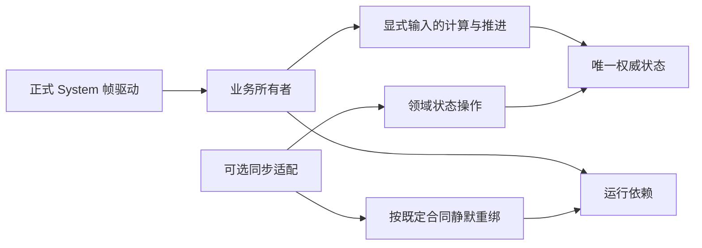

# 业务状态与执行职责规范

> 文档类型：Canonical 职责与评审规范。依据 2026-11-19 用户确认“按推荐的顺序进行推进”，先统一职责和状态操作语义，再以真实业务核对共性，随后细化声明式检查，最后按重复证据提炼公共工具。
>
> 本文建立组织约定与验收要求，不新增运行时接口、标记、注册中心或生成协议。回滚启用、Provider / Command、恢复资格及失败处理的权威正文仍为[业务状态回滚契约](../../../.claude/skills/framesync-prediction-rollback/business-state-rollback.md)；MOBA 新机制继续遵循[机制治理](../../MobaMechanismGovernance.md)。

## 1. 适用范围

本规范供业务新增和重构时选用。普通项目保留对象模型和写法自由；明确声明需要完整状态读写或回滚支持的业务，按相应合同检查状态边界，不以类名包含 State、Runtime 或 Controller 自动扩大检查范围。MOBA 帧同步所用模拟机制继续要求提供相应支持。

数据与逻辑分离的目标是让未来结果所需数据可明确定位，让逻辑通过显式输入操作数据。它不要求所有类无字段、所有方法静态、每种职责各建一类，也不要求非 ECS 状态迁入组件。已有合法的实体骨架恢复、同实例门禁和结构所有权各按已批准合同处理。

## 2. 五种职责

| 职责 | 内容与边界 | 可采用的实现 |
|---|---|---|
| 状态 | 进度、冻结参数、资格、稳定顺序及其它未来充分数据；关系以已定义的 ID / handle 表达 | struct、class、领域集合；是否可自动处理由具体工具决定 |
| 计算与推进 | 读取显式输入，操作指定状态并产生结果；不私藏影响后续帧的权威字段 | 静态函数、无跨帧权威状态的策略对象、Runtime 内的窄职责方法 |
| 业务所有者 | 持有唯一权威状态，组织正常操作，拥有运行依赖与生命周期 | 原有 Service / Runtime / 实体；System 按正式帧顺序调用 |
| 状态操作 | 独立捕获、只读验证、无玩法结算的完整替换 | 所有者上的方法或领域辅助函数；不要求公共基类或接口 |
| 可选同步适配 | 既有组件 codec / Provider、结构 Command、恢复协调与依赖重绑 | 放在对应同步适配层；核心领域不引用 FrameSync |

“无状态逻辑”指不隐含持有跨帧权威状态，不代表调用任意服务的函数天然无副作用。碰撞求解、RNG、属性查询、事件提交等依赖，必须分别说明读取或修改了谁的状态。服务引用从字段挪到参数，不会自动使其成为纯计算。

业务所有者仍可保留依赖、对象池、查询工作区和缓存；须明确哪些是权威状态，哪些在读取前确定性重建或隔离。逻辑接收的上下文应按实际需要定义，不提供一个任意读取全世界的通用 Context 来隐藏输入。状态变更无需逐次包装为 Command，结构恢复仍沿既有协议。

## 3. 状态操作的共同语义

以下名称说明角色，不构成必须实现的接口或生成规则。已有 API 保持自身兼容语义；不能仅按方法名称推断可接入统一恢复。

| 操作 | 完整状态能力的要求 | 不应混入的行为 |
|---|---|---|
| Capture | 取得合同范围内的充分值；可变数组、集合和嵌套对象与运行对象及其它捕获相互独立 | 推进、抽样、激活、业务规范化；不能保证独立时声称已取得快照 |
| Validate | 只读验证数据形状与领域不变量，诊断定位字段；实例资格或依赖另按原合同验证 | 修改输入或世界、执行 Restore 试探、通过普通配置入口修正非法值 |
| Restore | 完整覆盖本合同负责的数据，删除目标中不存在的旧项；不保留输入中的可变存储 | 正常 Enter / Activate / Cancel、玩法通知、重新查询属性或导航以替代已保存值 |
| Bind | 恢复已有合同允许的关系、索引和执行依赖 | 重评估已冻结资格、补发历史事件、隐含创建未获准的业务对象 |
| Reset | 采用本领域明确的合法初始值；区分正常停用清理、对象池清理和纯数据初始化 | 把 default(T) 当作所有领域均合法的恢复目标 |

数组或托管成员使结构体赋值仍可能共享存储；只读引用也不保证其指向的集合不可变。需分别说明捕获与恢复的所有权。跨字段别名若会影响业务，应显式建模并保留语义，不能用通用深复制悄悄拆散共享关系。

新设计的局部完整值恢复优先采用“验证 → 准备全部数据 → 一次提交”：准备失败不修改目标。此项是领域操作的局部合同，不承诺跨 Provider 全局事务，也不撤销已批准的补偿或失败停机要求。既有恢复未达到此能力时登记差距，不仅通过改名宣称达标。

Capture 不必默认执行严格 Validate。普通业务可能允许完整恢复入口不支持的特殊值，应按原合同分别保留正常行为和显式恢复诊断，不能因提炼公共工具而改变普通业务准入。

## 4. 纯数据与自动工具支持分开判断

纯数据对象可以采用只读值、构造函数、属性或专用集合。当前某个生成器只接受 public mutable fields，不代表其它形式不是纯数据。业务约束、自动处理子集和适配支持范围必须分别记录。

| 情况 | 建模与工具处理原则 |
|---|---|
| 只读值对象 / 构造函数恢复 | 可是合法纯数据；工具没有对应构造能力时诊断“不支持此恢复形状”，不要求全仓改为可写字段 |
| 数组 / 集合 / 嵌套值 | 明确 null、empty、元素合法性、独立复制和顺序；没有排序合同不能统一按 ID 排序 |
| 字典 / 共享对象 | 编码顺序与业务执行顺序分别核实；值相等不代表别名关系相同 |
| 委托 / 服务 / 实体实例 / 引擎对象 | 不作为独立充分值自动复制；拆为运行依赖或采用明确的身份合同 |
| 不可见类型 / 多态 / 循环图 | 工具不能证明支持时明确诊断；不得静默跳字段或假装空状态 |
| 缓存 / 帧内输出 | 证明重算或清空早于下一次读取后才能省略；单凭命名无法判定 |

## 5. 本次真实业务核对

以下是 2026-11-19 源码查证，不是对全部模块的合规认证，也不赋予新的世界恢复资格。

| 对象 | 已有事实 | 可以提炼的共同语义 | 必须保留的差异 |
|---|---|---|---|
| PathFollower | `PathFollowerState` 保存完整路径与推进参数；`PathFollowerStepper` 无跨帧字段；Source 捕获复制数组，验证后准备副本并提交 | 状态独立、只读验证、静默完整替换、System 驱动 | 旧 `MotionSourceSnapshot` 不含路径且 Import 有夹取语义；不能冒充完整状态 |
| MotionPipelinePolicy | 当前私有 int→int[] 映射；setter 复制数组，null/empty 删除项；getter 返回内部数组 | 规则映射应能独立捕获与完整替换；无需人为加入业务身份 | D3-A 尚待独立确认；外层 key 排序仅用于其状态表达，内层顺序和重复值保留；普通 getter 行为保留 |
| FixedDelta | `FixedDeltaMotionExactState` 为只读值；恢复核对当前冻结配置，仅写剩余 raw 时间和活动标记 | 精确数值、无通知、校验先于写入 | 是同冻结来源的受限恢复，不能因字段齐全推断可任意重建来源；当前组件生成器不支持其形状不等于状态不纯 |

源码入口：

- [PathFollowerState.cs](../../../Unity/Packages/com.abilitykit.combat.motion/Runtime/MotionSystem/Generic/PathFollowerState.cs)、[PathFollowerStepper.cs](../../../Unity/Packages/com.abilitykit.combat.motion/Runtime/MotionSystem/Generic/PathFollowerStepper.cs)、[PathFollowerMotionSource.cs](../../../Unity/Packages/com.abilitykit.combat.motion/Runtime/MotionSystem/Generic/PathFollowerMotionSource.cs)。
- [MotionPipelinePolicy.cs](../../../Unity/Packages/com.abilitykit.combat.motion/Runtime/MotionSystem/Core/MotionPipelinePolicy.cs)、[D3-A 具体方案](../../../plans/MobaMotionDependencyStateSplitDecision.2026-11-19.md)。
- [FixedDeltaMotionSource.cs](../../../Unity/Packages/com.abilitykit.combat.motion/Runtime/MotionSystem/Generic/FixedDeltaMotionSource.cs)。

现阶段没有证据支持把这三类业务强行接到同一个状态恢复接口；它们的恢复资格、完整程度和数据形状不同。先共享语义与检查清单，公共运行时抽象留到实际重复适配出现之后。

## 6. 分批推进与自动检查边界

| 阶段 | 交付与验收 | 当前状态 |
|---|---|---|
| 1 职责和契约 | 本规范、真实业务差异、评审模板及文档入口；不改变玩法 | 本批完成 |
| 2 业务核对与试点 | PathFollower 作为现有样例；按独立 D3-A 方案补 Policy 值能力，验证真实仲裁、快照隔离和非法状态零写入 | 源码核对完成；Policy API 尚未实施 |
| 3 声明式检查 | 明确选择范围、形状规则、诊断位置、工具装配与正反用例，再实施有限检查 | 下述范围为建议，未新增配置或 Analyzer |
| 4 公共工具 | 根据至少两个实际业务中相同语义的重复处理，决定复制、验证或 codec 的复用位置 | 未实施；不提前放入 Core |

阶段 3 建议先做显式选定类型的纯数据形状检查，不引入运行时标记或强程序集分层。需要先确定选择配置放在哪里、如何取得真实编译语义和依赖、支持哪些嵌套类型及如何接入现有门禁。不能只按 `*State` 名称扫描，不能依靠 `using` 或文本关键字猜类型，无法解析的类型应报告不支持或输入不完整。

首批形状检查只负责字段图中可证明的问题，包括委托/服务引用、不支持成员及数据图循环等；诊断必须区分“违反选定状态合同”和“当前工具不支持”。方法副作用、隐藏的未来充分状态、合法别名和执行顺序仍由行为证据覆盖，不承诺 Analyzer 证明任意函数纯净或回滚正确。

复用入口及限制：

- [PlainDataShape.cs](../../../tools/AbilityKit.Entitas.CodeGen/Scanning/PlainDataShape.cs) 是当前组件扫描链的语法形状护栏，类型与集合支持还有后续检查；不能单独当作完整语义分析器或直接收紧其它业务。
- [PackageConstraints.cs](../../../Unity/Packages/com.abilitykit.analyzer/Runtime/AbilityKit.Analyzer/Configuration/PackageConstraints.cs) 表达包依赖约束，不能证明状态字段纯净或无副作用。
- [PackageQuality](../../../tools/AbilityKit.PackageQuality/Program.cs) 当前检查源码语法、中文多行注释和公开声明文档，不具备状态语义检查；不能把其现有通过结果作为新能力证明。
- 既有 Session 的 [State / Handles / Controllers 约定](../../../.claude/skills/state-handles-controllers/SKILL.md) 可供职责组织参考；会话资源状态不自动成为可复制的模拟状态，不全量套用到每个 Motion 来源。

统一的是规范、调度和验证，不新增一份与组件或 Service 竞争的状态存储。生成器与分析器可在工具层复用判断能力，核心包不反向依赖工具程序集。新增工具的公开输入和门禁行为、领域 API 或恢复资格，仍按适用治理方案确定后实施。

### Pipeline P1 试点

参照 [P1 实例](../../../plans/MobaPredictionCoreStateExecutionProposal.2026-11-19.md#4-p1-落地与验证)，新接入模块先分清：`Definition` 提供共享规则；本次应用参数（`Spec` 职责）只在已有定义与状态无法表达时单独建模；`State` 记录下次执行实际读取的跨帧值；`Executor` 仍由既有 System 推进，依赖不进快照。P1 复用现有 Cast 参数及 Context，不新增 `PipelineSpec` 类型。

领域包负责捕获独立值、只读预检、按原有定义静默写回内置状态；应用适配层负责版本化载荷、稳定身份、领域状态及必要的解除/重绑；FrameSync 继续负责世界阶段次序和输入重放。预检通过前不做解除绑定；写回不执行 Enter/Exit、已结算效果或重新求值。扩展阶段携带自定义值并验证，不把继承关系当作回滚完整性的证据。

这是 Pipeline 已验证的试点模式，不要求其他包实现其节点类，不将框架进度槽位提升为跨包标准。只有另一实际消费者证明语义一致后，再评审公共代码的落点；不以此文档扩大恢复资格。

## 7. 新增业务与迁移评审模板

每个实际变更按受影响范围填写，不为未修改模块重复建账：

| 核对项 | 必须回答 |
|---|---|
| 状态边界 | 哪些值影响未来结果；每项的唯一所有者是谁；冻结配置是否可寻址 |
| 执行输入 | frame / dt / RNG / 查询依赖由谁传入；逻辑是否另藏跨帧权威字段 |
| 独立性 | 捕获与恢复的可变成员是否隔离；是否存在必须保留的共享关系 |
| 操作语义 | 完整值操作还是依赖当前实例的局部恢复；Validate / Restore / Bind 的副作用边界 |
| 生命周期 | 普通 Reset 的含义；恢复是否允许实例缺失、归池或重建；由谁处理结构 |
| 工具支持 | 是领域合法性问题、自动处理子集限制，还是尚无检查工具；不能混写 |
| 验收 | 关闭回滚正常业务；完整恢复逐帧结果；非法状态与副作用；依赖和结构按既定资格检查 |

行为测试在真正实施状态操作时执行：非默认字段、捕获和恢复后的外部修改、空集合与存在性双向恢复、相同输入逐帧结果，以及恢复过程中无历史通知。生成代码还需新增字段遗漏的反例验证。文档、工具形状通过和最终 hash 均不能替代这些证据。
