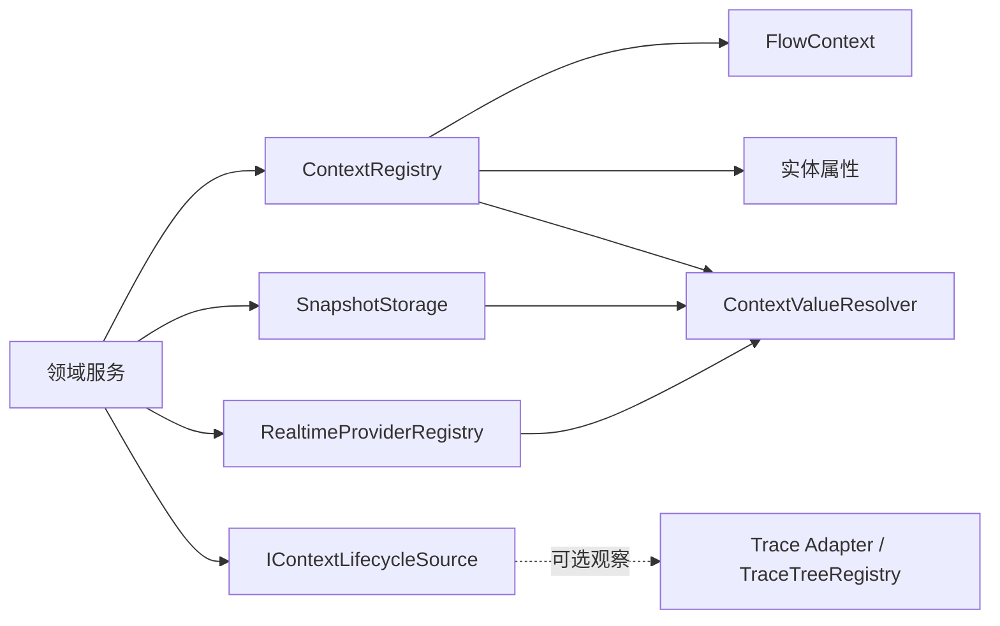
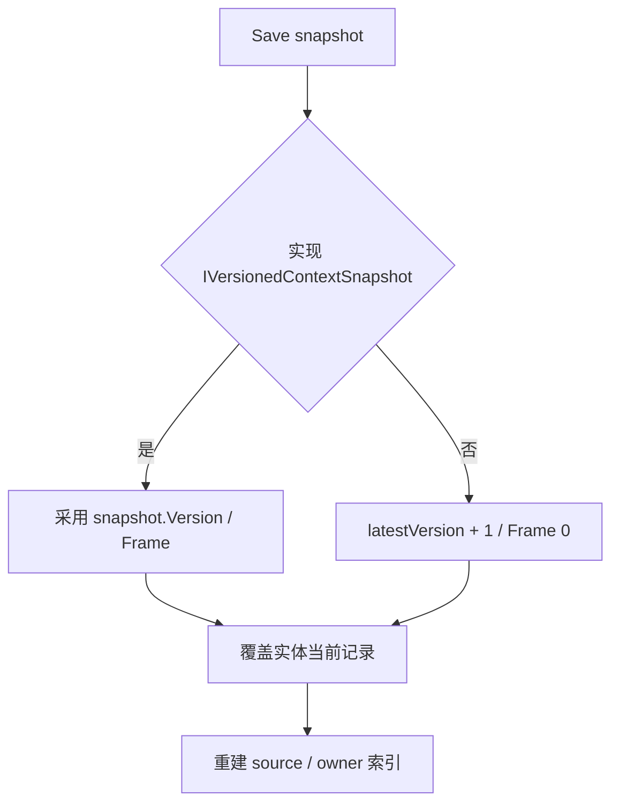
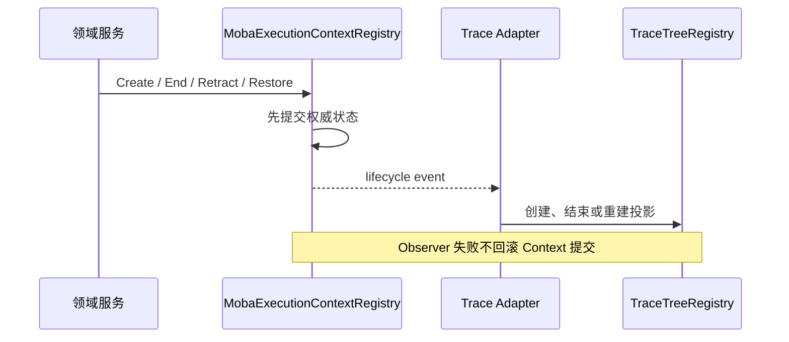

# Context Flow、Snapshot 与 Trace 桥接

> 文档类型：FrameworkCore canonical
> 事实基线：2026-09-22
> 文档版本：v4.0
>
## 一、文档定位

`com.abilitykit.context` 提供一组轻量运行时关联工具：用实体 ID 关联属性，用 Flow 记录一批实体所属的执行阶段，用 Snapshot 保留最新记录或有界历史，再通过读取器显式选择实时数据或快照。

该包采用 ECS 风格的实体、属性和查询接口，但它不是完整 ECS World：没有 System 调度、结构变更队列、Chunk 存储、帧历史或自动资源回收。它更适合承载 Buff、技能阶段、触发输入和诊断上下文等跨模块关联数据。

本文中的通用 Context 包与 MOBA 的 `MobaCombatExecutionContext` 是不同层次。前者管理轻量实体、Flow、Snapshot 和值解析；后者是项目应用层的战斗执行读模型，负责 source/target/root/parent/owner、skill runtime handle、frame 等 provenance 的确定性传播。MOBA canonical provenance 的字段合并和冲突策略不属于 `com.abilitykit.context` 的公共契约。

Context 还提供只读的生命周期观察契约 `IContextLifecycleSource<TNode>`。领域注册表在状态提交后发布事件，可选模块据此构建 Trace、指标或调试投影。观察者不能否决或修改 Context 提交，观察失败也不能反向破坏业务状态。Trace 树的创建、结束、引用计数和清理仍由 `com.abilitykit.trace` 负责，详见 `03-TraceLifecycleAndExportProtocol.md`。

## 二、组成与职责

当前实现由五个相互独立的部分组成：

| 部分 | 核心类型 | 当前职责 | 不负责 |
|---|---|---|---|
| 实体注册 | `ContextRegistry` | 分配实体 ID，保存属性和反向索引，发布变更事件 | System 调度、持久化、自动快照 |
| 流程组织 | `FlowContext` | 记录父子 Flow、Owner、阶段和所属实体 | 状态迁移校验、级联销毁 |
| 快照 | `SnapshotStorage` | 按实体索引最新记录，按精确引用读取有界历史 | 完整帧历史、增量日志、权威恢复或版本冲突处理 |
| 精确读取 | `ContextValueResolver` | 按实体或快照引用读取指定来源 | 跨来源回退、业务版本校验、值域校验 |
| 生命周期观察 | `IContextLifecycleSource<TNode>`、`ContextLifecycleEvent<TNode>` | 在 Context 状态提交后提供只读快照与生命周期事件 | 改写提交、要求 Trace 存在、传播观察者异常 |



图中的虚线表示可选观察关系。Context 不依赖 Trace；未安装 Trace Adapter 时，业务创建、结束、回滚和重放保持相同语义。

## 三、ContextRegistry 的实体模型

### 3.1 实体与属性

实体是注册表内的 `long` ID。`Create()` 先建立实体并发布 `Created`，然后返回 `EntityBuilder`；后续 `With()` 逐项调用 `Add()`，因此观察者可能先看到尚未附着属性的实体。

每种属性类型在 `PropertyTypeRegistry.Instance` 中按首次注册顺序取得整数 ID。注册表以该 ID 保存属性并维护反向索引。这个 ID 适合当前进程内查询，不是稳定的网络或存档标识：

- 注册表是进程级单例，不属于某个 `ContextRegistry` 实例；
- ID 由首次访问顺序决定；
- 没有固定清单、显式编号或 Schema 版本；
- `PropertyTypeRegistry` 自身没有并发保护。

需要序列化属性类型时，应使用稳定名称或由领域层维护的显式协议 ID，不应直接持久化运行时 `TypeId`。

### 3.2 查询语义

`Query` 支持 `With<T>()`、`Without<T>()`、按实体 ID 的谓词，以及读取属性的类型化谓词。`Execute()` 最后调用 `ToList()`，返回的是本次执行结果快照，不会在调用方枚举期间继续追踪注册表变化。

查询过程会多次调用注册表并分别获取实体或属性索引快照。注册表每个调用受锁保护，但整条 Query 不是一个事务。如果其他线程在执行期间修改实体，候选集合与谓词读取可能来自不同时间点。当前更合适的约束是：在逻辑线程执行查询和结构变更，或由上层建立只读阶段。

### 3.3 事件与异常边界

事件包括实体创建、属性更新、销毁前、销毁后、Flow 创建和 Flow 阶段变化。`ContextRegistry` 在锁内复制订阅者列表，在锁外同步调用 handler，因此回调不会持有 registry 锁。

单个 handler 抛错由 `EventHandlerException` 报告，不中断本次操作或后续 handler；错误报告回调抛错也会被隔离。

1. `Destroying` 在删除前发布，观察者仍可读取原实体及属性。同一实例在通知期间重复调用 `Destroy()` 返回 `false`，不会再次发布销毁事件。
2. 通知后只删除原实例。如果同 ID 已换成另一实例，本次销毁返回 `false`，不会删除新实例或为它发出 `Destroyed`。`Destroyed` 只在原实体及索引删除后发布。

这些保护不使通知成为事务边界。订阅者应保持短小、幂等；需要跟踪同一实体时，使用带 registry 和 generation 的 `ContextEntityReference`，不要以裸 ID 判断是否仍为原实例。

## 四、Flow 是组织记录，不是资源所有权

### 4.1 阶段与父子关系

Flow 阶段包括：

- `Created`
- `Running`
- `Completed`
- `Cancelled`
- `Failed`

`BeginFlow()` 创建 Flow，将其切换到 `Running`，并返回 `FlowContextScope`。Scope 可以创建归属该 Flow 的实体，也可以通过 `Complete()`、`Cancel()` 或 `Fail()`设置终态；未显式结束时，`Dispose()` 使用创建 Scope 时指定的终态。

子 Flow 记录 `ParentFlowId`，父 Flow 保存 child ID；Flow 还可记录 `OwnerEntityId`。这些字段用于关联和查询，不构成所有权协议。

### 4.2 终态不会清理资源

当前 `SetFlowPhase()` 只更新阶段和时间并发布事件，不会：

- 销毁 Flow 内实体；
- 结束或删除子 Flow；
- 删除 Flow 本身；
- 标记或移除 Snapshot；
- 结束关联 Trace；
- 注销实时 provider。

注册表也没有 Flow 删除 API。终态 Flow 会一直保存在 registry 中，直到 `Clear()`。长生命周期 World 若持续创建短 Flow，需要监控 `FlowCount`，并在框架补充清理策略前控制创建规模。

### 4.3 状态迁移没有约束矩阵

`SetFlowPhase()` 允许任意不同阶段之间切换，包括从 `Completed`、`Cancelled` 或 `Failed` 回到 `Running`。`FlowContextScope` 能防止同一个 Scope 重复结束，但无法阻止其他调用方直接修改阶段。

若业务要求严格状态机，应在领域服务中限制迁移，例如只允许：

```text
Created -> Running
Running -> Completed | Cancelled | Failed
```

这属于建议约束，不是当前包级保证。

## 五、SnapshotStorage 的数据边界

### 5.1 兼容最新记录与有界历史

兼容入口 `Save()` 以 `EntityId` 为键覆盖旧记录，并同步更新 source 和 owner 反向索引。旧记录不会保留，也不能按版本回读。

`TrySaveManaged()` 需要注册快照类型并提供 generation、frame 和 kind；成功时返回 `ContextSnapshotReference`。容量达到上限时淘汰未持有的记录；如果候选记录均被持有，则返回 `false`，不分配引用或替换记录。按 ID 读取的是当前最新记录，不证明与旧引用属于同一代；精确读取不会回退到最新记录或实时值。

若快照实现 `IVersionedContextSnapshot`，storage 直接采用对象给出的 `Version` 和 `Frame`；否则由 storage 为该实体自动递增版本，帧固定为 `0`。



### 5.2 版本不是并发控制协议

对显式版本，`Save()` 不检查版本或帧是否单调。因此版本较旧的快照也能覆盖较新的记录。`Remove()` 会同时删除最新版本和帧；之后保存非版本快照会重新从版本 `1` 开始。

当前 `Version` 更接近记录元数据，而不是 compare-and-swap、乐观锁或回放序号。生产使用需要由领域层在保存前比较版本，或者为 storage 增加拒绝回退的明确策略。

### 5.3 Destroy 标记与删除不同

兼容快照实现 `IDestroyableSnapshot` 时，`MarkDestroyed(entityId)` 调用该对象的销毁标记。托管快照的销毁状态是记录元数据，不修改 payload。销毁标记不会移除记录；`Remove()` 才会删除记录和索引。

`ContextRegistry.Destroy()` 不会自动调用 `SnapshotStorage.MarkDestroyed()`。这使得“实时实体已经销毁，但最终快照仍可读取”成为可实现的模式，同时也要求业务明确维护两者顺序。

## 六、实时值与快照值的统一读取

`ContextValueResolver` 只接受精确引用。`ReadRealtimeProperty`、`ReadRealtime` 使用 `ContextEntityReference` 校验注册表和代际；实时来源优先使用外部 provider 提供的属性对象，没有绑定时才读取 Registry 属性。一旦选定属性，字段缺失不再向另一对象取值。

`ReadSnapshot` 通过只读的 `IContextSnapshotReader` 查询指定的 `ContextSnapshotReference`，不读取实时值或实体最新记录。值为 `0` 仍可命中；记录存在但字段缺失是 `FieldMissing`，序号尚未分配是 `NotCaptured`，已保存但后来淘汰或删除是 `Unavailable`。保存失败返回无效引用，不能视为已保存。

这是破坏性 API 迁移：删除裸 ID Resolver 入口、默认值命中、逐键实时 provider 适配和 `ISnapshotAccessor`。字段由选中的属性或受管快照通过 `IContextValueProvider.TryGetValue` 提供。调用方在生产端冻结引用，不能在读取旧事实时用裸 ID 查找当前代次补绑。按业务模式选择来源是领域职责，例如 MOBA 同代 Buff 最终状态读取；它不属于通用解析器。

## 七、Context 生命周期观察与 Trace 桥接边界

`IContextLifecycleSource<TNode>` 暴露当前生命周期 revision、只读快照和订阅入口。当前事件包括 `Created`、`Ended`、`PredictionRetracted`、`Reconciled` 与 `Cleared`。事件只在 Context 权威状态已经提交后发出；单个 observer 抛错会被隔离，并可通过 `ObserverException` 报告，不会改变已提交状态或阻断其他 observer。

`TraceContextProperty` 已迁移到 `com.abilitykit.trace`。它只是 Trace 包提供的可选属性桥，用于把 root/context/kind 标识附着到通用 Context 实体并支持反向查询，不属于 `com.abilitykit.context` 的核心模型，也不提供生命周期所有权。



MOBA 的 `MobaExecutionContextRegistry` 是执行身份、父子关系、结束状态和预测分配边界的唯一业务权威。技能局部回滚只保存 `ExecutionContextNodes` 与 `ExecutionContextNextId`；恢复后发布 `Reconciled`，已安装的 Trace Adapter 从当前 Context 快照重建投影。正式 payload 不再保存 Trace 节点或 Trace next-id 字段。

Trace 仍独立负责投影树、retain/release、查询、导出与清理。不要通过 Trace purge 推断 Context 已清理，也不要让业务正确性依赖 Trace Adapter 是否安装。

## 八、MOBA 的领域接入

### 8.1 通用 Context 包的组合使用

`MobaRuntimeContextService` 是当前较完整的组合示例。它为 Buff 维护一个实时 provider，并在终止路径显式执行：

1. 从实时 Buff 创建最终 `MobaBuffContextSnapshot`；
2. 尝试将最终快照保存到 `SnapshotStorage`，通过记录元数据标记已销毁；
3. 从实时 provider 解绑 context ID；
4. 销毁 `ContextRegistry` 中的实体；
5. 按调用方是否保留引用，决定是否清空 BuffRuntime 上的标识、版本和身份。

快照因容量被拒绝时，Buff 销毁仍然完成。保存成功且记录尚可用时，同代引用才能读到最终快照。MOBA 领域读接口区分字段缺失 `ValueMissing` 和找不到最终快照 `SnapshotUnavailable`；后者不区分未保存和已淘汰。Action 诊断通过独立的 `MobaActionExecutionSnapshotStore` 维护观测快照，不参与 Buff 回收或玩法恢复。以上均为消费端编排，不是 Context 与 Trace 的自动联动。

MOBA 最终快照实现 `IImmutableContextSnapshot`，通过 `TryGetValue` 区分未知字段与合法的零值。领域读取选中快照后返回本次解析的精确引用；分析和断言若要重复读取同一事实，应保存该引用，而不是再选最新记录。

### 8.2 战斗执行 Context 与 canonical provenance

MOBA Trigger/Effect 链没有直接复用 `ContextRegistry` 实体作为执行参数，而是使用不可变投影：

| 投影 | 职责 |
|---|---|
| `MobaCombatContextSource` | 表达一次执行来源，不携带领域服务所有权 |
| `MobaTriggerExecutionSnapshot` | 固化触发瞬间的来源、目标、执行 Context 与帧 |
| `MobaPersistentContextSourceSnapshot` | 跨帧 runtime 可持久保留的来源投影 |
| `MobaCombatExecutionContext` | Effect/Action 运行时统一只读上下文 |
| `MobaCanonicalProvenance` | 多种 provider 之间逐字段归一化 identity，并记录字段来源状态 |

canonical 字段包含 source/target actor、source/parent/root/owner context 和 skill runtime handle。每个字段记录 `Missing`、`Synthesized`、`Inherited` 或 `Explicit` 状态：缺失字段允许由后续正式来源补齐；双方非缺失且值不同则 fail-fast。Context kind、trigger、frame 等执行 metadata 也使用确定性合并并拒绝冲突，配置来源 ID 与当前执行配置 ID 因语义不同，不合并为同一 canonical 字段。

Effect 创建或挂接正式 `EffectExecution` Context 后，`MobaCombatExecutionContext.WithEffectExecutionNode()` 会把 `SourceContextId`、`ParentContextId` 和 root identity 推进到真实执行节点。后续 Action、Damage、Buff、Projectile 和 Summon 继承该业务事实；Trace Adapter 仅观察并投影这些节点，不参与来源归一化或生命周期决策。

完整字段矩阵、冲突规则和 Action lifecycle 见 [MOBA Trace、Context 与 Effect 执行深潜](../09-ImplementationExamples/MOBA/09-TraceContextEffectDeepDive.md)。

## 九、线程与一致性

`ContextRegistry`、`SnapshotStorage` 和 `ContextRealtimeProviderRegistry` 分别使用自己的锁。provider 和事件 handler 都在持有内部锁之外执行，可降低回调重入造成的锁死风险。

这些锁不提供跨组件事务：

- 保存快照与销毁实体之间，其他线程可能看到两者都存在；
- 解绑 provider 与标记快照销毁之间，也可能存在短暂中间状态；
- Query 的候选集合和属性谓词读取可能跨越结构变化；
- `PropertyTypeRegistry` 没有锁，首次并发注册同一类型没有明确保证。

推荐在单逻辑线程完成一组 Context 生命周期操作。确需并发读取时，由领域服务定义可观察顺序，并使重复保存、解绑、销毁和标记操作幂等。

## 十、验证现状

`src/AbilityKit.Context.Tests` 是独立 `.NET` 测试工程，由 `core-stability` 的 `Context tests` 步骤执行。覆盖 Registry 事件顺序、异常隔离、重复销毁、ID 复用与回滚、精确引用、快照容量与持有、淘汰及来源隔离。

`src/AbilityKit.Demo.Moba.Tests/Context/MobaContextBridgeTests.cs` 另提供以下寄宿式证据：

- Flow 内创建实体并记录归属；
- Trace 包 `TraceContextProperty` 的可选附着和三种反向查询；
- `With`、`Without`、普通谓词和类型化属性谓词；
- Flow 创建和实体创建事件可被观察；
- 显式 `Execute(registry)` 使用执行时传入的注册表。

MOBA 的 `MobaRuntimeContextIdentityTests` 与 `MobaBuffContextRecoveryTests` 提供消费端证据，包括最终快照、字段缺失、淘汰和同 ID 恢复；这些不替代通用 Context 包的专项测试。

### 10.1 P0 测试

| 测试 | 目标 |
|---|---|
| Flow 终态与实体存续 | 固化“只改阶段、不级联销毁”的当前契约 |
| Flow 终态事件与异常 | 明确阶段迁移观察者失败后的 Flow 实际状态和事件顺序 |
| accessor-only 消费者迁移 | 先盘点依赖兼容行为的调用方，不直接改变 accessor 的命中语义 |
| 显式版本回退 | 明确选择允许覆盖还是拒绝旧版本 |

### 10.2 P1 测试

| 测试 | 目标 |
|---|---|
| Snapshot source/owner 重建 | 覆盖保存替换、Remove 和 Clear 的索引完整性 |
| MarkDestroyed | 验证只标记当前记录且不删除索引 |
| Flow 父子和 owner | 覆盖创建、阶段变化及终态查询 |
| 查询与结构变化 | 明确快照结果和并发修改边界 |

## 十一、生产接入清单

1. 为 Context ID 绑定 session 或 world 边界，不把实例内 ID 当作全局永久标识。
2. 不序列化运行时 `PropertyTypeId`；协议层使用稳定业务 ID。
3. 由领域服务显式编排 snapshot、provider 和 Context registry；Trace 仅通过只读 observer 跟随已提交生命周期。
4. 区分路由 identity 与 lifecycle ownership；owner/source/root ID 本身不代表持有或释放权限。
5. 跨 provider 传播正式 identity 时使用字段级状态和显式冲突策略，不依赖隐式优先级覆盖非零值。
6. 明确 Flow 终态后实体及子 Flow 的清理策略，并监控长期增长。
7. 对显式 Snapshot 版本执行单调性检查，决定重复版本是否允许覆盖。
8. 新快照优先实现 `IContextValueProvider`，调用 `GetValue()` 时检查 `Source`。
9. 事件订阅者保持短小、幂等；异常后依据 registry 实际状态恢复。
10. 把多组件生命周期操作放在同一逻辑线程，避免把独立锁误认为事务保证。

## 十二、当前边界

- Context Registry 是轻量关联索引，不是完整 ECS World。
- Flow 是阶段和归属记录，不是资源所有权或级联清理协议。
- SnapshotStorage 支持有界历史，但不保证完整帧历史，也不是权威恢复仓库。
- 显式版本和帧由 storage 信任，当前没有冲突或回退门禁。
- Registry 销毁与 Snapshot、provider、Trace 没有自动联动。
- Trace bridge 只保存 ID，不验证 Trace 节点，也不管理其生命周期。
- MOBA combat execution context 与 canonical provenance 属于项目应用层，不是通用 Context 包内置能力。
- 通用包尚未覆盖 Flow 终态和所有跨组件组合；单组件的读写与回收测试不等于跨组件事务保证。

---

*文档版本：v4.0 | 最后更新：2026-09-22 | 正式边界：Context 主导执行身份、生命周期与回滚；Trace 通过可选 observer 投影*
